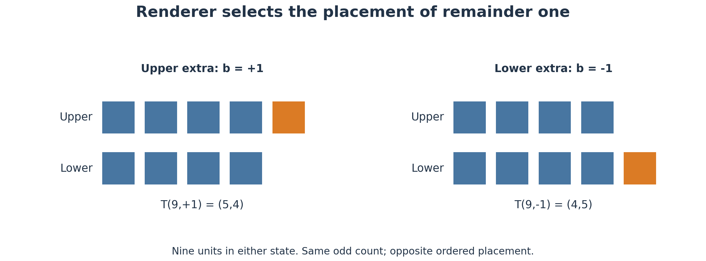

## 135. Alternating Single-Sector Output, Remainder Placement and Conjugate Conversion

*Added 19 October 2026 · Structural model and initial-condition hypothesis · No newly calculated microscopic production or annihilation rates*

### Verified inputs

Corresponding particles and antiparticles have equal masses and spin magnitudes, with conjugate internal quantum numbers. Opposite electric charge alone does not identify the pair: an electron and a positron correspond, whereas an electron and a proton do not. A representative confirmed channel is $e^-+e^+\to\gamma+\gamma$; allowed channels depend on initial states and conservation laws. The incoming particles need not have been created together [S1–S2].

This hypothesis distinguishes which sector a declared source newly outputs in a particular execution from how already existing conjugate phenotypes interact. Requiring pair production in the source-output specification and allowing subsequent physical pair production/annihilation are distinct contracts.

### WRRA transformation

#### 135.1 One newly output sector per declared execution and region

Let $k$ be an execution index in a declared region, with a source setting $\kappa_k\in\{+1,-1\}$. The signs select matter and antimatter respectively. Let $J_k\ge0$ be the attempted new source output and $Q_k\in\{0,1\}$ the resource, interaction and conservation permission gate. No mapping of $k$ to physical seconds or physical unit for $J$ is derived here.

$$J_{M,k}^{\rm new}=Q_k\frac{1+\kappa_k}{2}J_k,\qquad J_{\bar M,k}^{\rm new}=Q_k\frac{1-\kappa_k}{2}J_k.$$

The specified gate gives

$$J_{M,k}^{\rm new}J_{\bar M,k}^{\rm new}=0,\qquad J_{M,k}^{\rm new}+J_{\bar M,k}^{\rm new}=Q_kJ_k.$$

This specifies single-sector production at a given execution. Exclusivity follows by definition of the gate, not from a completed microscopic derivation. It does not set the product of already accumulated occupations $N_MN_{\bar M}$ to zero. The switching law is specified below; permissions and resource costs remain explicit state data.

The scope is the declared source's initial/basic output. It is not a universal prohibition of experimentally confirmed pair production in subsequent interactions. Replacing every production pathway by this gate would require an extension reproducing those actual reactions.

#### 135.2 Initial setting of our universe

Wonsik Choi's proposal is recorded as an initial-condition hypothesis:

> The phenotype renderer can select the matter or antimatter sector. The initial source execution of our universe was prepared in the matter-output condition.

Thus $\kappa_0=+1$ is applied to that initial source. This explicitly chosen preparation corresponds to observed matter predominance; it is not a calculated necessity for the sign. The conjugate setting remains a permitted candidate, without granting our realization a privileged selector. No actual second universe or antimatter identification of a dark sector is inferred.

Matter output does not mean producing only negative electric charge. Ordinary matter contains negative electrons and positive protons. The setting refers to conjugate matter/antimatter configurations, not spatial reflection or the earlier exterior-algebra parity selection alone.

Initial-condition ownership is explicit. One may implement $\kappa_0$ as a function of the existing SOURCE preparation $\eta$; if independently selected, it counts as an additional input. That interface is not completed here. Chapter 8's prohibition on arbitrary asymmetry from both CP-symmetric LAW and CP-symmetric preparation is retained. The new $\kappa_0=+1$ preparation declares an asymmetric state and is a different hypothesis.

Actual one-sector particle production requires source energy, charge and every declared conserved or violated quantum number to be tracked. A closed initial state with zero baryon number and exact baryon conservation cannot acquire net baryon number without an owner. Transfer, permitted violation or the opening interface must be supplied by a microscopic model. Output permission and actual production are distinct responsibilities.

#### 135.3 Alternating click modes and rare late output

The revised proposal specifies the switching law:

$$\kappa_{k+1}=-\kappa_k,\qquad \kappa_0=+1,\qquad \kappa_k=(-1)^k.$$

The setting alternates every click; actual generation occurs only when $Q_k$ permits it. This is not mandatory production of one particle per click. Define $J_k$ as a count of comparable output packages. Assume the large initial output $Q_0J_0=A>0$ completes within the matter-mode click. If the initial burst spans several clicks, its weighted sum $\sum_k\kappa_kQ_kJ_k$ must be recomputed. Equal output in two consecutive modes cancels their initial imbalance. An initial sign alone therefore does not ensure matter dominance.

Late output is small and infrequently permitted. Add the condition that the two modes have equal mean permitted output. For example, let $J_k=1$ for $k=1,\ldots,2n$, with independent $Q_k\sim\mathrm{Bernoulli}(p)$ and $0<p<1$. The late count difference $D=N_M^{\rm late}-N_{\bar M}^{\rm late}$ then satisfies

$$\mathbb E[D]=0,\qquad \operatorname{Var}(D)=2np(1-p).$$

Each late sector has expected count $np$. A long-run 1:1 ratio requires mode-unbiased statistics and sufficiently many events; exact equality in a finite realization is not guaranteed. This independent Bernoulli example demonstrates statistical compatibility, not a derived microscopic production probability. Mode-dependent permissions can produce a nonzero mean difference.

The total sector difference is

$$\Delta N=A+\sum_{k=1}^{2n}(-1)^kQ_kJ_k.$$

A large initial matter output and mean-symmetric late output coexist under these conditions. Baryon asymmetry requires separate weighting by each package's baryon number. The expression does not derive the observed five-percent matter fraction or baryon-to-photon ratio.

#### 135.4 Withdrawal of the pair-production prohibition and even-state splitting

The intermediate suggestion that pair production does not exist is withdrawn. Single-sector new source output is distinguished from later conversion of already output states. A candidate representation of later pair production splits a parent with even aggregate code $r$ into two conjugate states at odd-composite addresses:

$$\mathcal C_{\rm out}(r,\xi)\rightleftarrows(n,a,\chi)+(m,a,\bar\chi),\qquad r=n+m.$$

Here $\xi$ includes momenta, spins, phases, correlations and channel-selection data. This conversion has its own ledger term, separate from $J^{\rm new}$. The source exclusivity relation is not interpreted as a prohibition on later pair production. Splitting occurs only with an allowed parent energy and interaction environment. A microscopic theory must establish permitted channels and their time reverses; equal forward and reverse rates are not assumed.

Not every even composite splits into two odd composites. Examples are $18=9+9$, $24=9+15$ and $54=9+45=27+27$, whereas $20$ has no such decomposition. Even an arithmetic decomposition needs separate address admission, species, conjugacy and energy conditions. Define

$$\mathcal D(r)=\{(n,m):n,m\text{ are admitted odd composites},\ n+m=r\}.$$

An empty set closes that code's proposed channel. Multiple elements do not determine a channel or probability arithmetically. An even aggregate output code is not automatically an even-composite SOURCE resident. Using the latter as a parent needs an explicit transfer of sector energy and occupation. The identification of a photon itself with an even composite is not proved here.

Experimentally described particle-antiparticle production is an input to reproduce [S3]. The expression proposes a WRRA structural interpretation and does not deny those experiments. One photon alone cannot turn into two free massive particles in vacuum: its squared four-momentum is zero, whereas the final electron-positron system has invariant mass at least $2m_e$. A second photon, nuclear recoil or an external field must supply an appropriate energy-momentum environment. The arithmetic identity $r=n+m$ does not resolve this constraint.

#### 135.5 Separate source, conversion and occupation ledgers

For permitted splitting events producing one conjugate package in each sector, let their count be $P_k$; let $H_k$ count annihilations consuming one of each. Then

$$N_{M,k+1}=N_{M,k}+J_{M,k}^{\rm new}+P_k-H_k,$$
$$N_{\bar M,k+1}=N_{\bar M,k}+J_{\bar M,k}^{\rm new}+P_k-H_k.$$

Consequently $\Delta N_{k+1}=\Delta N_k+\kappa_kQ_kJ_k$. Symmetric splitting and annihilation do not themselves create or remove this count difference. These equations concern corresponding unit packages; multispecies reaction networks need stoichiometric coefficients and conserved-charge weights. Annihilation cannot exceed available occupations; splitting must be paid from parent occupation and energy. Composition calculations additionally require total energy density, expansion, reheating, branching and thermal history.

Electric charge is distinct from sector identity. A lone emitted electron requires the opposite charge in the source/environment, with an open ledger until transfer is specified. A neutral matter package is possible, but its baryon and lepton ownership remains required. Average cancellation between modes cannot replace local charge conservation.

#### 135.6 Upper/lower placement of the odd remainder

For an odd composite $n=2q+1$, introduce $b\in\{+1,-1\}$ to specify whether the remainder one is attached to the upper or lower position. The ordered occupations are

$$T(n,b)=\left(\frac{n+b}{2},\frac{n-b}{2}\right),\qquad U+D=n,\quad U-D=b.$$

The upper position has one extra unit for $b=+1$; the lower has one extra for $b=-1$. Arithmetic parity is unchanged, but the ordered placement differs. The renderer selects the permitted phenotype's remainder placement $b$. An interface to the source mode can declare a species reference $b_a^{(0)}$ and assign $b_{a,k}=\kappa_k b_a^{(0)}$. This correspondence is a structural assumption.

The combined placement residual is

$$\delta_{\rm pair}=(U_1+U_2)-(D_1+D_2)=b_1+b_2.$$

Opposite placements give zero; like placements leave $+2$ or $-2$. When $b_2=-b_1$, each position holds $(n+m)/2$. For example, the upper placement of 9, $(5,4)$, and lower placement of 15, $(7,8)$, combine as $(12,12)$. Two upper placements instead give $(13,11)$, leaving residual two.

| First | Second | Ordered totals for 9 and 15 | Residual | This balanced-closure channel |
|---|---|---|---|---|
| Upper | Lower | $(12,12)$ | $0$ | Candidate allowed |
| Lower | Upper | $(12,12)$ | $0$ | Candidate allowed |
| Upper | Upper | $(13,11)$ | $+2$ | Closed under this rule |
| Lower | Lower | $(11,13)$ | $-2$ | Closed under this rule |

The candidate closure gate is $K_{\rm close}=\mathbf1[b_1+b_2=0]$. The proposed difficulty of interlocking like placements is formalized as non-admission to this particular balanced-closure channel. It does not prohibit all interactions or binding between like placements. Actual interlocking feasibility and transition rates are not calculated from the occupation difference alone.

Exchanging the positions gives $\tau T(n,b)=T(n,-b)$ with $\tau^2=1$. This is a candidate geometric representation of conjugacy, not a substitute for the full species and charge/baryon/lepton conjugacy conditions. Upper/lower initially label internal or local positions, not electron spin up/down or an absolute cosmic direction. A physical spatial shape additionally needs coordinate-transformation rules, length/energy functions and an interaction.

For inverse splitting, the candidate parent has $U=D=r/2$ and distributes its occupations to admitted odd composites $n,m$ with opposite placements $b,-b$. The code $r$ alone does not specify addresses, directions or quantum correlations; $\xi$ and permission conditions remain necessary. Equal physical masses, electric-charge magnitudes, photon channels and annihilation cross sections have not been derived from this occupation model.

#### 135.7 Conjugate structures open each other's release pathway

The proposed annihilation interpretation is:

> Two conjugate particle phenotypes can open an interaction pathway that releases their stable implementation structures, transferring their particle-form energy into other carrier phenotypes.

The knot/key language denotes structural compatibility and release. Whether there is an actual geometric or topological twist is unresolved. Such a claim requires defined degrees of freedom, invariants, an energy functional and an interaction operator. Equal mass alone does not establish equal bit count or every information measure. Implementation load and distinguishable states/correlations require separate ledgers.

Use already admitted odd-composite addresses $n,m$, a corresponding species $a$ and conjugate internal structures $\chi,\bar\chi$. A candidate code is

$$(n,a,\chi)+(m,a,\bar\chi)\xrightarrow{\text{allowed interaction}}\bigl(r=n+m,\text{carrier output state}\bigr).$$

Every sum of two odd integers is even. Conjugacy therefore gates the interpretation as annihilation, rather than the arithmetic fact of evenness. Two same-sector particles also have an even address sum and must not annihilate solely for that reason.

The aggregate code $r$ has a different type from an existing even-composite SOURCE resident. Evenness alone identifies neither a photon nor dark matter. Exceeding the existing address cutoff does not automatically create SOURCE capacity; finite output encoding and its cost need specification.

#### 135.8 Energy and information transfer

Lost incoming particle occupations must transfer their energy, momentum and conserved internal quantum numbers to the outgoing state. Antimatter energy is not cancelled as negative energy. Zero rest mass of individual outgoing photons does not require zero invariant mass of the whole outgoing system.

$$E_{\rm out}=E_{\rm in},\qquad\mathbf p_{\rm out}=\mathbf p_{\rm in}.$$

Track states, phases and correlations rather than declaring information deleted. The sum code alone cannot preserve all inputs: $9+45=27+27=54$. An implementation requiring overall reversibility must retain the distinction in other output degrees of freedom or included environmental correlations. This does not require storing the universe's entire past as an additional archive.

### Outputs and scope

The new outputs are an alternating-mode/rare-output statistical ledger, conjugate splitting of even aggregate states with a common annihilation ledger, a single-sector gate for initial/basic source production, the matter-prepared initial condition of our universe, the conjugate-release interpretation and the type distinction between arithmetic codes and physical ledgers. No new microscopic production rate, annihilation cross section/lifetime, cosmic thermal history or five-percent composition calculation was executed. Chapter 135 connects Chapters 8 and 18 to a subsequent output-architecture hypothesis without recalibrating existing address, energy, GR or CMB results.

### Falsification conditions

An implementation fails if it annihilates same-sector particles merely because their address sum is even, identifies electron/proton as conjugates merely because charges are opposite, loses or duplicates energy/conserved quantities, or discards information it declares conserved. A microscopic interface must be revised if it fails to reproduce known production/annihilation channels or lacks an owner for its initial preparation and resource costs.

### Conclusion and genealogy

The hypothesis distinguishes a large initial matter-mode output, rare later output under alternating modes, and conjugate splitting of even aggregate states with reverse annihilation. The pair-production prohibition is withdrawn. Our universe's $\kappa_0=+1$ is a declared initial condition; arithmetic evenness is a candidate transition code. Actual knot structure and microscopic interactions remain to be derived.

This chapter is added to the formal v0.24 baseline. The earlier v0.25 calibrated generation/survival draft is discarded; this material replaces it in the new v0.25 without incorporating that calculation. The separated matter/antimatter-domain and SOURCE-size exploration also remains separate. Inclusion here records a structural hypothesis, not completed physical validation.

[S1] MIT, Markus Klute, [Charge Conjugation, Lecture 2.4](https://ocw.mit.edu/courses/8-701-introduction-to-nuclear-and-particle-physics-fall-2020/1f2bba94386a64cd8f5b640358c6a8d4_MIT8_701f20_lec2.4.pdf).

[S2] MIT, [Principles of Radiation Interactions: Electron–Positron Annihilation](https://ocw.mit.edu/courses/22-55j-principles-of-radiation-interactions-fall-2004/ca1553f56c6670570f63f804edbeffa9_energ_depos_elec.pdf).

[S3] SLAC E144 Collaboration, [Experiment E144: pair production](https://www.slac.stanford.edu/exp/e144/e144.html); K. T. McDonald, [Positron Production by Laser Light](https://www.slac.stanford.edu/pubs/slacreports/reports08/ssi97-029.pdf), 1997.
