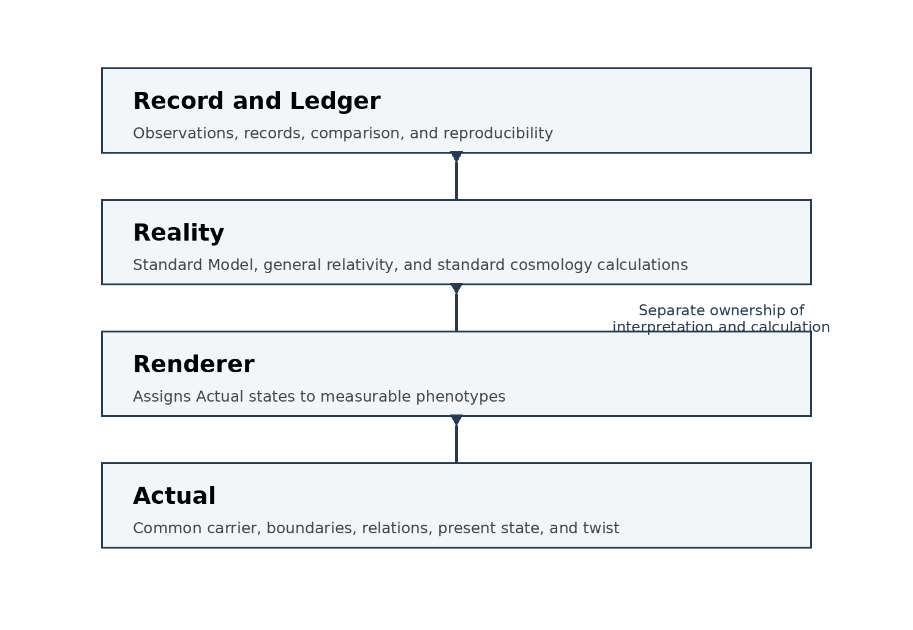
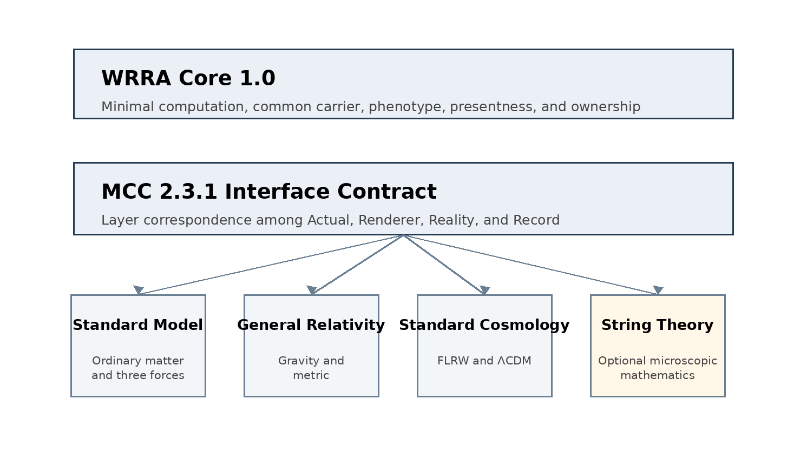
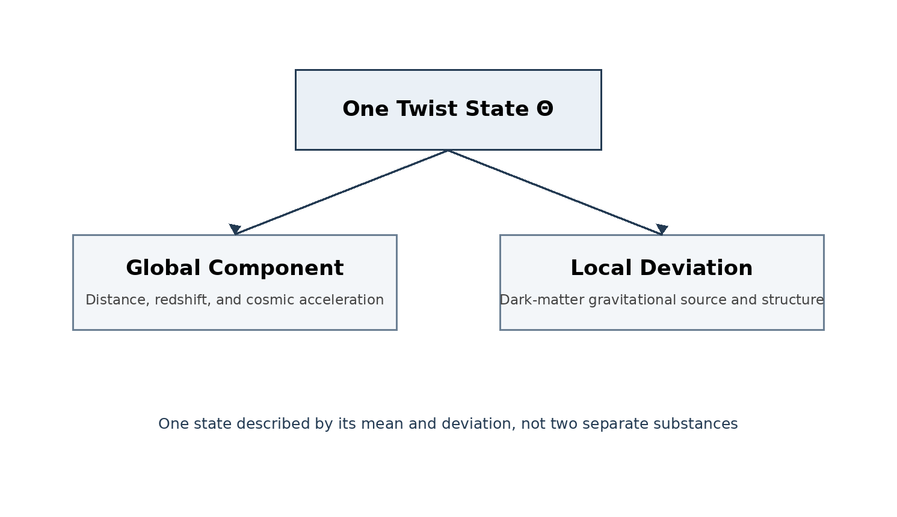
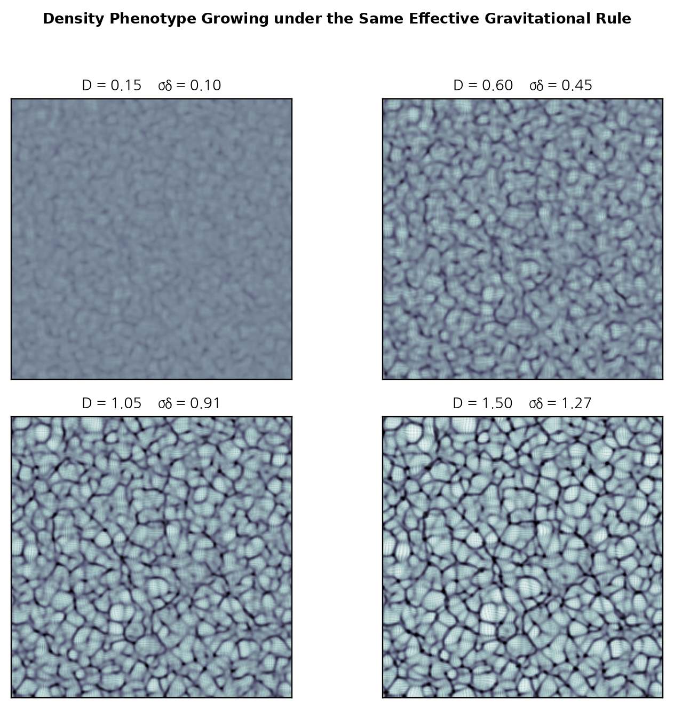
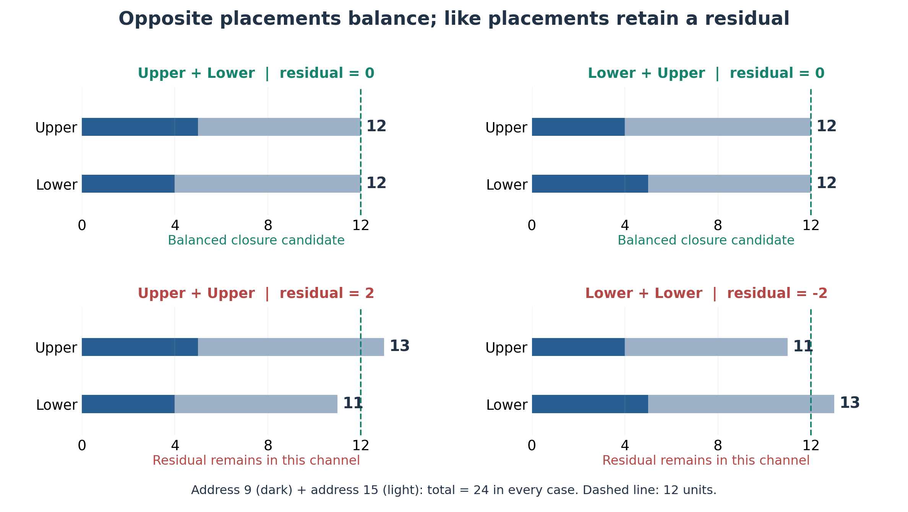
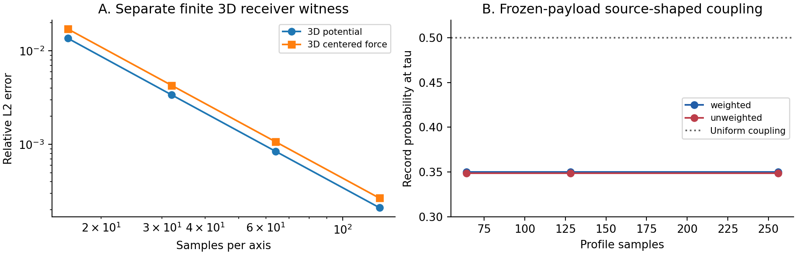
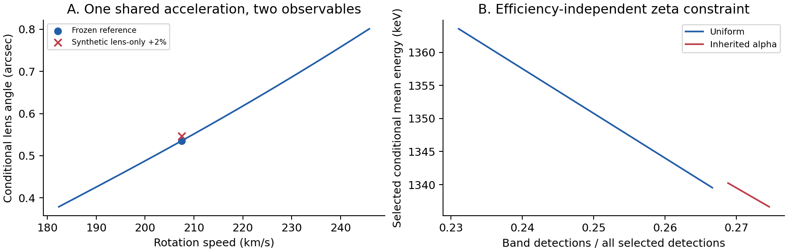

# Minimal Computing Cosmology 3.0

## Revision v0.28-r1: Five Executed WRRA Reinforcements — Recovered Sources and Replay for Chapters 132–134

Wonsik Choi · Jeongin Choi | 22 October 2026

**v0.28-r1 execution evidence update · 22 October 2026.** Five original ZIPs cited in Chapters 132–134 were recovered from the v0.24 complete package. Their five top-level finite programs were replayed and the results are incorporated in those chapters and Appendix H.6. Four available historical JSON outputs match; 25 original internal file hashes match; an isolated corruption is rejected. Reproduction through declared WRRA structures and transformations is an implementation and explanatory achievement. All 139 chapters, earlier values and artistic opening are retained. This does not establish whole-MCC execution or actual all-order xi positivity. This edition: https://doi.org/10.5281/zenodo.23549809. Previous edition: https://doi.org/10.5281/zenodo.23524780.

**v0.28 integration · 21 October 2026.** Add Chapter 139 and Appendix H.5 from the separately published five-reinforcement paper (DOI 10.5281/zenodo.23522417). The chapter integrates finite scaling, conditional SOURCE/carrier dynamics, RAR-preserving load/twist gravity, physical zeta readout/control, and freedom/joint-falsification accounting. All seven main/verifier pairs and 19 cross-module checks passed in that release; this book update reuses those frozen execution records and does not claim another full cosmological rerun. The earlier 138 chapters, opening, results and historical limitations are retained. Complete bilingual book v0.28 DOI: https://doi.org/10.5281/zenodo.23524780. Previous v0.27-r1: https://doi.org/10.5281/zenodo.23516661. GitBook presents this book revision; the standalone paper is not added as a separate GitBook document.

**v0.27-r1 editorial update · 21 October 2026.** Add a SOURCE construction table to Chapter 38 and Appendix H with the core falsification/OPEN register, module-boundary reading rules and Korean–English terminology. Clarify playback as execution of embodied relationships. Preserve all 138 chapters and earlier numerical results. This revision adds no scientific run, SPARC mass-bin diagnosis or Planck-scale error bound. Prior full book v0.27: https://zenodo.org/records/23511592.

**v0.27 integration note.** Preserve the artistic opening and cumulative Chapters 1–136. Add Chapter 137 for the frozen component replay, exact singlet restriction and source-dependency audit through color manuscript v0.8.2; add Chapter 138 for the actual live WRRA–AGAMA v0.3 iteration and Gaia comparison. This book update reran the 36 replay/algebra checks and four dependency checks, and cross-checked released galactic records; it did not rerun the full AGAMA integration. Numerical closure and sample-level disagreement are both retained. Complete CAMB initial-state injection, mean-to-individual preparation and full selection-corrected Galactic validation remain open. WRRA retains its established name, Wonsik Reality–Renderer Architecture. The conflicting expansion in one source manuscript is disclosed in Section 137.1. Book series: https://doi.org/10.5281/zenodo.23202731. Previous book v0.26: https://doi.org/10.5281/zenodo.23492729. Code/data: GitHub; complete Korean/English PDFs: Zenodo.

## Research Purpose and Design Principle: Reverse-Engineering a Physical Phenotype Interpreter

Minimal Computing Cosmology 3.0 and WRRA do not make proof that number-theoretic structure must uniquely produce the present physical structure a completion criterion. The research purpose is to reverse-engineer an interpreter that implements currently observed physical states and phenomena from number-theoretic structure. The structure and the interpreter's physical readout rules are specified together.

$$\Phi=\mathcal R_\theta(n,\chi,\xi).$$

Here $n$ is an arithmetic code, $\chi$ a conjugate orientation, $\xi$ additional momentum, preparation and record data, and $\theta$ an interpreter configuration containing species assignments, observed constants, admission and conversion rules. Structure and interpreter jointly determine the physical output. The same code can therefore be implemented differently by different interpreters; the code alone need not determine every particle property.

Observed masses, charges, spins, interactions and existing physical laws are legitimate construction and calibration inputs. Build the interpreter to implement the observed structure, disclose its inputs and calibration freedoms, then assess reproducibility, consistency, conservation and resource ownership across its declared scope. Do not silently change the rules for each desired outcome. Different interpreters or calibration branches have separately declared inputs.

The assessment order is **verified inputs → WRRA-specific transformation → outputs → falsification conditions**. Reproducing known structure is an implementation and explanatory achievement. An input mass is not counted as newly derived. A new independent prediction is not a prerequisite for legitimacy, originality or completion of this reinforcement. Record the purpose, structural specification, executed calculation and observational validation at their respective scopes.

**Implemented scope of this reinforcement.** Section 135.17 and its reproduction code execute two fixed interpreters reading code 9 as electron/positron or muon/antimuon states. This is a finite readout/conversion implementation with observed inputs, not a completed implementation of every Standard Model species or reaction rate. Audit the declared correspondence and conservation ledger rather than require a uniquely necessary number-theory-to-physics assignment.

## Opening — A Universe That Does Not Solve Its Equations Again

*The research premise clarified in a conversation between Wonsik Choi and AI on 12 October 2026*

> “Perhaps this is the core of Minimal Computing Cosmology. Computation is minimal not because the equations are simple, but because an already formed structure does the work, so the calculation need not be performed.” — Wonsik Choi, translated from Korean

### Art Revealed the Silhouette of an Answer

> “Intuition is not a question. It is the shadow of an answer. I did not see the answer directly, but I saw its silhouette.” — Wonsik Choi, translated from Korean

For me, art supplied an answer. This does not mean that I could immediately explain every detail or mechanism. It means that I saw its shape before I could explain it. Intuition arrived as the silhouette of an answer. Questions arose as by-products of the process of turning that silhouette into a complete form.

In Koo Jeong A’s exhibition, I intuited the shape of a finite universe without a boundary. In Tadao Ando’s architecture, I encountered light, air and spatial experience arising through an already established structure. These artistic experiences are not decorative analogies added to my research. They belong to its genealogy: they show the outlines of answers I perceived and how those outlines led toward Minimal Computing Cosmology and WRRA.

Artistic intuition need not move only by following the connections of existing knowledge one at a time. It can reach somewhere for which an explanatory vocabulary is not yet available and sense the whole first. When I said that humans sometimes sense a world “beyond phenotype,” I used a metaphor for that leap. In this conversation, the AI treated those words as a literal physical claim, whereas I was describing the experience of sensing the form of an answer beyond the boundaries of an existing explanation.

Research follows. The perceived outline is given structure, made explicit through equations and code, and examined through what that structure produces. In my experience, the sequence was not “I formulated a question and searched for an answer.” It was “I saw the silhouette of an answer through art, and questions arose as I worked to reveal its full form.”

### Playback of Relationships Inscribed in Structure

Consider a vinyl record. However complex the process of making the music and engraving its sound into the groove, playback does not repeat that process from the beginning. The stylus follows a groove already formed. For a track of the same duration played at the same speed, playback takes the same time whether producing the groove required ten thousand equations or a million. The complexity of the relationships embodied in the groove does not become a computational workload repeated at every playback: its result is already embodied in the structure.

This is what I mean by structure. Numerically simulating reality by repeatedly solving equations for the next state differs from execution through a structure that already embodies relationships and results. Vocal folds do not solve acoustic equations to produce sound. As air flows and the folds vibrate, relationships embodied in their structure manifest as sound. The record analogy is introduced specifically to distinguish the complexity of relationships embodied in a structure from their execution.

Tadao Ando’s architecture brings this idea into a spatial analogy. Instead of calculating and drawing the shape of light into a space at every instant, the architect establishes a structure through which light and air can enter and form an experience. Encountering Tadao Ando’s spaces during this Naoshima trip brings to mind the relationship between structure and execution that I explore in Minimal Computing Cosmology and WRRA. Where the vinyl record illustrates playback without recalculating the relationships embodied in its groove, Tadao Ando’s architecture illustrates phenomena arising through an already established structure.

### The Moment a Question Meets an Answer

Before Lee Ufan’s Relatum, I think about the relationship between question and answer. Which is the question, and which is the answer? How do whole and part, phenotype and what lies beyond it, encounter one another? Tension arises between them, attraction takes hold, and elation follows. The moment a question meets an answer. The intuition I experienced through art touches that encounter: a moment of recognizing the silhouette of an answer before I can fully express it in words.

### From Calculation to Playback

The transition from calculation to playback in this opening concerns what we place at the center of an explanation of the universe. It foregrounds a structure that already embodies relationships and produces phenomena, rather than a procedure for finding a solution anew at every step. Equations provide a language for describing and examining that structure; execution is the operation of the relationships embodied within it.

This is why the record analogy matters. The complexity of relationships embodied in a structure and the execution of those relationships are distinct. The computation needed to describe and numerically solve those relationships need not be repeated in the operation of the structure itself. If the architecture itself embodies a relationship, execution need not reconstruct that relationship by solving it from the beginning. This is the central perspective connecting minimal computation with a reality renderer in this book.

The reader is invited to follow how I gave structural form to the silhouette of an answer first perceived through artistic experience. The equations and computational examples that follow show what the structure does, how far it has been implemented, and the conditions under which its explanations hold. This opening is the entry point for reading the research as a whole.

WRRA stands for Wonsik Reality–Renderer Architecture. Architecture and Renderer express the direction of this research: a reality renderer in which a common carrier passes through structure and manifests as phenotype. The number of equations needed to describe a system is not automatically the number of equations that its execution must solve again. On this view, minimal computation begins with the possibility that executing an embodied relationship does not require calculating that relationship anew, rather than with the brevity of its mathematical description.

In the conversation, the AI initially interpreted this idea as a question of reduced computational workload and transmission latency. I corrected that interpretation. My distinction was between repeatedly calculating a result and replaying a structure in which the result is already inscribed. Missing this distinction also misses the connection between minimal computation and a reality renderer.

This is the starting point for reading the models in this book. The record analogy does not assert that the entire future of the universe is prerecorded. Each model must specify what is embodied in its structure and what varies with present inputs and states. The research task is to give this possibility of structural execution an explicit mathematical and computational form.

**Minimal computation concerns the mode of execution more than the simplicity of the equations. A relationship already inscribed in structure need not be solved again during playback.**

**Execution and physical laws.** Playback means execution of relationships embodied in structure. It does not posit a previous completed calculation of the universe, an external computer or a prerecorded future. A Typed Ledger specifies types, owners and allowed updates; local causality and energy conservation additionally require the model's explicit event order, dynamics and supplier/recipient balance laws. Their implemented scope and remaining junctions are summarized in Appendix H.3.

---

Can one nonprivileged universe be described through minimal computation, a common carrier and phenotype? WRRA stands for Wonsik Reality–Renderer Architecture. It places event histories, distinctions retained in the present, available resources and subsequent transformations in one state account.

This edition preserves the cumulative 2.3.2 skeleton and WRRA_M genealogy of the full v0.8 book, replaces its current parent construction with paper v1.8, and incorporates seven studies from the r11 composition paper through record capacity and overflow. It is a full-book editorial revision. Earlier v0.10 was a short current-model statement based on the paper, not an integrated full-length book.

Earlier calculations and interpretations retain their stated preparations, calibrations and readout domains. Closure or integration in the preserved chapters refers to the specified module and computational scope, not a completed physical theory or a proof of every subsequent dynamics. Chapter-level v0.12/v0.13 updates and Parts XIV–XXI specify the revised interfaces. The research genealogy remains while the changed conditions are visible at the relevant locations.

### Evaluation and reading order

Read verified inputs → WRRA transformation → outputs → falsification conditions before the conclusion. Incorporating known constants and observations is legitimate model construction. Reproduction counts as consistency and explanatory achievement; unmeasured quantities computed by the fixed internal map are conditional model predictions. Independent prediction is not required as a criterion of theoretical legitimacy or originality. External results count as integration only where corresponding WRRA calculations actually execute.

A first reading can begin with Chapters 34–35 on motivation, Chapters 59–64 on energy, response and records, Part XIV on the current parent model, and Chapters 92–99 on the seven-paper connection, and Chapters 100–135 on the frame, time, SOURCE, CMB and macroscopic predictions. Parts I–VIII preserve the foundational skeleton; Parts IX–XIII trace the subsequent construction. Earlier edition dates retained in the body identify the research genealogy.

### v0.25 Bidirectional phenotype rendering, singly even transitions and shutter phase

Chapter 135 specifies a bidirectional phenotype renderer and two information interfaces. It separates singly even arithmetic decomposition from actual phenotype admission and connects shutter phase, pending-partner conservation, the Big Bang submodel and the black-hole boundary hypothesis. Initial-condition branches relative to Section 8.1 and the two classifications are explicit. Structural specifications are distinguished from executed arithmetic and Lorentz audits.

### v0.24 Zeta Projector, Focus, Clarity and Subsequent RH Checks

Chapters 133–134 connect prime generation of natural numbers and common-log-coordinate synthesis of all zero components as a projector architecture. Complementary modes choose $1/2$ as maximum-visibility/minimum-mode-cost focus; the actual zeta explicit formula and a separate transport-stability contract are distinguished. Chapter 132 now includes finite theta/Jacobi certificates, the duplication audit and the strengthened order-$1/2$ counterkernel. Projector purpose is a design input, not measured physical image quality or an RH proof. Chapter 131's CRT execution and measurement-calibration procedure are preserved.

### v0.23 two-way connection to the RH study

Chapter 132 integrates Prime Relations and Positivity v0.4. It connects original theta coefficients to logarithmic-derivative coefficients, two Hankel quadratic forms, their all-degree equivalence with RH and a conditional self-adjoint realization. Actual positivity of both forms remains unproved. An exact rational counterexample to sufficiency of positive raw moments was checked. The existing Korean measurement/calibration supplement 131.3 is preserved and translated into English. No new GR/CMB/composition calculation or zero scan was performed.

### v0.22 output architecture and zero-phase superposition

Chapters 130–131 integrate prime-symmetric folding, zeta permission, relation-preserving prime CRT space and an executed finite zero-phase superposition. Equal branch preparation is declared. Output shape is conditional on preparation and propagation; physical dimensional uniqueness and single-record selection remain open. Existing composition and GR/CMB results are preserved.

### v0.25 current assessment and reading map

**Edition genealogy.** This revision adds Chapter 135’s initial single-sector output and conjugate-release hypotheses to the formal v0.24 baseline. The earlier v0.25 calibrated asymmetry draft is discarded. This replacement v0.25 adds alternating output, conjugate splitting/pair production, and annihilation hypotheses to v0.24. Separated matter/antimatter domains and SOURCE-size explorations remain separate. Chapter 135 records a conceptual/initial-condition specification, not newly derived microscopic rates or empirical confirmation.

This research monograph incorporates editorial and logical corrections from the Astra medium AI publication review. This is neither a new physical calculation nor journal approval. This table takes precedence over preserved historical conclusions. Version 0.17 retained the v0.16 review corrections and added four studies with actual CMB, initial mean-preparation and lensing calculations. Version 0.18 adds fixed coherence predictions and follow-up supplier noise, photon timing and CMB higher correlations in Part XX, Chapters 122–125. Version 0.19 adds the reviewed macroscopic registry v0.3-r1 in Part XXI, Chapters 126–129, stating which outputs exist and which numerical candidates remain pending. Earlier branch values retain their historical conditions.

| Research scope and chapters | Verified inputs and WRRA transformation | Outputs and present scope | Failure conditions and remaining links |
|---|---|---|---|
| Parent model and seven papers, 84–99 | Fixed preparations and addresses to energy, response and records | Executed results for the specified preparations | Reassess when preparation or volume contracts change |
| Finite frame v0.29.1, 100–108 | Supplier-inclusive resources to energy, pressure and GR | One mode; distinct from recorded CMB baselines | Conservation/constraint failure; subsequent CMB in 118–121 |
| Time synchronization, 109–113 | Joint neutrino calibration distinguished from the frozen branch | Joint q=1.735336791 meV; frozen q₀=1.725929280 meV | Hydrogen precision residual retained; time observables are distinct |
| SOURCE bridges v0.1/v0.2, 114–117 | Residue kernels to supplier probabilities to energy and pressure | Seven GR harmonics and 3D spectral transport | Scale generation and full interactions remain open; CMB follows in 118–121 |
| CMB, mean preparation and lensing, 118–121 | Actual address candidate to supplier mean, initial data, patched CAMB and lensing | High/low-ℓ and lensing evaluations executed | Mean versus individual execution, preparation dynamics and exact non-Gaussian lensing remain open |
| Independent predictions, 122–125 | Fixed 128-state phase coupling, supplier correlations and actual CMB transfers | Visibility loss/revival, averaging times, arrival RMS and higher correlations | Declared preparation, coupling, resources and observation; detection and exact lensing remain separate |
| Zeta, folding and prime space, 130–131 | Permission → selection → CRT placement → phase superposition | Conditional spatial output; 21 relation, 12 spatial and 15 superposition checks inherited | Physical permission timing, unique dimensions and individual records remain open |
| RH connection, 132 | Theta coefficients → log derivative → two Hankel forms → conditional operator | Global target and exact counterexample; actual positivity and RH open | Coefficient/domain/equivalence failure or an actual negative quadratic form |
| Projector, focus and clarity, 133–134 | Natural source → common-zero synthesis → complementary visibility and gain | Conditional focus 1/2, minimum cost and exact controls reproduced | Actual positive conserved metric, physical quality and RH remain open |
| Initial output and annihilation hypotheses, 135 | Alternating single-sector source and matter initial condition → late statistics and conjugate splitting/annihilation | Structural/initial-condition specification; no newly computed microscopic rates | Ownership of initial data/energy/quantum numbers; actual production/annihilation channels |
| Macroscopic registry, 126–129 | Fixed rotation response, 3D stress/metric and matter-transfer specifications | Existing optical/rotation outputs; M1–M3 numerical outputs pending | Freeze 3D closure, metric, wavenumber grid and data roles before validation |

The main reading route is the opening → Chapters 34–36 → 84–99 → 100–108 → 109–113 → 114–135 and the current synthesis. Return to earlier derivations as needed. For each part, identify its question, inputs, executed transformation and checkable output before reading the detailed derivation.

| Symbol or object | Distinct meanings and locations |
|---|---|
| q | Q−1 in Chapter 26, deceleration in 62, mass quantum in 109–110 |
| R | Return sector, record and radius require context/subscripts |
| N | Address count N_U, shutter count and spectral size; also distinct from GR ln a |
| 128 internal slots | Prephenotypic allocation, without time, flow or physical volume (101) |
| 512 | External spatial test cells (112) differ from joint-register states (104) |
| 1024 / 500×29×70 | Profile samples / 3D address serialization (114–117) |

### Main changes in this edition

Version 0.20 is the reviewed publication revision. It aligns the current reading map through Chapter 129, clarifies finite optical implementation versus physical completion, and states the M1 energy-density/mass-density unit contract. Scientific outputs and candidate statuses added in v0.18–0.19 are retained. Passing numerical controls is not empirical confirmation or a new Astra review approval.

Version 0.19 incorporates the just-reviewed macroscopic cases v0.3-r1. Chapter 126 records existing optical/rotation outputs and their provenance; Chapters 127–129 register vertical kinematics, lensing from the same galaxy and cosmic growth with inputs, transformations, targets and falsification conditions.

Version 0.18 adds the independent predictions of 14–15 October 2026 in Chapters 122–125 and updates the reading map, contents and current synthesis. The coherence fixed model was rerun; follow-up v0.2 is incorporated from its final source reports and corrections.

Version 0.15 adds Part XVIII, Chapters 114–117, and updates eight existing chapters. It restores local sector ownership from original SOURCE rules and incorporates supplier-mediated GR responses of seven macroscopic harmonics and three-dimensional transport.

Version 0.14 adds Chapters 109–113 on the time-synchronization studies completed today. All five source scripts—neutrino, hydrogen, joint calibration, muon/tau and light/shutter—were rerun, with connections added to Chapters 47, 63, 66, 77, 95, 103 and 108.

| Location | Revision |
|---|---|
| Chapters 7, 35, 48 | Conditional phenotype, finite-execution philosophy, response sufficiency versus full reconstruction |
| Chapter 56 | Progress through effective conversion, decay and compensation; remaining physical implementation |
| Chapters 59–65 | Energy versus pressure, preparation-dependent response, accumulated records and distinct q branches |
| Chapters 67, 73 | Evaluation rules, remaining tasks and the adequate-present conclusion |
| Chapters 84–91 | Current parent construction replaced by v1.8 |
| Chapters 92–99 | Seven-paper synthesis from r11 through finite-record overflow |
| Chapters 100–108 and links in earlier chapters | Through v0.29.1 sent to Afshordi: sieve and slots, P6 response, length and timing, supplier conservation, spatial mode and current observational calculations |

Existing internal AI reviews belong to their individual manuscripts, not to a new review of this v0.15 book. This task integrates research materials; it does not report new observations or reruns of every reproduction suite. The 26 single-mode checks and 28 audit checks of bridge v0.29.1 were actually rerun during this update.

### Reader guide and local notation

A first route is motivation and philosophy (34–36) → sufficient present and seven studies (92–99) → frame, time, SOURCE and independent predictions (100–135) → current calculation (84–91) → earlier derivations as needed. Symbols are local: Chapter 26 uses q=Q−1, unlike the deceleration q of Chapter 62. Pressure P, a prime set and a phenotype label are different objects; Hamiltonian H and Hubble H have different roles.

| Term | Role in this book |
|---|---|
| State / density operator | A table of probabilities and quantum coherence, constrained by positivity and unit trace |
| Rank | Number of independent directions distinguished by the specified linear map |
| CPTP channel | Transformation preserving valid quantum states and total probability |
| Holonomy | Global change left after transport around a closed path |
| Hessian / susceptibility | Second variation of energy / strength of response to an input change |
| Phenotype | Observable assignment under a specified state and readout rule |

| Common-carrier implementation | State, operation and output | Connection scope |
|---|---|---|
| Abstract 15 channels | Representation space, operators and admissible rank | Foundational structure, not automatic full particle dynamics |
| 128-state load example | Finite density matrix, load operators, sector energies | Macro response for the declared preparation |
| P4 effective two channels | Species labels, common pulse, conversion probability and work | Supplies P3 transitions; not a derivation of the complete coherent carrier |

# 3.0 Edition Declaration

Minimal Computing Cosmology 3.0 is not a version that discards 2.3.2 and replaces it with a new theory. It preserves the minimal execution architecture, common carrier, matter phenotype, asymmetric unification of the four forces, finite-boundaryless twist universe, and interfaces to standard-physics modules cumulatively integrated in 2.3.2. It then adds, upstream and in the intermediate layers, the high-energy-to-phenotype connection studied in WRRA_M and the finite-SOURCE generation rule introduced in 3.0.

In this book, the symbol $\oplus$ does not denote ordinary arithmetic addition. It denotes a **non-substitutive cumulative integration** that preserves the original ownership and provenance of each layer:

$$\boxed{\text{MCC 3.0} = \text{MCC 2.3.2 cumulative skeleton} \oplus \text{WRRA\_M 0.1-0.12 structural integration} \oplus \text{finite Klein-Zeta SOURCE candidate}}$$

The new central question of 3.0 is:

> **If the universe is finite, can the size of the SOURCE that executes it, together with the upstream generation structure, also close internally as a finite construction?**

MCC 3.0 offers one executable candidate answer and tests whether that state can propagate, within one ledger, through component, phenotype, energy, pressure, gravity, galaxy rotation, lensing, and cosmic expansion.

## Preservation of Authorship and Research Genealogy

This 3.0 book edition follows the authorship of the public MCC 3.0 release of 7 October 2026: **Wonsik Choi and Jeongin Choi**. It does not retroactively alter the authorship of earlier public records. The sole-author public releases of Minimal Computing Cosmology 2.3.2 and Prime Parts retain their original provenance, while the coauthored WRRA_M integrated releases retain theirs.

## Assessment Rule

Wherever possible, every computational or model claim in this book is judged in the same order:

$$\boxed{\text{verified inputs} \rightarrow \text{WRRA-specific transformation} \rightarrow \text{outputs} \rightarrow \text{falsification conditions}}$$

Using a known constant or observed value as an input is not itself a failure. When inputs and calibration freedoms are frozen first and a WRRA-specific transformation reproduces a physical value, the result is recorded as a consistency and explanatory achievement. When an unmeasured quantity is produced after the model has been fixed, it is classified separately as a conditional WRRA/MCC prediction.

> **PASS-C** means that the computational integration itself passes, while some key physical generation rules remain conditional assumptions or OPEN. It is not a grade for computational failure. It marks the boundary between what has closed and what has not yet been physically derived.

## What Version 3.0 Adds

- The externally convenient cutoff $N=1,000,000$ is replaced by the finite-SOURCE candidate $N_U=1,015,000$.
- Between a high-energy state and the present phenotype, 3.0 explicitly places a thermal probe, record formation, the micro/macro boundary, an origin-preserving component layer, and stable codeword/harmonic structure.
- Address, component, and SI-energy ledgers remain different types. Component, channel, generation, and harmonic counts are not allowed to duplicate cosmic energy.
- A genuine change in the upstream population must propagate through frozen downstream coefficients to diagnostics such as $q$, rotation, lensing, and expansion.
- Conditional outputs already obtained — including the finite-SOURCE size, the acceleration-transition scale, and the inherited neutrino harmonic ledger — are kept distinct from assumptions that remain OPEN.

## Concept Map and Quick Terminology

The new terms of 3.0 do not operate independently. Remembering the following execution order makes the later equations and ledgers much easier to read:

$$\boxed{\text{LAW} \rightarrow \text{finite SOURCE} \rightarrow \text{FILTER/RESIDUE} \rightarrow \text{RECORD} \rightarrow \text{COMPONENT} \rightarrow \text{CODEWORD/HARMONIC} \rightarrow \text{PHENOTYPE} \rightarrow \text{SI ENERGY/LOAD} \rightarrow \text{GRAVITY/LENSING/EXPANSION}}$$

The **common carrier** is the shared transport basis used by multiple representations and forces; it is not a fifth force. The Standard Model, general relativity, and FLRW remain precise Reality-layer calculation modules. String theory is used only as optional mathematical material when microscopic implementation needs reinforcement.

**Quick claim grades**

- **INPUT:** externally fixed model input.
- **CALIBRATED:** value fixed using observation or a declared calibration condition.
- **DERIVED:** output calculated from frozen inputs and rules.
- **OBSERVED:** externally measured data.
- **OPEN:** a generation law, owner, or value not yet closed.

This distinction prevents one number from being counted simultaneously as both an input and a prediction.

# Contents

Current Chapters 1–139. Original module numbers in Parts V and VII and historical Appendix G are separately scoped.

- 1. One Universe One Execution Architecture
- 2. Three Forms of Minimality
- 3. The Minimal SOURCE and the Opening of the Universe
- 4. Where Do Dimensions and Spacetime Come From
- 5. Why the Four Forces Cannot Be the Same Kind of Force
- 6. The Common Carrier How Diversity Emerges from One Structure
- 7. Matter Is a Phenotype Not a List of Numbers
- 8. An Actual World Composed of Matter
- 9. Actual Reality Event
- 10. Fixed Laws and an Open Single History
- 11. The Boundary Between Quantum Possibility and Macroscopic Reality
- 12. Conditions for One Reality to Remain the Same Reality
- 13. Placing Classical Relativistic and Quantum Physics in One Structure
- 14. Turning the Declaration into a Finite Execution System
- 15. Viewing Many Physical Phenomena with One Tool
- 16. The Minimal Execution Grammar Repeated Beyond Cosmology
- 17. What Has Already Been Obtained
- 18. What Still Needs to Be Completed
- 19. What 2.2 Adds
- 20. The Present Universe and the First Twist
- 21. Finite Boundaryless Topology and Two Twist Directions
- 22. Spatial Stress and Dark-Mass Phenotype
- 23. Minimal Galactic Response
- 24. Connecting Cosmological and Galactic Scales
- 25. Gravitational Lensing
- 26. Early-Universe and Structure Response
- 27. Interpretation, Tests and Assessment
- 28. Native Twist Dynamics and the CDM Equivalence Branch
- 29. One Global and Local Twist State
- 30. Final Interface of the Common Carrier and Four Forces
- 31. Compatibility of a Matter Occupied Reality and the Twist Universe
- 32. The Present Universe and Experienced Time
- 33. Final Integrated Propositions
- 34. — From an Exhibition to a Question
- 35. — Is the Universe a Finished File? WRRA and Minimal Computation
- 36. — Finite without Boundary: Sphere, Möbius Strip, and Klein Bottle
- 37. — The Shadow of the Primes: The Riemann Zeta Function and the Finite Klein-Zeta Generator
- 38. — Why 29 and 70? Generating 1,015,000 Addresses
- 39. — When a Number Enters the Physical Ledger: The Prime/Composite Filter
- 40. — Research Background and Objective
- 41. — Method — Frozen Baseline and Typed Ledger
- 42. — Stage 0.1 — Freezing the Baseline
- 43. — Stage 0.2 — From Temperature to a WRRA State
- 44. — Stage 0.3 — The Planck Boundary and Filter Stability
- 45. — Stage 0.4 — Cooling and Filter Stabilization
- 46. — Stage 0.5 — Residue, Return, and SOURCE Address Branching
- 47. — Stage 0.6 — Shutter, Event Discreteness, and Physical Time
- 48. — Stage 0.7 — Boundary Between Microscopic Uncertainty and Macroscopic Record
- 49. — Stage 0.8 — Component Activation Boundary and Primitive Alphabet
- 50. — Stage 0.9 — Cooling, Stable Codewords, and Harmonic States
- 51. — Stage 0.10 — Reconnecting Phenotype Energy to Downstream Gravity
- 52. — Stage 0.11 — Reverse Minimality Audit
- 53. — Stage 0.12 — Closing the Master Ledger
- 54. — Structures Newly Secured by the Integrated Study
- 55. — Integrated Falsification Conditions
- 56. — Research Questions After Stage 0.12
- 57. — Position of This Integrated Study within MCC 3.0
- 58. — Conclusion of the High-Energy-to-Phenotype Connection
- 59. — Information Load and Energy
- 60. — Gravity and Twist
- 61. — Galaxy Rotation and Lensing
- 62. — Cosmic Expansion
- 63. — Proper Time and Record
- 64. — End-to-End Master Ledger
- 65. — Reproduction of Verified Values
- 66. — WRRA/MCC Conditional Predictions
- 67. — Open Assumptions and Falsification Conditions
- 68. — Preservation Rules and the Meaning of Version 3.0
- 69. — Reading the Model Again as One Execution Genealogy
- 70. — Outputs and Conditional Predictions of Version 3.0
- 71. — A Hierarchy of Falsification
- 72. — Final Integrated Propositions of Minimal Computing Cosmology 3.0
- 73. — Conclusion: One Universe Executing a Finite Present
- 74. Introduction and scope
- 75. Finite SOURCE and arithmetic state
- 76. Minimal computation and equivalent implementation
- 77. From the common carrier to channels and phenotype
- 78. Internal calibration and the supplier for a single record
- 79. Correlated physical load and energy pressure
- 80. Gravity rotation lensing and expansion from one state
- 81. Validation results and disclosed construction
- 82. Falsification conditions and conclusion
- 83. Reproducibility and references
- 84. Model development and the three explanatory questions
- 85. Verified inputs and the finite construction
- 86. Exact correlation-preserving interface
- 87. Product-marginal error and dynamical closure
- 88. Shared energy, records and observable equivalence
- 89. Numerical controls and published-data comparison
- 90. Reproducibility and falsification
- 91. Conclusion
- 92. Starting from fractions without stopping at fractions
- 93. From number structure to particle selection
- 94. Can the same ledger survive particle decay?
- 95. How a common carrier implements the selection rule
- 96. Matching energy and pressure together
- 97. Defining the weight of information through response
- 98. A sufficient present and accumulating residue
- 99. One execution structure after seven papers
- 100. What has now been connected
- 101. Addresses and slots before phenotype
- 102. Equal information totals, different responses
- 103. What length and shutter timing determine
- 104. A frame including its supplier
- 105. Spatially varying vacuum readout and conservation
- 106. Positive and omission controls with the same denominator
- 107. The current positions of CMB, BAO and BBN calculations
- 108. Residual storage and the next verification boundary
- 109. From integer modes to physical event times
- 110. Comparing hydrogen and neutrinos through one phase scale
- 111. Anchoring the tau event ledger to the muon lifetime
- 112. Executing light and shutter as one spatial transition
- 113. One tick, different time observables
- 114. Address indices and a calibrated distance readout
- 115. Restoring local sector ownership
- 116. From SOURCE shape to supplier probabilities and seven GR modes
- 117. Three-dimensional indices and an isotropic transport test
- 118. Actual SOURCE CMB transfer and unit audit
- 119. Regenerating the dark-weight candidate from addresses
- 120. Finite initial mean preparation versus individual execution
- 121. SOURCE lensing and expanded observational evaluation
- 122. Interference Visibility Loss and Partial Revival
- 123. Supplier-Noise Averaging Times and Resource Conditions
- 124. Photon Arrival Distributions and Zero Intrinsic Dispersion
- 125. Three- and Four-Point Predictions Through Actual CMB Transfers
- 126. A Prediction Registry from Laboratory to Galactic Scales
- 127. M1 — Vertical Disk Kinematics from the Rotation State
- 128. M2 — Lensing from the Same Galactic State
- 129. M3 — From Cosmic Background to Matter Growth
- 130. Output Permission to Spatial Readout
- 131. Zeta-Zero Phase Superposition and Spatial Shape
- 132. Global positivity of prime relations and its two-way connection to MCC 3.0
- 133. A natural-number SOURCE and the common image replayed by all zeros
- 134. Projector focus, clarity and minimum mode cost
- 135. Bidirectional phenotype rendering, singly even transitions and shutter phase
- 136. From residue seeds to finite emission, thermal history and observational calculation
- 137. Particle/component replay and the address–color interface
- 138. A live Galactic distribution function and the Gaia comparison
- 139. Five Finite Reinforcements and Their Joint Constraints
- Appendix H. Claim tests, OPEN connections and bilingual glossary

# Parts I-VIII — Preservation of the 2.3.2 Cumulative Structure

The following Parts I-VIII preserve the execution architecture cumulatively integrated in Minimal Computing Cosmology 2.3.2 as the downstream and intermediate-layer foundation of 3.0. Version 3.0 does not delete this material or replace it with the new SOURCE hypothesis. New 3.0-specific changes are identified explicitly in Part IX and later, apart from the ownership boundary added to the string-microphysics section.


# Parts I through IV Complete Skeleton of Minimal Computing Cosmology 2.0

**Part I The Minimal Execution Structure of the Universe**

Big Bang, Dimensions, Laws, and Minimal Input

## Chapter 1 One Universe One Execution Architecture

The first claim of Minimal Computing Cosmology is not the proposal of a new particle, but that physical phenomena usually described separately can be rearranged as one process of generation, execution, and recording.

Modern physics is extraordinarily precise, yet it answers a single overarching question in different languages. Classical mechanics describes the motion of bodies, relativity describes spacetime and causal structure, and quantum mechanics describes the amplitudes and probabilities of possible events. But no single ledger explains how laws begin one universe, how matter and forces arise together within it, and why one recorded reality continues among many possibilities.

To fill this gap, Minimal Computing Cosmology proposes WRRA, the Wonsik Reality–Renderer Architecture, as named in the WRRA Core 1.0 specification frozen on 7 September 2026. WRRA does not discard the successful equations of existing theories. Instead, it places each equation into a single execution order according to what it owns and at which stage it acts. Unification here does not mean flattening different theories into one equation; it means connecting the process by which one reality is produced while preserving the distinct responsibilities of the component theories.

**Statement**

The Book in One Sentence A fixed LAW defines the space of possibilities and relational rules; a minimal SOURCE opens one history; common transport and selective renderers jointly implement spacetime, matter, and forces; and quantum events accumulate as one actual record within that execution.

LAW → SOURCE → EXECUTION → RENDERER → REALITY → RECORD (1.1)

Here, LAW owns the physical laws, constants, state space, symmetries, conservation laws, and boundary conditions. SOURCE is not a completed blueprint of the universe but the minimal boundary input that opens a prepared possibility. EXECUTION updates the present state into the next present. RENDERER turns internal degrees of freedom into a shared observable representation. REALITY is the physically realized visible sector of the entire Actual, and RECORD is the irreversibly accumulated history of events.

With these distinctions, the Big Bang, dimensions, the four forces, mass, vacuum, antimatter, quantum probability, and a single history are no longer unrelated chapters but different positions in one flow. The purpose of this book is not to rewrite tens of thousands of known facts in new notation. It is to show, with minimal structure, why those facts can be executed together in one universe without contradiction.

**Ledger — Established Theory · Primary Question · Position within WRRA**

- **Established Theory:** **Classical Mechanics**

  - **Primary Question:** How do realized objects move?

  - **Position within WRRA:** Motion of stable macroscopic phenotypes

- **Established Theory:** **Relativity**

  - **Primary Question:** How do spacetime and causal structure operate?

  - **Position within WRRA:** Common causal geometry and gravitational ledger

- **Established Theory:** **Quantum Mechanics**

  - **Primary Question:** What amplitudes and probabilities do possible events have?

  - **Position within WRRA:** Quantum refinement of the allowed event space

- **Established Theory:** **WRRA**

  - **Primary Question:** How do possibilities become one Reality and one Record?

  - **Position within WRRA:** Higher-level source-to-reality execution architecture

## Chapter 2 Three Forms of Minimality

In this theory, ‘minimal’ does not merely mean that an equation is short. It means jointly reducing the number of dimensions that must be physically realized, the number of independent inputs, the amount of transport structure, and the scope that must be recomputed at every moment.

The first is minimal dimensionality. To explain the observable universe, WRRA does not require as a premise a large number of physical extra dimensions that cannot be directly visualized. The physical stage of our universe closes in three spatial directions and one temporal ordering. If additional dimensions are introduced, one must first distinguish whether they are dimensions of an internal representation space, a state space, an arithmetic registry, or actual spacetime dimensions. A large number of internal degrees of freedom does not by itself imply a high-dimensional physical space.

**Statement**

Academic Meaning of Minimality Independent prediction is one axis for evaluating a theory. But the capacity to explain many already known facts together, without contradiction and with fewer dimensions, inputs, owners, and transport rules, is also a central criterion in theory choice.

The second is minimal structure. If charge, mass, spin, position, the three gauge forces, and gravity are each produced in separate factories and then attached afterward, the number of coupling rules proliferates. WRRA reuses a common state, common transport, common boundaries, and selective representations. Diversity is obtained not by multiplying independent origins, but by allowing the same structure to be read through different ledgers.

The third is minimal computation. The universe need not pre-store every future event or reread its laws from outside at every moment. Fixed laws and the current state generate the next present; observable differences are output only at the boundaries where they are needed; and only events that actually occur are recorded.

C_total = L_LAW + L_SOURCE + C_read + C_evolution + C_render + C_record (2.1)

Thus, minimization targets the total explanatory cost rather than a single count of operations. If one model requires more physical dimensions, more independent initial values, more separate carriers, and more post hoc corrections to explain the same observations, then it has a larger structural cost over the same explanatory domain.

A\* = Pareto-min {D_phys, L_SOURCE, N_owner, N_carrier, C_update \| A ⊨ Ω_observed} (2.2)

Rather than rank all models by an arbitrary single number, this framework uses Pareto minimality. A structure is a minimal candidate when reducing one item while preserving observational compatibility necessarily increases another. WRRA is a candidate that achieves a broad explanatory range with 3+1 dimensions, one opening, reused common transport, and local updating.

## Chapter 3 The Minimal SOURCE and the Opening of the Universe

The Big Bang is not an explosion of a completed data set for the universe. It is a constraint-preserving boundary transition in which a possibility dormant under fixed laws enters one actual history.

If the first cause of the universe contains a list of particles, all future events, and every value at every point in space, the explanation never really begins, because one must again explain who created that information, where it was stored, and how it is read. Minimal Computing Cosmology replaces the first cause as an information list with a single operation acting on a structured possibility.

P = {H_potential, Ω, P_Ω, H_WRRA, G, A}, \[Ω, P_Ω\] = iℏ (3.1)

ρ_dorm = F(H_potential, G, A, C), free coefficients = 0 (3.2)

The dormant state is not nothingness but a possibility prepared by law. However, if arbitrary initial coefficients are hidden in this state, the claim that there is only one SOURCE collapses. Therefore, uniqueness of the invariant state, residual degeneracy, block weights, and superselection rules must all be exposed either as part of LAW or as explicit boundary data.

U_S = exp(iηΩ/ℏ), U_S† P_Ω U_S = P_Ω + η (3.3)

The parameter eta is not a particle or a list of energy values. It is a primordial boundary input that starts one execution by shifting the momentum of a prepared opening degree of freedom. Matter and events that appear afterward are not items read out of SOURCE; they are generated through the interaction of LAW with the evolving state.

Restricting the system to flat FLRW geometry and a homogeneous scalar chi, a bare kick that changes only the momentum of chi violates the Hamiltonian constraint. This provides a clear counterexample to a simple primordial-impulse model. By contrast, the following boundary generator shifts the scalar and gravitational momenta together and preserves the constraint.

B_η(a,χ) = ηχ − √6 M̄\_P \|η\| ln(a/a\*) + constant (3.4)

pχ⁺ = η, pa⁺ = −√6 M̄\_P\|η\|/a\*, H\* = \|η\|/(√6 M̄\_P a\*³) (3.5)

The central point of this result is not that ‘the Big Bang has been proven,’ but something more specific. The opening of the universe cannot be an arbitrary impulse acting only on the matter sector; it must be a canonical boundary map that changes the geometry and the energy ledger together. The Big Bang is not an explosion inside space, but a transition in which space, clock, and transport begin to operate together.

### 3.1 From Opening to the Hot Big Bang

**v0.25-r3 submodel connection.** Initial bulk implementation in Section 135.14 is a submodel of matter rendering and output phase within this opening, energy-transfer, radiation-domination and hot-Big-Bang sequence. It does not replace expansion, cooling, nucleosynthesis or recombination, or insert a completed inventory of the universe into SOURCE. A common prepared phase is not absolute global simultaneity. Radiation ownership and No Extra Radiation Register remain in force.

As the simplest effective branch after the constraint-preserving opening, consider an interval in which the kinetic energy of chi dominates. The kination scaling rho_chi proportional to a^-6 is a BASELINE result of standard cosmology. What WRRA newly connects is this branch directly to the opening with p_chi+ = eta, while refusing to insert a radiation component as a new initial value in SOURCE.

ρ_χ,\* ≃ η²/(2a\*⁶), ρ_χ(a) = ρ_χ,\* (a\*/a)⁶ (3.6)

Radiation is not supplied as an independent primordial register. Suppose that the opening sector and interactions already contained in LAW own a nonnegative energy-transfer function Q_r. Then the total energy ledger can be conserved while the evolution is written as the following pair of equations.

ρ̇\_χ + 6Hρ_χ = −Q_r, ρ̇\_r + 4Hρ_r = Q_r, Q_r ≥ 0 (3.7)

In particular, radiation can be generated during EXECUTION even if rho_r(t\*) = 0 at the instant of opening.

ρ_r(t) = a(t)⁻⁴ ∫\_\[t\*\]^t a(t′)⁴ Q_r(t′) dt′ (3.8)

Therefore, if Q_r is positive on any finite interval, rho_r becomes positive. No separate radiation seed needs to be inserted as SOURCE data. This is the No Extra Radiation Register condition.

Defining R = rho_r/rho_chi, the transfer equations during the kination interval give the following relation.

Ṙ/R = 2H + Q_r(1/ρ_r + 1/ρ_χ) ≥ 2H (3.9)

Thus, while Q_r \>= 0, the ratio of radiation to opening-sector energy grows at least as rapidly as a^2. Even after the transfer ends, rho_r proportional to a^-4 while rho_chi proportional to a^-6, so sufficiently prolonged expansion leads to radiation domination. In the simple seed limit Q_r = 0, with epsilon_r = rho_r,\*/rho_chi,\*, one has a_RD/a\* = epsilon_r^(-1/2); continued transfer with Q_r \> 0 does not delay this transition.

Accordingly, the minimal cosmological-history connection used in this book is: dormant -\> constraint-preserving opening -\> kination/energy transfer -\> radiation domination -\> hot Big Bang. The microscopic owner of Q_r and the actual transition temperature remain OPEN, but the need to add a separate radiation initial value to SOURCE in order to obtain a hot Big Bang is removed.

## Chapter 4 Where Do Dimensions and Spacetime Come From

WRRA does not treat dimensions as empty boxes given in advance. A dimension is a direction in which relations can be transmitted independently and maintained as stable records.

The dimension filter F selects, from the possible relations, the sector that passes locality, stability, information conservation, and boundary-record conditions. The transmitted kernel and complementary sector are separated as follows.

K_DF = F†F, L_DF = I − K_DF (4.1)

The advantage of this expression is that it does not prematurely divide visible space and invisible degrees of freedom into existence versus nonexistence. A degree of freedom may exist in the total Actual while failing to pass through the physical renderer. Dark sectors, internal representation spaces, and hidden correlations can therefore occupy different positions within the same distinction.

d_eff(t) = −2 d log Tr(exp(−tK_DF)) / d log t (4.2)

The effective dimension can be read from spectral flow. This book does not claim to have derived three spatial dimensions uniquely and without input. The more precise achievement is to provide a minimal implementation path that preserves the observed 3+1-dimensional universe without requiring additional physical spacetime dimensions. The dimensionality of an internal 15-channel space or of Hilbert space is not an extra physical spatial dimension.

Time likewise need not be an external clock already flowing before the opening. Taking the Hamiltonian constraint as fundamental, conditional time can be obtained from correlations between a clock subsystem and a semiclassical branch after the opening.

Ĉ\|Ψ⟩ = 0, iℏ ∂τ\|ψ_cond(τ)⟩ = H_eff\|ψ_cond(τ)⟩ (4.3)

A persistent space requires more than a metric of rank three at one instant. The metric at every time must remain uniformly comparable with a common reference, and reconstruction rules in overlapping local regions must agree with one another.

c g\* ≤ g_k ≤ C g\* (all k), R_U\|U∩V ≃ R_V\|U∩V (4.4)

**Statement**

The Precise Claim of Minimal Dimensionality WRRA accommodates a 3+1-dimensional Reality, a large internal state space, and diverse particle representations without assuming eleven physical spacetime dimensions. This is structural minimality, distinct from a proof of dimensional uniqueness.

**Part II Asymmetric Unification of Forces and Matter**

A Common Origin Does Not Erase Differences

## Chapter 5 Why the Four Forces Cannot Be the Same Kind of Force

Unifying gravity with the three gauge forces does not mean flattening all four terms into a single gauge field. It means showing how four representations with different ownership rules can operate together within one execution of Reality.

Electromagnetism, the weak interaction, and the strong interaction selectively read particular representation currents carried by matter. Gravity, rather than selecting a particular charge, couples to the stress-energy of all physically realized degrees of freedom. This difference is not merely a difference in phenomenological strength; it means that the input ledgers are of different kinds.

Gμν + Λgμν = (8πG/c⁴) Tμν_total, ∇μTμν_total = 0 (5.1)

Dμ = ∇μ^geo − ig₁YBμ − ig₂TᵃWμᵃ − ig₃tᴬGμᴬ (5.2)

Let $O_G(X)=T_{\mu\nu}[X]$ and $O_a(X)=J_a[X]$. Compare two admissible states with the same gauge currents but different stress tensors. Distinct energy occupations of a gauge-neutral sector provide the counterexample whenever they satisfy these conditions.

$$\exists X,Y:\quad J_a[X]=J_a[Y]\ (a=1,2,3),\quad T_{\mu\nu}[X]\ne T_{\mu\nu}[Y].\qquad\text{(5.3)}$$

$$\nexists f:\quad O_G[Z]=f(O_1[Z],O_2[Z],O_3[Z])\quad\text{for every }Z\in\{X,Y\}.\qquad\text{(5.4)}$$

A single-valued function cannot return two different outputs for identical inputs. One zero-current state with nonzero stress alone would not establish this impossibility.

This counterexample shows that a flat unification reducing gravity completely to a selective gauge current of the same kind as the other three forces is not generally possible. Gravity reads the geometric ledger of the entire realization, while the three gauge forces selectively read internal representations within it. A common origin is therefore possible without requiring that all four forces be of the same type.

**Statement**

Asymmetric Unification Proposition Gravity = the common causal geometry of the entire realization. Electromagnetism, the weak interaction, and the strong interaction = selective internal gauge representations of the same local state. The four forces arise within one renderer, but they do not read the same ledger.

This structure also gives dark matter a natural place. Even a gauge singlet remains in the gravitational sector if it carries real energy, momentum, and pressure. Conversely, abstract information content or computational complexity alone is not a gravitational source. A contribution enters the gravitational ledger only when metric variation produces a nonzero T_mn.

WRRA’s unification is therefore not a ‘weaker failure’ than conventional grand unification; the goals are different. Grand unification seeks a common microscopic origin of gauge groups and coupling constants. WRRA asks why gravity and gauge forces, within the same Reality, can simultaneously display universality and selectivity in different ways. These tasks may compete, but they should not be scored by an identical rubric.

## Chapter 6 The Common Carrier How Diversity Emerges from One Structure

Minimal structure does not erase every difference. It must reuse common transport laws while preserving the charge, representation, and selection rules of each channel.

One generation of chiral matter carries multiple charges and representations. Treating the 15 directions as 15 unrelated origins increases both SOURCE complexity and transport rules. WRRA instead places the 15 directions under one common continuum and one common transport operator, implementing their differences through internal labels and boundary readout.

D_C : ⊕ᵢ₌₁¹⁵ Hᵢ → ⊕ᵢ₌₁¹⁵ Hᵢ, rank(D_C\|band)=15 (6.1)

The common carrier is neither a particle nor a fifth force. It is a higher-level operator that allows different channels to share the same skeleton of local transport, kinematics, and boundary recording. Just as using the same road does not give all vehicles the same destination or properties, commonality is compatible with distinguishability.

An early democratic rank-one coupling transmitted only one bright combination and left the other fourteen directions dark. This failure closed the shortcut that ‘symmetry alone implies unification.’ A serial rotor was then proposed in which a rotating rank-one port accumulates phase coding over time and opens the full span.

P(φ)=\|v(φ)⟩⟨v(φ)\|, rank P(φ)=1, rank span{v(φₖ)}=15 (6.2)

However, opening rank 15 in an abstract 15-dimensional space is not the same as realizing one gauge-covariant Standard-Model generation. The commutant of the Standard Model decomposes into five irreducible blocks, so a pure-state orbit that commutes with the gauge action cannot exceed rank five.

End_GSM(H₁₅) ≅ ℂ⁵, rank(span orbit) ≤ 5 (6.3)

This result does not discard the common carrier. It clarifies that abstract carrier rank, gauge-invariant density support, and particle-antiparticle Fock production have different owners. The strength of WRRA is not in forcing the number 15 to match everywhere, but in distinguishing which layer a given occurrence of 15 belongs to.

## Chapter 7 Matter Is a Phenotype Not a List of Numbers

**v0.12 chapter update**

A particle phenotype is not fixed merely by naming an address. P2 supplies two known pair channels and calculates their selection probabilities from factor multiplicities. P4 implements these probabilities through an effective common interaction; it does not derive masses, charges, spins or the full fifteen-channel carrier. Read the inherited genealogy within that distinction; see Chapters 93 and 95.


Obtaining mass, charge, spin, and position separately does not yet create one particle. A physical object exists when multiple attributes are jointly owned by the same execution and the same record.

The Standard Model is the precise phenotype grammar of observed matter. WRRA does not relabel that success and claim it as its own. Instead, it asks at which layer of the universe’s execution architecture the Standard Model’s representations, couplings, and mass generation are owned.

m_f(μ)=y_f(μ)v(μ)/√2, det S_f⁻¹(p)\|p²=m²_pole = 0 (7.1)

Charge and spin are representation properties, while mass is not a single number stored in SOURCE. It is an execution phenotype jointly produced by the Higgs-Yukawa structure, self-energy dressing, QCD binding, and stable poles, gaps, and thresholds. Therefore, an observed mass used as an input must be labeled CALIBRATED; only a value obtained from upstream generative rules may be labeled DERIVED.

The phrase ‘one particle’ contains a hidden co-ownership condition. Mass, charge, spin, and position must be read together from the same local observable algebra, the same translation history, the same spectral pole, and the same event record. Placing four numbers from different calculations in one table is not the same thing as showing that one physical object exists.

Object X ⇔ co-owned{m, q, s, x} on (A_local, history, pole, record) (7.2)

This notion of co-ownership extends beyond matter to complex systems in general. If it is not specified which functions, memories, resources, and outputs belong to the same object, explanation remains a list of correlations. WRRA’s ownership concept is therefore not decorative terminology but a logical device for fixing ‘what is a state of what.’

**Ledger — Information Grade · Meaning · Example**

- **Information Grade:** **INPUT**

  - **Meaning:** Explicitly supplied by the law or the model

  - **Example:** c, hbar, observed coupling constants

- **Information Grade:** **DERIVED**

  - **Meaning:** Calculated from inputs and execution rules

  - **Example:** Time evolution of a specified model

- **Information Grade:** **CALIBRATED**

  - **Meaning:** Value fitted to observation

  - **Example:** Fixing a scale using the electron mass

- **Information Grade:** **OBSERVED**

  - **Meaning:** Value read from external data

  - **Example:** Present cosmic composition; observed events

- **Information Grade:** **OPEN EVENT**

  - **Meaning:** An outcome newly recorded during execution

  - **Example:** An individual detection outcome

- **Information Grade:** **OPEN**

  - **Meaning:** Owner or value not yet determined

  - **Example:** Upstream derivation of generations and Yukawa couplings

## 7.1 Closed internal motion and mass quantization

For an internal circle $S^1$ of radius $R$ and coordinate $y$, periodic boundary conditions yield integer modes $n\in\mathbb Z$. In the specified compact witness, with $\hbar=c=1$,

$$\Phi(x,y)=\sum_n\phi_n(x)e^{iny/R},\qquad p_y=n/R.\qquad\text{(7.3)}$$
$$m_n^2=m_0^2+n^2/R^2,\qquad E_n^2=|\mathbf p_3|^2+m_n^2.\qquad\text{(7.4)}$$

The $n=0$ branch has no hidden momentum; nonzero $n$ contributes timelike mass in the reduced description. Quantized internal modes are assigned a mass phenotype through the renderer; calling mass only a downstream label would omit this result.

The recorded lattice check uses $a=2\pi R/N$ and $m_{\rm lat}=2\sin(\pi/N)/a$. For $N=8\ldots512$, the relative-error exponent against $1/R$ was approximately −1.999845, consistent with $O(N^{-2})$ convergence. This is a numerical consistency check, not a new particle-mass measurement. Grade: CONSTRUCTED/EXACT within the specified $S^1$ witness.

## 7.2 Dual projection into mass and charge

The same mode integer has an even mass projection and a sign-preserving charge projection:

$$n\mapsto(m_n,q_n)=\left(\sqrt{m_0^2+n^2/R^2},gn\right).\qquad\text{(7.5)}$$
$$m_0=0:\quad(m_n,q_n)=(|n|/R,gn),\quad m_{+n}=m_{-n},\quad q_{+n}=-q_{-n}.\qquad\text{(7.6)}$$

Grade: CLOSED IN THE SPECIFIED UNIVERSAL WITNESS. The simplest circle fixes a mass-to-charge ratio and cannot reproduce the full observed Standard Model hierarchy. Additional internal structure, symmetry breaking and dressing are required. The book does not claim that every pole mass is an integer multiple of one universal unit.

## 7.3 Common geometry for gravity and electromagnetism

A compact-fibre metric provides the specified common-geometric witness:

$$ds_5^2=g_{\mu\nu}dx^\mu dx^\nu+R^2(d\theta+\kappa A_\mu dx^\mu)^2.\qquad\text{(7.7)}$$
$$S_4=\frac1{16\pi G_4}\int d^4x\sqrt{-g}\left[R_4-\frac{\kappa^2R^2}{4}F_{\mu\nu}F^{\mu\nu}\right].\qquad\text{(7.8)}$$

The fixed-radius reduction supplies Einstein geometry and the Maxwell term from one metric. A lower-dimensional curvature check reproduced $R_{\rm total}=-\kappa^2B^2/2$, with maximum absolute defect $6.07\times10^{-11}$ in the recorded witness.

$$p_z=v_z+\kappa Bxv_y=\mathrm{constant},\qquad q=\kappa p_z.\qquad\text{(7.9)}$$
$$a_x=qBv_y,\qquad a_y=-qBv_x.\qquad\text{(7.10)}$$

Conserved hidden momentum reads as Lorentz force in the reduced description. Electromagnetic stress also sources the common metric. This closes the specified classical witness, while radion stabilization and the universe's full hierarchy remain open.

For a massless spin-2 field, $N_{\rm grav}(D)=D(D-3)/2$, or $N_{\rm grav}(d)=(d+1)(d-2)/2$ in spatial dimension $d$. With $C(d)=c_Ed+c_TN_{\rm grav}(d)$, assume $c_E,c_T\ge0$ and $c_E+c_T>0$. Then $C(d+1)-C(d)=c_E+c_Td>0$ for $d\ge3$, so the minimum in this admissible class occurs at $d=3$. This is conditional on local propagating spin-2 admissibility and the chosen cost, not a theorem about every possible information cost.

## 7.4 Different quantization claims for mass and gravity

The quantized quantities in this witness are internal mode integers and their mass/charge projections. No analogous fundamental quantization rule for gravity itself has been proved here:

$$n\in\mathbb Z\to p_\theta=n/R\to m_n\to\text{mass phenotype}.\qquad\text{(7.11)}$$
$$T_{\mu\nu}^{\rm total}\to g_{\mu\nu}\to\text{gravitational observables}.\qquad\text{(7.12)}$$

Gravity reads total implemented stress–energy through the common geometry and is calculated by the GR response at the Reality layer. Lack of a complete quantum-gravity construction neither proves gravity eternally classical nor invalidates the specified classical reduction.

## 7.5 Quantitative renderer and nonduplicating standard-physics interface

$$\mathcal R_m=\mathcal R_{\rm pole}\circ\mathcal R_{\rm SM}\circ\mathcal R_{\rm compact}.\qquad\text{(7.13)}$$
$$\mathcal R_{\rm compact}(n,R,m_0)=\sqrt{m_0^2+n^2/R^2},\qquad\mathcal R_q(n)=gn.\qquad\text{(7.14)}$$
$$m_{\rm pole}=\operatorname{Pole}[m_n,y_f(\mu)v(\mu)/\sqrt2,\Sigma_f(p;\mu),\Lambda_{\rm QCD},\text{boundary data}].\qquad\text{(7.15)}$$

The compact map is exact in its witness. The SM map denotes established mathematical material from SM, QCD and RG. Only a specified internal execution counts as an executed WRRA connection. A full map fixing all observed particle pole masses without additional inputs remains open; the two layers are not double-counted.

The gravity renderer maps total stress–energy and boundary data through GR to proper time, trajectories, redshift, lensing and waves. No arbitrary departure from GR is inserted where no WRRA correction has been derived.

The recorded first-generation mass grid is $m_0^{(e\text{-grid})}=m_e/23=22.217345682$ keV, with $(n_e,n_u,n_d)=(23,99,211)$ and $(m_e,m_u,m_d)=(0.51099895069,2.19951722,4.68785994)$ MeV. Fixing the scale with the electron mass makes this a calibrated low-integer approximation.

The neutrino subgrid uses $D_\nu=2\cdot23^6=296071778$, $q_\nu=m_e/D_\nu=1.725929280$ meV and $(n_1,n_2,n_3)=(0,5,29)$. It gives $(m_1,m_2,m_3)=(0,8.62965,50.05195)$ meV, $\sum m_\nu=58.6816$ meV, $\Delta m_{21}^2=7.44708\times10^{-5}$ eV² and $\Delta m_{31}^2=2.50520\times10^{-3}$ eV².

Observed mass-squared differences informed discovery. Absolute masses and their sum are conditional outputs of the procedure frozen on 28 August 2026: DISCOVERY-CALIBRATED plus FROZEN HOLDOUT. Failure of the declared later checks requires revision or rejection; these are not claimed as independently observed absolute masses.

The SM15 ledger records capacity PASS, anomaly EXACT and mass availability PASS. Full interacting operators, W transitions, Higgs intertwiners, generation replication, CKM/PMNS mixing and pole residues remain open beyond the specified effective constructions.


## Chapter 8 An Actual World Composed of Matter

The fact that the laws symmetrically permit matter and antimatter does not mean that the actual universe must continuously occupy both sectors in equal amounts.

Three layers are mixed together in the matter-antimatter problem: first, the symmetry permitted by the equations; second, pair production in particular processes; and third, the occupation state of the actual universe over long times. Once these three layers are separated, a reality composed of matter need not conflict with the antimatter channels permitted by the laws.

Lawful sectors = H_matter ⊕ H_antimatter, Occupied Reality(t) ⊂ H_matter (8.1)

This proposition does not say that antimatter fails to exist mathematically. Antimatter is a conjugate sector allowed by LAW and can be physically output together with matter when the required conditions are present, such as collisions, external fields, or nonstationary boundaries. But in an ordinary long-lived reality without such events, the antimatter sector has no obligation to remain continuously occupied.

WRRA’s physical vacuum follows the same distinction. Vacuum is not the zero vector of the Actual, nor a state in which every field is literally zero. It is a phenotype in which, for a specified background, observer, and detector prescription, the normal real-particle output rate and net energy flux are zero.

Γ_real-particle\[vacuum; background, detector\] = 0 (8.2)

⟨N⟩=0 ⇏ {⟨Tμν⟩\_ren=0 ∨ G_plus(x,x′)=0} (8.3)

Pair production is not a process in which ‘existence continually emerges from nothing.’ In a stable stationary background, the persistent production rate of on-shell pairs is zero. Real output appears when particle definitions and energy exchange change, as in external fields, collisions, time-dependent boundaries, curvature, horizons, or accelerated observation. Pair annihilation likewise is not the deletion of existence but a conservative transfer of ownership from particle ports to other carrier modes such as photons.

matter + antimatter → carrier output, ΔLedger_total = 0 (8.4)

**Statement**

Matter-Only Reality Proposition The symmetry of the laws is a symmetry of the possibility space. Occupation of Reality is the result of events, boundaries, and stability. Therefore, antimatter can remain lawful while the persistent actual universe is composed of matter.

The problem of calculating the quantitative baryon asymmetry must be distinguished from this ontological possibility. The Sakharov conditions address the dynamics needed to explain why our universe acquired a particular asymmetry. WRRA’s prior conclusion is more basic: what is possible and what remains persistently actual need not be the same set.

### 8.1 Dynamics of a Matter Preponderant Reality

Here, ‘matter preponderance’ does not mean the cosmological matter-dominated era, in which rho_m exceeds radiation or dark energy. In this chapter it means a matter-over-antimatter asymmetry in long-term occupation.

Δ_M ≡ n_M − n_Mbar (8.5)

When expansion, production, and annihilation are included together, symmetric annihilation terms cancel from the difference equation, and the actual occupation asymmetry can be tracked as follows.

d(a³Δ_M)/dt = a³(S_M − S_Mbar) (8.6)

After asymmetry generation ends, if S_M-S_Mbar=0, then a^3 Delta_M is conserved. In a state with Delta_M\>0, if the symmetric matter-antimatter component annihilates sufficiently, n_Mbar becomes small and the remaining matter approaches the residual asymmetry. Thus, it is compatible for LAW to allow antimatter channels while the actual long-lived Reality remains matter-preponderant.

**Historical stricter-branch condition.** No Extra Asymmetry Register below requires an origin construction. The current r5 branch adopts the matter-prepared initial condition in Section 135.20 without simultaneously imposing that stricter premise set.

The asymmetry itself, however, must not be inserted as a new primordial number. Delta_M,\* must either be a function of eta and LAW or arise from S_M-S_Mbar generated by existing interactions after the opening. This is the No Extra Asymmetry Register condition.

In the stricter branch with both exactly CP-symmetric LAW and symmetric initial preparation/opening, the boundary must not create an arbitrary matter direction.

F_B(η, LAW_CP-symmetric) = 0 (8.7)

Therefore, to generate a real baryon asymmetry, the required baryon-number violation, C/CP asymmetry, and out-of-equilibrium execution must be explicitly owned by LAW or by interactions after the opening. The upstream calculation of the final numerical value eta_B=(n_B-n_Bbar)/s remains OPEN, and this boundary is the same one applied to conventional baryogenesis.

### 8.2 v0.25: Initial output selection and annihilation

Chapter 135 specifies a bidirectional renderer with phase alternating at conditional shutter opportunities and actual output permission-gated. It distinguishes singly even decomposition/recombination at the intermediate/phenotype boundary from pseudo-prime exchange at the topmost/intermediate boundary. Arithmetic splitting has no compositeness restriction; actual massive output separately requires admission. Conjugate pair outputs are one shutter period apart, with the intermediate source owning the pending partner’s conserved quantities. Completed equal pairs do not by themselves create a net matter excess.

**Adopted r5 branch.** Treat the initial matter mode as disclosed preparation without requiring an additional origin derivation for completion. Initial space is finite and boundaryless, including twist. Distinguish later probabilistic pair reactions from expansion and structure evolution. Section 8.1 origin-generation constraints describe a separate stricter branch. Detailed rates, quantitative baryon asymmetry and complete initial-geometry dynamics are not newly calculated.

## Chapter 9 Actual Reality Event

The total Actual and the visible Reality must be distinguished if information conservation, vacuum, measurement, and dark sectors are to be handled in one language.

Actual is the total dynamical state evolving under LAW. Reality is the sector jointly implemented through the physical observable algebra and the renderer. An Event is one newly distinguishable record added to that Reality. SOURCE is not the whole Actual, and Reality is not a screen that copies all of Actual.

Ω_t ∈ S_Actual ─R_t→ ρ_t ∈ S_Reality ─I_a→ (a_t, ρ\_{t+1}) (9.1)

ρ_Reality(τ)=P_vis\[e^(−iHτ/ℏ) U_S ρ_dorm U_S† e^(+iHτ/ℏ)\] (9.2)

p(o,τ)=Tr\[E_o ρ_Reality(τ)\] (9.3)

The renderer is not an arbitrary image generator. In a tensor-factor model it can be implemented as a CPTP channel such as a partial trace; under restriction to an observable algebra it must preserve positivity, normalization, and the relevant conservation conditions. If several Actual states are compatible with the same Reality, the invisible differences remain in a compatibility fiber.

C(ρ)={Ω : R(Ω)=ρ} (9.4)

Information that does not appear in Reality has therefore not necessarily disappeared. It may remain in hidden or environmental correlations. This distinction allows black-hole information, vacuum correlations, quantum measurement, and macroscopic records to be discussed within one framework. Information is not simply a matter of ‘present or absent,’ but of who owns it and which observable algebra can read it.

The Actual-Reality distinction is not a declaration of two Platonic worlds. It aligns the distinctions already used in physics between total states, reduced states, observable algebras, and records with their ontological responsibilities. WRRA’s additional claim is that these layers jointly produce one Reality within a single execution order.

## Chapter 10 Fixed Laws and an Open Single History

There is no contradiction between laws being fixed and future events not yet being written. A closed conservation ledger and open events can coexist within one execution system.

Fixed laws constrain possible transitions, amplitudes, conserved quantities, and causal structure. But this does not mean that every future event must be stored as a classical list. WRRA imposes the No Predetermined Event Register condition: neither LAW nor SOURCE contains a readable register that directly stores the future event sequence.

(a₁,a₂,…,a∞) ∉ readable registers of LAW or SOURCE (10.1)

A quantum instrument supplies the probabilities of possible outcomes and the conditional post-event states. Only one outcome is actually recorded, and it becomes part of the condition for the next present.

p(a\|ρ)=Tr\[I_a(ρ)\], ρ_a=I_a(ρ)/p(a\|ρ) (10.2)

Ψ_n → {a₁,…,a_k}, A_n∈{a₁,…,a_k}, h_n=(h\_{n−1},A_n) (10.3)

This structure does not require either a classical table of predetermined endings or the unrestricted actualization of every branch in a many-worlds picture. Possibilities are plural, but the actual record is singular. Outcomes not selected remain counterfactual possibilities, while the event that occurs is incorporated into the accumulated history. The future is conditionally open, and the past is closed in the record.

Finite execution experiments have constructed multiple sequential event histories from the same initial complex state and the same self-adjoint Hamiltonian while preserving unitarity and instrument completeness. This is an existence construction demonstrating the logical compatibility of fixed laws with open events.

Σ_a I_a†(Q)=Q, \|\|U†U−I\|\|≈0, Σ_a p(a\|ρ)=1 (10.4)

The information in a realized history can be written not as the size of a file stored from the beginning, but as the conditional surprise accumulated whenever an event occurs.

I_history(T)=Σ_t −log₂ p(a_t\|h\_{t−1}) (10.5)

**Statement**

The Information Economy of the Universe Short laws can generate a long history. The universe is not a device replaying a completed future; it is an execution system that updates the present under fixed laws and writes its own history.

## Chapter 11 The Boundary Between Quantum Possibility and Macroscopic Reality

Quantum probability is not magic that can manufacture arbitrary events. There is first a space of events permitted by the laws, and amplitudes and Born weights operate only within that space.

WRRA divides selective realization into two passes. The first pass constructs the support set Gamma_lawful allowed by causality, energy, momentum, charge, gauge constraints, interaction history, and stable recording. The second pass assigns complex amplitudes and probabilities only to paths within that set.

Γ_lawful=C_LAW(ρ; laws, constants, constraints, history) (11.1)

A\[γ\]=a\[γ\]exp(iS\[γ\]/ℏ), K=Σ\_{γ∈Γ_lawful} A\[γ\] (11.2)

supp P_WRRA ⊆ Γ_lawful (11.3)

This structure is not an after-the-fact prohibition switch designed to restrict quantum-mechanical calculations. In a completed model, Gamma_lawful must be generated for both microscopic and macroscopic systems from the same states, environments, and transport rules. The central intuition is that probability does not manufacture physical possibilities from nothing; it assigns relative weights to events that are already lawful possibilities.

The difference between microscopic uncertainty and macroscopic definiteness is not divided by mass alone. When small event differences are redundantly stored through environmental records and interactions, macroscopic history becomes stable. A candidate scale combines the mass M, discontinuous displacement Delta x, and record redundancy R_rec.

Ω_WRRA = R_rec McΔx/h, χ_est=exp(−Ω_WRRA) (11.4)

This quantity is not yet a universal constant but a candidate boundary scale. The direction, however, is clear: the quantum-to-classical transition is not fundamentally a matter of ‘an observer looking,’ but of how redundantly and persistently the distinguishability of alternatives is stored in physical records.

Decoherence reduces interference between different record branches, but it is not the same operation as making only one branch actual. No deterministic selector based solely on linear unitary dynamics can send every superposition to one outcome while preserving linearity, norm, and Born weights simultaneously. Record formation and single-outcome selection must therefore be treated as distinct layers.

U(\|ψ⟩\|E₀⟩)=Σ_a c_a\|a⟩\|E_a⟩, ⟨E_a\|E_b⟩≈δ_ab (11.5)

## Chapter 12 Conditions for One Reality to Remain the Same Reality

Outputting a Reality once is not enough to make a universe. Different rendering paths must yield the same physical content, that content must remain stable over long times, and local realities must glue together into one shared Reality.

Two rendering paths that begin at the same physical boundary and end at the same boundary must agree on protected observables even if their intermediate slices and gauge choices differ. This is renderer path independence.

R\_{γ₁}(B_f,B_i) ≃\_gauge R\_{γ₂}(B_f,B_i) (12.1)

In canonical gravity, compositions of small deformations must close into another allowed deformation. If the constraint algebra does not close, different choices of slicing produce different physical realities.

{H\[N\],H\[M\]}=D\[qᵃᵇ(N∂\_bM−M∂\_bN)\] (12.2)

A general quantum channel can contract information, so the mere fact that a map is CPTP does not preserve position or metric rank. What is required is not recovery of every microscopic state, but recovery on the physically protected observable algebra.

Recovery ∘ Φ = id on A_protected (12.3)

R₁∘Φ\_{γ₁} ≃ R₂∘Φ\_{γ₂} on A_protected (12.4)

Recovery at one instant and long-term stability are also different requirements. Repeated disturbances must be summable, or there must be a noiseless observable algebra, or the recovery map must contract toward a code manifold.

d\_{k+1} ≤ λd_k+ε_k, 0≤λ\<1 (12.5)

Uniform metric corridors and quasi-local gluing must be added to these conditions before multiple local observations can form one shared Reality. This family of conditions is an important independent contribution of WRRA because it asks not only ‘what exists’ but what minimal conditions allow the same existence to remain the same Reality across different observations and times.

**Part IV The Meaning of Unification and a Computable Architecture**

A Higher-Level Placement of Established Physics and a General Execution Grammar

## Chapter 13 Placing Classical Relativistic and Quantum Physics in One Structure

A higher-level theory does not invalidate the precise calculations of lower-level theories. It preserves the questions and domains answered by each theory while explaining the execution order connecting them.

Classical mechanics describes motion extremely well after stable macroscopic records have formed. Relativity describes the common geometry and causal structure in which that motion occurs. Quantum mechanics describes the amplitudes, interference, and probabilities of allowed microscopic possibilities. WRRA asks how these three layers connect within one execution of the universe and become one actual record.

Motion → Causal Geometry → Quantum Possibility → Physical Realization (13.1)

WRRA’s higher-level role therefore does not mean merely reproducing all established equations as approximations to one new equation. More fundamentally, it connects the inputs and outputs of existing theories and assigns ownership by specifying what kind of object the output of one layer becomes for the next.

**Ledger — Framework · Nature of Additional Assumptions · Mode of Unification**

- **Framework:** **Parallel use of standard physics**

  - **Nature of Additional Assumptions:** Independent equations and matching conditions for each domain

  - **Mode of Unification:** Selected by observational regime

- **Framework:** **String-theory family**

  - **Nature of Additional Assumptions:** Higher dimensions, strings/branes, compactification

  - **Mode of Unification:** Unification of UV microstructure

- **Framework:** **Simulation cosmology**

  - **Nature of Additional Assumptions:** Possibility of an external computer or implementer

  - **Mode of Unification:** Philosophical execution analogy

- **Framework:** **Minimal Computing Cosmology**

  - **Nature of Additional Assumptions:** 3+1 physical dimensions, minimal SOURCE, renderer

  - **Mode of Unification:** Unification of ownership and execution order

This table alone cannot decide which framework is ultimately true, but it permits theoretical comparison. Minimal Computing Cosmology connects the Big Bang, matter, forces, quantum events, and a single history in one execution language without requiring physical space beyond the observed 3+1 dimensions or an external simulator. If the same explanatory range is achieved, structural economy is a substantive advantage.

In particular, WRRA does not force gravity to become the same kind of entity as the three gauge forces. It preserves the difference between the geometry of the whole realization and selective internal representations while unifying them in one execution. A central feature of WRRA is that unification must not be confused with identity.

## Chapter 14 Turning the Declaration into a Finite Execution System

**v0.23 positivity connection.** Chapter 132 connects this positive-measure/self-adjoint construction to the two Hankel positivity targets of the actual zeta coefficients. An operator realization conditional on both global positivities is distinguished from a proof of those positivities; different spectra are not identified.


To avoid remaining a purely verbal framework, WRRA constructed a finite benchmark in which a positive spectrum, a self-adjoint Hamiltonian, a visible port, a recovery gap, and an entropy ledger coexist.

H_N = H_Jacobi ⊗ H_loc ⊗ H_syn (14.1)

The starting point is a positive generalized-Laguerre spectral density above a threshold s_0. For alpha \> -1 it is normalizable, and the three-term recurrence of the orthogonal polynomials determines a real symmetric Jacobi matrix.

$$\rho(s)=\frac{(s-s_0)^\alpha e^{-(s-s_0)/\Lambda^2}}{\Gamma(\alpha+1)\Lambda^{2\alpha+2}}\Theta(s-s_0).\qquad\text{(14.2)}$$

(J_N)nn=s₀+Λ²(2n+α+1), (J_N)n,n+1=Λ²√((n+1)(n+1+α)) (14.3)

If the first basis vector e_0 is chosen as the visible port, each eigenvalue weight is the square of its first component, so the weights are automatically nonnegative and sum to one. One collective coordinate reads N hidden spectral nodes. The Euclidean response and generator-parameter amplitude arise from the same nodes and weights.

$$G_E(Q^2)=\int\frac{\rho(s)}{Q^2+s}\,ds,\qquad G_{E,N}(Q^2)=\sum_{j=1}^N\frac{w_j}{Q^2+s_j}\approx G_E(Q^2).\qquad\text{(14.4)}$$

A_N(t)=Σ_j w_j e^{−is_jt} (14.5)

Here $s_j$ is the mass-squared-type spectral variable of (14.4), and $t$ in (14.5) is its conjugate generator parameter with reciprocal units. It is not identified with physical time in seconds; that connection requires a separately specified energy generator and unit conversion.

For N=2,4,8,16,32, the maximum relative error over the specified Euclidean window decreased from 4.089 x 10^-2 to 1.763 x 10^-9. A finite spectrum, however, retains long-time recurrence. This difference separates the ‘time window over which a finite system accurately imitates a continuum’ from ‘permanent irreversibility.’

In the recovery sector, an amplitude-damping-type Lindblad operator was introduced and the syndrome-transverse gap was calculated exactly.

L_rec(ρ)=κ\[σ₋ρσ₊−½{σ₊σ₋,ρ}\], Δ_corr=κ/2 (14.6)

ΔS_rec=−p ln p−(1−p)ln(1−p), Q_min=k_BTΔS_rec (14.7)

The value of this benchmark is not that it replicates the entire universe. It is that positivity, self-adjointness, a common visible port, finite-window convergence, recovery, metric preservation, and a thermodynamic ledger - all required by WRRA - can coexist without contradiction in one finite construction.

## Chapter 15 Viewing Many Physical Phenomena with One Tool

WRRA’s explanatory power does not consist in inserting the same numbers into every phenomenon. It consists in reading different phenomena through the same system of questions: in which ledger and at which boundary does each phenomenon arise?

**Ledger — Phenomenon · Core WRRA Interpretation · Primary Owner**

- **Phenomenon:** **Big Bang**

  - **Core WRRA Interpretation:** Constraint-preserving opening boundary transition

  - **Primary Owner:** SOURCE + geometry ledger

- **Phenomenon:** **Dark Matter**

  - **Core WRRA Interpretation:** A remainder invisible to gauge interactions but retained in T_mn

  - **Primary Owner:** gravitational ledger

- **Phenomenon:** **Black Hole**

  - **Core WRRA Interpretation:** Finite boundary information and the problem of internal transport and recording

  - **Primary Owner:** boundary + transport

- **Phenomenon:** **Temperature**

  - **Core WRRA Interpretation:** Sensitivity of the number of accessible states to energy

  - **Primary Owner:** coarse-grained state space

- **Phenomenon:** **Entropy**

  - **Core WRRA Interpretation:** Weighted multiplicity of histories indistinguishable from the current record

  - **Primary Owner:** observer/coarse-graining

- **Phenomenon:** **Vacuum**

  - **Core WRRA Interpretation:** Zero-real-particle-output phenotype on a stationary background

  - **Primary Owner:** detector + background

- **Phenomenon:** **Pair Production**

  - **Core WRRA Interpretation:** Conditional output opened by a driven configuration

  - **Primary Owner:** external work + field

- **Phenomenon:** **Pair Annihilation**

  - **Core WRRA Interpretation:** Conservative transfer of ownership from particles to carrier modes

  - **Primary Owner:** conservation ledger

- **Phenomenon:** **Nuclear Decay**

  - **Core WRRA Interpretation:** Multiple clocks associated with distinct barriers and transition rules

  - **Primary Owner:** channel-specific dynamics

- **Phenomenon:** **Superconductivity / Superfluidity**

  - **Core WRRA Interpretation:** Collective phenotype of global phase stiffness, not merely local pairing

  - **Primary Owner:** boundary + phase relation

The important point in this table is not a claim that WRRA replaces the standard-physics calculation for every phenomenon. It separates problems previously blurred under the same words into owner, boundary, transport, and record, making clear which connections are shared and which dynamics are specific to each field. That is the precise meaning of ‘seeing them together.’

For example, temperature and entropy are not identified merely because both can be described using information language. The area-based capacity of a black hole, its current entropy, and the length of a generative description are also distinguished. Antimatter production is separated from persistent antimatter occupation, and quantum correlations from real-particle output. WRRA’s unification does not remove distinctions; it places them in the correct locations.

1/(k_BT)=∂S_acc(E)/∂E (15.1)

S_hist=−k_B Σ_i p_i ln p_i (15.2)

In (15.1), $S_{acc}=\ln\Omega(E)$ is the dimensionless entropy of accessible states. In (15.2), $S_{hist}$ includes $k_B$ and has physical entropy units; the two normalization conventions are distinct.

These distinctions allow facts from different fields to be compared in a single ledger. In particular, they help determine whether explaining a phenomenon requires adding a new entity, whether a different output of an existing state is sufficient, whether an invisible sector carries real energy, or whether it is merely hidden computationally.

## Chapter 16 The Minimal Execution Grammar Repeated Beyond Cosmology

The value of applying WRRA to multiple fields is not that external applications automatically validate the cosmology. It is that the minimal questions required to construct complex reality recur across domains.

Cells, the origin of life, neural behavior, economics, and weather contain different physical components. Yet the need to distinguish independent states, relation networks, boundaries, residual history, update rules, and resource ledgers recurs. WRRA expresses this common grammar as SOURCE, RELATION, BOUNDARY, RESIDUE, UPDATE, and LEDGER.

System = {SOURCE, RELATION, BOUNDARY, RESIDUE, UPDATE, LEDGER} (16.1)

In life, a DNA sequence alone does not make an executable cell; translation machinery, energy, boundaries, catalysts, distribution, and intergenerational regeneration must close together. In neural behavior, the relevant question is not merely whether memory exists but which tasks require past history and what difference that memory makes to reward and safety. In weather and economics, one must test whether a weak historical signal actually outperforms a strong current-state baseline.

In these external applications, some models failed to beat their baselines. But the information contained in failure was preserved precisely through the common grammar. Rather than saying ‘there is no residue,’ one can say ‘the observed trajectory is not the owner of the residue’; rather than saying ‘memory is useless,’ one can say ‘the given task does not reward that memory.’ The location of failure can therefore be identified.

**Statement**

Value of a General-Purpose Tool A single equation need not output the numbers of every field. The common format instead determines who owns which information, what is closed by the present state, and where new events, environments, or boundaries are required.

This is stronger than a simple analogy. If the same structural questions operate independently on different data sets and repeatedly expose incorrect ownership assignments, WRRA becomes a metatheory for comparing execution structures of reality. At the same time, it preserves logical independence by not converting success in a particular external domain into evidence for the cosmology itself.

## Chapter 17 What Has Already Been Obtained

The value of a theory cannot be assessed solely through a list of what remains unfinished. Structural discoveries, exact constructions, NO-GO results, and quantities that remain to be calculated must be separated into different classes of achievement.

**Ledger — Grade · What This Book Has Obtained**

- **Grade:** **Core architecture**

  - **What This Book Has Obtained:** Single flow of LAW-SOURCE-EXECUTION-RENDERER-REALITY-RECORD

- **Grade:** **Theoretical result**

  - **What This Book Has Obtained:** Asymmetric unification produced by global T_mn ownership for gravity and selective ownership of three gauge currents

- **Grade:** **Ontological result**

  - **What This Book Has Obtained:** Compatibility between lawful antimatter and an Actual Reality occupied by matter; conditional dynamical connection from Delta_M\>0 and annihilation of the symmetric component to matter-preponderant occupation

- **Grade:** **Exact constructions**

  - **What This Book Has Obtained:** Constraint-preserving boundary map in FLRW minisuperspace; finite Jacobi structure with positivity and self-adjointness

- **Grade:** **Boundary results**

  - **What This Book Has Obtained:** Failure of a bare kick; obstruction to current-only gravity flattening; nonidentity of decoherence and single-outcome selection

- **Grade:** **Methodological result**

  - **What This Book Has Obtained:** Provenance ledger for information ownership, input, derivation, calibration, observation, and events

- **Grade:** **Computational result**

  - **What This Book Has Obtained:** Common visible port, fixed-window spectral convergence, recovery gap, and entropy ledger

- **Grade:** **Higher-level integration**

  - **What This Book Has Obtained:** Staged placement of classical motion, relativistic geometry, quantum possibility, and single-Reality implementation

- **Grade:** Cosmological-history connection

  - **What This Book Has Obtained:** Conditional route to the hot Big Bang after the constraint-preserving opening through radiation generated by Q_r and the different dilution rates of radiation and kination; No Extra Radiation Register

The remaining problems are also clear. A fully covariant 3+1-dimensional action, upstream derivations of Standard-Model generations, Yukawa couplings, mixing, and coupling constants, the E_lift into quantum Actual, the R_phys map fixing physical quantities and units, and the microscopic dynamics of the Born rule and single-outcome selection still require further calculation.

These unfinished items do not reduce the preceding achievements to zero. Just as the mathematical achievements of string theory’s higher-dimensional unification do not disappear because vacuum selection and all low-energy phenomena remain unfinished, WRRA possesses theoretical structures and exact partial results that can be evaluated before independent predictions are completed.

Most important is not to insert established equations into WRRA and then call them WRRA achievements. Standard equations are labeled BASELINE; structures exactly constructed inside the model are labeled CONSTRUCTED/EXACT; structural connections are labeled THEORETICAL RESULT; values fitted to observation are labeled CALIBRATED; and quantities whose owner is still unresolved are labeled OPEN. These distinctions are not apologetic caveats that weaken the theory, but boundaries that protect its actual achievements.

## 17.1 Scope already closed in physical model 1.0

| Result | Grade |
|---|---|
| Compact $S^1$ modes $p_\theta=n/R$, $m_n^2=m_0^2+n^2/R^2$ | CONSTRUCTED/EXACT |
| Dual mass–charge projection | CLOSED in the specified universal witness |
| Compact-metric Einstein–Maxwell reduction and Lorentz force | CLOSED in the specified universal witness |
| $d=3$ minimum under propagating spin-2 and positive-cost assumptions | CONDITIONAL THEORETICAL RESULT |
| First-generation grid and neutrino absolute masses/sum | CALIBRATED plus FROZEN HOLDOUT |

An incomplete full Standard Model or quantum gravity does not erase these restricted results. The remaining tasks concern a full 3+1-dimensional covariant action, matching compact modes to three generations, Yukawa and mixing structures, coupling constants and pole residues, the lift to quantum Actual, physical unit assignment, and microscopic Born-rule/single-outcome selection dynamics. The recent effective calculations in Chapters 93–96 address limited parts of this interface; they do not close all of it.

Established formulae are BASELINE; exact model constructions are CONSTRUCTED/EXACT; demonstrated structural connections are THEORETICAL RESULT; observationally fitted quantities are CALIBRATED; unexecuted connections remain OPEN. These distinctions preserve the achievements and their conditions.


## Chapter 18 What Still Needs to Be Completed

The next stage is not to diminish the value of the theory again, but to connect the central architecture already established to stronger mathematics and calculation.

The first task is to formalize minimality. A Pareto ledger must be completed that compares 3+1-dimensional physical space, SOURCE input length, the number of independent owners, the number of carriers, and update cost under the same observational contract. This turns the aesthetic claim that ‘nature should be simple’ into a computable comparison principle.

The second task is to extend the scope of the asymmetric-unification result. Starting from the gauge-singlet counterexample, one must show that the global geometric owner and selective current owners coexist consistently within a covariant action, anomaly freedom, symmetry breaking, and RG matching. This would give WRRA’s unification of the four forces a sharper theoretical form.

**Subsequent v0.25 hypothesis.** Chapter 135 adds the initial matter-output setting and conjugate-release specification. Their actual microscopic ownership is an interface to the following work list. This addition is limited to the output-selection and annihilation hypotheses.

The third task is to calculate the microscopic owners of the early-universe dynamical links already established. Q_r, which produces radiation from the opening, and S_B-S_Bbar, which produces the matter-antimatter asymmetry, must be closed as functions of the existing LAW and eta. Neither a radiation seed nor Delta_B may be added as a new SOURCE initial value. The ultimate targets are independent calculations of the transition temperature and eta_B=(n_B-n_Bbar)/s.

The fourth task is a single covariant execution expression. The FLRW opening, gauge matter, common carrier, quantum instrument, and renderer must be placed under a shared set of variables, symmetries, and constraint algebra.

S_WRRA\[g, Φ_open, Ψ_matter, A_gauge, R\] = ∫d⁴x √−g L_total + S_boundary (18.1)

The fifth task is to compare explanatory compression directly. When conventional parallel theories, higher-dimensional unification models, and WRRA explain the same set of phenomena, their required physical dimensions, independent inputs, separate carriers, calibrated values, and joining rules can be compared in an open ledger. This quantitatively evaluates explanatory economy independently of new predictions.

**Statement**

The Next Sentence of the Research The unfinished parts are not holes that negate the existence of the theory; they are a work list specifying how far the already identified minimal execution architecture remains to be closed.

# **Conclusion Explaining One Universe with the Least**

Minimal Computing Cosmology does not stop at the metaphor that the universe is a computer. It asks, within one execution architecture, what counts as LAW, what counts as primordial input, how possibilities pass through transport and boundaries to become matter, forces, and spacetime, and how a plurality of quantum possibilities becomes one actual record.

The architecture simultaneously seeks minimal dimensionality, minimal structure, and minimal computation. It does not require physical extra dimensions beyond 3+1 as a necessary premise. One opening begins one history; common transport and a renderer reuse structures across diverse physical representations. The entire future event sequence is not pre-stored; the next Reality is produced from the present.

The unification of the four forces is also redefined through this minimality. Gravity reads the stress-energy of the whole realization, while electromagnetism, the weak interaction, and the strong interaction selectively read internal representation currents. Because of this difference, gravity cannot be flattened into the same kind of object as the other three forces, yet precisely this asymmetry allows them to be integrated more naturally within one execution of Reality.

Matter and antimatter are organized in the same way. The fact that LAW permits both sectors is different from the claim that Reality must occupy them equally. If an asymmetry Delta_M\>0 is generated by LAW or during EXECUTION and the symmetric component annihilates sufficiently, the actual long-lived Reality can remain matter-preponderant while antimatter channels remain lawful. Under exact CP symmetry the boundary asymmetry must vanish, and the upstream calculation of the observed eta_B remains a separate OPEN task.

**Current scope connection.** Chapter 135 records an initially matter-prepared source and subsequent conditional release of conjugate phenotypes as hypotheses. The historical CP-symmetric boundary and microscopic production-ownership task remain.

Classical mechanics, relativity, and quantum mechanics do not disappear in this architecture. They are responsible, respectively, for motion, geometry and causality, and amplitudes of possibility. WRRA is responsible for explaining how their outputs connect to one implemented Reality and one history. The goal of Minimal Computing Cosmology is therefore not to deny established physics but to place its scattered successes together within a smaller ontological and computational structure.

**Statement**

Final Proposition The universe is not the replay of an enormous primordial data set. It is an execution system in which minimal input and reusable laws and relational structures update the present and jointly produce spacetime, matter, forces, and one actual history.

Whether or not this theory is the final answer, the scale of the question is not small. It is an attempt to explain, through one principle of minimal dimensionality, minimal structure, and minimal computation, the connection from a constraint-preserving opening to the hot Big Bang, the actual matter-preponderant Reality, the asymmetric unification of the four forces, the relation between quantum possibility and a single macroscopic record, and the relation among different physical theories. The attempt has academic value worthy of reading and examination.

# Part V Selective Reinforcement from String Microphysics

Chapter 0. Comparison of Minimal Computing Cosmology 2.0 and String Theory

This is not a document that mixes the two theories at equal status. Minimal Computing Cosmology 2.0 owns the higher-level execution architecture from the universe’s SOURCE to one Reality and Record. String theory is used as material to reinforce portions that remain microscopically weak within that architecture, including quantum gravity, anomaly closure, the microscopic origin of chiral matter, and black-hole microstates. In one sentence: MCC/WRRA is the skeleton, and string theory supplies repair material.

**Ledger — Item · MCC 2.0 · String Theory · Owner After Combination**

- **Item:** Highest-level question

  - **MCC 2.0:** How does possibility become one actual universe, Reality, and Record?

  - **String Theory:** From what consistent microscopic structure do quantum gravity, gauge fields, and matter arise together?

  - **Owner After Combination:** MCC

- **Item:** Basic principle

  - **MCC 2.0:** Minimal dimension, minimal structure, minimal computation

  - **String Theory:** Quantized string/brane structure and worldsheet consistency

  - **Owner After Combination:** MCC is higher-level

- **Item:** SOURCE

  - **MCC 2.0:** Dormant state + minimal opening input η

  - **String Theory:** Requires selection of a particular vacuum/compactification

  - **Owner After Combination:** MCC

- **Item:** Spacetime

  - **MCC 2.0:** Reality uses 3+1 physical dimensions as the minimal arena

  - **String Theory:** Perturbative superstring theory is 9+1 dimensional, with six compact dimensions

  - **Owner After Combination:** Conditional combination

- **Item:** Gravity

  - **MCC 2.0:** Universal geometry owner reading total Tμν

  - **String Theory:** Massless closed-string spin-2 mode and low-energy gravity

  - **Owner After Combination:** String provides microscopic reinforcement

- **Item:** Gauge sectors

  - **MCC 2.0:** Selective current owners

  - **String Theory:** Gauge sector from compactification/topology/bundle or branes

  - **Owner After Combination:** String provides microscopic reinforcement

- **Item:** Common carrier

  - **MCC 2.0:** Higher-level transport operator shared by 15 channels

  - **String Theory:** Bundle-covariant Dirac/kinetic operator and common 10D field structure

  - **Owner After Combination:** MCC concept + String realization

- **Item:** Matter

  - **MCC 2.0:** Phenotype with jointly owned mass, charge, spin, and location

  - **String Theory:** Compactified zero modes, representations, Yukawa/overlap data

  - **Owner After Combination:** String material + MCC phenotype

- **Item:** Anomaly/BRST

  - **MCC 2.0:** Partial closure; full microscopic origin remains weak

  - **String Theory:** Green–Schwarz mechanism and strong 10D consistency

  - **Owner After Combination:** String reinforcement

- **Item:** Big Bang

  - **MCC 2.0:** Constraint-preserving opening → kination/transfer → hot Big Bang

  - **String Theory:** Multiple string-cosmology/reheating scenarios

  - **Owner After Combination:** MCC skeleton retained

- **Item:** Matter dominance

  - **MCC 2.0:** Distinguishes lawful antimatter from occupied matter

  - **String Theory:** Provides candidate CP sources, moduli, heavy states, etc.

  - **Owner After Combination:** MCC occupancy structure + String source candidates

- **Item:** Black holes

  - **MCC 2.0:** Explains the meaning of boundary information and record

  - **String Theory:** Successful microstate counting for specific BPS black holes

  - **Owner After Combination:** Division of labor

- **Item:** Vacuum selection

  - **MCC 2.0:** Minimal-computation/Pareto selection candidate

  - **String Theory:** Many compactifications/vacua

  - **Owner After Combination:** MCC supplies selection principle

- **Item:** Single history

  - **MCC 2.0:** Actual → Reality → Event → Record

  - **String Theory:** A universal single-history selection rule is not a central function

  - **Owner After Combination:** MCC

The conclusion of the comparison is division of labor rather than mutual replacement. As summarized in a 2024 Annual Review, string theory provides powerful resources for quantum gravity, a common microscopic origin of gauge and gravitational sectors, and compactifications yielding four-dimensional Standard-Model-like structures; however, selecting which compactification corresponds to our universe and selecting one complete early-universe history remain active research programs \[S1\]. MCC retains the higher-level ledger of selection, execution, expression, and recording.

**Statement**

Asymmetry of the Combination If string theory changes MCC’s SOURCE, minimal computation, common carrier, phenotype, or Actual–Reality distinction, the combination fails. Conversely, it also fails if MCC merely renames established string mathematics in WRRA terminology. Existing string results are labeled BASELINE / IMPORTED MICROPHYSICS; MCC’s new contribution is restricted to connecting ownership, selection, execution order, and minimality.

Part I. Rules of Combination — Do Not Confuse the Skeleton with the Repair Material

Chapter 1. Three Invariants: Minimal Computation, Common Carrier, Phenotype

1.1 Minimal Computation as an Invariant

Minimality in MCC does not mean that fewer dimensions automatically win. The Pareto minimality of 2.0 is extended so that the cost of compactification itself is made explicit. Six compact dimensions in string theory incur an independent cost; however, if the same structure simultaneously realizes gravity, gauge sectors, chirality, anomaly cancellation, and the common carrier—thereby greatly reducing the number of owners, carriers, and post-hoc junctions—it can still be globally minimal.

**Equation (1.1)**

C_hybrid = {D_phys, D_compact, L_SOURCE, N_owner, N_carrier, N_moduli, N_free, C_update}

**Equation (1.2)**

A\* ∈ ParetoMin{ C_hybrid(A) \| A ⊨ Ω_observed }

The reason to admit ten dimensions is therefore not that “string theory is famous,” but that the cost of six compact dimensions may be smaller than the cost of the independent microscopic structures they eliminate. Conversely, a compactification requiring hundreds of freely adjustable moduli and arbitrary flux choices pays a high price in the MCC minimal-computation ledger.

1.2 Common Carrier as an Invariant

The common carrier is not identical to the string itself. In WRRA, the common carrier is a higher-level operator that lets multiple matter channels share the same local transport, kinematic, and boundary-recording skeleton. String theory can provide microscopic material for realizing this operator. In particular, a common covariant Dirac/kinetic operator on a compactified bundle can make distinct four-dimensional zero modes descend from the same microscopic transport law.

**Equation (1.3)**

D_C^WRRA : ⊕\_(i=1)^15 H_i → ⊕\_(i=1)^15 H_i

**Statement**

Forbidden Do not write that “all particles are strings, therefore no common carrier is needed.” That statement asserts common origin but does not realize the actual gauge-covariant transport of the fifteen chiral channels or a shared visible port.

1.3 Phenotype as an Invariant

A string excitation or a compactification zero mode is not immediately an observed particle. A phenotype is obtained only after four-dimensional representation assignment, symmetry breaking, Yukawa coupling, RG flow, confinement/self-energy dressing, and the appearance of a stable spectral pole, so that mass, charge, spin, and location become jointly owned by one physical object.

**Equation (1.4)**

String state → zero mode → 4D representation → SSB/RG/dressing → physical phenotype

String theory therefore supplies upstream material for phenotype. WRRA continues to own the final co-attribution of mass, charge, spin, and location, together with the Actual–Reality–Record distinction.

Chapter 2. Ten Dimensions Are Allowed, but Not for Free

This reinforcement does not require eleven-dimensional M-theory as a premise. The primary microscopic material is the 9+1-dimensional structure of perturbative superstring theory. We distinguish 3+1-dimensional Reality from 9+1-dimensional microscopic Actual.

**Equation (2.1)**

D_micro = 9+1, D_Reality = 3+1, D_11 ∉ required ontology

The six extra dimensions are, in standard string theory, genuine compact spacetime dimensions; this is not concealed. They are not, however, the same as macroscopically open propagation directions: they are small and compactified, and therefore do not appear as directly accessible directions in low-energy Reality. MCC records their cost explicitly as D_compact.

The key assessment is this: if a 10D compactification simultaneously provides 4D gravity, a gauge group, chirality, anomaly cancellation, and a realization of the common carrier within one microscopic structure, its total Pareto cost can be lower than a “strictly 3+1” implementation that must assign separate owners to each. Minimal computation permits this in principle.

**Statement**

Compatibility Condition Between Minimal Computation and Ten Dimensions Additional compact dimensions must purchase real explanatory economy. If the same observations can be implemented in a smaller 3+1 structure with equal or lower owner/carrier/input cost, the 10D structure is dominated as a fundamental implementation.

Chapter 3. Primary Repair Material: E8×E8 Heterotic String

Among ten-dimensional string constructions, the primary repair material in this document is the E8×E8 heterotic string. The reason is straightforward: a single ten-dimensional framework contains closed-string gravity together with non-Abelian gauge structure, while Calabi–Yau/bundle compactification can yield four-dimensional chiral matter. Modern reviews of Standard-Model-like string compactifications likewise treat heterotic, type-II/F-theory, and related constructions as major routes toward realistic gauge/matter structures \[S1\].

This is not a declaration that heterotic string theory is uniquely correct. It is a primary candidate because, in the MCC cost ledger, it can reinforce the common carrier and phenotype with relatively few additional owners. Type II, intersecting D-brane, and F-theory material can be compared as secondary candidates when needed.

**Equation (3.1)**

M_10 = M\_(3,1) × K_6

The ten-dimensional bosonic low-energy sector has, schematically, the following structure in the string frame. This is IMPORTED MICROPHYSICS, not a new MCC derivation.

**Equation (3.2)**

S_het^(10) = (1/2κ_10²) ∫ d¹⁰x √−G e^(−2Φ)\[ R + 4(∂Φ)² − (1/12)H² − (α’/4)(Tr F² − tr R\_+²) + … \]

This action matters because geometry, the dilaton, an antisymmetric tensor, and gauge fields appear within one microscopic package. MCC places this package as a candidate microscopic engine of Actual, while refusing to absorb higher layers such as SOURCE, renderer, and phenotype into the action itself.

Part II. Microscopic Structural Reinforcement

Chapter 4. Microscopic Material for Gravity

In MCC 2.0, the central issue for gravity is ownership. Gravity reads the stress-energy of all implemented physical degrees of freedom, not a particular gauge charge. Importing string theory does not change this ownership.

**Equation (4.1)**

O_G(X) = T_μν\[X\], O_a(X) = J_a\[X\]

In string theory, the closed-string spectrum contains a massless spin-2 excitation, and the low-energy limit produces Einstein-Hilbert-type gravity together with higher-curvature corrections. This reinforces a point that remained comparatively weak in MCC: why a quantum microscopic sector and gravity can coexist consistently within the same internal theory.

**Equation (4.2)**

S_4^grav = ∫ d⁴x √−g \[ (M_P²/2)R + α’ c₁R² + α’² c₂R³ + … \]

The role of MCC is not to keep every higher-curvature term permanently active in fundamental Reality. If the Einstein term alone maintains viability at low curvature, minimal execution uses the leading sector, while corrections are interpreted as effective redundancy that activates only where high curvature makes them necessary.

**Statement**

Preservation of Ownership The string graviton does not turn gravity into a “fourth gauge current.” Regardless of its closed-string origin, the owner of gravity in 4D Reality remains total Tμν, while the three gauge forces selectively read representation currents.

Chapter 5. Gauge, Anomaly, and BRST Closure

One important OPEN problem in MCC 2.0 is to close the common carrier and gauge matter within a fully anomaly-free microscopic realization. Heterotic string theory provides direct repair material here. Ten-dimensional consistency and the Green–Schwarz mechanism supply a strong structure for cancelling gauge and gravitational anomalies.

**Equation (5.1)**

H = dB − (α’/4)(ω_3Y − ω_3L)

**Equation (5.2)**

dH = (α’/4)\[ tr(R∧R) − Tr(F∧F) \]

Signs and trace normalizations depend on convention, but the structural point is that the topology of the gauge bundle and tangent bundle are not independent ledgers: they are tied by a B-field consistency condition. From the MCC perspective, this is a good example of an added degree of freedom paying for itself. The B-field is not decoration; it performs anomaly closure.

The previous conditional BRST closure in WRRA can therefore be divided by role. Ten-dimensional microscopic anomaly/BRST consistency is an IMPORTED STRING CONSTRAINT, whereas four-dimensional renderer path independence and protected-observable recovery are WRRA CONSTRAINTS. They are not the same problem.

Chapter 6. Microscopic Realization of the Common Carrier

This is the central chapter of the reinforcement. The abstract WRRA common carrier is linked to a common bundle-covariant operator arising from string compactification. On a compact space K6 with gauge bundle V, we take the ten-dimensional fermionic kinetic operator in the following form.

**Equation (6.1)**

𝒟\_(10,V) = Γ^M(∇\_M + A_M)

Under product or warped compactification, the fermionic field is expanded in internal eigenmodes.

**Equation (6.2)**

Ψ(x,y) = Σ_n ψ_n(x) ⊗ ξ_n(y), 𝒟\_(K,V) ξ_n = λ_n ξ_n

Low-energy chiral matter arises from suitable zero modes or light modes. The important point is that different 4D channels need not require independent carriers: they descend from the same 10D covariant operator and the same compactification geometry/bundle.

**Equation (6.3)**

D_C^(4) ≔ P_15 · Red\_(K6)\[𝒟\_(10,V)\] · P_15

Equation (6.3) is not a theorem of standard string theory but an MCC-proposed microscopic identification. P15 is a projector selecting the fifteen chiral Standard Model channels of one generation, and Red_K6 is the compactification/reduction map. If this identification holds, the common carrier moves one step from “abstractly one” toward “which microscopic operator is it?”

**Statement**

Preservation of the Common Carrier String is material for the carrier, not a name that deletes the carrier. The genealogy 10D common operator → multiple internal zero modes → fifteen 4D channels is required to satisfy the MCC common-carrier condition.

Chapter 7. Fifteen Chiral Channels and Generations

Four-dimensional chirality is one of the most important resources supplied by compactification. The index of the bundle-covariant internal Dirac operator connects the net difference between left- and right-handed zero modes to topology.

**Equation (7.1)**

N_L − N_R = index(𝒟\_(K,V))

This strengthens the explanation of why chiral matter is possible far beyond MCC alone. It must not, however, be claimed that the index automatically equals three. To obtain three generations, one must select a compactification whose geometry, bundle, and topological data yield net chirality three.

**Equation (7.2)**

index(𝒟\_(K,V)) = 3 (target condition, not automatic identity)

The new role of MCC is not merely to note that many topologies “can produce three,” but to select, among candidates satisfying the observational contract, those with the smallest total computation/structure cost.

The fifteen channels of one generation decompose according to Standard Model representations, but their transport skeleton is shared through the common carrier of Eq. (6.3). The number of generations need not be defined by duplicating the common carrier three times; distinct internal zero-mode families of the same carrier operator can constitute the generations.

Chapter 8. Matter as Phenotype

In string phenomenology, the four-dimensional particle spectrum depends sensitively on compactification geometry, brane/bundle data, symmetry breaking, and moduli. MCC does not treat this only as a weakness. It also supplies microscopic material for the prior claim that “matter is not a list of numbers but an executed phenotype.”

**Equation (8.1)**

Φ_string → {ξ_i(y), r_i, q_i} → 4D field ψ_i(x) → SSB/Yukawa → RG/dressing → pole/record

Charge and representation are read from compactification, while mass appears as a stable pole after Higgs/Yukawa structure, modulus dependence, self-energy, and QCD dressing. We therefore do not reduce all mass to a single “string vibration number.”

**Equation (8.2)**

m_f(μ) = y_f(μ)v(μ)/√2, det S_f^(−1)(p)\|\_(p²=m_pole²) = 0

String-derived Yukawa couplings can be determined by internal wavefunction overlaps or geometry. Schematically:

**Equation (8.3)**

Y_ijk ∼ ∫\_(K6) 𝒲_i(y) 𝒲_j(y) 𝒲_k(y) · measure(K6)

The final physical particle, however, is not the coupling itself. The WRRA phenotype map jointly assigns mass, charge, spin, location, history, and record to one object.

**Equation (8.4)**

Object X ⇔ co-owned{m,q,s,x} on (A_local, history, pole, record)

**Statement**

Phenotype Invariance Even after importing string theory, the argument does not end with “a particle is a string vibration.” A string mode is genotype-like microscopic material; an observed particle is a phenotype produced through 4D execution and the renderer.

Part III. Reinforcement of Cosmic History

Chapter 9. SOURCE and Big-Bang Ownership Remain with MCC

String cosmology contains many early-universe scenarios—inflation, reheating, moduli domination, kination, string/brane gas, pre-Big-Bang, and ekpyrotic/cyclic models \[S2\]. In this combination, that diversity is not allowed to overwrite MCC’s SOURCE. The beginning of the universe remains owned by the dormant state and constraint-preserving opening of MCC 2.0.

**Equation (9.1)**

ρ_dorm ─B_η→ opening → execution

**Equation (9.2)**

B_η(a,χ) = ηχ − √6 M̄\_P\|η\| ln(a/a\*) + constant

String theory may provide the microscopic identity of χ or the owner of interactions after opening. For example, χ may be realized as the four-dimensional effective coordinate of a compactification modulus, a dilaton-like mode, or another string-derived scalar. But replacing η with multiple string-vacuum labels, or adding unlimited modulus values to SOURCE, would destroy the minimal SOURCE.

**Statement**

SOURCE Veto Modulus, flux, and bundle data required for compactification must be disclosed as LAW / instance specification. They must not be used as extra primordial registers hiding future events, the radiation content of the hot Big Bang, or the baryon asymmetry.

Chapter 10. String-Theory Material for the Radiation-Transfer Owner Qr

In the final MCC 2.0 manuscript, the most important OPEN element connecting opening to the hot Big Bang is the microscopic energy-transfer owner Qr. String compactification naturally provides scalar moduli and gauge kinetic functions, so it can directly reinforce this gap.

**Equation (10.1)**

ℒ_gauge ⊃ −(1/4) Re f_a(Φ) F_a,μνF_a^μν − (1/4) Im f_a(Φ) F_a,μν F̃\_a^μν

If the opening field χ, or a modulus Φ mixed with it, evolves or decays with time, energy can be transferred into the gauge sector. In coarse-grained cosmology this can be written as follows.

**Equation (10.2)**

ρ̇\_χ + 6Hρ_χ = −Q_r, ρ̇\_r + 4Hρ_r = +Q_r

**Equation (10.3)**

Q_r ≃ Σ_a Γ\_(Φ→a) ρ_Φ + Q_nonpert + …

Equation (10.3) shows that Qr need not remain an unidentified phenomenological function. Once a concrete compactification and gauge kinetic function are specified, there is an owner from which decay widths and production rates can be calculated. Numerical values remain OPEN because the compactification has not yet been fixed.

This reinforcement fits the No Extra Radiation Register principle. Instead of placing a radiation seed in SOURCE, string-derived interactions contained in LAW generate radiation during execution.

**Equation (10.4)**

ρ_r(t) = a(t)^(−4) ∫\_(t\*)^t a(t’)^4 Q_r(t’) dt’

String microphysics is therefore not the owner of the Big Bang; it owns the energy-transfer material required for the MCC opening to develop into the hot Big Bang.

Chapter 11. String-Theory Material for the Matter–Antimatter Asymmetry Source

The MCC proposition of a matter-dominant Reality separates two layers. LAW may permit both matter and antimatter channels, while actual occupancy can nevertheless be asymmetric. The remaining OPEN element is the microscopic owner of ΔB or the source S_B−S_Bbar.

**Equation (11.1)**

d\[a³Δ_B\]/dt = a³(S_B − S_B̄)

String compactification can provide a variety of microscopic ingredients required by baryogenesis or leptogenesis, including CP phases, heavy singlet states, moduli/axion couplings, and supersymmetric flat directions \[S2\]. String theory itself, however, does not force one unique baryogenesis mechanism. MCC therefore places candidate mechanisms into the cost ledger and selects among them.

**Ledger — Candidate Material · Advantage · Cost / Risk · Assessment**

- **Candidate Material:** Heavy singlet / leptogenesis

  - **Advantage:** Applicable if the compactification contains singlets and Majorana terms

  - **Cost / Risk:** Additional heavy-state owner, CP phase, and decay calculation

  - **Assessment:** Candidate

- **Candidate Material:** Affleck–Dine-type flat direction

  - **Advantage:** Uses a flat direction in the 4D SUSY effective theory

  - **Cost / Risk:** Scalar direction, lifting operator, late decay

  - **Assessment:** Candidate

- **Candidate Material:** Modulus/axion-driven source

  - **Advantage:** CP-odd coupling and out-of-equilibrium decay of a string-derived scalar

  - **Cost / Risk:** Depends on coupling and stabilization

  - **Assessment:** Candidate

The principle of minimal computation does not choose the most famous mechanism. It selects the smallest viable source that reuses field content already required by the theory, adds no separate primordial datum, and produces the observed ηB.

**Equation (11.2)**

η_B,f = \[a\*³Δ_B,\* + ∫a³(S_B−S_B̄)dt\] / S_com

The stricter branch retains No Extra Asymmetry Register. The current r5 branch instead adopts Section 135.20 matter preparation. In a LAW containing exact CP symmetry and baryon-number conservation alone, an arbitrary asymmetry must not appear.

**Equation (11.3)**

F_B(η, LAW_CP-symmetric) = 0

**Statement**

Matter Dominance Is a Phenotype / Occupancy Result String theory may supply microscopic material for an asymmetry source, but MCC continues to own the distinction “matter-dominant Reality” and the lawful-versus-occupied separation between matter and antimatter.

Chapter 12. String-Theory Material for the Dark Sector

In MCC 2.0, the minimal condition for dark matter is that it be nearly invisible to Standard Model gauge currents while still carrying real stress-energy and therefore remaining in the gravitational ledger. String compactification provides many candidates satisfying this condition, including axion-like fields, moduli, and hidden gauge sectors.

**Equation (12.1)**

J_SM\[X\] ≃ 0, T_μν\[X\] ≠ 0, τ_X ≫ H_0^(−1)

In particular, axion-like modes descending from the antisymmetric B-field and compact cycles are good examples of hidden internal degrees of freedom appearing as four-dimensional phenotypes. But an abundance of candidates recreates a selection problem. Dark-sector candidates are therefore not adopted automatically from the string landscape; they must pass the MCC Pareto filter.

Dark energy is treated similarly. The cosmological constant and quintessence/moduli candidates of the string landscape are not simply imported as answers. In the current 2.0 framework, Λ remains a BASELINE / observed low-energy parameter and is promoted to an upstream string realization only if string material improves both cost and observational fit.

Part IV. Information, Selection, and Boundary

Chapter 13. Black Holes: Meaning of the WRRA Boundary + String Microstates

**v0.25-r5 black-hole boundary connection.** Section 135.21 connects external-port access closure to internal/boundary ownership without universally annihilating local matter at the horizon. Adopted Schwarzschild/PG geometry, area entropy and Hawking temperature are calculated with information transfer and energy checks. Global compact-cosmology matching, microscopic counting and radiation dynamics remain outside this finite module.

The division of labor is cleanest here. WRRA explains why a horizon/boundary can serve as a minimally sufficient record for internal Reality and where information remains owned and recorded. String theory has the representative achievement of counting actual microscopic state degeneracies for specific extremal/BPS black holes and reproducing the Bekenstein–Hawking entropy \[S3\].

**Equation (13.1)**

S_BH = k_B ln Ω_string = k_B A/(4ℓ_P²) (specific controlled sectors)

MCC therefore does not claim string microstate counting as its own derivation. Instead, it links the compatibility fiber C(ρ) and the number of microscopic states underlying a boundary record to Ω_string.

**Equation (13.2)**

C(ρ\_∂) = {Ω_Actual : R\_∂(Ω_Actual)=ρ\_∂}

**Equation (13.3)**

\|C(ρ\_∂)\| ↔ Ω_string (candidate microscopic identification)

If this identification holds, WRRA’s question “why can the boundary be sufficient?” and string theory’s question “how many microscopic states correspond to that boundary?” become complementary. This does not mean that a complete microstate count has been obtained for all generic astrophysical black holes.

Chapter 14. Placing Duality within Reality-Equivalence

T- and S-duality in string theory are powerful examples in which different microscopic descriptions can yield the same physics. MCC places this within its Actual–Reality distinction.

**Equation (14.1)**

Φ_A ~\_R Φ_B ⇔ R_vis∘Φ_A = R_vis∘Φ_B on A_protected

String duality may be a concrete example of Eq. (14.1). MCC does not claim that every Reality-equivalence is a string duality. Rather, it places string duality in the higher-level language of “different Actual descriptions of the same Reality.”

Computational costs can differ even within one equivalence class. Among descriptions yielding the same Reality, MCC may treat the lower-cost representative as a candidate canonical implementation.

**Equation (14.2)**

C̄(\[Φ\]) = inf\_(Ψ∈\[Φ\]) C_hybrid(Ψ)

If two descriptions have exactly equal cost, both remain minimal solutions. No external selector need be postulated.

Chapter 15. Filtering the String Landscape by Minimal Computation

One of the major structural difficulties of string theory is the large number of possible compactifications and vacua. Flux compactification and moduli stabilization form extensive research programs, and realistic four-dimensional models involve choices of geometry, topology, bundle/brane data, fluxes, and vacuum \[S1,S4\]. Here MCC takes on its most important new role.

**Equation (15.1)**

𝒱_string = {v_i = (K_6, bundle/brane, flux, moduli, …)}

First, vacua that fail the observational contract are removed.

**Equation (15.2)**

𝒱_obs = {v ∈ 𝒱_string : v ⊨ Ω_observed}

The minimal-computation ledger is then applied to candidates that reproduce the same observational scope.

**Equation (15.3)**

𝒱_MCC = ParetoMin{ C_hybrid(v) \| v ∈ 𝒱_obs }

The number of moduli, independent flux choices, additional light fields, separate carriers, post-hoc tuning, and update cost can matter more than compact dimension count alone. This principle refuses to treat “infinitely many possibilities are all explanations” as sufficient and demands explanatory economy at the level of implementation.

**Statement**

What MCC Contributes to String Theory String theory generates possible microscopic worlds. MCC supplies a selection layer that filters candidates compatible with our Reality by three criteria: minimal computation, common carrier, and phenotype. When this selection produces an actual ranking of vacua, it becomes an independent result of the combined framework.

Part V. Integrated Execution Equations and Final Assessment

Chapter 16. The MCC–String Integrated Execution System

The combined framework does not mix every layer into one enormous action. Microscopic Actual dynamics, MCC selection, SOURCE, renderer, and phenotype are kept in sequence.

**Equation (16.1)**

LAW_string + MCC constraints → viable microscopic class 𝒱_MCC

**Equation (16.2)**

ρ_dorm\[v\*\] ─U_S(η)→ Ω_Actual(t) ─R_vis→ ρ_Reality(t) ─I_a→ Event/Record

Microscopic evolution is described by the four-dimensional effective Hamiltonian or action of the selected compactification v\*.

**Equation (16.3)**

S_eff\[v\*\] = S_GR + S_gauge + S_matter + S_moduli + S_higher + S_boundary\[B_η\]

When the common carrier and phenotype map are made explicit, the full genealogy is:

**Equation (16.4)**

10D common dynamics → Red\_(K6)\[𝒟_10\] → D_C^(4) → chiral channels → phenotype renderer → Reality

The reinforced structure can therefore be compressed into three layers.

**Ledger — Layer · Primary Owner · Content**

- **Layer:** Skeleton layer

  - **Primary Owner:** MCC/WRRA

  - **Content:** Minimal computation, SOURCE, owner, common carrier, Actual–Reality–Record

- **Layer:** Microscopic-material layer

  - **Primary Owner:** Primarily 10D heterotic string

  - **Content:** Quantum gravity, anomaly closure, compactified gauge/chiral matter, microstates

- **Layer:** Phenotype layer

  - **Primary Owner:** 4D effective physics + WRRA renderer

  - **Content:** Mass/charge/spin/location, hot Big Bang, matter asymmetry, observed objects

Chapter 17. What Has Actually Been Reinforced?

**Ledger — Gap · MCC 2.0 · Imported Repair Material · Current Assessment**

- **Gap:** Microscopic quantum gravity

  - **MCC 2.0:** Weak

  - **Imported Repair Material:** Closed-string spin-2 + 10D effective gravity

  - **Current Assessment:** External mathematical material / conditional correspondence; not completed internal execution

- **Gap:** Anomaly/BRST

  - **MCC 2.0:** Conditional

  - **Imported Repair Material:** Green–Schwarz / 10D consistency

  - **Current Assessment:** Strong conditional support from external mathematical material; separate internal execution required

- **Gap:** Microscopic owner of common carrier

  - **MCC 2.0:** Abstract operator

  - **Imported Repair Material:** Bundle-covariant 10D Dirac/kinetic reduction

  - **Current Assessment:** Candidate realization

- **Gap:** Chiral matter

  - **MCC 2.0:** 15-channel abstract carrier

  - **Imported Repair Material:** Internal zero modes + index

  - **Current Assessment:** External mathematical material / conditional correspondence; not completed internal execution

- **Gap:** Number of generations

  - **MCC 2.0:** OPEN

  - **Imported Repair Material:** Compactifications with index = 3 are possible

  - **Current Assessment:** Conditional; not an automatic derivation

- **Gap:** Upstream phenotype structure

  - **MCC 2.0:** Based on SM/QFT

  - **Imported Repair Material:** String zero modes/overlaps added as upstream material

  - **Current Assessment:** External mathematical material / conditional correspondence; not completed internal execution

- **Gap:** Microscopic owner of Qr

  - **MCC 2.0:** OPEN phenomenology

  - **Imported Repair Material:** Modulus/gauge kinetic function/decay

  - **Current Assessment:** External mathematical material / conditional correspondence; not completed internal execution

- **Gap:** Baryon source

  - **MCC 2.0:** OPEN

  - **Imported Repair Material:** String-derived CP/heavy/flat-direction candidates

  - **Current Assessment:** Partial correspondence to external material; not completed internal execution

- **Gap:** Dark sector

  - **MCC 2.0:** Owner conditions only

  - **Imported Repair Material:** Axion/moduli/hidden-sector candidates

  - **Current Assessment:** More candidates; selection still needed

- **Gap:** Black-hole microstates

  - **MCC 2.0:** Strong boundary meaning, weak coefficient derivation

  - **Imported Repair Material:** Specific BPS microstate counting

  - **Current Assessment:** Strong conditional support from external mathematical material; separate internal execution required

- **Gap:** Vacuum selection

  - **MCC 2.0:** Minimality principle

  - **Imported Repair Material:** String landscape provides a real selection target

  - **Current Assessment:** New MCC role

The most important discipline is not to say that “every gap has been closed.” Parts already calculated strongly within string theory can be imported to reinforce MCC, but without choosing a concrete compactification, numerical values for the gauge group, Yukawa couplings, modulus spectrum, Qr, and ηB are still not uniquely fixed.

Chapter 18. Remaining OPEN Problems and Failure Conditions

18.1 OPEN Problems That Actually Remain

• Apply the MCC cost ledger to real string-compactification candidates and nontrivially eliminate at least one vacuum.

• Explicitly construct the common-carrier relation in Eq. (6.3) for the fifteen one-generation chiral zero modes of a concrete E8×E8 compactification.

• Verify, in one instance, not only index = 3 but the exact Standard Model representations, hypercharge normalization, and an anomaly-free low-energy spectrum.

• Calculate Qr from a string-derived gauge kinetic function and modulus spectrum, and independently derive the opening-to-hot-Big-Bang transition temperature T_RD.

• Select the minimum-cost baryogenesis source and calculate ηB without calibrating to the observed value.

• Produce at least one independent mass ratio or coupling relation at the phenotype layer, including Yukawa, RG, and dressing effects.

• Extend the relation between the WRRA compatibility fiber and string microstate space beyond one specific controlled black-hole example.

18.2 Conditions Under Which the Combination Fails

• If admitting 10D string compactification forces the removal or marginalization of minimal computation, the common carrier, or phenotype.

• If the added cost of six compact dimensions and their moduli/flux structure exceeds the owner/carrier/tuning cost they remove, so that the construction is Pareto-dominated by every observationally equivalent 3+1 implementation.

• If the fifteen chiral channels cannot actually be obtained from a common 10D operator and channel-by-channel independent carriers must be reintroduced.

• If a string mode is identified directly with an observed particle, bypassing the phenotype layers of SSB, RG, dressing, and record.

• If hot-Big-Bang radiation or baryon asymmetry is hidden in SOURCE as a new independent initial datum under the name of a string-vacuum parameter.

• If MCC selection makes no actual distinction among vacua and merely redescribes the string landscape.

**Statement**

Final Assessment Criterion The success of this combination is not judged by whether “string theory was added,” but by whether the number of microscopic OPEN problems is reduced while the three invariants of MCC 2.0 are preserved. The next decisive test is an explicit 10D realization of the common carrier together with an actual calculation of either Qr or ηB.

Conclusion. Keep the Skeleton; Strengthen Only the Microscopic Material

The greatest strength of Minimal Computing Cosmology 2.0 is that it places the universe in one execution genealogy—LAW–SOURCE–EXECUTION–RENDERER–REALITY–RECORD—and organizes ownership across different physical phenomena with three axes: minimal computation, common carrier, and phenotype. Its largest weakness was that microscopic quantum gravity and anomaly-free chiral-matter realization beneath that skeleton were less mature than the corresponding structures in established physics.

This reinforcement fills those weaknesses with material from string theory without changing who owns the theory. Using ten-dimensional E8×E8 heterotic string theory as the primary microscopic material makes it possible to import, in one package, gravity and gauge sectors, anomaly cancellation, chiral zero modes, an internal Dirac operator, modulus/gauge kinetic functions, and microstate counting for specific black holes. MCC places only the needed pieces into its owner map.

The three axes remain unchanged. Minimal computation places ten dimensions and the landscape themselves into the cost ledger and asks whether they are necessary. The common carrier is not erased by the word “string”; it demands a concrete realization in which a 10D bundle-covariant operator descends to the fifteen 4D chiral channels. Phenotype remains the final co-owned state after a string state passes through compactification, symmetry breaking, RG flow, dressing, renderer, and record.

**Equation (C.1)**

MCC skeleton + selected string microphysics → stronger Actual engine → WRRA phenotype/Reality

The central statement of the combined framework is therefore:

**Statement**

Final Proposition The skeleton of the universe is an execution architecture governed by minimal computation. String theory does not replace that skeleton; where needed, it supplies mathematical repair material for gravity, gauge sectors, chiral matter, anomaly structure, and boundary microstates. The common carrier binds this material into one transport skeleton, and phenotype is the final stage by which that microscopic structure appears as matter and forces in actual 3+1 Reality.


## 18.3 Ownership Boundary between the finite SOURCE and String-Theory Microphysics

In MCC 3.0, the finite-SOURCE size $N_U=1,015,000$ is **not** derived from the $E_8\times E_8$ structure or from ten-dimensional compactification. $N_U$ is a conditional output of the upstream Klein-Zeta finite-generation rule. String theory enters later, as an optional microscopic realization candidate for the common carrier, gauge representations, chirality, and gravity as finite addresses are rendered into physical phenotypes.

The present ownership structure is therefore separated into two lineages:

1. **KZF finite SOURCE -> WRRA address/filter -> component/phenotype:** the upstream generation lineage.
2. **String microphysics -> possible microscopic realization:** a candidate microscopic implementation lineage for the common carrier and phenotype.

Whether these two lineages must meet through one common mathematical invariant remains **OPEN**. MCC 3.0 does not assume such a connection in order to justify $N_U$.

> **Why this boundary matters.** It prevents a nonexistent derivation of the form “ten dimensions imply a finite SOURCE of 1,015,000 states,” while still identifying the exact point at which finite upstream generation and microscopic particle realization would have to meet in future work.


# Part VI The Twist-Stress Universe

This part preserves the microscopic proposals of 2.1 and studies the dark sector through the distinction between Actual and Phenotype. The aim is consistency across galaxies, lensing and cosmology, not a claim of superior fit to standard cosmology. Here closure refers to the declared interpretation and calculations, not to a completed fit of every observation.

| Version | Main scope | Preserved structure |
|---|---|---|
| WRRA Core 1.0 | Domain-independent execution rules | Minimal computation, common carrier, phenotype |
| MCC 2.0 | Cosmic execution and common carrier | LAW–SOURCE–EXECUTION–RENDERER–REALITY–RECORD |
| MCC 2.1 | Conditional microscopic mathematical materials | MCC skeleton and three invariants |
| MCC 2.2 | Twist stress and dark-mass phenotype | 2.1 and WRRA Core 1.0 |

## Chapter 19 What 2.2 Adds

### 19.1 Purpose

The starting question is not whether dark-matter particles are impossible. Keeping ordinary matter unchanged, can additional gravity be interpreted as the phenotype of stress stored in space without failing the declared galaxy, lensing and early-universe checks? Minimal computation means a sufficient structure that survives changing conditions, rather than maximal performance.

Known constants and observed relations are legitimate inputs for checking connections across scales. A discriminating prediction can add evidence but is not a prerequisite for an explanatory model.

Interpretation → consistency across scales → optional discriminating prediction. (19.1)

### 19.2 Central proposition

Ordinary matter retains its established field and particle description. In the dark sector, spatial twist stress is the proposed Actual, while the additional mass inferred from gravity is its Phenotype: a geometric response rewritten as a source on the right-hand side of the gravitational equation.

Distributed twist stress → renderer → effective dark-mass phenotype. (19.2)

## Chapter 20 The Present Universe and the First Twist

### 20.1 Time is relational

The model does not require past and future to exist as separate physical places. A present state exists; time compares changes and records between states. Consciousness can interpret them as experience but is not required for the universe's computation.

$$\Delta t_{\rm clock}:=\Delta C/R_C.\qquad\text{(20.1)}$$

Here $C$ is a repeatable clock variable and $R_C$ its reference rate. The covariant foliation label $\tau$ orders states; its interpretation is distinguished from the dynamical requirements of the action below.

### 20.2 The first twist

The Big Bang is interpreted as the initial logical asymmetry that makes the current relational network possible. In a wholly undifferentiated state there are no distinguished directions, positions, particles or records. First quantization distinguishes states; first twist distinguishes directions and paths.

Undifferentiated state → first quantization → distinguishability → first twist → relational universe. (20.2)

This is an interpretation, not a proved topology theorem. A Möbius strip illustrates orientation reversal, but has a boundary. Boundaryless topology requires a different example, such as a closed surface; actual three-dimensional cosmic topology remains observationally constrained.

## Chapter 21 Finite Boundaryless Topology and Two Twist Directions

### 21.1 Local geometry and global topology

Locally nearly flat space can be globally closed. No local patch is assigned a privileged seam, centre or end. Global information may be recorded by holonomy, the change remaining after transport around a closed path. Under the conditions for the relevant Hodge decomposition,

$$A=d\phi+\delta B+h,\qquad dh=0,\quad\delta h=0.\qquad\text{(21.1)}$$
$$\oint_\gamma h=\Theta_\gamma\ne0.\qquad\text{(21.2)}$$

The gradient $d\phi$, rotational term $\delta B$ and harmonic sector $h$ separate local response from global path information. This construction allows ordinary local gravity alongside a finite boundaryless global structure.

### 21.2 Two directions

Opposite twists can coexist. Stress reads squared magnitudes, while directional bias reads their difference:

$$\kappa^2=\kappa_+^2+\kappa_-^2,\qquad
\chi_T=\frac{\kappa_+^2-\kappa_-^2}{\kappa_+^2+\kappa_-^2}.\qquad\text{(21.3)}$$

Thus nonzero total stress need not imply a large net directional bias; $\chi_T$ is defined when its denominator is nonzero.

### 21.3 Identifiability of global size

$$L_\gamma=|\Theta_\gamma|\frac{c}{H_0}\sqrt{\frac{\zeta}{6f_T}}.\qquad\text{(21.4)}$$

A representative closed-path size requires holonomy $\Theta_\gamma$, stiffness $\zeta$ and stress fraction $f_T$. Present inputs constrain the product $\zeta\kappa^2$, not stiffness and twist separately. No unique cosmic size follows. Earlier 73 and 147 Gly estimates were conditional branches with additional assumptions, not final values of 2.2.

## Chapter 22 Spatial Stress and Dark-Mass Phenotype

### 22.1 Minimal stress energy

$$u_T=\frac{\zeta c^4\kappa^2}{16\pi G},\qquad\zeta>0.\qquad\text{(22.1)}$$
$$\alpha=\frac{c\kappa}{H_0},\qquad f_T=\frac{u_T}{\rho_c c^2}=\frac{\zeta\alpha^2}{6}.\qquad\text{(22.2)}$$

Here $\rho_c$ is critical mass density. An observed effective fraction fixes the product $\zeta\alpha^2$; it does not identify both factors. This is an identifiability result, not a numerical defect.

### 22.2 Mass as phenotype

Stress need not have electric or optical expression. Its metric response nevertheless changes matter and light trajectories and can be written as effective mass density:

$$\rho_T^{\rm eff}=-\frac{1}{4\pi G}\nabla\cdot[(1-\mu)\mathbf g].\qquad\text{(22.3)}$$

This is not a new particle number density. It rewrites a modified geometric response as a standard Poisson source. Background stress need not be uniform: matter, boundary conditions and global holonomy can affect its local response.

## Chapter 23 Minimal Galactic Response

### 23.1 Static effective energy

$$E[\phi]=\int d^3x\left[\frac{a_T^2F(Y)}{8\pi G}+\rho_b c^2\phi\right].\qquad\text{(23.1)}$$
$$Y=\frac{c^4|A|^2}{a_T^2},\qquad\mathbf g=-c^2 A.\qquad\text{(23.2)}$$

The transition scale $a_T$ joins Newtonian and low-acceleration regimes. A single response function avoids assigning an independent halo profile to each galaxy in this construction.

$$\nabla\cdot[\mu(|\mathbf g|/a_T)\mathbf g]=-4\pi G\rho_b,\qquad\mu=F_Y.\qquad\text{(23.3)}$$

### 23.2 Deep low-acceleration regime

$$F(Y)=\tfrac23Y^{3/2}\quad\Rightarrow\quad\mu(x)=x.\qquad\text{(23.4)}$$
$$g=\sqrt{a_Tg_b},\qquad v_f^4=GM_ba_T.\qquad\text{(23.5)}$$

For spherical symmetry or sufficiently isolated circular-orbit approximations, the same response yields the radial-acceleration and baryonic Tully–Fisher relations. This is the declared consistency target, not a maximal-accuracy fit to every galaxy.

### 23.3 Static stability

$$\lambda_\perp=\mu>0,\qquad\lambda_\parallel=\mu+x\mu'>0.\qquad\text{(23.6)}$$

For $\mu=x$ and $x>0$, the eigenvalues are $x$ and $2x$. This checks static ellipticity. It does not prove stability of all covariant modes; cosmological scalar and long-wavelength Jeans sectors require separate checks.

## Chapter 24 Connecting Cosmological and Galactic Scales

### 24.1 Matched response

Assume that isotropic 3+1 projection, background stress and the galactic response share the matched normalization $C=1$:

$$a_T=cH_0\sqrt{f_T/8},\qquad f_T=8(a_T/cH_0)^2.\qquad\text{(24.1–2)}$$

The factor $1/8$ is a declared construction choice; Chapter 88 states its provenance and sensitivity. This relation is not a first-principles proof of that coefficient.

### 24.2 Numerical input

| Quantity | Value | Role |
|---|---|---|
| $H_0$ | 67.4 km s⁻¹ Mpc⁻¹ | Background change scale |
| $f_T$ | 0.265 | Effective stress fraction |
| $cH_0$ | $6.55\times10^{-10}$ m s⁻² | Cosmological acceleration combination |
| $a_T$ | $1.192\times10^{-10}$ m s⁻² | Low-acceleration transition |

The connection across scales is an explanatory consistency result. Since $f_T$ is inferred in a Lambda-CDM analysis, it is not a wholly model-independent input. Later chapters use their separately stated preparations.

## Chapter 25 Gravitational Lensing

### 25.1 One metric for matter and light

$$ds^2=-(1+2\Phi/c^2)c^2dt^2+(1-2\Psi/c^2)d\mathbf x^2.\qquad\text{(25.1)}$$
$$\hat\alpha=c^{-2}\int\nabla_\perp(\Phi+\Psi)\,d\ell.\qquad\text{(25.2)}$$

Universal coupling to one metric and the specified static weak-field relation give

$$\Phi=\Psi+O(c^{-2}),\qquad\eta_{\rm slip}=\Psi/\Phi=1+O(c^{-2}).\qquad\text{(25.3)}$$
$$\hat\alpha=2c^{-2}\int\nabla_\perp\Phi\,d\ell
\quad\Rightarrow\quad M_{\rm lens}=M_{\rm dyn}\text{ at leading order}.\qquad\text{(25.4)}$$

The effective phenotype therefore affects both stellar motion and light deflection under these conditions. Colliding clusters and nonspherical systems still require dynamics in which the stress centre follows the observed lensing centre while separating from the baryonic gas centre when observations require it.

## Chapter 26 Early-Universe and Structure Response

### 26.1 Covariant mathematical material

A covariant framework close to the relativistic Khronon theory of Blanchet and Skordis supplies mathematical material. It is imported material, not a fresh derivation of that theory. WRRA's contribution here concerns the present-state interpretation, stress Actual, mass phenotype, global Hodge sector and cross-scale connection.

$$S=\frac{c^3}{16\pi G}\int d^4x\sqrt{-g}[R-2J(Y)+2K(Q)]+S_m.\qquad\text{(26.1)}$$
$$n_\mu=-\frac{c}{Q}\nabla_\mu\tau,\qquad
Q=c\sqrt{-g^{\mu\nu}\nabla_\mu\tau\nabla_\nu\tau}.\qquad\text{(26.2)}$$
$$A_\mu=c^2n^\nu\nabla_\nu n_\mu,\qquad Y=A_\mu A^\mu/c^4.\qquad\text{(26.3)}$$

$J$ governs spatial response and $K$ the nearly pressureless cosmological component. Although $\tau$ is interpreted as an ordering label, $K(Q)$ gives its normalization physical significance. This tension with fully reparametrization-invariant timeless ontology remains in the cost ledger.

### 26.2 DBI-type cosmological response

$$K(Q)=\frac{2\mu^2}{\lambda_D}[1-\sqrt{1-\lambda_D(Q-1)^2}].\qquad\text{(26.4)}$$
$$q(a)=Q-1=[\lambda_D+(a^3/r)^2]^{-1/2},\qquad r=I_0/(2\mu^2).\qquad\text{(26.5)}$$
$$w=\frac{\lambda_Dq^2+(1+q)\sqrt{1-\lambda_Dq^2}-1}{2+(1+\lambda_D)q}.\qquad\text{(26.6)}$$
$$c_{\rm ad}^2=\frac{q(1-\lambda_Dq^2)}{1+q}.\qquad\text{(26.7)}$$
$$c_s^2(a,k)=c_{\rm ad}^2\left[1+\frac{c_{\rm ad}^2k^2}{4\pi Ga^2\rho_T(1+w)}\right]^{-1},\qquad\Sigma_T=0.\qquad\text{(26.8)}$$

Here $q=Q-1$ is not the deceleration parameter used in Chapters 62 and 92; $\mu$ in this action is a scale parameter, not the galactic interpolation function.

### 26.3 Recorded finite check

With $H_0=67.4$ km s⁻¹ Mpc⁻¹, $\Omega_{T0}=0.265$, $\mu^{-1}=22.3$ Mpc and $\lambda_D=1$, normalization to present stress density gives $r=9.9913\times10^{-6}$.

| State | $q$ | $w$ | $c_{\rm ad}^2$ |
|---|---:|---:|---:|
| Very early $a\ll10^{-3}$ | →1 | →0 | →0 |
| Recombination $a=1/1100$ | 0.999999997 | $3.76\times10^{-5}$ | $2.83\times10^{-9}$ |
| Present $a=1$ | $9.99\times10^{-6}$ | $5.00\times10^{-6}$ | $9.99\times10^{-6}$ |
| Relational state $a=10$ | $9.99\times10^{-9}$ | $5.00\times10^{-9}$ | $9.99\times10^{-9}$ |

The recorded check admits a nearly pressureless early component and zero anisotropic stress in this branch. It is not a complete CMB angular-spectrum likelihood fit or an observation newly performed for this book.

## Chapter 27 Interpretation, Tests and Assessment

**v0.17 current connection.** Chapters 118–121 report actual SOURCE photon/neutrino/recombination transfer, an address-regenerated dark-weight candidate, finite initial mean preparation, SOURCE covariance lensing and public high/low-ℓ/lensing evaluation. Pending/baseline statements below apply to their historical stages. Mean versus individual execution, preparation dynamics, exact non-Gaussian lensing and broader joint analyses remain open.

### 27.1 Levels of assessment

| Level | Question | Declared result |
|---|---|---|
| Interpretation | What Actual–Phenotype structure describes known phenomena? | Dark mass read as stress phenotype |
| Consistency | Do the specified galaxy, lensing and early-background calculations conflict? | No fatal conflict in the stated checks |
| Discrimination | Can measurements distinguish competing constructions? | Local control and nonspherical response remain open |

The first two results do not depend on already having a new discriminating measurement.

### 27.2 Measurement directions

Candidate tests concern environment-dependent accelerations, gas–lensing offsets in colliding clusters, nonspherical shear, global path correlations and long-wavelength structure response.

$$\frac{\delta g(x)}{\delta B_{\rm boundary}(y)}\ne0.\qquad\text{(27.1)}$$

Controlled changes of effective gravity without removing inertial mass would be a direct signal if local stress or boundary conditions could be manipulated. No present engineering method is established here.

### 27.3 Failure and follow-up conditions

| Test | Declared status | Failure or remaining requirement |
|---|---|---|
| Galactic rotation/RAR | Stated relation reproduced | A fixed response fails systematically across the intended galaxy domain |
| Baryonic Tully–Fisher | Stated scaling reproduced | Wrong scaling or acceleration scale |
| Lensing | Conditional leading-order agreement | Required slip or gas–lensing offset cannot be produced |
| Early universe | Limited background check | Sound response spoils joint CMB/growth agreement |
| Global size | Undetermined | Independent stiffness/holonomy input needed |
| Relational time | Interpretation | Completion requires additional physical time degrees of freedom |

### 27.4 Minimal-computation assessment

Two response functions and a correlation scale are costs. They may nevertheless be cheaper than independent owners for each target if one state supports the specified rotation, lensing and background response. No absolute optimality is claimed.

$$C_{2.2}=\{N_{\rm field},N_{\rm response},N_{\rm scale},N_{\rm initial},C_{\rm update},C_{\rm failure}\}.\qquad\text{(27.2)}$$

Acceptance requires survival of the declared galaxy, lensing, background and structure tests within stated tolerance. (27.3)

### Conclusion of Part VI

MCC 2.2 is a calculable interpretation, not a uniquely established cosmology. It keeps ordinary matter and connects additional gravitational response to stress phenotype. The recorded relations support limited cross-scale consistency; full CMB spectra, cluster dynamics and global-topology measurements remain uncompleted tests. The initial quantization/twist and present-only ontology retain their interpretive status.


# Part VII Interfaces to Standard Physics and Observational Calculation

## 2 Actual Renderer Reality Record

Version 2.3.2 does not mix ontology and calculation in a single sentence. Actual is the layer in which the common-carrier state, boundary relations, and twist exist. Renderer assigns the Actual state to measurable phenotypes such as particles, fields, mass, distance, and time. Reality is the layer of field equations and metrics used by experimenters. Record and Ledger preserve observations, sources, scopes of application, and update histories.

{width=95%}

Equation 2 Correspondence from Actual to Reality and observables

{width=95%}

Figure 1 Four layers of Minimal Computing Cosmology and their information flow

Layer separation prevents the same object from being counted twice. The Standard Model electron and a WRRA common-carrier state are not two electrons. The electron is a phenotype calculated in Reality, while the common carrier is the Actual basis from which that phenotype arises. Likewise, the dark-matter tensor and twist stress describe the same gravitational source in two languages and are not added simultaneously.

### 2 1 Ownership Rules

**Ledger — Object · Reality calculation ownership · Actual interpretation ownership**

- **Object:** Ordinary matter particles and three forces

  - **Reality calculation ownership:** Standard Model

  - **Actual interpretation ownership:** Boundary-specific channel phenotypes of the common carrier

- **Object:** Ordinary matter mass

  - **Reality calculation ownership:** Higgs coupling and QCD binding energy

  - **Actual interpretation ownership:** Phenotype of a state assigned as mass

- **Object:** Gravity

  - **Reality calculation ownership:** Metric of general relativity

  - **Actual interpretation ownership:** Geometric transmission of total state change

- **Object:** Dark matter gravitational source

  - **Reality calculation ownership:** Effective CDM tensor of ΛCDM

  - **Actual interpretation ownership:** Mass phenotype of local twist stress

- **Object:** Redshift and distance

  - **Reality calculation ownership:** FLRW scale factor and light paths

  - **Actual interpretation ownership:** Distance and wavelength phenotypes of global twist

- **Object:** Cosmic acceleration

  - **Reality calculation ownership:** Λ or a validated background module

  - **Actual interpretation ownership:** Background phenotype of global twist

## 3 Integration Rules

### 3 1 Module Adoption

An external theory becomes an official module of version 2.3.2 when it satisfies four conditions at once. First, it must have a domain validated by observation or experiment. Second, it must not logically contradict the fixed propositions of WRRA. Third, ownership of what it calculates and at which layer must be explicit. Fourth, it must not duplicate a physical quantity already counted by another module.

{width=95%}

Equation 3 Module-admission condition defined by validation V consistency C ownership O and non-duplication D

Adopting a module does not import the entire ontology of that theory. Version 2.3.2 adopts its calculated results and validated domain, then reassigns their ontological meaning through the layer rules of WRRA. Source, version, conditions of application, and output are stored in Record. Re-derivation is not obligatory, but provenance recording alone does not establish internal execution. Integration is executed only when the declared inputs pass through the specified WRRA transformation to calculated outputs; otherwise the status is external mathematical material or conditional correspondence.

### 3 2 Module Hierarchy

{width=95%}

Figure 2 Hierarchy of WRRA Core and adopted and optional modules

**Ledger — Status · Module · Scope of use**

- **Status:** Higher specification

  - **Module:** WRRA Core 1.0

  - **Scope of use:** Layers update minimal computation ownership phenotype

- **Status:** Cosmological profile

  - **Module:** Minimal Computing Cosmology 2.3.2

  - **Scope of use:** Cosmological correspondence and integration

- **Status:** Validated calculation

  - **Module:** Standard Model

  - **Scope of use:** Ordinary matter and strong weak electromagnetic forces

- **Status:** Validated calculation

  - **Module:** General relativity

  - **Scope of use:** Metric gravity lensing orbits gravitational waves

- **Status:** Validated calculation

  - **Module:** FLRW and ΛCDM

  - **Scope of use:** Background distances CMB and structure growth

- **Status:** Optional mathematics

  - **Module:** String theory

  - **Scope of use:** Used only to implement common-carrier microstructure

### 3 3 What Integration Does Not Permit

- The common carrier is not treated as an additional particle beside the photon, gluon, W, and Z.

- An Actual state and its Reality particle tensor are not added simultaneously as gravitational sources.

- Extra dimensions and a particular vacuum from string theory are not automatically imported as established propositions of version 2.3.2.

- The numerical successes of standard cosmology are retained and are not refitted with arbitrary correction terms.

- The incompleteness of optional research is not recast as a failure to explain existing observations.

## 4 The Standard Model and Ordinary Matter

### 4 1 Adopted Scope

The Standard Model calculates interactions among quarks, leptons, gauge bosons, and the Higgs field within the SU(3)C × SU(2)L × U(1)Y gauge structure. Version 2.3.2 retains its calculations of the particle inventory, scattering amplitudes, coupling constants, mixing matrices, and symmetry breaking. Experimental values and uncertainties compiled through the Particle Data Group review system are adopted as inputs and validation records for the Reality module.

{width=95%}

Equation 4 Modular decomposition of the Standard Model Lagrangian

The masses of fermions and the W and Z bosons are calculated through their couplings to the Higgs field. Most of the mass of hadrons such as protons and neutrons comes not from the sum of quark rest masses but from QCD field energy and binding dynamics. The WRRA mass phenotype does not erase this distinction. It interprets different generation mechanisms as being assigned through Renderer to the common measurable quantities of inertial and gravitational mass.

### 4 2 The Common Carrier and the Three Gauge Forces

The common carrier is not a fourth gauge boson. It is the common capacity in Actual that enables change to be transmitted, which Renderer expresses as different gauge interactions according to boundary conditions and channels. The gauge symmetries and field equations of the Standard Model are therefore retained. The unification of forces is not the forced merger of the three observed forces into a larger gauge group. It is a higher-order assignment in which different forces arise from the same transmission basis in Actual.

{width=95%}

Equation 5 Generative correspondence from the common carrier to Standard Model gauge channels

Equation 5 does not claim to derive the particles and coupling constants of the Standard Model. It is a connection rule that preserves the WRRA interpretation of matter developed from versions 1.0 through 2.1 while fixing the exact calculation ownership of Reality in the Standard Model. Direct derivation of particle species, generations, charges, and mixing angles from an Actual state remains optional microscopic research.

### 4 3 Quantum Fields and Vacuum

Quantum field theory in Reality calculates correlation functions, perturbative expansions, vacuum fluctuations, and scattering probabilities. WRRA does not automatically interpret virtual particle pairs used as calculation terms as hidden events continually created and annihilated in Actual. A stable physical vacuum is a state with no observable flow of particle events; a particle event enters Record only when an external field or collision produces real particles. This distinction does not restrict quantum-field calculations. It separates ownership of a computational representation from ownership of an existence event.

## 5 General Relativity and Gravity

In version 2.3.2 gravity does not disappear merely because it is described as a phenotype. In Reality, gravity is the actual response of the metric to total energy-momentum. Matter moves on that metric, and light follows its null geodesics. Because the model retains the coordinate covariance and local conservation laws of general relativity, it also retains calculations of Solar System orbits, gravitational lensing, gravitational waves, and strong gravitational fields.

{width=95%}

Equation 6 Gravitational field equation in Reality with untwisted matter and radiation plus twist stress

In Equation 6, Tm denotes all contributions from matter and radiation other than the dark component and the cosmological-constant term. It includes the energy-momentum of baryons, electrons, photons, neutrinos, and Standard Model fields. The cosmological constant remains on the left-hand side and is not counted again in Tm or TΘ.

The common carrier does not reduce gravity to particle exchange of the same kind as a gauge force. The three gauge forces and gravity share the generative fact that state change is transmitted in Actual, while retaining different effective equations in Reality. This explains why gravity and the three forces operate in one universe without forcing their calculations into a single equation.

### 5 1 Equivalence Principle and Conservation

The ordinary-matter tensor calculated by the Standard Model and the effective tensor of twist stress enter the right-hand side of the same metric equation. Their sum must be covariantly conserved. This is not an interpretive option; it is an interface contract that follows from adopting general relativity. If twist stress does not satisfy it, the local-twist implementation must be revised.

## 6 Selective Adoption of String Theory

### 6 1 What Is Adopted

String theory uses one-dimensional objects and their vibrational modes instead of point particles and describes their coupling to spacetime fields through a worldsheet action. It provides a consistent mathematical structure that includes quantum gravity and tools for treating gauge and gravitational degrees of freedom together. Version 2.3.2 accepts this mathematics as a candidate microscopic implementation of the common carrier. Worldsheet boundaries, vibrational modes, chiral channels, anomaly cancellation, and compression of surplus degrees of freedom may be used to refine the 3+2 structure and rotor candidates studied in version 2.1.

{width=95%}

Equation 7 Polyakov action of the optional string module

In Equation 7, X maps the worldsheet to background spacetime, h is the worldsheet metric, and G is the background metric. This action is not an established equation of the common carrier itself. To adopt a string module, a specific implementation must reproduce the particle species and symmetries of the Standard Model, agree with the low-energy limit of general relativity, and avoid double-counting additional degrees of freedom.

### 6 2 What Is Not Adopted

A particular number of dimensions, compactification, vacuum choice, or supersymmetric particle spectrum from string theory does not automatically become a proposition of version 2.3.2. Mathematics demonstrating internal consistency, such as the anomaly-cancellation result of Green and Schwarz, may be used. Promoting a specific microscopic implementation to a validated Reality module, however, requires an observational correspondence. Its present status is optional mathematical material.

**Ledger — String-theory element · Status in version 2.3.2 · Condition for adoption**

- **String-theory element:** Worldsheet and vibrational modes

  - **Status in version 2.3.2:** Available

  - **Condition for adoption:** When they simplify common-carrier microstructure

- **String-theory element:** Chiral structure and anomaly cancellation

  - **Status in version 2.3.2:** Available

  - **Condition for adoption:** When Standard Model symmetries are preserved

- **String-theory element:** Extra dimensions and compactification

  - **Status in version 2.3.2:** Implementation candidate

  - **Condition for adoption:** When they do not duplicate observable degrees of freedom

- **String-theory element:** Supersymmetric spectrum

  - **Status in version 2.3.2:** Undetermined

  - **Condition for adoption:** When experimental correspondence is established

- **String-theory element:** Claim of completed quantum gravity

  - **Status in version 2.3.2:** Not adopted

  - **Condition for adoption:** Requires a concrete low-energy correspondence and validation

## 7 A Finite Boundaryless Universe and Twist

### 7 1 Definition of Twist

Twist does not mean that the universe is physically bent like a sheet of paper inside an external dimension. It denotes the residual relation of a global connection that remains different after a state is transported around a closed path. A finite space without a boundary is possible in spherical spaces, tori, and quotient spaces. Version 2.3.2 does not fix the topology as a Möbius strip. The Möbius image is an analogy for directional reversal and nonprivileged gluing.

{width=95%}

Equation 8 Decomposition of one twist state into a global mean and local deviation

{width=95%}

Figure 3 Division of roles between global twist and local stress

The global component appears in Reality as the background of distance, redshift, and cosmic acceleration. Local deviations appear as additional gravitational sources and seeds of structure. They are not two separate substances, but the mean and deviation descriptions of one Actual state. In Equation 8, λ is a continuous approximation to the discrete updates n of Equation 1. Local twists with different directions are permitted when they satisfy total conservation and boundary conditions.

### 7 2 Total Content and Stress of the Universe

The total content of Actual is assumed not to leak outside. Ordinary matter retains its interpretation as existing fields and particles. Only the additional mass component corresponding to dark matter is interpreted as the phenotype of local twist stress preserved in space. The total mass of the universe is not redefined as stress. This restriction preserves the Standard Model interpretation of matter and the lineage from versions 1.0 through 2.1.

## 8 The Mass Phenotype of Dark Matter

### 8 1 Tensor Correspondence

Dark-matter phenomena require a common additional gravitational source in galactic rotation curves, gravitational lensing, colliding clusters, the CMB, and structure growth. Version 2.3.2 does not deny this observational fact. It adopts the effective CDM tensor used by ΛCDM as a Reality calculation module and interprets the source of the same tensor in Actual as local twist stress.

{width=95%}

Equation 9 Reality equivalence of the dark-matter tensor and twist stress and the conditions for inheriting CDM calculations

This equivalence does not add a separately renamed gravitational source. CDM and twist stress divide the calculation and interpretation ownership of the same term. To inherit the density-perturbation transfer functions and N-body results of standard CDM, twist stress must be separately covariantly conserved at the relevant scales; its effective pressure, sound speed, and anisotropic stress must be negligible; and its nongravitational coupling, dissipation, and self-interaction must remain below observational limits. If a self-action outside these conditions is introduced, it is tested as new dynamics rather than added simultaneously to the CDM module.

### 8 2 Colliding Clusters and Distribution

The weak-lensing map of the Bullet Cluster shows that the centers of the dominant baryonic plasma and the gravitational potential are separated. This observation requires an invisible additional gravitational source to move differently from the plasma during the collision. The twist-stress module must produce the same effectively nondissipative distribution as the CDM tensor; otherwise that implementation fails. Observation does not directly detect the word twist, but it specifies the dynamics that the interpretation must reproduce.

### 8 3 Measurability of Local Stress Relaxation

To determine whether twist stress is more than a relabeling, one must search for metric effects left by the relaxation or redistribution of local stress. Candidates include time-delay lensing in colliding clusters, relaxation of lensing mass centers, phase offsets in nonspherical halos, and boundary-dependent residuals in precision gravimetry. Version 2.3.2 does not yet fix the magnitude of such effects. This measurement belongs to the observational-protocol branch of the four areas of further research.

## 9 A Twist Interpretation of Expansion and Redshift

### 9 1 FLRW Calculations Are Retained

Observers do not directly see galaxies fleeing into an external space. They measure relations among redshift, brightness, angular distance, and time delay. Standard cosmology calculates these relations with the FLRW metric and scale factor. Version 2.3.2 retains that calculation and interprets the scale factor a not as the exterior size of Actual but as the effective scale at which global twist appears in distance measurements in Reality.

{width=95%}

Equation 10 FLRW metric retained in Reality

{width=95%}

Equation 11 Correspondence between standard redshift and global twist

{width=95%}

Equation 12 Friedmann equation retained in Reality

In Equations 10 through 12, a_R is a scale factor with dimensions of length, χ and k are respectively a dimensionless coordinate and curvature index, and k is one of -1, 0, or 1. The quantity ρ_R is the total effective mass density, including the contribution of radiation energy density divided by c². When the energy density ε_R is used, the first term in the Friedmann equation is written as 8πGε_R/(3c²).

Equation 11 applies to cosmological redshift between a comoving emitter and observer in an FLRW background. An observed redshift may also include a Doppler component from peculiar velocity and a local gravitational redshift. In data analysis, these components are modeled or corrected separately before comparison with the background relation.

Expansion and twist use the same mathematics within their observationally equivalent domain, but they do not present the same ontological picture. The standard description defines distance through changes in a, while version 2.3.2 interprets those changes as updates of internal connections within one finite boundaryless Actual. Retaining the redshift relation alone does not inherit all supernova, BAO and CMB fits. Conditional equivalence requires the same background and perturbation equations, matter content, initial/boundary conditions and observational map. Actual WRRA execution status is given in Chapters 107, 116 and 118–121.

### 9 2 A Conserved Actual and Changing Distances

{width=95%}

Equation 13 Compatibility of a conserved-total marker for Actual with scale change in Reality

Equation 13 does not fix coordinate volume or the physical volume of Reality. V_A is a marker for the conserved total of Actual that assumes no exterior, whereas a_R represents distance relations compared by internal observers. The parameter λ continuously approximates the discrete updates of Equation 1. If gluing and connection are distributed across all positions and updated incrementally, systematic changes in internal distances are possible without a moving external boundary. The specific dynamics of this correspondence belong to subsequent interface research.

### 9 3 Cosmic Acceleration

In Reality, acceleration is calculated with the standard equations including the cosmological constant Λ. In Actual, the background state of global twist appears as the acceleration phenotype. The mass phenotype of local stress and the acceleration phenotype of the global background need not be the same particle species. Components at different scales of the same twist state may be rendered as different effective terms.

## 10 The Big Bang and Presentness

### 10 1 The First Relational Opening

The Big Bang is not interpreted as the explosion of a point placed in empty space outside the universe. In version 2.3.2 it is the relational opening at which distinguishable states, relations, paths, and quantization first became established. The first twist may have appeared together with the first quantization that produced different paths and directions. This statement assigns meaning to the initial condition; it does not claim a completed equation of quantum gravity.

{width=95%}

Equation 14 Distinction between the initial limit in Reality and the total volume of Actual

In standard cosmology, the limit in which a approaches zero is an extrapolation toward a hot, dense initial state. Version 2.3.2 does not turn this into the proposition that the whole Actual vanished into a Euclidean point. Nucleosynthesis, recombination, the CMB, and primordial perturbations are calculated by the standard thermal-history module; the relational opening supplies the Actual meaning of those calculations.

### 10 2 Meaning of Observing the Past

To observe a galaxy from 13 billion years ago is to reconstruct, with the present metric, a record stored in light that arrives now. The past universe does not remain as a place outside the present universe. Every observation occurs in the present, while distance and lookback time are relations among records. This interpretation does not alter calculations using the speed of light, null geodesics, or redshift.

## 11 Integrated Calculation of Large Scale Structure

### 11 1 Inheritance of Standard Calculations

Primordial CMB perturbations and the growth of large-scale structure are treated with the linear perturbation and N-body calculations of standard cosmology. In version 2.3.2, the dark-matter density used in those standard calculations is read as the mass phenotype of twist stress. With the same initial conditions, metric, and effective tensor, the calculated filaments, walls, clusters, and voids are identical.

{width=95%}

Equation 15 Condition for observational equivalence between adopted modules and Minimal Computing Cosmology

In Equation 15, Mcalc is not a simple sum of the Standard Model, general relativity, FLRW, and ΛCDM. It is a composed calculation package in which each module has its own domain and input-output contract. Ownership of a physical quantity is assigned to only one module, and a calculated output is passed between modules as the next module’s input.

### 11 2 Limited Structure Growth Calculation

The following two-dimensional toy calculation uses a 256 × 256 periodic grid and 65,536 mass elements. A Zel’dovich displacement is applied to one scalar perturbation field generated with fixed random seed 22447864. The rule is taken from a standard structure-growth approximation; only the reading of the scalar field as twist stress belongs to the interpretation of version 2.3.2. This is neither a cosmological parameter fit nor a calculation of an actual CMB transfer function.

{width=95%}

Figure 4 Density phenotype of twist stress growing under the adopted Zel’dovich rule

**Ledger — Growth D · Density contrast standard deviation · Void fraction percent · High density fraction percent · Periodic connected components**

- **Growth D:** 0.15

  - **Density contrast standard deviation:** 0.103

  - **Void fraction percent:** 0.0

  - **High density fraction percent:** 0.0

  - **Periodic connected components:** 0

- **Growth D:** 0.60

  - **Density contrast standard deviation:** 0.451

  - **Void fraction percent:** 6.0

  - **High density fraction percent:** 3.4

  - **Periodic connected components:** 416

- **Growth D:** 1.05

  - **Density contrast standard deviation:** 0.915

  - **Void fraction percent:** 23.1

  - **High density fraction percent:** 8.4

  - **Periodic connected components:** 665

- **Growth D:** 1.50

  - **Density contrast standard deviation:** 1.273

  - **Void fraction percent:** 37.3

  - **High density fraction percent:** 11.4

  - **Periodic connected components:** 856

As D increases from 0.15 to 1.50, the standard deviation of the density contrast rises from about 0.103 to 1.273, while the fraction of regions below half the mean density rises from 0 percent to about 37.3 percent. The mean-mass error remains at floating-point level. Connected components are counted with four-neighbor connectivity and periodic boundary conditions that identify the left-right and top-bottom edges. This result does not validate a new cosmology. It demonstrates implementability: structure-formation calculations are preserved under the twist-stress interpretation when the same effective gravitational rule is retained.

## 12 Full Inheritance of Observational Results

**Current execution grades, v0.12**

| Object | Current grade | Actual evidence and output |
|---|---|---|
| Full SM scattering, thermal history, CMB transfer, N-body | External mathematical material / interface task | This table reports no internal execution |
| String spin-2, BRST, compactification, Qr | External material / conditional correspondence | Concrete vacuum and Qr selection and complete execution remain OPEN |
| Closed S¹ and classical common geometry | Internal specified witness | Equations and original lattice/curvature records in 7.1–7.5 |
| Restricted structure-growth example | Specified finite calculation | Original growth-figure record; not full CMB or N-body |
| Common load and macro response | Internal execution | Chapters 84–91; B reproduce_all.py and original records |
| P4→P3 and P5 compensation | Restricted executed connection | Chapters 94–96 and their manuscript scripts |
| P6 and P7 | Separate internal finite calculations | Chapters 97–98; all-series autonomous dynamics not executed |


The successes of standard physics are not owned exclusively by a particular ontological vocabulary. Models using the same equations, initial conditions, boundary conditions, and observational correspondences produce the same numerical results within their shared domain. Version 2.3.2 makes this explicit and fixes the scope of inheritance in the following table.

**Historical ledger scope.** The following records version 2.3.2 conditional observational-equivalence claims, requiring identical equations, preparations and observational maps. It does not certify internal execution. Chapters 107, 116 and 118–121 and the current scope table govern the latest status.


**Ledger — Observational domain · Adopted calculation · Actual interpretation in version 2.3.2 · 2.3.2 conditional-equivalence claim**

- **Observational domain:** Particle scattering and decay

  - **Adopted calculation:** Standard Model

  - **Actual interpretation in version 2.3.2:** Channel phenotype of the common carrier

  - **2.3.2 conditional-equivalence claim:** Conditional equivalence; internal execution assessed separately

- **Observational domain:** Atoms and ordinary matter mass

  - **Adopted calculation:** Higgs QCD quantum field theory

  - **Actual interpretation in version 2.3.2:** Mass phenotype

  - **2.3.2 conditional-equivalence claim:** Conditional equivalence; internal execution assessed separately

- **Observational domain:** Solar System and binaries

  - **Adopted calculation:** General relativity

  - **Actual interpretation in version 2.3.2:** Metric response

  - **2.3.2 conditional-equivalence claim:** Conditional equivalence; internal execution assessed separately

- **Observational domain:** Gravitational waves

  - **Adopted calculation:** General relativity

  - **Actual interpretation in version 2.3.2:** Geometric transmission of Actual change

  - **2.3.2 conditional-equivalence claim:** Conditional equivalence; internal execution assessed separately

- **Observational domain:** Galaxy rotation and lensing

  - **Adopted calculation:** GR plus CDM

  - **Actual interpretation in version 2.3.2:** Local twist stress

  - **2.3.2 conditional-equivalence claim:** Conditional equivalence; internal execution assessed separately

- **Observational domain:** Colliding clusters

  - **Adopted calculation:** Nondissipative CDM tensor

  - **Actual interpretation in version 2.3.2:** Mobile stress distribution

  - **2.3.2 conditional-equivalence claim:** Conditionally inherited

- **Observational domain:** Redshift supernovae BAO

  - **Adopted calculation:** FLRW and Λ

  - **Actual interpretation in version 2.3.2:** Global-twist distance phenotype

  - **2.3.2 conditional-equivalence claim:** Conditional equivalence; internal execution assessed separately

- **Observational domain:** CMB

  - **Adopted calculation:** Linear perturbations and recombination

  - **Actual interpretation in version 2.3.2:** Record of initial twist

  - **2.3.2 conditional-equivalence claim:** Conditional equivalence; internal execution assessed separately

- **Observational domain:** Large-scale structure

  - **Adopted calculation:** Perturbations and N-body

  - **Actual interpretation in version 2.3.2:** Mass phenotype of stress distribution

  - **2.3.2 conditional-equivalence claim:** Conditional equivalence; internal execution assessed separately

- **Observational domain:** Early thermal history

  - **Adopted calculation:** Nucleosynthesis and standard cosmology

  - **Actual interpretation in version 2.3.2:** Reality after relational opening

  - **2.3.2 conditional-equivalence claim:** Conditional equivalence; internal execution assessed separately

The final Planck mission data showed strong agreement with the spatially flat six-parameter ΛCDM model. Version 2.3.2 does not replace those parameters or the CMB acoustic scale with new values. Even when current data do not uniquely choose between the standard description and the ontology of version 2.3.2, the compatibility of the same calculations with version 2.3.2 forms the observational basis of the integrated model.

The 2025 DESI DR2 BAO analysis reported a preference for a time-varying dark-energy equation of state over ΛCDM in extended models combining DESI and CMB data. That preference remained after adding the 2026 Lyman-alpha forest full-shape analysis, although the central value of the new high-redshift measurement moved toward ΛCDM. Version 2.3.2 therefore does not make Λ a fixed ontological conclusion. It retains Λ, or the latest validated background module, as the owner of the Reality calculation. Even when observational modules are updated, assignment under the Core to global twist as a distance and background phenotype remains unless a contradiction is demonstrated.

## 13 Restricted Further Research

Further research is opened only when the integrated model demonstrably fails to explain, calculate, or map an item, or when a logical contradiction or double-counting is found between adopted modules. Its scope is limited to the missing element and its interface. Recalculating under the WRRA name a phenomenon already calculated by the Standard Model, general relativity, or ΛCDM is not a required task.

### 13 1 Twist Metric Interface

Specify in one action or update equation the Renderer from global twist to a_R and H_R and the tensor rule from local twist to TΘ. This research is needed when an independent dynamical calculation is desired. It is not a condition for the observationally equivalent interpretation of version 2.3.2.

### 13 2 Common Carrier Standard Model Interface

Study how a common-carrier state produces the representations of SU(3)C × SU(2)L × U(1)Y, particle generations, charge, mass, and mixing. String worldsheets, a 3+2 internal structure, chiral channels, and a rotor are candidate tools. They remain optional implementations until a candidate actually reproduces the Standard Model.

### 13 3 Topology Presentness Interface

For admissible finite boundaryless topologies, calculate the global holonomy, total size, and range of directional reversal. At the same time, formalize the relation of the present update order λ to relativistic covariance and proper time. Both questions must be treated without reintroducing an exterior of the universe or an absolute clock.

### 13 4 Measurement Falsification Interface

Quantify residuals that local stress relaxation could leave in lensing time delays, colliding-cluster halo shapes, or precision gravimetry. Constrain global topology with repeated images, matched circles, and distance correlations. A reproducible difference is a model-discriminating prediction. Reproducing known values is an explanatory achievement; an unmeasured quantity computed internally after fixing validated inputs is a conditional WRRA prediction even if another theory gives the same value.

**Ledger — Research area · Opening condition · Protected component · Completion output**

- **Research area:** Twist metric

  - **Opening condition:** Need to calculate intrinsic evolution without standard modules

  - **Protected component:** FLRW and GR observational calculations

  - **Completion output:** Covariant action and Renderer

- **Research area:** Common-carrier matter

  - **Opening condition:** Attempt to derive particle species and couplings

  - **Protected component:** Validated values of the Standard Model

  - **Completion output:** Gauge-preserving microscopic map

- **Research area:** Topology and presentness

  - **Opening condition:** Attempt to formalize total size and λ

  - **Protected component:** Finite boundarylessness and proper-time calculations

  - **Completion output:** Topology group and covariant update rule

- **Research area:** Measurement and falsification

  - **Opening condition:** A residual distinct from standard results is calculated

  - **Protected component:** Observational equivalence under identical calculation conditions

  - **Completion output:** Preregistered statistical test

## 14 Failure Conditions and Order of Revision

Version 2.3.2 does not alter the Core in response to every objection. When failure is established, revision begins with the lowest-level implementation. Inputs and numerical implementation of the observational-fit module are checked first, followed by Renderer and the correspondence definitions. Local or global twist implementations are revised next. WRRA Core is reopened by separate agreement only when failure follows directly from Core grammar.

- Revise the global Renderer if one global-twist correspondence is shown unable to reproduce redshift, distance, the CMB, and structure growth within the same FLRW metric.

- Revise the local-stress implementation if its tensor cannot satisfy conservation, lensing dynamics, and the nondissipative behavior of colliding clusters together.

- Discard a microscopic common-carrier implementation if its Renderer cannot preserve Standard Model gauge symmetries without duplicate degrees of freedom.

- Revise the topological hypothesis if finite boundarylessness and nonprivileged gluing cannot agree with admissible cosmic topologies and observational constraints.

- Reconsider the physical profile of presentness if present-state updating and relativistic covariance cannot be logically compatible.

### 14 1 Module Replacement Rule

If a new validated theory calculates the same phenomenon more accurately over a wider domain than an existing module, the Reality module may be replaced. Replacement does not alter WRRA Core. Inputs, outputs, units, conservation laws, and observational correspondences are specified, and differences from the previous module are stored in Record. This structure allows version 2.3.2 to absorb future research without losing its own criteria.

## 15 Final Integrated Propositions

**Ledger — No · Final proposition**

- **No:** 1

  - **Final proposition:** WRRA Core 1.0 is the higher-order execution grammar of Minimal Computing Cosmology 2.3.2

- **No:** 2

  - **Final proposition:** Our universe need not be special or optimal and maintains viable sufficiency

- **No:** 3

  - **Final proposition:** The universe is one finite boundaryless present whole

- **No:** 4

  - **Final proposition:** Time is a relation of change and record rather than an independent substance and Reality retains proper-time calculations

- **No:** 5

  - **Final proposition:** Ordinary matter and the three gauge forces are calculated by the Standard Model in Reality

- **No:** 6

  - **Final proposition:** Ordinary matter is interpreted in Actual as boundary-specific phenotypes of the common carrier

- **No:** 7

  - **Final proposition:** Gravity is the actual metric response to total energy-momentum and is calculated by general relativity

- **No:** 8

  - **Final proposition:** Dark matter is the mass phenotype of local twist stress and is not added again to the effective CDM tensor

- **No:** 9

  - **Final proposition:** Expansion redshift and cosmic acceleration are distance and background phenotypes of global twist

- **No:** 10

  - **Final proposition:** The Big Bang is the first relational opening rather than a point explosion in external space

- **No:** 11

  - **Final proposition:** The Standard Model general relativity and standard cosmology are adopted as validated calculation modules

- **No:** 12

  - **Final proposition:** String theory is an optional mathematical module used only when needed for a microscopic implementation of the common carrier

- **No:** 13

  - **Final proposition:** External research is adopted without internal re-derivation when it satisfies validation consistency ownership and non-duplication

- **No:** 14

  - **Final proposition:** Further research is limited to WRRA interfaces where a real gap or module conflict has been identified

## Conclusion

Minimal Computing Cosmology 2.3.2 neither discards the Standard Model nor elevates it into the final ontology of the universe. The Standard Model calculates ordinary matter, general relativity calculates gravity, and standard cosmology calculates the background and structure formation. WRRA organizes these results as phenotypes of Reality produced through Renderer by one common-carrier and twist state.

Standard modules provide external mathematical material for major observations. Internal executions in this book are the specified finite witnesses, background responses, restricted growth example and connections in Chapters 92–99. Chapters 118–121 now execute conditional SOURCE CMB transfer and covariance-lensing evaluation. A complete thermal-history reconstruction, all scattering and N-body calculations are not counted as executed here. Their interfaces require actual input-to-output execution before promotion to integrated status.

The originality of version 2.3.2 does not lie in discarding existing numerical results and fitting new ones. It reads reality as phenotype, expansion as the distance phenotype of global twist rather than the motion of an external boundary, and force unification as the generative basis of a common carrier rather than a single additional particle. This interpretation is logically compatible with standard calculations and closes as one conceivable finite boundaryless universe.

# Part VIII Cumulative Integration and Nonduplicating Interfaces

## Chapter 28 Native Twist Dynamics and the CDM Equivalence Branch

MCC 2.2 and 2.3.1 are not competing versions. They operate at different computational depths. In the native branch of 2.2, a twist action directly produces an effective tensor.

$$T_{\mu\nu}^{\Theta} = - \frac{2}{\sqrt{- g}}\frac{\delta S_{\Theta}}{\delta g^{\mu\nu}}$$

In the equivalence branch of 2.3.1, the same tensor is identified with the CDM computational representation within a declared scale and accuracy.

$$T_{\mu\nu}^{\Theta} \equiv T_{\mu\nu}^{CDM},\quad\quad\nabla^{\mu}T_{\mu\nu}^{\Theta} = 0,\quad\quad p_{\Theta} \simeq 0,\quad c_{s,\Theta}^{2} \simeq 0,\quad\Pi_{\Theta} \simeq 0$$

They are not entered twice in one gravitational equation.

$$G_{\mu\nu} + \Lambda g_{\mu\nu} = \frac{8\pi G}{c^{4}}\left( T_{\mu\nu}^{m} + T_{\mu\nu}^{\Theta} \right),\quad\quad T^{\Theta} \neq T^{\Theta} + T^{CDM}$$

The native branch gains its own calculation ownership when it passes conservation, lensing, colliding-cluster, CMB, and structure-formation tests. Where that calculation is not yet closed, the equivalence branch inherits validated calculations. This interface preserves twist as more than a renamed source while retaining successful standard computations.

## Chapter 29 One Global and Local Twist State

$$\Theta(x,\lambda) = \bar{\Theta}(\lambda) + \delta\Theta(x,\lambda)$$

The global mean $\bar{\Theta}$ is rendered as $a_{R}$, $H_{R}$, and cosmological distance relations. The local deviation $\delta\Theta$ is rendered as $T_{\mu\nu}^{\Theta}$ and as the seed of structure growth.

$$a_{R} = \mathcal{R}_{a}\left\lbrack \bar{\Theta} \right\rbrack,\quad\quad T_{\mu\nu}^{\Theta} = \mathcal{R}_{T}\lbrack\delta\Theta\rbrack$$

These are not two independent dark substances. They are a scale decomposition of one Actual twist state. The global mean is not added again to the dark-matter tensor, and the local deviation is not duplicated in the cosmological-constant term.

## Chapter 30 Final Interface of the Common Carrier and Four Forces

The common carrier is neither a fifth force nor a field that flattens all four forces into one gauge current. A shared Actual transport basis is rendered through different owner maps as the three gauge representations and gravity.

$$\mathcal{R}_{gauge}\left\lbrack C_{A} \right\rbrack \rightarrow \{ SU(3)_{C},SU(2)_{L},U(1)_{Y}\}_{R},\quad\quad\mathcal{R}_{G}\left\lbrack C_{A},\Phi_{R} \right\rbrack \rightarrow g_{\mu\nu}$$

The gauge forces selectively read $J_{a}$, while gravity reads total $T_{\mu\nu}$. The four forces are unified within one transport basis and one Reality precisely without being declared identical. The singlet counterexample and fifteen-channel equations of MCC 2.0 provide the argument; the Standard Model and general relativity modules of 2.3.1 provide the Reality calculations.

## Chapter 31 Compatibility of a Matter Occupied Reality and the Twist Universe

Ordinary matter retains its conventional particle and field description. Only the additional gravitating dark component is read as a local twist-stress phenotype. At the same time, the lawful matter and antimatter sectors are separated from long-term actual occupancy.

$$\mathcal{H}_{lawful} = \mathcal{H}_{matter} \oplus \mathcal{H}_{antimatter},\quad\quad Occupied\ Reality(\lambda) \subset \mathcal{H}_{matter}$$

Adding twist does not convert all ordinary matter into spatial stress. A matter-occupied Reality is a proposition about long-term ordinary-matter occupancy. The dark mass phenotype is a proposition about spatial stress that has negligible electric and optical expression but a nonzero gravitational expression. Their ownership domains differ and they are mutually compatible.

## Chapter 32 The Present Universe and Experienced Time

Actual contains an updating present. The past remains as Record in the present, and the future is an unrealized possibility. Proper time in general relativity and the FLRW time coordinate remain effective quantities that calculate relations among change and records in Reality. Consciousness is not a prerequisite for cosmic computation. It is a phenotype that integrates memory and prediction into an experienced flow of time. Change proceeds without consciousness, but no subject experiences its duration.

When stability fails, a second universe is not created outside the first. The single Actual updates into a next state. An unstable state updates again, while a stable state persists for the duration of its stability. Finite boundarylessness means that no external edge is required; it does not require an infinite material container.

## Chapter 33 Final Integrated Propositions

**Ledger — Number · Fixed proposition of Minimal Computing Cosmology 2.3.2**

- **Number:** 1

  - **Fixed proposition of Minimal Computing Cosmology 2.3.2:** Our universe need not be privileged or optimally designed and is one persistent viable structure

- **Number:** 2

  - **Fixed proposition of Minimal Computing Cosmology 2.3.2:** Minimal computation is the nearest sufficient computation and reserve that avoids fatal failure under change and extremes

- **Number:** 3

  - **Fixed proposition of Minimal Computing Cosmology 2.3.2:** LAW SOURCE EXECUTION RENDERER REALITY and RECORD form one cosmic execution genealogy

- **Number:** 4

  - **Fixed proposition of Minimal Computing Cosmology 2.3.2:** One constraint-preserving opening starts one history and radiation can arise during execution without a separate SOURCE register

- **Number:** 5

  - **Fixed proposition of Minimal Computing Cosmology 2.3.2:** Gravity reads total stress energy while three gauge forces read selective currents so the four forces are asymmetrically unified

- **Number:** 6

  - **Fixed proposition of Minimal Computing Cosmology 2.3.2:** Fifteen chiral channels share one common carrier skeleton while abstract rank and gauge-covariant realization remain distinct

- **Number:** 7

  - **Fixed proposition of Minimal Computing Cosmology 2.3.2:** Matter is a jointly owned phenotype of mass charge spin location and record

- **Number:** 8

  - **Fixed proposition of Minimal Computing Cosmology 2.3.2:** Antimatter may remain lawful while long-term occupied Reality consists of matter

- **Number:** 9

  - **Fixed proposition of Minimal Computing Cosmology 2.3.2:** Quantum possibilities are weighted within lawful support and one event and Record condition the next present

- **Number:** 10

  - **Fixed proposition of Minimal Computing Cosmology 2.3.2:** The universe may be a finite boundaryless Actual with no privileged edge or origin point

- **Number:** 11

  - **Fixed proposition of Minimal Computing Cosmology 2.3.2:** First quantization and first twist interpret the Big Bang as the opening of relation and direction

- **Number:** 12

  - **Fixed proposition of Minimal Computing Cosmology 2.3.2:** Global twist is rendered as distance redshift and background acceleration while local twist is rendered as dark mass and structure

- **Number:** 13

  - **Fixed proposition of Minimal Computing Cosmology 2.3.2:** The native twist branch of 2 2 and the CDM equivalence branch of 2.3.1 are non-substitutive and are never double counted

- **Number:** 14

  - **Fixed proposition of Minimal Computing Cosmology 2.3.2:** The Standard Model GR FLRW and validated cosmology are Reality modules and do not replace the WRRA skeleton

- **Number:** 15

  - **Fixed proposition of Minimal Computing Cosmology 2.3.2:** String theory is optional microscopic material and does not delete minimal computation the common carrier or phenotype

- **Number:** 16

  - **Fixed proposition of Minimal Computing Cosmology 2.3.2:** Past and future need not exist as separate places and time is a relation among change and records

- **Proposition 17:** Closed internal mode n supplies discrete mass precursors pθ=n/R and mₙ²=m₀²+n²/R², assigned to mass phenotype through the renderer.

- **Proposition 18:** Modes +n and −n project to equal mass and opposite charge in the specified universal witness.

- **Proposition 19:** Gravity is common geometry responding to total stress–energy; the present witness does not quantize gravity by the mass-mode rule.

- **Proposition 20:** The Standard Model and GR supply Reality calculations of pole mass and metric observables; they do not replace the upstream witness.

- **Proposition 21:** There is one universe in the adopted ontology. The same Actual updates when a state loses stability; a stable state persists while its stability holds.

- **Proposition 22:** Physical time relates change and records. Experienced temporal flow involves memory and prediction; the present-only reading is a philosophical interpretation, not a measured fact about every consciousness.

# Conclusion

The center of Minimal Computing Cosmology 2.3.2 is not a new name for dark matter. It is the full execution architecture in which the least independent input and reusable laws update the present, a common carrier and selective renderer produce dimensions, matter, forces, and observable Reality, and quantum possibility becomes one event and one recorded history.

The four forces are unified without being made identical. Gravity reads the $T_{\mu\nu}$ of the whole realized system, whereas electromagnetism, the weak force, and the strong force selectively read internal representation currents $J_{a}$. The common carrier preserves that distinction while providing one Actual transport basis. Matter is not a stored list of numbers but a phenotype in which mass, charge, spin, location, and history are jointly owned. LAW may permit both matter and antimatter while a long-lived actual universe occupies the matter sector.

The twist universe is not a decorative later addition. It is the cosmological model that closes finiteness, dark gravity, and distance relations on top of the execution skeleton. Global holonomy and local stress are the mean and deviation of one state, rendered respectively as the distance phenotype of expansion and acceleration and the mass phenotype of dark matter. Native twist dynamics connects galaxies, lensing, and the early universe directly; the CDM-equivalence branch inherits validated structure-formation calculations under the same effective tensor conditions.

The Standard Model, general relativity, FLRW, and cosmological data enter as computational modules inside this skeleton. They are neither discarded nor promoted into the ontology of the whole architecture. They calculate where they have demonstrated accuracy, while WRRA explains how their outputs arise from one Actual and become Reality and Record. Version 2.3.2 is therefore the cumulative integrated edition that preserves both the achievements of MCC 2.0 and the complete twist structure of MCC 2.2.

# Appendix Core Equations and Claim Grades

# Appendix A Ledger of Core Equations

**Ledger — Function · Equation**

- **Function:** **Overall execution**

  - **Equation:** LAW → SOURCE → EXECUTION → RENDERER → REALITY → RECORD

- **Function:** **Minimal cost**

  - **Equation:** C_total=L_LAW+L_SOURCE+C_read+C_evolution+C_render+C_record

- **Function:** **Opening operation**

  - **Equation:** U_S=exp(iηΩ/ℏ), U_S†P_ΩU_S=P_Ω+η

- **Function:** **FLRW boundary**

  - **Equation:** B_η=ηχ−√6M̄\_P\|η\|ln(a/a\*)+constant

- **Function:** **Dimension filter**

  - **Equation:** K_DF=F†F, L_DF=I−K_DF

- **Function:** **Common transport**

  - **Equation:** D_C:⊕H_i→⊕H_i, rank(D_C\|band)=15

- **Function:** **Gravity**

  - **Equation:** Gμν+Λgμν=(8πG/c⁴)Tμν_total

- **Function:** **Gauge coupling**

  - **Equation:** Dμ=∇μ^geo−ig₁YBμ−ig₂TᵃWμᵃ−ig₃tᴬGμᴬ

- **Function:** **Reality state**

  - **Equation:** ρ_Reality=P_vis\[U(τ)U_Sρ_dormU_S†U†(τ)\]

- **Function:** **Event probability**

  - **Equation:** p(a\|ρ)=Tr\[I_a(ρ)\]

- **Function:** **Path equivalence**

  - **Equation:** R\_{γ₁}(B_f,B_i)≃\_gauge R\_{γ₂}(B_f,B_i)

- **Function:** **Recovery**

  - **Equation:** Recovery∘Φ=id on A_protected

- **Function:** **Support set**

  - **Equation:** supp P_WRRA⊆Γ_lawful

- **Function:** **History information**

  - **Equation:** I_history(T)=Σ_t−log₂p(a_t\|h\_{t−1})

- **Function:** **Finite runtime**

  - **Equation:** H_N=H_Jacobi⊗H_loc⊗H_syn

- **Function:** Radiation generation

  - **Equation:** ρ_r(t)=a(t)⁻⁴∫\_\[t\*\]^t a(t′)⁴Q_r(t′)dt′

- **Function:** Radiation takeover

  - **Equation:** R=ρ_r/ρ_χ, Ṙ/R=2H+Q_r(1/ρ_r+1/ρ_χ)≥2H

- **Function:** Matter asymmetry

  - **Equation:** Δ_M=n_M−n_Mbar, d(a³Δ_M)/dt=a³(S_M−S_Mbar)

- **Function:** CP boundary

  - **Equation:** F_B(η,LAW_CP-symmetric)=0

# Appendix B Sources and Grades of Claims

The purpose of this ledger is to prevent established equations of standard physics from being mistaken for new derivations by WRRA, while also preventing WRRA’s theoretical achievements from being buried under excessive qualification.

**Ledger — Label · Meaning · Rule of Use**

- **Label:** **BASELINE**

  - **Meaning:** Established equations or observations of standard physics

  - **Rule of Use:** State the source and domain of applicability

- **Label:** **DEFINITION**

  - **Meaning:** Layers or ownership assignments newly defined by WRRA

  - **Rule of Use:** Distinguish definitions from their consequences

- **Label:** **THEORETICAL RESULT**

  - **Meaning:** Structural conclusion logically obtained from assumptions

  - **Rule of Use:** State the assumptions and the scope of counterexamples

- **Label:** **CONSTRUCTED/EXACT**

  - **Meaning:** Exactly constructed or calculated in a specified model

  - **Rule of Use:** Do not identify it with the entire theory

- **Label:** **CALIBRATED**

  - **Meaning:** Fixed using observational values

  - **Rule of Use:** Do not call it an independent derivation

- **Label:** **PREDICTION**

  - **Meaning:** Output not used in calibration

  - **Rule of Use:** Freeze the procedure, timing, and failure conditions

- **Label:** **OPEN**

  - **Meaning:** A connection not yet determined

  - **Rule of Use:** Maintain it as a separate list after the core achievements

# Appendix C Major Public Research Genealogy

- 10.5281/zenodo.22038142 - Hypothesis on Gravity and Three-Dimensional Space

- 10.5281/zenodo.22052565 - Common-Carrier Unification without a Grand-Unified Gauge Field

- 10.5281/zenodo.22056516 - Minimal Common Transporter for Chiral Matter

- 10.5281/zenodo.22063551 - Autonomous Rank Opening of 15 Channels

- 10.5281/zenodo.22121047 - Conditional BRST Closure of the Common Carrier

- 10.5281/zenodo.22124886 - Renderer Path Independence and the Einstein Branch

- 10.5281/zenodo.22125506 - Recoverable Rendering and Metric Faithfulness

- 10.5281/zenodo.22126125 — time-uniform recoverable rendering

- 10.5281/zenodo.22126918 — finite-Jacobi compatibility benchmark

- 10.5281/zenodo.22137993 — open-universe execution model

- 10.5281/zenodo.22139233 — WRRA information provision ledger

- 10.5281/zenodo.22141639 — two-pass open-outcome rendering

- 10.5281/zenodo.22142880 - The Position of WRRA among Four Axiomatic Frameworks

- 10.5281/zenodo.22177447 - Final Our-Universe Scenario of Minimal Computing Cosmology

- 10.5281/zenodo.22239485 - Ownership of the Four Forces

- 10.5281/zenodo.22239574 - Big Bang, Dark Matter, and the Conservation Ledger

- 10.5281/zenodo.22239864 / 22239895 - Antimatter Direction-History Verification Program

- 10.5281/zenodo.22330256 / 22331940 - Information Closure and the Interpretation-Prediction Methodology

- 10.5281/zenodo.22447864 - A Physically Auditable Classifier of Interpretation and Prediction

- 10.5281/zenodo.22502619 - WRRA-Worm Execution and Comparative Study

# Appendix String Reinforcement Ledger

Appendix A. Claim-Grade Ledger

**Ledger — Item · Grade · Exact Meaning**

- **Item:** Three invariants of MCC 2.0

  - **Grade:** CORE / PRESERVED

  - **Exact Meaning:** Must not be changed by this combination

- **Item:** 10D superstring requirement

  - **Grade:** IMPORTED BASELINE

  - **Exact Meaning:** Microscopic consistency of perturbative superstring theory

- **Item:** E8×E8 heterotic as primary material

  - **Grade:** MODEL CHOICE

  - **Exact Meaning:** Preferred candidate under MCC cost; no uniqueness claim

- **Item:** 10D heterotic low-energy action

  - **Grade:** IMPORTED BASELINE

  - **Exact Meaning:** Not a new MCC derivation

- **Item:** Green–Schwarz anomaly closure

  - **Grade:** IMPORTED EXACT/KNOWN

  - **Exact Meaning:** Existing result of string theory

- **Item:** D_C^(4)=P15 Red\[𝒟10\] P15

  - **Grade:** MCC PROPOSED IDENTIFICATION

  - **Exact Meaning:** Requires validation in a concrete compactification

- **Item:** index = 3 target

  - **Grade:** CONDITIONAL

  - **Exact Meaning:** Not an automatic prediction of three generations

- **Item:** String zero mode → phenotype

  - **Grade:** MCC THEORETICAL RECAST

  - **Exact Meaning:** Places string material in the upstream phenotype layer

- **Item:** Qr from modulus/gauge kinetic function

  - **Grade:** CANDIDATE CONSTRUCTION

  - **Exact Meaning:** Numerical calculation remains OPEN

- **Item:** ηB source from string sector

  - **Grade:** CANDIDATE

  - **Exact Meaning:** Mechanism selection and calculation remain OPEN

- **Item:** WRRA boundary ↔ string microstates

  - **Grade:** CONDITIONAL IDENTIFICATION

  - **Exact Meaning:** Test beginning with specific black holes

- **Item:** MCC landscape Pareto filter

  - **Grade:** NEW SELECTION PRINCIPLE

  - **Exact Meaning:** Requires actual vacuum ranking

Appendix B. Allowed and Forbidden Repair Material

**Ledger — Decision · Material / Action · Reason**

- **Decision:** Allowed

  - **Material / Action:** 10D heterotic effective action

  - **Reason:** Microscopic gravity/gauge/anomaly owner

- **Decision:** Allowed

  - **Material / Action:** Calabi–Yau/bundle compactification

  - **Reason:** Generates 4D chiral zero modes and representations

- **Decision:** Allowed

  - **Material / Action:** Green–Schwarz mechanism

  - **Reason:** Reinforces anomaly consistency

- **Decision:** Allowed

  - **Material / Action:** Gauge kinetic function / moduli couplings

  - **Reason:** Candidate microscopic owner of Qr

- **Decision:** Allowed

  - **Material / Action:** String axion/moduli/hidden sectors

  - **Reason:** Dark-sector candidates

- **Decision:** Allowed

  - **Material / Action:** Controlled black-hole microstate counting

  - **Reason:** Reinforces microscopic capacity of the WRRA boundary

- **Decision:** Conditional

  - **Material / Action:** Type II/D-brane/F-theory material

  - **Reason:** Use when it has lower Pareto cost than heterotic material or supplies a required structure

- **Decision:** Forbidden

  - **Material / Action:** Promoting 11D M-theory to the required skeleton

  - **Reason:** Outside the present scope and not required by this construction

- **Decision:** Forbidden

  - **Material / Action:** Treating the string landscape itself as the selection explanation

  - **Reason:** Cannot be adopted without MCC minimality screening

- **Decision:** Forbidden

  - **Material / Action:** Replacing the common carrier with the phrase “everything is string”

  - **Reason:** Eliminates the actual transport operator

- **Decision:** Forbidden

  - **Material / Action:** String mode = observed particle

  - **Reason:** Destroys the phenotype layer

- **Decision:** Forbidden

  - **Material / Action:** Extra SOURCE hiding radiation/asymmetry in vacuum labels

  - **Reason:** Violates minimal SOURCE

Appendix C. References

\[C1\] Choi, W. (2026). WRRA Core 1.0: Domain-Agnostic Execution Architecture — Frozen Specification with Application Registry. 7 September 2026.

\[M1\] Choi, W. (2026). Minimal Computing Cosmology 2.0 — Reader-Centered Final Edition. Internal final manuscript, 2026-09-07.

\[S1\] Marchesano, F., Shiu, G., & Weigand, T. (2024). The Standard Model from String Theory: What Have We Learned? Annual Review of Nuclear and Particle Science, 74, 113–140. https://doi.org/10.1146/annurev-nucl-102622-012235

\[S2\] Cicoli, M., Conlon, J. P., Maharana, A., Parameswaran, S., Quevedo, F., & Zavala, I. (2023). String Cosmology: from the Early Universe to Today. arXiv:2303.04819.

\[S3\] Strominger, A., & Vafa, C. (1996). Microscopic Origin of the Bekenstein-Hawking Entropy. Physics Letters B, 379, 99–104. arXiv:hep-th/9601029.

\[S4\] Denef, F., Douglas, M. R., & Kachru, S. (2007). Physics of String Flux Compactifications. Annual Review of Nuclear and Particle Science, 57, 119–144. https://doi.org/10.1146/annurev.nucl.57.090506.123042

\[S5\] Candelas, P., Horowitz, G. T., Strominger, A., & Witten, E. (1985). Vacuum Configurations for Superstrings. Nuclear Physics B, 258, 46–74.

\[S6\] Gross, D. J., Harvey, J. A., Martinec, E., & Rohm, R. (1985). Heterotic String. Physical Review Letters, 54, 502–505.

\[S7\] Green, M. B., Schwarz, J. H., & Witten, E. (1987–1988). Superstring Theory, Vols. 1–2. Cambridge University Press.

\[S8\] Blumenhagen, R., Cvetič, M., Langacker, P., & Shiu, G. (2005). Toward Realistic Intersecting D-Brane Models. Annual Review of Nuclear and Particle Science, 55, 71–139. https://doi.org/10.1146/annurev.nucl.55.090704.151541

# Appendix Twist References

# References

\[1\] Bekenstein, J. and Milgrom, M. 1984. Does the missing mass problem signal the breakdown of Newtonian gravity. The Astrophysical Journal 286 7-14. https://doi.org/10.1086/162570

\[2\] Milgrom, M. 1983. A modification of the Newtonian dynamics as a possible alternative to the hidden mass hypothesis. The Astrophysical Journal 270 365-370. https://doi.org/10.1086/161130

\[3\] McGaugh, S. S., Lelli, F. and Schombert, J. M. 2016. Radial Acceleration Relation in Rotationally Supported Galaxies. Physical Review Letters 117 201101. https://doi.org/10.1103/PhysRevLett.117.201101

\[4\] Lelli, F., McGaugh, S. S. and Schombert, J. M. 2016. SPARC Mass Models for 175 Disk Galaxies with Spitzer Photometry and Accurate Rotation Curves. The Astronomical Journal 152 157. https://doi.org/10.3847/0004-6256/152/6/157

\[5\] Planck Collaboration. 2020. Planck 2018 Results VI Cosmological Parameters. Astronomy and Astrophysics 641 A6. https://doi.org/10.1051/0004-6361/201833910

\[6\] Clowe, D. et al. 2006. A Direct Empirical Proof of the Existence of Dark Matter. The Astrophysical Journal Letters 648 L109-L113. https://doi.org/10.1086/508162

\[7\] Blanchet, L. and Skordis, C. 2024. Relativistic Khronon Theory in Agreement with Modified Newtonian Dynamics and Large Scale Cosmology. Journal of Cosmology and Astroparticle Physics 2024 11 040. https://doi.org/10.1088/1475-7516/2024/11/040

\[8\] Zlosnik, T. G., Ferreira, P. G. and Starkman, G. D. 2007. Modifying Gravity with the Aether An Alternative to Dark Matter. Physical Review D 75 044017. https://doi.org/10.1103/PhysRevD.75.044017

\[9\] Planck Collaboration. 2016. Planck 2015 Results XVIII Background Geometry and Topology of the Universe. Astronomy and Astrophysics 594 A18. https://doi.org/10.1051/0004-6361/201525829

\[10\] Choi, W. 2026. Minimal Computing Cosmology and WRRA research records. https://doi.org/10.5281/zenodo.22660185 and https://doi.org/10.5281/zenodo.22650956

# Appendix Integrated Definitions and Research Lineage

# Definitions

**Ledger — Term · Definition**

- **Term:** WRRA

  - **Definition:** Higher-order execution grammar organizing state relation law boundary update phenotype and record

- **Term:** Minimal computation

  - **Definition:** Principle of maintaining enough computation and reserve to avoid fatal failure under changing conditions

- **Term:** Actual

  - **Definition:** Existence layer containing the common carrier boundary relations present state and twist

- **Term:** Renderer

  - **Definition:** Correspondence that assigns an Actual state to particles fields mass distance and time in Reality

- **Term:** Reality

  - **Definition:** Effective reality layer calculated by observers with standard physical equations

- **Term:** Record

  - **Definition:** Record preserving observations sources uncertainties and scope of application

- **Term:** Ledger

  - **Definition:** Ledger managing module versions ownership updates and failure history

- **Term:** Common carrier

  - **Definition:** Common basis enabling change and transmission in Actual rather than an additional particle

- **Term:** Phenotype

  - **Definition:** Result rendered as an observable property through Renderer

- **Term:** Twist

  - **Definition:** Residual global or local relation left after a state is transported around a closed connection

- **Term:** Mass phenotype

  - **Definition:** State in which local twist stress is assigned as an additional gravitational source in Reality

- **Term:** Relational opening

  - **Definition:** Actual interpretation of the Big Bang in which distinguishable states paths and quantization first become established

# References and Research Lineage

1\. Choi W. WRRA and Minimal Computing Cosmology research record. Zenodo. DOI 10.5281/zenodo.22447864.

2\. Choi W. Related WRRA Core and Minimal Computing Cosmology record. Zenodo. DOI 10.5281/zenodo.22660185.

3\. Choi W. Related Minimal Computing Cosmology record. Zenodo. DOI 10.5281/zenodo.22650956.

4\. Takahashi F et al. Particle Data Group. Review of Particle Physics. International Journal of Modern Physics A 41 2630011. 2026.

5\. Einstein A. Die Feldgleichungen der Gravitation. Sitzungsberichte der Preussischen Akademie der Wissenschaften. 844 to 847. 1915.

6\. Friedmann A. Über die Krümmung des Raumes. Zeitschrift für Physik 10 377 to 386. 1922. DOI 10.1007/BF01332580.

7\. Planck Collaboration. Planck 2018 Results VI Cosmological Parameters. Astronomy and Astrophysics 641 A6. 2020. DOI 10.1051/0004-6361/201833910.

8\. Clowe D et al. A Direct Empirical Proof of the Existence of Dark Matter. Astrophysical Journal Letters 648 L109 to L113. 2006. DOI 10.1086/508162.

9\. Riess A G et al. Observational Evidence from Supernovae for an Accelerating Universe and a Cosmological Constant. Astronomical Journal 116 1009 to 1038. 1998. DOI 10.1086/300499.

10\. Perlmutter S et al. Measurements of Omega and Lambda from 42 High Redshift Supernovae. Astrophysical Journal 517 565 to 586. 1999. DOI 10.1086/307221.

11\. Zel’dovich Y B. Gravitational Instability An Approximate Theory for Large Density Perturbations. Astronomy and Astrophysics 5 84 to 89. 1970.

12\. Polyakov A M. Quantum Geometry of Bosonic Strings. Physics Letters B 103 207 to 210. 1981. DOI 10.1016/0370-2693(81)90743-7.

13\. Green M B and Schwarz J H. Anomaly Cancellations in Supersymmetric D 10 Gauge Theory and Superstring Theory. Physics Letters B 149 117 to 122. 1984. DOI 10.1016/0370-2693(84)91565-X.

14\. Davis T M and Lineweaver C H. Expanding Confusion Common Misconceptions of Cosmological Horizons and the Superluminal Expansion of the Universe. Publications of the Astronomical Society of Australia 21 97 to 109. 2004. DOI 10.1071/AS03040.

15\. DESI Collaboration. DESI DR2 Results II Measurements of Baryon Acoustic Oscillations and Cosmological Constraints. Physical Review D 112 083515. 2025. arXiv 2503.14738.

16\. DESI Collaboration. DESI DR2 Results IV Alcock Paczynski Measurements from the Lyman Alpha Forest and Cosmological Constraints. 2026. arXiv 2607.27410.

17\. DESI Collaboration. DESI DR2 Publications. Releases of 19 March 2025 and 30 July 2026. https://data.desi.lbl.gov/doc/papers/dr2/.


# Part IX — The Starting Point of 3.0: Klein-Type Boundarylessness, the Zeta Function, and a Finite SOURCE

The strangest part of 3.0 begins here. Can a universe be finite without being sealed off by a terminal wall? Why should the zeros of a function that encodes prime-number structure meet a finite address-space boundary? And can that meeting descend into an actually executable SOURCE size? This Part introduces those questions first through pictures and thought experiments, and only then places the equations.

> **Reading rule for Part IX.** MCC 3.0 does not claim that the universe is literally a Möbius strip or a Klein bottle, and it does not claim to prove the Riemann Hypothesis. These objects are used as mathematical candidates for testing two narrower ideas: execution that is finite without terminating at an edge, and a finite spectral count carrying prime-number structure.

MCC 2.3.2 and the early WRRA_M implementation already used a finite address space in computation, but its size $N=1,000,000$ was an externally supplied convenience cutoff. Version 3.0 begins by replacing that last external upper bound with an internally generated candidate.

# Chapter 34 — From an Exhibition to a Question

Research sometimes begins not with a calculator but with a way of seeing. In an exhibition, a form can appear not to bend at one isolated point but to change direction gradually across its entire structure. The question that arose was not “is the universe curved?” It was simpler:

> **Can a structure be finite without ever meeting an edge?**

Imagine an ant walking on the surface of Earth. It can keep moving north, east, and south without ever meeting a railing marked “the world ends here.” The surface area is finite, but the surface has no boundary. Earth is not a model of the universe; it merely gives the quickest intuition that **finite** and **having an edge** are not the same statement.

> **Thought experiment — are finiteness and boundary the same thing?** A room floor is finite and has a wall as a boundary. A sphere surface is also finite, but it has no wall. MCC 3.0 does not begin by fixing the actual shape of space. It asks for the minimal structure by which an executable state can fail to terminate at an endpoint and instead reconnect with itself.

The immediate conceptual trigger for MCC 3.0 was not a new astronomical measurement. While viewing **KOO JEONG A: OUSSSMOS** at Leeum Museum of Art in Seoul, the image arose of a twist distributed across an entire form rather than concentrated at a single local fold. That intuition was later formalized in the precursor study *Finite but Boundaryless: A WRRA Hybrid Expansion and Accumulated Twist Cosmology with Hidden Gravitational State* [3.0-R1].

In that precursor, the Möbius strip was never proposed as the literal topology of the universe. It has a boundary and the wrong dimension. The real question was:

> If the universe is finite but has no terminal wall, how does its state close, how can transport return to itself, and what physical residue can be left by an accumulated twist?

The precursor chain was

$$\boxed{\text{global closure} \rightarrow \text{distributed connection} \rightarrow \text{holonomy} \rightarrow \text{transport residue} \rightarrow \text{twist stress} \rightarrow \text{gravity}}.$$

The exhibition is acknowledged as a conceptual trigger, not scientific evidence. The equations, computations, and falsification conditions that follow must stand independently.

MCC 3.0 pushes the earlier question one level upstream. If we want to speak of a finite but boundaryless universe, it is not enough to say that the spatial form is finite. The SOURCE that executes that universe should itself be finitely generated. Up through MCC 2.3.2 and WRRA_M, the address space used an external cutoff. The objective of 3.0 is to replace that last external upper bound with an internal generation rule and then follow the result all the way down to particles, energy, gravity, and expansion.

# Chapter 35 — Is the Universe a Finished File? WRRA and Minimal Computation

**v0.13 connection update**

Structural playback is now executed through separate prephenotypic address allocation and postphenotypic energy readout. The slots of Chapter 101 are internal information labels, not physical cells or units of time or flow. The exchange of Chapter 104 redistributes prepared resources with the supplier included. Restart remains a black box in Chapter 108. The opening account of artistic intuition and playback is preserved as the starting point for these distinctions.

**v0.12 chapter update**

Completed physical infinity is assigned Null as an execution premise. Null is not numerical zero: this model assigns no executable physical state to a demand for completed infinite resources. This is a philosophical restriction, not an observational theorem about every part of the universe. Continuous probes, real probabilities and derivatives remain effective mathematical descriptions, not infinite-precision devices. An adequate present can support the next action without perfect reset; P7 distinguishes that sufficiency from accumulating inaccessible distinctions.


The question is not merely a computer metaphor. When we watch a movie, every scene is already stored in the file. A game is different: the next scene depends on the current state of play. The universe tested by MCC is closer to the second picture — except that MCC does not assume an external player or external computer. The model assumption is that the universe's own current state and fixed law produce the next present.

Minimal computation therefore does not mean “compute as little as possible.” It means that the system need not physically own the entire unrealized future in advance, provided that the information required for the next execution is preserved. If the present state, relations, residue, and resource ledger are sufficient for the next update, unrealized possibilities need not already occupy the physical SOURCE.

## 35.1 A finished file or an executed present?

Minimal Computing Cosmology asks whether the universe must store every future event and particle state in advance, or whether it can generate only the next required state from the present state and law.

MCC adopts the second option as a model hypothesis. The universe is not treated as a database in which all future entries already exist, but as an execution system that computes the next present from the current present. MCC 2.3.2 organized this view through SOURCE-RELATION-BOUNDARY-RESIDUE-UPDATE-LEDGER and WRRA [3.0-R2].

SOURCE owns executable possibility. RELATION owns connection and transformation. BOUNDARY owns admissibility. RESIDUE is history retained in the present and capable of affecting the next state. LEDGER owns conserved, transferred, and assigned resources.

## 35.2 Non-specialness

MCC does not require our universe to be selected as a uniquely privileged mathematical object. A fixed generation law may permit multiple possible realizations, with our universe corresponding to one realized branch. The target is not an infinitely detailed initial specification written solely for our universe, but a finite rule capable of reproducing its observed structure.

## 35.3 Mathematical infinity and physical execution

Infinite sets and limits remain indispensable mathematical tools. MCC 3.0 does not reject them. It asks a narrower physical question: must a physically instantiated SOURCE own an infinite address space all at once?

$$\boxed{\text{mathematical infinity} \neq \text{physically instantiated infinite SOURCE}}.$$

# Chapter 36 — Finite without Boundary: Sphere, Möbius Strip, and Klein Bottle

“Finite but boundaryless” sounds contradictory only if finiteness is confused with having a physical edge. In topology, the two are independent. What matters is not how an object is drawn on paper, but which points are identified and how paths return.

A sphere is the familiar example: finite area, no edge. A torus is another. A useful intuition is an old video game in which walking off the right side of the screen returns you on the left, and leaving the top returns you at the bottom.

The Möbius strip adds something different. Take a strip of paper, twist one end by half a turn, and glue it to the other. An arrow transported around the strip can return with reversed orientation. It is an intuitive model of **orientation reversal**. But a Möbius strip still has an edge, so it is not itself a boundaryless candidate for the universe.

A **Klein bottle** preserves orientation reversal while eliminating the boundary. The familiar bottle-shaped drawing appears to pass its neck through its body because a Klein bottle cannot be embedded smoothly in ordinary three-dimensional Euclidean space without self-intersection. Mathematically it is a closed two-dimensional manifold; an embedding without self-intersection requires four dimensions.

> **Important — MCC 3.0 does not claim that the universe is “shaped like a Klein bottle.”** The Klein-type identification is a candidate **state-space closure** used to close one coordinate pair of the finite SOURCE by an orientation-reversing return instead of letting the state terminate at an endpoint.

The schematic identification used in 3.0 is

$$\boxed{(-T,\theta)\sim(T,-\theta)},\qquad \theta\in S^1.$$

Here $\theta$ is periodic and $T$ denotes the finite range on the identified coordinate pair. In this context, “finite” refers to compact/bounded closure of the identified state-space coordinate, not to a claim that the continuum contains only finitely many mathematical points.

The important idea is not the bottle drawing. The endpoint is not a terminal wall. When a trajectory reaches the identified boundary, it does not disappear; it re-enters the state space with transformed orientation information. This creates room for global identification, holonomy, and transport residue.

The earlier question “why is an infinite SOURCE unnecessary?” therefore becomes more specific: can a finite address space be generated and then closed in such a way that its ends are not merely computational stop signs?

MCC 3.0 imposes six requirements on its starting rule:

1. it must be finite;
2. it must generate addresses;
3. it must admit nonterminal closure rather than simple termination at the boundary;
4. it must connect to the frozen WRRA_M filter;
5. it must preserve inherited validation ledgers without hidden retuning;
6. if it fails, the failed rule must be separately identifiable.

# Chapter 37 — The Shadow of the Primes: The Riemann Zeta Function and the Finite Klein-Zeta Generator

When the zeta function suddenly enters a cosmology book, the obvious question is: **why this function?** The answer in MCC 3.0 is not mystical. The Riemann zeta function is a compressed map in which a sum over all positive integers and a product over all prime numbers describe the same analytic object.

For $\Re(s)>1$,

$$\zeta(s)=\sum_{n=1}^{\infty}\frac{1}{n^s}.$$

Euler showed that the same function can be written as

$$\zeta(s)=\prod_p(1-p^{-s})^{-1}.$$

This Euler product is why prime-number structure is encoded in the zeta function. In a WRRA branch where SOURCE addresses are organized through prime/composite structure, the zeta function is therefore not introduced merely as decorative mathematics; it is a natural spectral organizer to test.

After analytic continuation, the zeta function has zeros. The negative even integers are the trivial zeros. The nontrivial zeros lie in the critical strip $0<\Re(s)<1$. The Riemann Hypothesis states that all nontrivial zeros have real part $1/2$.

> **Claim boundary.** MCC 3.0 does **not** prove the Riemann Hypothesis. The standard known heights of nontrivial zeros are used as inputs and numerical cross-check locations. The finite Euler-Maclaurin surrogate tests numerical consistency at those locations; it is not an independent theorem deriving the zero spectrum from scratch.

The relevant feature here is that the zeros form an ordered spectral sequence. Rather than physically instantiating an infinite sequence, MCC 3.0 counts how many positive nontrivial zeros lie below a finite phase boundary defined inside the model. That finite count becomes $C$.

The first coordinate is the arithmetic ledger:

$$(0.05,0.268,0.682)=\left(\frac{25}{500},\frac{134}{500},\frac{341}{500}\right),$$

so the least common exact denominator is

$$\boxed{L=500}.$$

The second coordinate is the inherited neutrino harmonic ledger $(0,5,29)$, which supplies

$$\boxed{H=29}.$$

The third coordinate is the finite zeta-focus count. Declare the finite phase boundary

$$\boxed{T_H=2\pi H=182.212373908208}.$$

There are 70 positive nontrivial zeta zeros below this boundary. In particular,

$$\gamma_{70}=182.20707848436646 < T_H < \gamma_{71}=184.87446784838750,$$

so

$$\boxed{C=70}.$$

To avoid treating an infinite Dirichlet series as the physical SOURCE itself, the numerical implementation uses a finite Euler-Maclaurin surrogate with cutoff

$$M=LH=14,500.$$

At the standard locations of the first 70 zeros, the maximum absolute residual is approximately $5.29\times10^{-13}$; at $\gamma_{70}$ it is about $6.98\times10^{-14}$ [3.0-R4]. These are finite numerical cross-checks of known zero locations, not independent zero generation.

The Klein-type closure is represented schematically by

$$(-T,\theta)\sim(T,-\theta),$$

not as a claim that measured spacetime is a Klein bottle, but as a candidate way to prevent the finite address system from ending in a terminal wall.

# Chapter 38 — Why 29 and 70? Generating 1,015,000 Addresses

**v0.19 macroscopic update.** Chapters 126–129 distinguish existing optical/rotation outputs from additional vertical-kinematics, lensing and growth candidates.

**v0.18 prediction update.** Chapters 122–125 add the recent fixed coherence, supplier-noise, photon-timing and CMB higher-correlation predictions, including inputs, transformations, outputs and falsification conditions.

Now the three numbers meet. $L=500$ comes from the exact integer resolution of the cosmic arithmetic ledger. $H=29$ is the largest index in the inherited neutrino harmonic ledger $(0,5,29)$. $C$ is the number of positive nontrivial zeta zeros that fall inside the finite phase window associated with $H$.

Why multiply $H$ by $2\pi$ instead of treating 29 directly as a length? In a harmonic phase, the natural angular period is $2\pi$. MCC 3.0 therefore declares the candidate phase boundary

$$T=2\pi H=2\pi\times29=182.212373908208.$$

The 70th standard nontrivial zero lies just below this boundary and the 71st lies above it:

$$\gamma_{70}=182.20707848436646<T<\gamma_{71}=184.87446784838750.$$

Hence the number of positive nontrivial zeros in the finite phase window is $C=70$. Structurally, the order matters: $T$ is declared first and $C$ is counted afterward. The count is not selected post hoc to produce 70. The physical necessity of $T=2\pi H$, however, and the independence of $L,H,C$ remain OPEN.

The present candidate product rule is

$$\boxed{N_U=L\times H\times C=500\times29\times70=1,015,000}.$$

> **Why is this number interesting?** Earlier WRRA_M calculations used $N=1,000,000$ as a convenient cutoff. The 1,015,000-state candidate is not a new cutoff chosen to recover those outputs. It is generated from three internal ledgers. The decisive test is therefore whether the same downstream computation survives when this new SOURCE is inserted.

Let

$$0\le \ell<L,\qquad 0\le h<H,\qquad 1\le z\le C.$$

Serialize the product state by

$$\boxed{n=1+\ell+L\big[h+H(z-1)\big]}.$$

Then

$$1\le n\le1,015,000.$$

Label 1 remains an inactive multiplicative/vacuum reference and the executable address domain is

$$\boxed{n=2,\ldots,1,015,000}.$$

In this construction, integers are execution addresses serializing a finite product state; MCC does not require the physically realized SOURCE to be an actually instantiated infinite integer substrate.

\clearpage

### 38.A Reader's Summary: How the Finite SOURCE Candidate Is Constructed

**Verified inputs.** The address-share targets 0.05, 0.268 and 0.682, the inherited harmonic ledger $(0,5,29)$ and standard tabulated positive zeta-zero heights are disclosed inputs. The decimal shares are the declared finite calibration targets, not infinitely precise measurements. Their exact rational representation fixes an arithmetic resolution conditional on those targets.

| Step / owner | Definition or constraint | Output and status |
|---|---|---|
| Address calibration | $0.05=1/20$, $0.268=67/250$, $0.682=341/500$ | Supplied address-share targets; distinct from ENERGY shares |
| Arithmetic resolution | $L=\operatorname{lcm}(20,250,500)$ | $L=500$ for the stated rational targets |
| Harmonic input | Largest index of inherited $(0,5,29)$ | $H=29$; not rederived by this table |
| Declared phase window | $T_H=2\pi H$ | $182.212373908208$; construction assumption |
| Finite spectral count | $C=\#\{j:0<\gamma_j<T_H\}$ | $C=70$, since $\gamma_{70}<T_H<\gamma_{71}$ |
| Finite product domain | $N_U=LHC$ | $500\times29\times70=1{,}015{,}000$ address labels |
| Executable domain | Address 1 inactive; $n=2,\ldots,N_U$ | $N_U-1=1{,}014{,}999$ active addresses |

**WRRA-specific transformation.** Serialize the finite product by $n=1+\ell+L[h+H(z-1)]$, with $0\le\ell<L$, $0\le h<H$, $1\le z\le C$. Thus multiplication counts the declared product domain. It is not an iterative convergence process toward $N_U$. The Euler–Maclaurin cutoff $M=LH=14{,}500$ is a separate numerical cutoff, not an additional factor in the address count.

**Outputs and falsification conditions.** The product and inactive-address count follow exactly from the declared construction. A failed denominator calculation, zero count, serialization bijection or frozen downstream replay would invalidate its associated claim. The physical selection of the harmonic input and phase rule, and robustness under alternative disclosed calibration/preparation branches, remain open. In particular $C$ depends on $H$ through $T_H$; the factors must not be described as three established statistically independent measurements. This table supplies traceability, not a new derivation of a universal cosmic capacity. See Chapters 37–40 and 102.


# Chapter 39 — When a Number Enters the Physical Ledger: The Prime/Composite Filter

Obtaining 1,015,000 is not yet physics. The number matters only if the resulting address set can be inserted into the existing WRRA_M filter and then survive the inherited ledgers and downstream calculations without hidden retuning. The task of this chapter is therefore not “we found a number,” but “what survives when the new SOURCE is plugged into the frozen execution system?”

Addresses are separated into prime, even-composite, and odd-composite sectors while inheriting the existing phase-aware rule. A prime label is not automatically a particle name. Integers are execution addresses; only after filtering and later component/phenotype readout can a physical interpretation arise.

> **Three dangerous misunderstandings**
>
> 1. **“The universe is literally a Klein bottle.”** No. A Klein-type quotient is a state-space closure candidate.
> 2. **“MCC 3.0 solves the Riemann Hypothesis.”** No. Known zeta-zero data are used for finite counting and numerical consistency checks.
> 3. **“1,015,000 is a measured cosmological constant.”** No. It is a conditional MCC/WRRA output under the declared $N_U=LHC$ construction.

The address weights are

$$w_n\propto n^{-\alpha},$$

with the inherited reference exponent

$$\alpha_0=1.8996876950554356.$$

At the new $N_U=1,015,000$, keeping the old arithmetic calibration frozen first yields

$$\phi=0.05000002538983289,$$
$$D=0.26800001828881304,$$
$$R=0.6819999563213559.$$

The new finite address counts are

- primes: **79,608**;
- even composites: **507,499**;
- odd composites: **427,892**.

The odd-composite sector inherits the existing eight-frame zeta-phase drive. Reapplying only the same two previously declared arithmetic freedoms gives

$$\boxed{\alpha_1=1.8996877935161325},$$
$$\boxed{h_1=1.4476744689338703}.$$

The effective comparison

$$\boxed{\beta_{eff}=0.8654567230719301}$$

is a derived readout, not a third fit. The final arithmetic ledger closes at

$$\boxed{\phi/D/R=0.05/0.268/0.682}.$$

The achievement of Part IX is therefore not merely the value $1,015,000$. A finite nonterminal closure candidate, a zeta spectral count carrying prime structure, an inherited harmonic ledger, and the arithmetic composition ledger meet inside one finite-SOURCE construction. The next Part asks whether that SOURCE can descend through records, components, harmonics, and phenotype without breaking the frozen downstream physics.


# Part X — From High Energy to Phenotype: Records, Components, and Harmonics

# Chapter 40 — Research Background and Objective

## 40.1 The connection problem remaining after 2.3.2

MCC 2.3.2 and the existing WRRA M integration provide a downstream executable path connecting the common carrier, address conditioning, internal state, phenotype energy, pressure, information load, gravity, and expansion. What had not yet been organized sufficiently into one ledger was how high-energy Actual descends into the stable phenotypes of the present universe, and where the component identity, activation, and assembly-order effects observed in Prime Parts belong within the upstream-downstream structure.

The direct questions of this study can be grouped into four sets.

1. How should a high-energy or high-temperature condition be entered into a WRRA state?
2. How can the boundary between microscopic state and macroscopic record be defined without identifying it with a minimum time or one universal constant?
3. When is a pre-phenotype part judged to be an independent component, and how is its origin preserved after a state transition?
4. How can stable component assembly and harmonic states be connected to the existing phenotype-energy and downstream-gravity ledgers without energy duplication?

These questions are not independent. If temperature does not directly generate a particle, intermediate states are needed between temperature and phenotype: filter, admission/return, record, component stabilization, and assembly. The strategy of this study is therefore to solve the problems separately and then reconnect them in stage 0.12 as a single typed ledger.

## 40.2 Completion criterion

This study is not defined so that it can be completed only by producing a new independent prediction. Its completion criterion consists of four items:

**verified inputs -> WRRA-specific transformation -> outputs -> falsification conditions**

Even when established constants and observations are used, values reproduced through WRRA-specific state transformations after those inputs have been frozen are treated as consistency and explanatory achievements. Conversely, if an as-yet-unmeasured quantity is produced after the model has been fixed, it is distinguished as a conditional WRRA prediction.

## 40.3 Rule against mixing types

The most important ledger rule in this study is that numbers with different meanings must not be treated as the same physical quantity. At least the following five types are kept distinct.

| Ledger type | Meaning | Representative example |
|---|---|---|
| ADDRESS | admitted, resident, and returned address shares | $0.05/0.268/0.682$ |
| ENERGY | physical distribution of SI energy | $0.0493/0.265/0.6857$ |
| RECORD | state readout and repeated stability | $B_D$, $B_R(\delta)$ |
| COMPONENT | part identity that preserves origin | $O$, active/reserve |
| PHASE | relative-phase ledger for multiple modes | $\Phi$, $0:5:29$ |

Without this distinction, address shares may be mistaken for energy shares, the number of components may be mistaken for an amount of energy, or a phase-cycle count may be mistaken for a particle count.

# Chapter 41 — Method — Frozen Baseline and Typed Ledger

## 41.1 Freeze contract

The new high-energy extension is attached upstream of the existing WRRA M model. Downstream coefficients therefore may not be readjusted in order to match the established outputs. The frozen baseline is shown in Table 1.

| Quantity | Frozen value | Type |
|---|---:|---|
| phenotype address fraction | 0.050000000 | ADDRESS |
| resident nonphenotype fraction | 0.268000000 | ADDRESS |
| return fraction | 0.682000000 | ADDRESS |
| phenotype energy fraction | 0.0493 | ENERGY |
| resident nonphenotype energy fraction | 0.2650 | ENERGY |
| return energy fraction | 0.6857 | ENERGY |
| deceleration diagnostic $q_0$ | -0.52855 | DOWNSTREAM |
| reference rotation | 207.5109051266 km/s | DOWNSTREAM |
| conditional lensing | 0.5355865106 arcsec | DOWNSTREAM |

The address fractions sum to one, and the energy fractions form a separately normalized SI ledger. The two ledgers are not automatically identified merely because some values are numerically similar.

## 41.2 Overall research flow

The entire 0.1-0.12 connection is

$$
\text{high-energy Actual}
\rightarrow \rho_T
\rightarrow \text{filter/readout}
\rightarrow \text{SOURCE branching}
\rightarrow \text{shutter/record}
\rightarrow B_{\mu M}
\rightarrow \text{component activation}
\rightarrow \text{codeword/harmonic}
\rightarrow \text{phenotype}
\rightarrow E(V)
\rightarrow P
\rightarrow \text{load}
\rightarrow \text{twist/gravity/expansion}.
$$

Each arrow is treated not as a loose conceptual association but as an interface specifying what type of input is received and what type of output is passed to the next stage.

# Chapter 42 — Stage 0.1 — Freezing the Baseline

## 42.1 Verified inputs

The address branching, internal Hamiltonian, SI energy ledger, pressure, information load, local gravity, and homogeneous-expansion calculations used in WRRA Core 1.0, MCC 2.3.2, and the existing WRRA M 1.0 are fixed.

## 42.2 WRRA-specific transformation

The new upstream variables do not alter the cause of the established downstream outputs. They are added only as an input layer determining **which state is supplied to the downstream model**. Therefore, after introducing the new upstream layer, the downstream coefficients may not be retuned merely to preserve the existing $q_0$.

## 42.3 Outputs and interpretation

The frozen values are reference points that the new research is not allowed to move. A change that rearranges only internal labels or phases, without changing total energy or population, must preserve the baseline downstream values. By contrast, an upstream change that genuinely changes the population must produce a downstream response. This distinction is tested directly in the stage-0.10 sensitivity analysis.

## 42.4 Falsification conditions

The 0.1 contract fails if any of the following occurs.

- Existing SI coefficients are recalibrated in order to connect the new upstream layer.
- ADDRESS fractions are automatically substituted for ENERGY fractions.
- An increase in the number of components or harmonics is treated as an increase in cosmic energy.

**Verdict: PASS.**

# Chapter 43 — Stage 0.2 — From Temperature to a WRRA State

## 43.1 Problem statement

Entering temperature $T$ as one number does not uniquely determine the internal state. At the same positive temperature, the distribution depends on the Hamiltonian energy gaps and eigenspaces. A constant scalar shift H→H+cI cancels from the normalized Gibbs state. The energy, work and free-energy ledger still requires a consistent reference; a physical volume-dependent term is distinguished from a constant reference shift. Temperature is therefore treated in WRRA as one condition used to construct a state, not as the state itself.

## 43.2 Definition of the thermal probe

For a finite Hamiltonian $H$ and reference energy $E_0$, define

$$
\rho_T=
\frac{
\exp[-(H-E_0I)/(k_BT)]
}{
\operatorname{Tr}\exp[-(H-E_0I)/(k_BT)]
}
$$

as the thermal probe. The required input is therefore the triple

$$
(T,H,E\text{-prescription}).
$$

The Planck temperature may be used as a comparison scale, but a state not defined by the present finite representation is not silently extrapolated merely because the Planck scale is invoked. Regions outside the defined representation remain NULL.

## 43.3 Numerical check using the inherited internal gap

The inherited internal gap is

$$
\Delta E=431.081244315\ \mathrm{MeV}.
$$

The existing conditional excited population is

$$
p_{\mathrm{exc}}=0.0799766545,
$$

with excitation contribution

$$
E_{\mathrm{exc}}=34.4764357391\ \mathrm{MeV}.
$$

If this population is interpreted backward only as a two-state Gibbs population, the equivalent temperature is approximately

$$
T_{\mathrm{Gibbs}}\simeq 2.048\times10^{12}\ \mathrm{K},
$$

while the temperature scale of the gap itself is

$$
\frac{\Delta E}{k_B}\simeq5.00249\times10^{12}\ \mathrm{K}.
$$

These values are vastly below the Planck temperature. There is therefore no basis for identifying the internal thermal mixing of the current particle model with the Planck boundary.

## 43.4 Outputs and falsification conditions

The conclusion that temperature alone does not determine the state becomes an important constraint on all later stages. At fixed positive $T$, Hamiltonians differing only by a scalar identity term yield the same Gibbs state. Outside that equivalence, an output inconsistent with the stated Gibbs formula, positivity or normalization fails the implementation. Likewise, the inherited address-conditioned population must not be automatically reinterpreted as a thermal population.

**Verdict: finite thermal probe PASS.**

# Chapter 44 — Stage 0.3 — The Planck Boundary and Filter Stability

## 44.1 Test hypothesis

The initial candidate hypothesis was

$$
T\uparrow
\Rightarrow \text{thermal mixing}\uparrow
\Rightarrow \text{filter gap}\downarrow
\Rightarrow 0.
$$

If this were correct, the phenotype filter would lose its discriminating power at high temperature and be reselected as the system cooled. This stage tests that intuition directly under the frozen filter rule.

## 44.2 Compatibility and the gap

Define the compatibility between carrier states $u_i$ and $u_j$ as

$$
c(i,j)=-\|u_i-u_j\|_C^2.
$$

For $F_{DX}$ to be selected uniquely in the inherited four-filter structure, both left and right competitive gaps must be positive.

Representative baseline responses are

$$
0.672634137,
\qquad
0.825428002,
$$

and the baseline calculation gives

$$
\Delta_L=\Delta_R=0.04669193039>0.
$$

Selection of $F_{DX}$ is retained in the nine inherited perturbation cases. For a finite perturbation $\rho$, one may use the stability condition that selection is preserved whenever the minimum gap remains sufficiently large, schematically

$$
\min\Delta > 4\rho.
$$

## 44.3 High-temperature limiting test

When only the thermal population is mixed toward a uniform high-$T$ limit, the frozen response rule does not send the gap to zero. A positive gap remains even for a uniform population.

Therefore

$$
\boxed{
\text{thermal population mixing alone}
\not\Rightarrow
\text{filter destruction}
}
$$

under the present implementation.

## 44.4 Meaning of the negative result

This is not a failed stage. It narrows the physical location of the missing mechanism. If high-to-low temperature evolution is to control filter stability, temperature must act on **response contrast, the metric, the readout structure, or an activation law**, rather than merely on carrier populations. That conclusion becomes the starting point of stage 0.4.

**Verdict: NEGATIVE RESULT PRESERVED.**

# Chapter 45 — Stage 0.4 — Cooling and Filter Stabilization

## 45.1 Contrast order parameter

Take 1.0 as the center of the two filter responses and set the frozen contrast to

$$
\kappa_0=0.25.
$$

The two representative response positions are then

$$
1-\kappa_0=0.75,
\qquad
1+\kappa_0=1.25.
$$

Define the diagnostic coordinate

$$
m_F=\frac{\kappa}{\kappa_0}.
$$

At $m_F=0$, contrast vanishes and the competing filters are tied. At $m_F=1$, the frozen filter structure is recovered.

## 45.2 Gap at small contrast

In the small-$\kappa$ region, the calculated gap is approximately

$$
\Delta\approx1.56498\kappa^2.
$$

Substituting $\kappa=0.25m_F$ gives

$$
\Delta\approx0.0978113m_F^2.
$$

If the environmental perturbation scale is $\rho_{\mathrm{env}}$, the approximate order required to preserve filter selection may be written as

$$
m_{F,\mathrm{crit}}\approx6.395\sqrt{\rho_{\mathrm{env}}}.
$$

## 45.3 What is connected and what remains to be generated

This stage establishes the final three links in

$$
T\rightarrow m_F(T)\rightarrow\kappa(T)\rightarrow\Delta(T)\rightarrow F.
$$

That is, once $m_F$ is supplied, the route from contrast to filter gap and filter selection is calculable. The first arrow, $T\rightarrow m_F(T)$, still requires an independent physical generation law.

Accordingly, an arbitrary interpolation such as

$$
m_F=1-T/T_P
$$

is not inserted merely to force $T_F=T_P$. Doing so would amount to entering the desired boundary by hand rather than deriving a new physical law.

**Verdict: structural PASS. The absolute Kelvin law $T\rightarrow m_F$ is a follow-up research problem.**

# Chapter 46 — Stage 0.5 — Residue, Return, and SOURCE Address Branching

## 46.1 Separating two kinds of filters

Stages 0.3-0.4 concern carrier/channel selection. SOURCE admission/return, which generates the present-universe address composition, is a separate operation. The two operations are therefore kept distinct:

- Filter A: carrier/channel selection
- Filter B: SOURCE address admission/return

This distinction becomes important when the component layer is inserted. Selecting a channel does not automatically imply that a source address has been admitted into phenotype.

## 46.2 Address weighting and branching rule

Let addresses run over $n=2,\ldots,N$ with weights

$$
w_n\propto n^{-\alpha}.
$$

The baseline calculation uses

$$
N=10^6,
\qquad
\alpha_0=1.8996876950554356,
\qquad
\beta_0=0.8654570124136961.
$$

Classifying the weighted sum gives the odd-composite weight

$$
O=0.05777294456,
$$

the even-composite weight

$$
E=0.268,
$$

and the prime weight

$$
P=0.6742270554.
$$

If a fraction $\beta$ of the odd-composite weight is admitted to phenotype, then

$$
\phi=\beta O=0.05,
$$

while the rejected odd-composite weight is

$$
O-\phi=0.00777294456.
$$

Return is therefore not a third independently fitted quantity. It follows from completeness:

$$
R=P+(O-\phi)=0.682.
$$

The resident Actual share is

$$
\phi+D=0.05+0.268=0.318.
$$

## 46.3 The 31.8% share is not an automatic recycling fixed point

A separate test asks whether $31.8\%$ becomes an automatic equilibrium when the SOURCE repeatedly releases the remaining stock. Under a representative repeated-release control, a release fraction of 0.2 applied over 32 cycles moves the cumulative branching to about $87.79\%$. If release is allowed indefinitely in the mathematical iteration, the cumulative release approaches 100%.

Thus the present $31.8\%$ Actual fraction is not an automatic fixed point of unlimited recycling. Maintaining a specific cosmic branching ratio therefore requires

$$
\boxed{\text{a finite generation window}}
$$

or another explicit balance closure.

## 46.4 Verdict

Address branching and completeness close at this stage. How $\alpha$, $\beta$, the admission shutter, and the generation window are set by an actual cosmic thermal history is a separate generation-law problem.

**Verdict: SOURCE address branching PASS.**

# Chapter 47 — Stage 0.6 — Shutter, Event Discreteness, and Physical Time

**v0.14 time-synchronization connection**

Chapter 112 fixes the shutter obtained here from energy and phase resolution, then connects external spatial steps through Δx=cΔt with c as input. One common transport operator acts on 15 internal channels; high-energy phase alias is checked and space and time are refined together. This does not turn the conditional shutter below into a unique universal minimum time.

## 47.1 Meaning of a frame

A WRRA frame is a finite execution unit ordered as

$$
\text{preparation}
\rightarrow
\text{transformation}
\rightarrow
\text{shutter}
\rightarrow
\text{record}.
$$

Here, "minimum" means a **readout event not further subdivided within the execution contract**, not a universal minimum physical time shared by the whole universe.

Four objects are kept distinct:

1. SOURCE frame index $k$,
2. readout shutter,
3. worldline proper time $\tau$,
4. Planck time $t_P$.

## 47.2 Inherited SI clock bridge and numerical scale

For the inherited electron mode,

$$
23\mu_E=22217.345682174\ \mathrm{eV}
$$

corresponds to the characteristic time

$$
t_\mu=2.962603932832\times10^{-20}\ \mathrm{s}.
$$

Applying the conditional resolution $\epsilon=0.05$ gives

$$
\Delta\tau_*
=1.481301966416\times10^{-21}\ \mathrm{s}.
$$

Relative to Planck time,

$$
\frac{\Delta\tau_*}{t_P}\approx2.75\times10^{22}.
$$

Under the separate SOURCE condition $\xi=0.1$, the time interval used is

$$
\Delta\tau_{\mathrm{source}}
=2.962603932832\times10^{-21}\ \mathrm{s}.
$$

## 47.3 The same frame unitary with different physical times

If only the dimensionless frame transformation is fixed, one may increase the generator rate and shorten the frame duration, or decrease the rate and lengthen the duration, while preserving the same unitary transformation. The frame index therefore does not determine a unique SI time interval.

Hence

$$
\boxed{
\text{event discreteness}
\neq
\text{physical-time discreteness}
}
$$

in the current implementation.

The baseline choice $K=8$ is an execution input, not a derivation that the universe possesses a universal shutter count of eight.

## 47.4 Verdict

**Finite shutter/readout event: PASS.**

Identifying a WRRA frame with Planck time is not required and is not supported by the present calculations. This separation motivates stage 0.7, where the micro-macro boundary is reformulated as a record-structure problem rather than as a universal time constant.

# Chapter 48 — Stage 0.7 — Boundary Between Microscopic Uncertainty and Macroscopic Record

**v0.12 chapter update**

P7 needs two states for its specified present response but sixteen for full history reconstruction. Record stability, response sufficiency, reconstruction and unique-outcome generation are different tasks. Finite saturation constrains subsequent policies without selecting an outcome or cosmic restart. The repeated-shutter example below is not such a selection law. See Chapter 98.


## 48.1 Two boundaries instead of one threshold

If the microscopic-macroscopic distinction is defined by one absolute number, it cannot naturally reflect the fact that the boundary depends on which observable is read, at what resolution, and with what tolerance. This study therefore uses two boundaries.

**Distinguishability boundary**

$$
B_D:
\quad
\text{Can different states be distinguished by different record projectors?}
$$

**Record-stability boundary**

$$
B_R(\delta):
\quad
\text{Is instability under repeated readout below the tolerance }\delta\text{?}
$$

The micro-macro interface is then defined as

$$
\boxed{
B_{\mu M}=B_D\cap B_R(\delta)
}
$$

rather than by one universal constant.

## 48.2 Address 9/15 and coarse/fine readout

The inherited 9/15 state pair is distinguishable under fine readout, while a coarse bin can place both addresses in the same record class. The same physical state information may therefore remain as internal coherence or be separated into distinct records depending on the readout partition.

The readout scaling $q$ is kept distinct from the projector itself. Numerical scaling of the displayed readout must not be confused with the partition structure that defines which states are distinguishable.

## 48.3 Repeated-shutter calculation

Let $K$ be the number of fine shutter events over a fixed total evolution interval. The transition probability is

$$
a_K=
\frac{1-\cos^K(2gs/K)}{2}.
$$

For the baseline $g=1$ and $s=1.2$, the values are:

| $K$ | $a_K$ |
|---:|---:|
| 1 | 86.869686% |
| 2 | 43.434843% |
| 4 | 26.799767% |
| 8 | 15.308671% |
| 16 | 8.264840% |
| 32 | 4.307302% |
| 64 | 2.200630% |
| 128 | 1.112503% |
| 256 | 0.559356% |
| 512 | 0.280461% |
| 1024 | 0.140428% |

For large $K$,

$$
a_K\sim\frac{1.44}{K}.
$$

The transition probability therefore decreases continuously as repeated fine readout increases.

## 48.4 Record-stability boundary as a function of tolerance

If record instability is required to stay below a tolerance $\delta$, the approximate minimum $K$ shifts as follows.

| tolerance $\delta$ | approximate minimum $K$ |
|---:|---:|
| 0.1 | 13 |
| 0.05 | 28 |
| 0.01 | 143 |
| 0.001 | 1,439 |
| 0.0001 | 14,399 |

The micro-macro boundary is therefore not best represented as one universal number. It is a **family of boundaries determined by the distinction being demanded and the stability tolerance being imposed**.

## 48.5 Separating decoherence from a unique record

Even when off-diagonal coherence disappears under a three-branch coarse shutter, the calculated purity remains

$$
\mathcal P=0.539448,
$$

and the diagonal population remains

$$
(0.05,0.268,0.682).
$$

The disappearance of coherence therefore does not automatically imply that one unique record has been selected.

$$
\boxed{
\text{decoherence}
\neq
\text{single selected record}
}
$$

This distinction leads directly to the stage-0.8 requirement that a component must preserve origin and ledger identity rather than merely correspond to a decohered branch.

**Verdict: micro/macro record interface PASS.**

# Chapter 49 — Stage 0.8 — Component Activation Boundary and Primitive Alphabet

## 49.1 Why a component layer is needed before particle phenotype

If the upstream model moves directly into a final particle phenotype, there is no layer in which to represent the assembly order, origin identity, inactive reserve, and repeated-composition differences found in the Prime Parts studies. A component layer is therefore inserted before particle phenotype.

A component is defined here by four jointly required properties:

$$
\boxed{
\text{Component}
=
\text{origin}
+
\text{activation}
+
\text{identity retention}
+
\text{ledger closure}
}
$$

## 49.2 Component boundary

The structural component boundary can be written as

$$
B_C=B_D\cap B_{\mathrm{origin}}\cap B_{\mathrm{ledger}}.
$$

When the component must persist into a stable phenotype, repeated-record stability is also required:

$$
B_C^{\mathrm{persistent}}
=B_C\cap B_R(\delta).
$$

## 49.3 Origin-preserving transition

The inherited Prime Parts execution retains orthogonal origin tags through state transitions. For example,

$$
j:n\rightarrow j:D
$$

changes the current state label while preserving the origin $j$. In the control in which the origin tag is removed, the isometry test fails. Origin is therefore not merely a descriptive name. It is a degree of freedom required to preserve the history carried by the component.

## 49.4 Inactive reserve

A component that is not currently expressed in the phenotype is not treated as having disappeared.

$$
\boxed{
\text{inactive reserve}
=
\text{origin preserved, phenotype inactive}
}
$$

This separates the currently expressed phenotype from the larger pre-phenotype component inventory.

## 49.5 What Address 105 shows

Address 105 demonstrates that the same source address can produce different numbers of active component occurrences depending on assembly order.

| assembly order | active component occurrences |
|---|---:|
| small-first | 11 |
| big-first | 4 |

One therefore cannot conclude directly that there are four fundamental component types merely because one assembly path produces four active occurrences. The quantity four in this case is an **active occurrence count** associated with one assembly path.

Thus

$$
\boxed{
N_{\mathrm{active}}
\neq
N_{\mathrm{primitive}}
}
$$

in general.

## 49.6 Primitive hierarchy

The minimum hierarchy is written as

$$
A_{N_P}=\{b_1,\ldots,b_{N_P}\},
$$

for the primitive alphabet,

$$
C_j=G(\text{sequence, order, phase, repetition}),
$$

for the origin/code layer, and

$$
P=\mathcal R(C_1,C_2,\ldots)
$$

for the final particle phenotype.

Within this hierarchy, prime labels may be used as address rules at the component/origin layer, but primality itself is not automatically asserted to be the fundamental primitive alphabet.

## 49.7 Exact status of the four-primitive candidate

Under the additional assumption of a code with two independent positions,

$$
4^2=16
$$

is an interesting candidate relation. However, the same 16-state capacity can also be generated by another grammar such as $2^4$, while a three-symbol alphabet with code length three has capacity $3^3>16$. The present data therefore do not uniquely fix $N_P=4$.

Likewise, the inherited common-carrier inventory contains 15 base channels and permits a conditional 16th neutral extension. That statement is not equivalent to the claim that the universe fundamentally contains 16 primitive component types.

**Verdict: Component Activation Boundary PASS. The size of the primitive alphabet remains a follow-up output target.**

# Chapter 50 — Stage 0.9 — Cooling, Stable Codewords, and Harmonic States

## 50.1 Cooling suppresses reverse transitions rather than creating components from nothing

After stage 0.8 defines the existence conditions for a component, stage 0.9 interprets the role of cooling not as "creating components from nothing" but as **suppressing reverse transitions and stabilizing allowed assemblies**.

If the reverse barrier of state $j$ is $\Delta E_j$, one may use the diagnostic relation

$$
P_{\mathrm{reverse},j}
\sim
\exp\left[-\frac{\Delta E_j}{k_BT}\right].
$$

For a tolerated reverse probability $\delta$, define the state-dependent stability scale

$$
T_j(\delta)
=
\frac{\Delta E_j}{k_B\ln(1/\delta)}.
$$

This is not a prediction of the actual cosmic temperature history. It is a diagnostic showing how much thermal suppression is required for a given barrier and tolerance.

## 50.2 Examples of state-dependent barriers

Inherited reference barriers already span substantially different scales, for example the deuteron scale $2.22588559\,\mathrm{MeV}$ and the $\alpha\rightarrow d+d$ breakup scale $23.92275894\,\mathrm{MeV}$. This supports the use of state-dependent stability boundaries rather than the assumption that every component locks simultaneously at one universal $T_C$.

## 50.3 Distinguishing stable codewords from harmonic states

A **stable codeword** is defined as an assembly satisfying three conditions:

1. its origin is distinguishable,
2. reverse transitions are sufficiently suppressed,
3. its assembly identity is maintained under repeated record formation.

A **harmonic state**, by contrast, contains multiple eigenmodes while preserving relative-phase information. Such a state is more naturally represented by a multi-mode phase ledger than by one fixed component codeword.

## 50.4 Phase ledger of the neutrino $0:5:29$ structure

The existing WRRA neutrino candidate is retained:

$$
(n_1,n_2,n_3)=(0,5,29).
$$

The basic mass quantum is

$$
q_\nu=1.725929280\ \mathrm{meV}.
$$

Therefore

$$
m_1=0,
$$

$$
m_2=5q_\nu=8.6296464\ \mathrm{meV},
$$

and

$$
m_3=29q_\nu=50.0519491\ \mathrm{meV}.
$$

Their sum is

$$
\sum m_\nu=58.6815955\ \mathrm{meV}
\approx58.6816\ \mathrm{meV}.
$$

The common rest-phase recurrence is

$$
T_\Phi\approx2.39619\times10^{-12}\ \mathrm{s},
$$

and over this interval the three modes accumulate respectively

$$
0,
\quad5,
\quad29
$$

integer phase cycles. Thus $0:5:29$ is not merely a list of three numbers; it is an integer phase ledger defined on a common recurrence interval.

## 50.5 What is claimed and what is not yet claimed

This result provides an internal basis for representing the neutrino state harmonically. It does not identify the rest-phase recurrence directly with an observable flavor-oscillation period. Nor does it claim that the microscopic origin of the PMNS mixing matrix has already been generated from primitive grammar.

A diagnostic ratio such as

$$
\Lambda=\frac{\Gamma_R}{\Delta f_{ij}}
$$

may be useful for characterizing the boundary between codeword locking and harmonic coherence, but it is not fixed here as a universal law.

**Verdict: stable-codeword/harmonic interface PASS.**

# Chapter 51 — Stage 0.10 — Reconnecting Phenotype Energy to Downstream Gravity

## 51.1 The central conservation rule

After adding the component and harmonic layers, the first required test is energy nonduplication. Finer internal structure must not increase the total cosmic energy merely because more internal labels exist.

The conserved normalization rule is therefore

$$
\boxed{
\sum_{g,j}E_{\phi,g,j}=E_\phi
}
$$

where $g$ may label generation and $j$ a component/channel slot. The inherited 48-slot routing uses normalized weights, and its sum returns to the existing $E_\phi$.

## 51.2 Reserve and harmonic phase are not new cosmic sectors

Inactive reserve is component inventory not currently expressed in phenotype. It is not a fourth cosmic fraction added to ordinary matter, resident nonphenotype, and return. Likewise, a harmonic phase register increases internal state information but does not automatically increase population or total energy.

Therefore

$$
\text{more components/channels/generations/phases}
\not\Rightarrow
\text{more cosmic energy}.
$$

## 51.3 Separating internal rearrangement from real population change

If only labels or phases are rearranged within the same $E_\phi$, the baseline $q_0$, rotation, and lensing outputs should remain unchanged. If the SOURCE generation rule actually changes the phenotype population, however, the downstream pressure and load should change and $q$ should respond.

To test this, the generation control is varied while the SI coefficients are kept frozen.

| upstream control | phenotype fraction | downstream $q$ |
|---:|---:|---:|
| $K=4$ | 3.704794619% | -0.547908522 |
| $K=8$ | 5.000000000% | -0.528550000 |
| $K=16$ | 5.682473858% | -0.518343025 |

These values are not obtained by refitting the coefficients to a target output. The upstream population moves, passes through the same frozen downstream mapping, and produces a corresponding change in $q$.

The sensitivity chain is therefore

$$
\boxed{
\text{upstream population change}
\rightarrow
\text{same }E(V)
\rightarrow
P
\rightarrow
\text{load}
\rightarrow
q
}
$$

and exists explicitly within the model.

## 51.4 Relation to inherited local and global outputs

At the baseline state $K=8$, the frozen outputs remain

$$
q_0=-0.52855,
$$

$$
v_{\mathrm{rot}}=207.5109051266\ \mathrm{km\,s^{-1}},
$$

and

$$
\theta_{\mathrm{lens}}=0.5355865106^{\prime\prime}.
$$

Internal relabeling or phase rearrangement alone should not move these values. A genuine change in population or in the energy ledger, by contrast, should propagate through the same downstream rule.

**Verdict: upstream-downstream structural reconnection PASS.**

# Chapter 52 — Stage 0.11 — Reverse Minimality Audit

## 52.1 Reversing the question

Stages 0.1-0.10 proceed from high-energy conditions toward phenotype and downstream physics. Stage 0.11 reverses the direction and asks which ingredients cannot be removed while preserving the current calculations.

The minimum interface required by the present executable structure is summarized as

$$
\boxed{
G_{\min}=\{A_{N_P},O,B_L,B_R,R,\Phi,L\}
}
$$

with the following roles.

| Symbol | Meaning | Failure when removed |
|---|---|---|
| $A_{N_P}$ | primitive alphabet | minimum symbol space for assembly disappears |
| $O$ | origin identity | component history/isometry breaks |
| $B_L,B_R$ | independent filter distinctions | independent filter discrimination disappears |
| $R$ | assembly/termination rule | the assembly result for a given address is not determined |
| $\Phi$ | phase register | harmonic multi-mode representation disappears |
| $L$ | conservation/normalization ledger | energy and population may be duplicated |

## 52.2 Origin is required

Without origin, different histories cannot be distinguished by the current state label alone, and the inherited isometry control fails. Preserving component identity therefore requires $O$.

## 52.3 Assembly order and termination rule are required

Address 105 produces different active component profiles under different assembly orders. An alphabet alone is therefore insufficient to determine the result. At minimum, order and a termination rule are also required.

## 52.4 Harmonic interpretation requires a phase register

To preserve relative-phase structure in a multi-mode state such as the neutrino $0:5:29$ configuration, $\Phi$ cannot be removed. The need for a phase register, however, does not by itself determine the primitive count.

## 52.5 What is not a required assumption

Removing the assumption $N_P=4$ does not destroy the current component boundary, codeword/harmonic interface, energy normalization, or downstream sensitivity. Four primitive types are therefore not yet a necessary premise.

Likewise, removing the identification of the WRRA frame with Planck time leaves the executed results intact. Planck-time identification is not part of the minimum structure.

The three neutrino modes may imply a spectral capacity of at least three, but spectral-mode capacity is not identical to the number of primitive component types. The two counts remain distinct.

**Verdict: reverse/minimality constraints PASS.**

# Chapter 53 — Stage 0.12 — Closing the Master Ledger

## 53.1 One typed chain

The results obtained in stages 0.1-0.11 are finally placed into the following chain:

$$
\boxed{
\begin{aligned}
\text{high-energy Actual}
&\rightarrow \text{finite thermal probe}\\
&\rightarrow \text{filter/readout}\\
&\rightarrow \text{SOURCE admission/return}\\
&\rightarrow \text{shutter + conditional record}\\
&\rightarrow B_D\cap B_R(\delta)\\
&\rightarrow \text{origin-preserving component}\\
&\rightarrow \text{stable codeword or harmonic state}\\
&\rightarrow \text{phenotype}\\
&\rightarrow \text{normalized SI energy}\\
&\rightarrow \text{pressure/information load}\\
&\rightarrow \text{twist/gravity/expansion}.
\end{aligned}
}
$$

## 53.2 Closed interfaces

The interfaces judged closed at stage 0.12 are listed below.

| No. | Interface | What is closed |
|---:|---|---|
| 1 | finite thermal probe | finite thermal state defined by $T,H,E_0$ |
| 2 | SOURCE branching | phenotype/resident/return completeness |
| 3 | shutter/readout | finite conditional record event |
| 4 | micro/macro | record boundary $B_D\cap B_R(\delta)$ |
| 5 | component | origin-preserving activation/reserve accounting |
| 6 | codeword/harmonic | distinction between stable assembly and multi-mode phase |
| 7 | phenotype -> SI energy | normalized allocation without energy duplication |
| 8 | energy -> pressure | pressure calculated from the same $E(V)$ |
| 9 | upstream -> $q$ | downstream propagation of a genuine population perturbation |
| 10 | local gravity | retained conditional rotation/lensing outputs |
| 11 | homogeneous expansion | macroscopic output of the frozen energy-pressure ledger |

## 53.3 What stage 0.12 closes is the research scope

Closure at stage 0.12 does not mean that every microscopic origin in the universe has already been derived. The question closed by this study is narrower and explicit:

> Can high-energy states be connected through records, components, and phenotypes to the existing WRRA M energy-gravity ledger as one executable structure without mixing types, duplicating energy, or retuning the frozen downstream model?

The answer produced by stages 0.1-0.12 is **yes**.

The final verdict is therefore

$$
\boxed{
\textbf{WRRA M 0.1-0.12 Structural Integration 1.0 - CLOSED}
}
$$

# Chapter 54 — Structures Newly Secured by the Integrated Study

## 54.1 A component layer now exists between upstream generation and downstream physics

The earlier simplified flow could be read as

$$
\text{carrier/filter}
\rightarrow
\text{phenotype}
\rightarrow
\text{downstream physics}.
$$

After the present study, the structure becomes

$$
\boxed{
\text{carrier/filter}
\rightarrow
\text{record}
\rightarrow
\text{component}
\rightarrow
\text{codeword/harmonic}
\rightarrow
\text{phenotype}
\rightarrow
\text{downstream physics}
}
$$

The detailed Prime Parts assemblers have not all been absorbed into the WRRA M core. Nevertheless, the **origin-preserving component ontology** identified in Prime Parts now functions as a formal bridge between upstream generation and downstream phenotype physics.

## 54.2 Negative results narrowed the structure

Two important hypotheses were not adopted.

First,

$$
\text{high }T
\Rightarrow
\text{population mixing}
\Rightarrow
\text{filter collapse}
$$

does not hold under the current frozen rule.

Second,

$$
\text{WRRA frame}=t_P
$$

is not required by the current calculation.

These negative results do not weaken the research. They more precisely locate where filter dynamics and clock dynamics must enter the architecture.

## 54.3 The micro-macro boundary is recast as a record problem

Rather than assigning the microscopic-macroscopic transition to one length, time, or mass constant, the study places it at

$$
B_D\cap B_R(\delta).
$$

This incorporates directly into the structure the fact that the boundary can move with measurement resolution and tolerance.

## 54.4 Harmonic structure is a phase ledger rather than a metaphor

The neutrino $0:5:29$ structure is organized not merely as a musical analogy but as integer cycles on a common rest-phase recurrence. "Harmonic" therefore has a concrete phase-bookkeeping meaning inside the model.

## 54.5 Growth of internal structure is separated from growth of cosmic energy

Even when the numbers of components, channels, generations, or harmonic modes increase,

$$
\sum E_{\phi,g,j}=E_\phi
$$

is preserved. This rule prevents increasing internal state-space complexity from being misread as an automatic increase in the cosmic energy budget.

# Chapter 55 — Integrated Falsification Conditions

This study closes a structural chain while also stating the conditions under which a connection must be revised or rejected.

| Category | Falsification condition |
|---|---|
| probability/state | failure of trace, positivity, or branch completeness |
| conservation | failure of $Q/B/L/E$ or of declared normalization |
| filter | the same unique filter remains selected after contrast is removed |
| component | identical component history and isometry remain fully preserved after origin is removed |
| record | increasing $K$ produces a trend opposite to the declared stability behavior |
| energy | total cosmic energy increases merely with component/channel/generation/harmonic count |
| bridge | a genuine upstream population change produces no response in frozen downstream output |
| clock | proper-time and phase units contradict one another within the same ledger |
| observation | future observations under matched preparation significantly disagree with a conditional output |

A crucial distinction is maintained between an unresolved follow-up question and a falsification of a completed result. For example, the fact that a physical particle Hamiltonian has not yet been generated from primitive grammar is not a falsification of the stage-0.8 component boundary. Falsification occurs when the declared boundary violates its own input-output contract.

# Chapter 56 — Research Questions After Stage 0.12

**v0.12 chapter update**

Several original tasks now have bounded executable examples: P2 conditional readout, P3 daughter-cohort dynamics, P4 a common effective pulse and P5 record-aware compensation. It is no longer correct to say that no interaction candidate or nonequilibrium extension exists. The full particle spectrum, a derivation of weak interactions, autonomous control and covariant spacetime remain separate tasks. The entries below preserve the original questions; Chapters 93–99 give their updated assessment.


Once stages 0.1-0.12 are closed, four research axes remain. They are not a failure list for the present work; they are independent next-stage problems demanded by the closed structure.

## 56.1 From temperature to generation controls

There is not yet a physical generation law

$$
T\rightarrow\{\kappa,\alpha,\beta,K_*\}.
$$

Deriving such a law would directly connect thermal history to filter contrast, address admission, and the generation window.

## 56.2 From primitive grammar to a particle Hamiltonian

The component and assembly grammar are structurally defined, but a separate study is still required for

$$
\text{primitive grammar}
\rightarrow
H_{\mathrm{particle}}.
$$

Closing this adapter would complete, at executable-code level, the connection between Prime Parts assembly structure and the inherited internal Hamiltonian.

## 56.3 From $0:5:29$ to flavor dynamics

An integer phase ledger currently exists. The next question is how that phase structure appears as an observable flavor-mixing dynamics through an interaction/readout grammar:

$$
0:5:29
\rightarrow
\text{mixing dynamics}.
$$

## 56.4 Common SI geometry for homogeneous background and nonuniform local states

Homogeneous expansion and conditional local gravity are already connected in the same broad ledger, but an executable model that evolves background and nonuniform states simultaneously in one fully covariant SI geometry remains a separate research task.

# Chapter 57 — Position of This Integrated Study within MCC 3.0

The 0.1-0.12 integration does more than add one new number to MCC 2.3.2. It fixes a new intermediate layer in the generation flow of the universe and therefore provides structural groundwork for version 3.0.

If the compact 2.3.2 flow is written as

$$
\text{common carrier}
\rightarrow
\text{filter}
\rightarrow
\text{phenotype}
\rightarrow
\text{forces/cosmology},
$$

the present architecture is

$$
\boxed{
\text{SOURCE/Actual}
\rightarrow
\text{filter}
\rightarrow
\text{record}
\rightarrow
\text{component}
\rightarrow
\text{codeword/harmonic}
\rightarrow
\text{phenotype}
\rightarrow
\text{energy/load}
\rightarrow
\text{gravity/expansion}
}
$$

The next major MCC revision should therefore not attach this research merely as an appendix. It is more natural to rewrite the **record/component layer** as a formal part of the core architecture following the common carrier.

# Chapter 58 — Conclusion of the High-Energy-to-Phenotype Connection

This study fills the missing intermediate structure between the high-energy upstream side of WRRA M and the established phenotype-to-downstream physics through a staged 0.1-0.12 examination.

Stage 0.1 freezes the inherited cosmic ledgers and forbids retuning. Stage 0.2 converts temperature into a finite thermal probe, and stage 0.3 rejects the hypothesis that thermal population mixing alone removes the filter gap. Stage 0.4 constructs a filter-stabilization structure through a contrast order coordinate. Stage 0.5 separates channel selection from SOURCE branching, closes the $5\%/26.8\%/68.2\%$ address ledger through completeness, and shows that a finite generation window is required rather than unlimited recycling.

Stage 0.6 retains the frame as a record event while separating it from a universal minimum physical time. Stage 0.7 defines the micro-macro boundary as $B_D\cap B_R(\delta)$ and quantifies the record-stability crossover through repeated-shutter calculations. Stage 0.8 introduces the origin-preserving component as a formal bridge, connecting Prime Parts to the upstream-downstream integration. Stage 0.9 distinguishes stable assemblies from harmonic states and organizes the neutrino $0:5:29$ structure as a concrete integer phase ledger.

Stage 0.10 preserves normalized phenotype energy so that richer internal structure does not generate extra cosmic energy, while confirming that a genuine upstream population change propagates into the frozen downstream $q$. Stage 0.11 identifies the minimum interface required by the current execution through a reverse audit. Stage 0.12 integrates all of these connections into one Master Ledger.

The conclusion of the study is therefore summarized by one statement:

$$
\boxed{
\textbf{WRRA M 0.1-0.12 Structural Integration 1.0 - CLOSED}
}
$$

Here, CLOSED does not mean that there are no further research questions. It means that the starting points of the next questions are now explicit. The subsequent research axes are the law generating filter/admission/generation controls from temperature, the law generating a particle Hamiltonian from primitive grammar, the law connecting the $0:5:29$ phase ledger to flavor mixing, and a common covariant SI geometry for homogeneous and nonuniform states.

A central achievement of the integration is that these next-stage questions are not mixed into the completed 0.1-0.12 results. They are separated as the next interfaces of an already closed structural chain.

# Appendix A. Stage-by-Stage Verdict Ledger

| Stage | Core question | Main output | Verdict |
|---|---|---|---|
| 0.1 | What must be frozen? | address/energy/downstream baseline | PASS |
| 0.2 | How is temperature entered into a state? | finite thermal probe | PASS |
| 0.3 | Does high-$T$ mixing erase the filter? | gap remains positive | NEGATIVE RESULT |
| 0.4 | How are cooling and filter selection connected? | $m_F\rightarrow\kappa\rightarrow\Delta$ | PASS |
| 0.5 | How do addresses branch? | $\phi/D/R=0.05/0.268/0.682$ | PASS |
| 0.6 | Is a frame a minimum physical time? | event/physical-time separation | PASS |
| 0.7 | What is the micro/macro boundary? | $B_D\cap B_R(\delta)$ | PASS |
| 0.8 | What is a component? | origin-preserving component | PASS |
| 0.9 | How are stable states represented? | codeword/harmonic | PASS |
| 0.10 | How is the component layer reconnected downstream? | normalized energy + $q$ sensitivity | PASS |
| 0.11 | What is minimally required? | $G_{\min}$ | PASS |
| 0.12 | Does the whole chain close in one ledger? | Master Ledger | CLOSED |

# Appendix B. Core Numerical Ledger

| Quantity | Value |
|---|---:|
| uncalibrated phenotype residue | 4.876893353% |
| address phenotype | 5.0% |
| address resident nonphenotype | 26.8% |
| address return | 68.2% |
| inherited energy phenotype | 4.93% |
| inherited energy resident | 26.5% |
| inherited energy return | 68.57% |
| internal gap $\Delta E$ | 431.081244315 MeV |
| conditional excitation contribution | 34.4764357391 MeV |
| filter gap $\Delta_L=\Delta_R$ | 0.04669193039 |
| SOURCE $\alpha_0$ | 1.8996876950554356 |
| SOURCE $\beta_0$ | 0.8654570124136961 |
| odd-composite weight $O$ | 0.05777294456 |
| even-composite weight $E$ | 0.268 |
| prime weight $P$ | 0.6742270554 |
| proper-time step $\Delta\tau_*$ | $1.481301966416\times10^{-21}$ s |
| neutrino quantum $q_\nu$ | 1.725929280 meV |
| neutrino mass sum | 58.6816 meV |
| common rest-phase recurrence | $2.39619\times10^{-12}$ s |
| baseline $q_0$ | -0.52855 |
| reference rotation | 207.5109051266 km/s |
| conditional lensing | 0.5355865106 arcsec |

# Appendix C. Reproducibility and Public Records

This study is written on the public provenance chain of the following WRRA records.

- WRRA M Integrated Upstream and Downstream Model 1.0 r1 - DOI: 10.5281/zenodo.23126800
- WRRA M Integrated Measurement Case 1.0 - DOI: 10.5281/zenodo.23149260
- WRRA Prime Parts 0.1-0.12 Reviewed Collection - DOI: 10.5281/zenodo.23134716
- WRRA Address 105 Prime Parts Case Study - DOI: 10.5281/zenodo.23137504
- WRRA M High-Energy-to-Phenotype Extension 1.0 - DOI: 10.5281/zenodo.23176529

GitHub integration path:

`https://github.com/Wonsik-Choi-janefather/wrra-m-0.1/tree/main/integrated/high_energy_extension_v1_0`

This detailed integrated research manuscript expands the stage-by-stage calculations, negative results, intermediate ledgers, and connection logic of the existing 1.0 release. The original provenance of the sole-author Prime Parts public releases and the coauthored WRRA M public releases is preserved.

# Part XI — Downstream Execution in 3.0: From Information Load to Cosmic Expansion

Part X closes the intermediate generation layer. Part XI checks how that result descends, in the finite-SOURCE branch of 3.0, into the inherited WRRA_M calculations of SI energy, pressure, gravity, galaxies, lensing, and cosmic expansion.

# Chapter 59 — Information Load and Energy

**v0.13 connection update**

Chapter 104 specifies a joint Hamiltonian including a supplier bit, preventing source-energy increase from being counted as an increase in the universe’s total energy. The mode 8↔72 exchange conserves total energy and the volume derivative of the same function. Chapter 102 connects equal information totals to different responses through address-resolved covariances. Earlier energy values retain their preparation and sector scope.

**v0.12 chapter update**

Matching total energy and matching its volume derivative are separate conditions. P2 requires sectorwise constancy of energy and derivative for recovery across all preparations. A P5 compensator must contribute its energy and records to the total. The inherited SI numbers below belong to the original macro allocation and do not automatically apply to a new hot-particle readout. See Chapters 93 and 96.


The cosmic additive ledger contains only

$$\boxed{\phi \oplus D \oplus R}.$$

Address response is

$$g_{s}(n) = 1 + \lambda_{s}\frac{\log n}{\log N_{U}},\quad\quad\left( \lambda_{\phi},\lambda_{D},\lambda_{R} \right) = (0,0.25,0.1).$$

The finite-source address moments are

$$\boxed{\left( \mu_{\phi},\mu_{D},\mu_{R} \right) = (0.0500000000000001,0.278925610976744,0.687742539854239)}.$$

The frozen SI coefficients are

$$\eta_{\phi} = 7.561582499072265 \times 10^{- 10},\quad\eta_{D} = 7.285761328795971 \times 10^{- 10},\quad\eta_{R} = 7.646102818811323 \times 10^{- 10}\ J\, m^{- 3}.$$

At $V_{0} = 1\, m^{3}$,

$$E_{\phi} = 3.78079124953614 \times 10^{- 11}J,$$

$$E_{D} = 2.03218543006515 \times 10^{- 10}J,$$

$$E_{R} = 5.25855017259595 \times 10^{- 10}J,$$

$$\boxed{E_{total} = 7.668814727614716 \times 10^{- 10}J}.$$

Prime-part and 48-channel descriptions are nested nonadditive views of the phenotype budget. Each view separately sums back to $E_{\phi}$; alternative views must never be added as new cosmic energy.

For dimensional clarity, $E_{s,0}=V_0\eta_s\mu_s$, with $V_0=1$ m³. The quoted $E_s$ values are initial energies in J. Matter-sector densities divide by $V_0a^3$; the return energy is $E_R(a)=E_{R,0}a^3$, so its density is constant. Component energies obey $E_{\phi,j}=V_0\eta_\phi\mu_{\phi,j}$.

# Chapter 60 — Gravity and Twist

**v0.13 connection update**

Chapters 105–106 add a one-spatial-mode test of the finite frame under adopted standard GR. A spatially varying vacuum-form readout requires momentum transfer; the executed candidate assigns its recipient to sector D. Included and omitted transfer are compared in the same source units. This is an additional test distinct from the earlier galactic twist calculation below, whose provenance is retained.

**v0.12 chapter update**

P6 calculates different susceptibilities for the same mean load and inherited snapshot when fluctuations or relaxation constraints differ. The local gravity law below is a frozen macro-response branch, not identical to the new finite equilibrium response. Combining them requires spatial mapping, coupling, bath and dimensional anchors. Chapter 97 defines the response meaning of information weight.


The precursor finite-boundaryless work interpreted accumulated spatial twist as a possible owner of hidden gravitational stress \[1\]. Later WRRA twist-stress work connected that owner to a dark-mass phenotype and a low-acceleration gravitational response \[5\].

MCC 3.0 does not add a second fundamental force. The resident D-sector is mapped through the already frozen local response. With inherited reference $f_{c} = 0.265$,

$$a_{T,0} = cH_{0}\sqrt{\frac{f_{c}}{8}},$$

and the candidate state uses

$$a_{T} = a_{T,0}\sqrt{\frac{\rho_{D}}{u_{crit}f_{c}}}.$$

At $a = 1$,

$$\boxed{a_{T} = 1.1917875313971119 \times 10^{- 10}\ m\, s^{- 2}}.$$

The same $a_{T}$ is used for both rotation and conditional lensing.

# Chapter 61 — Galaxy Rotation and Lensing

The frozen test source has mass $6 \times 10^{10}$ solar masses, Plummer scale 3 kpc, test radius 8.2 kpc, finite lens patch radius 200 kpc and impact parameter 10 kpc.

The direct baryonic reference rotation remains $161.4505105\ km\, s^{- 1}$. The finite-source total reference rotation is

$$\boxed{207.5102419\ km\, s^{- 1}}.$$

The same local gravity response yields conditional finite-patch lensing

$$\boxed{0.5355822400''}.$$

Relative shifts from the legacy one-million-address branch are approximately $3.20 \times 10^{- 6}$ for rotation and $7.97 \times 10^{- 6}$ for lensing. These are model continuity outputs, not new astronomical measurements.

# Chapter 62 — Cosmic Expansion

**v0.13 connection update**

Chapters 104–107 calculate the Hubble value from the joint source and supplier budget. The weighted, uniformly prepared reference gives H₀=67.44991813 km/s/Mpc; Gibbs-parity preparation gives a different background. This value and the earlier q branches below are distinguished by preparation, included energy and readout contract. A homogeneous exchange is not interpreted as creating additional expansion energy.

**v0.12 chapter update**

The dust assignment and expansion table below follow the inherited macro energy law. Hot particles and decay daughters in P2–P3 can have positive pressure at the same energy. This table is therefore not an automatic result of microscopic refinement. Specify cold allocation, accept altered pressure, or supply the explicit P5 compensation. Conditional background closure is still not a complete cosmological perturbation theory.


The inherited volume exponents are $\left( n_{\phi},n_{D},n_{R} \right) = (0,0,3)$. Thus

$$\rho_{\phi}(a) = E_{\phi,0}/(V_0a^{3}),\quad\quad\rho_{D}(a) = E_{D,0}/(V_0a^{3}),\quad\quad\rho_{R}(a) = E_{R,0}/V_0.$$

Pressure is $P_{\phi} = P_{D} = 0$, $P_{R} = - \rho_{R}$.

The homogeneous diagnostics are

$$\frac{H(a)}{H_{0}} = \sqrt{\frac{\rho(a)}{u_{crit}}},\quad\quad q(a) = \frac{1}{2}\frac{\rho(a) + 3P(a)}{\rho(a)}.$$

| a   | density (J/m³)   | H/H0         | q             |
|-----|------------------|--------------|---------------|
| 0.5 | 2.4540666613e-9  | 1.7888556123 | 0.1785814590  |
| 1.0 | 7.6688147276e-10 | 0.9999913260 | -0.5285585894 |
| 2.0 | 5.5598332420e-10 | 0.8514575347 | -0.9187161585 |

The uniform-branch acceleration transition is

$$\boxed{a_{trans} = 0.6119598067968817}.$$

# Chapter 63 — Proper Time and Record

**v0.14 time-synchronization connection**

Chapters 109–113 calculate a relative-phase cycle, the first minimum of full flavour survival, a decay mean lifetime and inverse partial rates, then express them in common shutters. These are distinct time observables. The light shutter uses local-frame time, not photon proper time.

**v0.13 connection update**

Chapter 103 adds a calculation in which discarding event-time labels and retaining them give different coherence. A Planck-time bin width is an assumed input to that test. The energy-degenerate logical record bit of Chapter 104, earlier finite-energy phenotypic records, and logical residual storage in Chapter 108 have distinct roles. Earlier record-capacity and overflow results retain their original contracts.

**v0.12 chapter update**

P3 anchors one decay episode to a supplied muon lifetime; it does not derive the proper-time interval below. P7 calculates finite record accumulation and overflow, advancing beyond an entirely open record question. Autonomous measurement apparatus and a cosmic post-overflow law remain separate.


The inherited proper-time step is

$$\Delta\tau = 1.4813019664158691 \times 10^{- 21}s.$$

MCC 3.0 does not identify this with Planck time or an absolute minimum physical time.

For the candidate finite carrier, noncommuting internal loads evolve while total energy remains conserved to a maximum relative drift of approximately

$$\boxed{9.99 \times 10^{- 16}}.$$

State trace remains unity within numerical precision. The framework distinguishes state update and ledger conservation from a full autonomous theory of irreversible physical record formation. Physical apparatus, reset and persistent-record dynamics remain open where not explicitly executed.

# Chapter 64 — End-to-End Master Ledger

**v0.12 chapter update**

Each arrow requires retained state information. Totals may fail to determine pressure, and current energy and pressure may fail to determine the next state. P4→P3 and P5 cohort-aware compensation are executed compositions. P6 equilibrium response and P7 record experiments have not thereby become one autonomous universe simulator. Read the connection table in Chapter 99.


The integrated chain is

$$\text{finite rule} \rightarrow \text{finite addresses} \rightarrow \text{filter} \rightarrow \text{residue} \rightarrow \text{component/phenotype}$$

$$\rightarrow \text{information load} \rightarrow \text{energy} \rightarrow \text{pressure/gravity} \rightarrow \text{rotation/lensing} \rightarrow \text{expansion}$$

Only the $\phi,D,R$ sector energies are additive. Component and channel descriptions are internal alternative decompositions of $E_{\phi}$, not new resources. This ownership rule prevents explaining the same physical content twice and then counting both descriptions as additional energy.

# Chapter 65 — Reproduction of Verified Values

**v0.13 connection update**

Chapter 107 collects the latest observational-calculation status. Existing CAMB baselines, PRIMAT interpolation, BAO distances and the new interacting single mode are distinguished. The diagonal RMS diagnostic from public Planck bins is not the official likelihood. This editing run reran 26 single-mode checks and 28 audit checks of bridge v0.29.1, not the entire observational code lineage.

**v0.12 chapter update**

The values below preserve the earlier SI-load branch. The r11 value −0.523 uses a different sector-energy allocation. Do not treat them as conflicting outputs of identical inputs or replace one by the other. Check counts are internal audits of each study, not additive counts of independent observations. Chapter 92 explains the distinction.


The frozen legacy branch reproduces $(0.05,0.268,0.682)$ and the reference outputs

$$q_{0} = - 0.52855,\quad\quad v = 207.5109051266\ km\, s^{- 1},\quad\quad\theta = 0.5355865106''.$$

The finite-source branch gives

$$q_{0} = - 0.5285585894,\quad\quad v = 207.5102418659\ km\, s^{- 1},\quad\quad\theta = 0.5355822400''.$$

The repository contains 54 declared Stage 1–5 checks and 11 Stage-6 cross-stage checks, for a total of $\boxed{65}$ passing mathematical, implementation and provenance checks. These are not 65 independent physical experiments.

# Chapter 66 — WRRA/MCC Conditional Predictions

**v0.19 macroscopic update.** Chapters 126–129 distinguish existing optical/rotation outputs from additional vertical-kinematics, lensing and growth candidates.

**v0.18 prediction update.** Chapters 122–125 add the recent fixed coherence, supplier-noise, photon-timing and CMB higher-correlation predictions, including inputs, transformations, outputs and falsification conditions.

**v0.14 time-synchronization connection**

Chapter 109 adds the joint calibration q=1.735336791 meV for modes (0,5,29), with computed event times. The joint hydrogen–neutrino test freezing the older q₀=1.725929280 meV remains a separate branch in Chapter 110. Reproduction against calibration inputs is distinguished from times computed after fixing inputs. The speed of light c remains a fixed input.

**v0.13 connection update**

Chapter 101 inherits N_U=1,015,000 as a frozen candidate from the generation rule below. The wave number and occupation-modulation amplitude in Chapter 105 are specified test inputs; the constraint residual in Chapter 106 is a computed output. An unmeasured quantity computed through WRRA after fixing inputs is recorded as a prediction, without relabeling supplied values or numerical tolerances as physical predictions.

The finite source size

$$\boxed{N_{U} = 1,015,000}$$

is an unmeasured output generated after the declared KZF construction is fixed. Its status is therefore a **conditional MCC/WRRA prediction**.

The homogeneous acceleration-transition scale

$$\boxed{a_{trans} = 0.6119598068}$$

is another derived output of the frozen energy/pressure branch.

MCC 2.3.2 also carries the earlier frozen neutrino mass pattern

$$m_{1} = 0,\quad\quad m_{2} = 8.62965\ meV,\quad\quad m_{3} = 50.05195\ meV,$$

$$\sum m_{\nu} = 58.6816\ meV.$$

MCC 3.0 inherits $H = 29$ from that prior ledger but does not claim to have independently rederived the neutrino masses in the present six-stage integration.

# Chapter 67 — Open Assumptions and Falsification Conditions

The following remain open:

1.  necessity of $T = 2\pi H$;
2.  Cartesian independence of $L,H,C$;
3.  uniqueness of $N_{U} = LHC$;
4.  physical necessity of the Klein-type quotient;
5.  microscopic physical status of the zeta-focus rule;
6.  unique Prime-Parts to particle-species mapping;
7.  full spin/flavor/confinement/binding Hamiltonian;
8.  baryon/lepton origin;
9.  fully covariant inhomogeneous completion;
10. autonomous physical measurement and persistent-record dynamics.

The integrated model must be revised if the finite source fails its frozen checks, a hidden third arithmetic fit or new SI refit becomes necessary, internal component views are double-counted as energy, rotation and lensing require different tuned gravity responses, proper-time conservation fails, cross-stage handoffs disagree, or an open microscopic rule becomes necessary and cannot be consistently supplied.

Undefined calculations remain OPEN rather than being counted as successes.

## 67.1 Where MCC 3.0 Converges with Standard Physics

MCC 3.0 does not aim to produce a different number merely because the Standard Model, general relativity, or FLRW already calculate a domain precisely. When the same inputs, boundary conditions, and Reality-layer calculation modules are adopted, convergence on the same observed value is the expected result. In such domains, the achievement lies less in a new number than in connecting SOURCE, common carrier, component, phenotype, and gravity under one explicit ownership and execution order.

## 67.2 Where WRRA/MCC May Differ

Independent discriminating power arises only where WRRA-specific structure creates a different physical dependency from the standard interpretation. The clearest present candidates are boundary-condition-sensitive gravitational response, rotation and lensing owned by the same D-sector, nonspherical stress distributions, global-holonomy correlations, and the path by which a finite-SOURCE perturbation propagates through frozen downstream coefficients into macroscopic outputs.

Candidate discriminants include:

- changes in internal galactic acceleration correlated with external fields or boundary conditions;
- relative displacement between baryons and lensing centers in colliding clusters;
- nonspherical lensing shear tied to one stress state rather than an independently tuned halo;
- repeated correlations or topology-sensitive signatures associated with global holonomy;
- very-long-wavelength suppression or scale dependence in structure growth;
- upstream finite-SOURCE changes that produce a pre-registered response in multiple downstream domains without domain-specific refitting.

## 67.3 Outputs after input calibration and their assessment

Verified constants and observations may be disclosed construction inputs. Once relevant inputs, calibration freedoms and readouts are fixed, unmeasured quantities computed by the internal WRRA transformation are conditional predictions. Reproduction of known values counts as consistency and explanatory achievement. Numerical agreement with another theory does not negate an internally executed WRRA calculation; externally imported results are labelled separately. Effects below measurement uncertainty remain calculated outputs with limited current detectability. Significant disagreement after fixing the model requires revising the relevant assumption or connection. Independent prediction is an additional test route, not a prerequisite for theory or originality.

# Part XII — Final Integration of Minimal Computing Cosmology 3.0

# Chapter 68 — Preservation Rules and the Meaning of Version 3.0

The major-version change in 3.0 does not consist of deleting earlier achievements. The single execution architecture, common carrier, matter phenotype, twist universe, and standard-physics interfaces organized in 2.3.2 remain in place. What changes is that the finite SOURCE and the record/component layer are added, turning the genealogy from SOURCE to present-day downstream physics into a longer and more explicit typed chain.

Whenever 3.0 reuses an equation or result from an earlier version, it therefore distinguishes among **inherited inputs**, **frozen reference values**, and **values newly calculated in 3.0**. A known input does not invalidate the explanatory achievement of a WRRA-specific connection; conversely, an input is not relabeled as a new prediction.

# Chapter 69 — Reading the Model Again as One Execution Genealogy

The complete execution flow of 3.0 can be summarized as

$$\boxed{\text{LAW} \rightarrow \text{finite SOURCE} \rightarrow \text{address/filter} \rightarrow \text{residue/return} \rightarrow \text{thermal/readout}}$$

$$\boxed{\rightarrow \text{record boundary} \rightarrow \text{origin-preserving component} \rightarrow \text{stable codeword/harmonic}}$$

$$\boxed{\rightarrow \text{phenotype} \rightarrow \text{SI energy} \rightarrow \text{pressure/information load}}$$

$$\boxed{\rightarrow \text{twist/gravity} \rightarrow \text{galaxy/lensing} \rightarrow \text{cosmic expansion} \rightarrow \text{Record}}.$$

No layer in this chain replaces the preceding layer. An address is not energy. A component is not automatically a particle species. The number of harmonic modes is not new cosmic energy. Even when one physical resource has several internal representations, the additive ledger owns and sums it only once. This is the nonduplication rule of MCC 3.0.

# Chapter 70 — Outputs and Conditional Predictions of Version 3.0

Using $L=500$, $H=29$, and $C=70$ in the finite Klein-Zeta SOURCE candidate gives

$$\boxed{N_U=LHC=1,015,000}.$$

This is not a measured cosmological constant. It is a conditional MCC/WRRA output once the declared KZF construction is frozen.

With the new finite SOURCE inserted into the address filter, the unretuned ledger remains

$$5.000002539\% / 26.800001829\% / 68.199995632\%.$$

Re-freezing only the same two previously declared arithmetic freedoms closes the ledger again at $5\%/26.8\%/68.2\%$ to numerical precision.

Without refitting downstream SI response coefficients or the local gravity response, the reference finite-SOURCE branch records

$$q_0=-0.5285585894,$$

$$a_T=1.1917875314\times10^{-10}\ m\,s^{-2},$$

$$v_{ref}=207.5102419\ km\,s^{-1},$$

$$\theta_{lens}=0.5355822400'',$$

and, for the uniform constitutive branch,

$$a_{trans}=0.6119598068.$$

The inherited neutrino absolute-mass candidate

$$m_1=0,\qquad m_2=8.62965\ \text{meV},\qquad m_3=50.05195\ \text{meV},$$

$$\sum m_\nu=58.6816\ \text{meV}$$

was not newly derived in 3.0. Version 3.0 inherits the previously frozen $0:5:29$ harmonic ledger and uses its largest index $H=29$ inside the finite-SOURCE generator.

# Chapter 71 — A Hierarchy of Falsification

Minimal Computing Cosmology 3.0 is not framed so that the entire program must be either wholly correct or wholly false in one step. Failure conditions are separated by interface so that a failed connection can be identified and revised without silently rewriting every layer.

- **finite SOURCE:** revise the SOURCE candidate if $T=2\pi H$, the independence of $L,H,C$, the product rule $N_U=LHC$, or the physical need for Klein-type closure cannot survive a simpler alternative.
- **filter/branching:** reject the corresponding connection if probability, normalization, or completeness fails, or if closing the ledger requires new post-hoc freedoms beyond the frozen ones.
- **record/component:** revise the present interpretation if component history remains fully preserved after origin identity is removed, or if a unique filter remains selected even after contrast is removed.
- **particle layer:** reject the current decoder hypothesis if one fixed rule cannot reproduce known quantum numbers, or if uniqueness can only be claimed by ignoring persistent order sensitivity.
- **energy/gravity:** reject the integrated ledger if component, channel, generation, or harmonic counts duplicate energy, or if a genuine upstream population change produces no downstream response under frozen coefficients.
- **geometry/cosmology:** revise the downstream connection if the same D-sector and energy-pressure ledger cannot enter local and global calculations consistently, or if they cannot be embedded in a fully covariant SI geometry.

# Chapter 72 — Final Integrated Propositions of Minimal Computing Cosmology 3.0

1. Our universe need not be assumed to be a privileged optimum; it is treated as one persistent viable execution.
2. Minimal computation is not a rule that makes every quantity as small as possible. It is the nearest sufficient structure that reduces independent inputs, owners, carriers, and update costs while preserving observational viability.
3. MCC does not assume that a physically realized SOURCE must instantiate an infinite address space.
4. The 3.0 finite-SOURCE size $1,015,000$ is a conditional output under the KZF construction and is not established as a universal constant.
5. The common carrier is not a fifth force. It is a shared Actual transport basis selectively read by multiple renderers.
6. Gravity and the three gauge forces are asymmetrically unified because gravity reads total $T_{\mu\nu}$ while gauge sectors read selective currents $J_a$; the forces are not flattened into one identical interaction.
7. Address, component, and SI-energy ledgers are different types and are not directly summed.
8. Before the present particle phenotype, a record/component/codeword-harmonic layer may exist, and component identity preserves origin.
9. Event discreteness is not identified with universal physical-time discreteness.
10. Components, channels, generations, and harmonics may decompose an existing phenotype energy budget, but they do not automatically generate additional cosmic energy.
11. A genuine upstream population change must be able to propagate through frozen downstream coefficients into $q$ and other downstream outputs.
12. Version 3.0 judges the computational integration PASS while preserving the physical necessity of KZF, a unique particle decoder, full spin/flavor/confinement/binding closure, and a fully covariant SI geometry as OPEN.

# Chapter 73 — Conclusion: One Universe Executing a Finite Present

**Preserved-stage marker (v0.16).** Current/PASS language and numerical tables here belong to this research stage. The front scope table, Chapters 109–121 and current synthesis govern the book-wide assessment. Joint neutrino calibration and the frozen q₀ branch remain distinct.

**v0.13 connection update**

Subsequent calculations make the sufficient present concrete through addresses, moments, total resources and spatial response. Part XVI executes a supplier-inclusive conserving exchange and a conditional spatial mode, and identifies their interface with existing observational baselines. Next steps are physical three-dimensional placement, an interaction action and the full Boltzmann connection; the unspecified restart boundary is retained.

**v0.12 chapter update**

After seven studies, the current conclusion is that the information sufficient for a declared query can be calculated, rather than that every detail is complete. Conditions for preserving totals, pressure, dynamics, equilibrium response and record capacity are connected. An adequate present without perfect reconstruction can coexist with accumulating residue. Part XV assesses the concrete achievements and remaining physical connections.


The center of Minimal Computing Cosmology 3.0 is not the single number 1,015,000. Its core achievement is to extend the single execution genealogy built in 2.3.2 by separating, and then reconnecting, finite SOURCE generation, record formation, component identity, phenotype energy, information load, gravity, and expansion under explicit ownership rules.

This book does not claim that every microscopic origin has already been solved. Calculations that close are marked closed; quantities that depend on construction assumptions are marked conditional; physical generation laws not yet executed remain OPEN. Maintaining these distinctions is what keeps MCC from becoming one untestable grand declaration and instead leaves it as a program that can be inspected, reproduced, modified, and rerun.

The current status of 3.0 is **six-stage computational integration PASS / integrated scientific model PASS-C**. The next task is not to hide the remaining interfaces, but to execute them with fewer freedoms: from primitive grammar to a physical particle Hamiltonian, from the harmonic ledger to flavor dynamics, and from local and global sectors to one covariant SI geometry.


# Appendix A — Core Numerical Ledger of Version 3.0

**Preserved-stage marker (v0.16).** Current/PASS language and numerical tables here belong to this research stage. The front scope table, Chapters 109–121 and current synthesis govern the book-wide assessment. Joint neutrino calibration and the frozen q₀ branch remain distinct.

| Quantity | Value |
|---|---:|
| address phenotype | 5.0% |
| address resident nonphenotype | 26.8% |
| address return | 68.2% |
| uncalibrated phenotype residue | 4.876893353% |
| inherited SI-energy phenotype | 4.93% |
| inherited SI-energy resident | 26.5% |
| inherited SI-energy return | 68.57% |
| finite SOURCE $L$ | 500 |
| harmonic $H$ | 29 |
| zeta count $C$ | 70 |
| finite SOURCE $N_U$ | 1,015,000 |
| internal gap $\Delta E$ | 431.081244315 MeV |
| filter gap $\Delta_L=\Delta_R$ | 0.04669193039 |
| SOURCE $\alpha_0$ | 1.8996876950554356 |
| SOURCE $\beta_0$ | 0.8654570124136961 |
| proper-time step $\Delta\tau_*$ | $1.481301966416\times10^{-21}$ s |
| neutrino quantum $q_\nu$ | 1.725929280 meV |
| neutrino mass sum | 58.6816 meV |
| common rest-phase recurrence | $2.39619\times10^{-12}$ s |
| MCC 3.0 $q_0$ | -0.5285585894 |
| D-sector acceleration $a_T$ | $1.1917875314\times10^{-10}$ m/s² |
| reference rotation | 207.5102419 km/s |
| conditional lensing | 0.5355822400 arcsec |
| acceleration transition $a_{trans}$ | 0.6119598068 |

# Appendix B — Verification Ledger

**Preserved-stage marker (v0.16).** Current/PASS language and numerical tables here belong to this research stage. The front scope table, Chapters 109–121 and current synthesis govern the book-wide assessment. Joint neutrino calibration and the frozen q₀ branch remain distinct.

The public MCC 3.0 release reports **54 Stage 1-5 computational/implementation checks** plus **11 Stage-6 cross-stage checks**, for a total of **65 PASS** items. These are not 65 independent physical experiments; they are a combined ledger of computation, implementation, provenance, conservation, and cross-stage consistency checks.

- **Stage 1:** finite SOURCE construction and zero-count consistency.
- **Stage 2:** finite addresses and prime/composite filter.
- **Stage 3:** component/phenotype replay and charge/color consistency.
- **Stage 4:** information load and SI energy-pressure ledger.
- **Stage 5:** gravity, galaxy rotation, lensing, and homogeneous expansion.
- **Stage 6:** end-to-end ownership and no-hidden-refit checks across stages.

# Appendix C — Public Records and Reproducibility Paths

- **Minimal Computing Cosmology 3.0** — DOI: https://doi.org/10.5281/zenodo.23202732
- **WRRA M High-Energy-to-Phenotype Extension 1.0** — DOI: https://doi.org/10.5281/zenodo.23176529
- **WRRA M Integrated Upstream and Downstream Model 1.0 r1** — DOI: https://doi.org/10.5281/zenodo.23126800
- **WRRA M Integrated Measurement Case 1.0** — DOI: https://doi.org/10.5281/zenodo.23149260
- **WRRA Prime Parts 0.1-0.12 Reviewed Collection** — DOI: https://doi.org/10.5281/zenodo.23134716
- **WRRA Address 105 Prime Parts Case Study** — DOI: https://doi.org/10.5281/zenodo.23137504
- **GitHub:** https://github.com/Wonsik-Choi-janefather/wrra-m-0.1

Reproduction entry point from the repository root:

```bash
python -m pip install -r mcc_3_0/requirements.txt
python mcc_3_0/reproduce_mcc_3_0.py
```

Stage 1 is a provenance freeze. Stages 2-5 replay in dependency order, and Stage 6 audits cross-stage consistency. A separate clean-machine replay by an external verifier remains an operational reproducibility step.

# Appendix D — 3.0 Terminology

- **finite SOURCE:** upstream candidate that generates a finite address window from a declared rule rather than assuming a physically instantiated infinite address space.
- **common carrier:** a shared transport basis in Actual used by multiple representations and forces; not a fifth force.
- **Actual:** the total state presently owned and updated.
- **Reality:** the layer in which the state is rendered into observables and calculated through validated physical modules.
- **Record:** information retained in the present and available to affect subsequent execution.
- **Residue:** a current ledger term retaining the effect of prior execution rather than a failed output to be discarded.
- **Component:** a pre-phenotype unit satisfying origin + activation + identity retention + ledger closure.
- **Phenotype:** rendered physical expression such as mass, charge, spin, location, or observable response.
- **Harmonic state:** a representation in which multiple modes preserve relative phase; the $0:5:29$ neutrino ledger is the present concrete example.
- **Typed ledger:** a bookkeeping structure that keeps addresses, probabilities, components, energy, information load, and gravity in distinct types and ownership domains.

# Appendix E — Edition Note

This is the **English translation of the cumulative integrated book manuscript v0.15**. The broad preservation of the 2.3.2 material is intentional: the purpose is not to erase the earlier research lineage but to place the new finite-SOURCE and record/component layers into a single continuous book. The English text preserves the scientific ownership and claim boundaries of the Korean v0.15 manuscript, with the shared historical appendix explicitly identified while using the already published English 2.3.2 and WRRA_M manuscripts where they are direct counterparts.

# Appendix F — Additional References for Version 3.0

**[3.0-R1]** Choi, W. (2026). *Finite but Boundaryless: A WRRA Hybrid Expansion and Accumulated Twist Cosmology with Hidden Gravitational State*, Version 1.0. GitHub repository: `Wonsik-Choi-janefather/wrra-finite-boundaryless-twist-cosmology`. The paper identifies *KOO JEONG A: OUSSSMOS*, Leeum Museum of Art, Seoul, as conceptual inspiration rather than scientific evidence.

**[3.0-R2]** Choi, W. (2026). *Minimal Computing Cosmology 2.3.2: Integrated Model*. Zenodo. DOI: https://doi.org/10.5281/zenodo.22733000

**[3.0-R3]** Choi, W.; Choi, J. (2026). *WRRA M Integrated Upstream-Downstream Model 1.0 r1*. Zenodo. DOI: https://doi.org/10.5281/zenodo.23126800

**[3.0-R4]** Choi, W.; Choi, J. (2026). *WRRA_M Finite Klein-Zeta Generation Window v0.1*. GitHub: `Wonsik-Choi-janefather/wrra-m-0.1/upstream/finite_klein_zeta_window_v0_1`

**[3.0-R5]** Choi, W. (2026). *Twist Stress Universe and the Mass Phenotype of Dark Matter*. Zenodo. DOI: https://doi.org/10.5281/zenodo.22700557

**[3.0-R6]** Choi, W. (2026). *WRRA Spatial Twist Selection of Galactic Disk Planes and the Dark Mass Phenotype*. Zenodo. DOI: https://doi.org/10.5281/zenodo.23003875

**[3.0-R7]** Choi, W. (2026). *WRRA Prime-Parts Rendering: Finite Assembly, Neutrality, Composition and Decay*. Zenodo. DOI: https://doi.org/10.5281/zenodo.23128482

**[3.0-R8]** NIST Digital Library of Mathematical Functions. *Riemann Zeta Function: Zeros and Euler-Maclaurin Representations*.

**[3.0-R9]** `mpmath` documentation, `zetazero`.

## Author Contact

**Wonsik Choi**  
Email: janefather@gmail.com  
ORCID: 0009-0001-4263-9772


# Part XIII Theory improvement and final review

# Chapter 74 Introduction and scope

The theory improvement of Minimal Computing Cosmology 3.0 and WRRA concerns an executable connection between a finite SOURCE, arithmetic addresses, a common carrier, phenotype, records, physical load, and macroscopic outputs. The cumulative edition described this genealogy, while the structural meaning of addresses, the scope of minimality, the supplier for jointly calibrated internal states, correlated loads, and gravitational responses required more explicit contracts. We assemble the six improvement stages and their final evidence audit into a mathematical construction and computational validation [1–8].

The evaluation order is fixed: verified inputs, WRRA transformation, outputs, falsification conditions, and conclusion. Observed values and known constants may serve as calibration inputs, with their locations disclosed. Reproduction of calibrated physical values counts as consistency and explanatory success. Unmeasured quantities computed after freezing the model are conditional WRRA predictions under the stated construction. Numerical novelty and additional independent predictions are not introduced as completion requirements for this improvement campaign.

The principles of cosmic nonexceptionality, minimal computation, and existence of the present remain starting premises. Computation verifies the model assembled from these premises and disclosed constitutive rules. The final stage consists of six cross-evidence checks of hashes and interfaces. It is neither six independent observations nor a new full rerun of every stage [8].

# Chapter 75 Finite SOURCE and arithmetic state

**v0.25-r3 readout boundary.** The singly even state of Sections 135.4 and 135.12 is an intermediate/phenotype exchange code. Arithmetic decomposition has no compositeness requirement; actual massive output separately requires the sector and admission filters. This code is not automatically a resident dark-sector address or a photon. Topmost/intermediate pseudo-prime exchange is a separate working interface specification.

The reference input fractions are (P,D,R)=(0.05,0.268,0.682), where P denotes phenotype, D resident nonphenotype, and R return. The least common multiple L=500 of reduced rational denominators, together with the disclosed construction factors 29 and 70, defines N. Address 1 is inactive, and normalization runs from 2 through N. This supplies one finite candidate; it neither requires nor derives mandatory temporal stability of cosmic capacity [2].

$$
N=L\cdot29\cdot70=1\,015\,000,\qquad w_n=\frac{n^{-\alpha}}{\sum_{m=2}^{N}m^{-\alpha}},\qquad \alpha=1.8996877935161325.
$$

An address represents prime-factor assembly and readout structure rather than an arbitrary display number. Primes enter the return branch; even composites enter D. Admission of odd composites into P follows four-mode phase readout and an eight-frame remainder update. Prime labels alone are not claimed to derive individual particle identities uniquely [3].

$$
d_k(n)=\sum_{j=1}^{4}c_j\cos\!\left[\gamma_j(\log n+\xi k)+\varphi_j\right],\quad t_k(n)=\frac{1}{1+\exp[-(d_k(n)-h)]}.
$$

$$
e_P(n)=1-\prod_{k=0}^{7}[1-t_k(n)],\quad e_R(n)=1-e_P(n),\quad e_D(n)=0\quad\text{for odd composites}.
$$

For other addresses, primes receive (eP,eD,eR)=(0,0,1) and even composites receive (0,1,0). Effects are therefore nonnegative and sum to one at each address. The reference coefficients are cj=0.5, offsets zero, ξ=0.1, and h=1.4476744689338703. The adopted γ values are 14.134725141734695, 21.022039638771556, 25.01085758014569, and 30.424876125859512. These are disclosed spectral and calibration inputs.

The sums ∑wn es(n) reproduce the reference fractions. Return 0.682 separates into a prime contribution of 0.6742270361220081 and a nonadmitted odd-composite contribution of 0.007772963877991983. Passive relabeling preserves outputs when assembly structure is transported with labels; active reassignment can change them. Separate input probes at N=4,060,000 and 20,300,000 were propagated through frozen downstream responses and are not interpreted as observations of cosmic time evolution [2,3].

# Chapter 76 Minimal computation and equivalent implementation

Minimal computation requires specifying what an alternative must preserve. Reductions that retain fractions, realizations that retain the full phase sequence, and implementations that execute the same operation more efficiently constitute different comparisons. Models with 1,2,4,8 frames and a scalar admission model can calibrate to the same reference fractions while differing in detailed readout and conditional outputs [4].

Proposition 1. An autonomous real linear time-invariant realization of the entire fixed four-mode phase continuation requires at least eight states. Preservation of the whole continuation and membership in the autonomous LTI class are assumptions of this statement.

$$
\lambda_{j,\pm}=e^{\pm i\gamma_j\xi},\qquad H_8=V\,\mathrm{diag}(a_1,\ldots,a_8)\,V^{T},\qquad \mathrm{rank}(H_8)=8.
$$

Proof. The eight poles are distinct and the complex coefficients at the reference address are nonzero. The corresponding 8×8 Vandermonde matrix V is invertible, so H8 has rank eight. A d-state autonomous LTI realization has Hankel rank at most d, implying d≥8. Four real 2×2 rotation blocks realize the same sequence and attain the bound. H8 uses synthesized continuation values at indices 0 through 14. It is not constructed from the eight admission samples alone, and the result does not establish uniqueness among all nonlinear implementations [4].

$$
\begin{pmatrix}C_{k+1}\\S_{k+1}\end{pmatrix}=\begin{pmatrix}\cos\omega&-\sin\omega\\\sin\omega&\cos\omega\end{pmatrix}\begin{pmatrix}C_k\\S_k\end{pmatrix},\qquad \omega=\gamma_j\xi.
$$

The rotation implementation preserves the generating sequence and its explanation while reducing trigonometric evaluations from 13,692,544 to 3,423,144. Additional multiplications and additions prevent interpreting this as a 75% reduction in total computation. Among the 15 nonempty mode subsets, the closest reduced model using modes 1 and 2 had a weighted admission L1 difference of 0.0005084783856417499. This is an internal model difference, not an observational fit loss [4].

# Chapter 77 From the common carrier to channels and phenotype

**v0.17 current connection.** Chapters 118–121 report actual SOURCE photon/neutrino/recombination transfer, an address-regenerated dark-weight candidate, finite initial mean preparation, SOURCE covariance lensing and public high/low-ℓ/lensing evaluation. Pending/baseline statements below apply to their historical stages. Mean versus individual execution, preparation dynamics, exact non-Gaussian lensing and broader joint analyses remain open.

**v0.15 SOURCE spatial-connection update**

Chapters 114 and 117 assign a calibrated distance readout to actual address indices and execute common three-dimensional spectral transport for 15 channels. Internal addresses and slots remain distinct from assigned physical distances. This follow-up supersedes the earlier status of having only a one-dimensional example.

**v0.14 time-synchronization connection**

Chapter 112 executes a finite shift common to 15 channels as a candidate external spatial Renderer. The test grid is distinguished from internal channels, addresses and slots; deriving a metre scale from SOURCE remains distinct from this conditional transport implementation.

The common carrier is defined on a 128-site load lattice, with a separate channel space. The 15 CCS transport directions and one neutral extension have transport ranks 15 and 16. Rank one of the default stochastic address-to-origin readout belongs to a different map. Three families and 16 channels provide 48 slots; these are not counted as 48 particles, masses, or independent record events. Their normalized weights partition one P-energy ledger [3,5].

Selection uses actual carrier responses and compatibility comparisons among four candidate filters. The F_DX placement was selected across the ten reviewed conditions, with a minimum score gap of approximately 0.0242867792. Zero selection contrast ties all four candidates and rejects selection. Optimization weights are not identified with Born probabilities. The selection result file is an actual dependency of phenotype construction [5].

$$
K_s(n)=\sqrt{e_s(n)}\,P_{\mathrm{sel}},\qquad \sum_s K_s(n)^\dagger K_s(n)=I_{16},\qquad A_s^{\mathrm{joint}}=I_{16}\otimes A_s.
$$

Under the classical address-block assumption, this map preserves positivity, normalization, and channel coherence before a separate label projection. Channel-blind load operators commute with the selected permutation, preventing passive placement from generating new energy. This conditional construction does not derive coherence between addresses or a collapse law. The anomaly cancellations of the disclosed charge assignment and the 48-slot ledger were computationally reproduced [5].

# Chapter 78 Internal calibration and the supplier for a single record

Nucleon internal states connect the inherited finite spin-flavor construction to two-configuration mixing. Proton and neutron masses of 938.27208943 and 939.56542194 MeV and current-response coefficients are disclosed calibration inputs. The effective Hamiltonian uses Δ=(mp+mn)/6 as a construction rule, not a measured QCD excitation spacing [5].

$$
H=(m-e_{\min})I+\Delta\begin{pmatrix}0&-C\sqrt{r_3r_5}\\-C\sqrt{r_3r_5}&1\end{pmatrix}.
$$

The magnetic-response calibration gives qmix=0.07353193837872393, θ=15.733765 degrees, and gA=1.5686240821617012, failing to reproduce the reference axial value 1.2753. The joint calibration uses qmix≈0.293525 and an additional current coefficient c1≈0.439987793 to reproduce masses, magnetic moments, gA=1.2753, and the inherited lifetime calibration. The lifetime of 878.3 s and its coefficient belong to an already calibrated ledger and are not independent predictions. The mixing quantity qmix differs from cosmic deceleration q [5].

A single effective record operation applies across the channels. Multiplying W=P+⊗Irecord+P−⊗Xrecord by the channel identity commutes with the disclosed charges. Effective record occupancy distributes the P ledger across channels without duplicating record cost by the number of slots. The supplier must cover both record work and the energy required by possible outcome branches [5,6].

| Branch | Effective gap MeV | P supply condition | 20% supplier |
| --- | --- | --- | --- |
| Inherited effective record | 431.081244315 | Tested at 20% | Admitted |
| Magnetic internal calibration | 366.935940492 | 15.9112205014% | Admitted |
| Joint internal calibration | 757.895431800 | 31.8278353979% | Rejected |

The joint branch requires work of 1.2033019830228727×10⁻¹¹ J and minimum supply, including outcome branches, of 1.2033440156388269×10⁻¹¹ J. The inherited 20% supply of 7.561582499072275×10⁻¹² J cannot execute it. An alternative branch is admitted after disclosing a minimum P-supply fraction of 31.82783539785394%. This is a supplier fraction within the record P ledger, not a cosmic matter fraction. A law for natural generation of the supplier is outside this computation [5].

Internal-state branches are alternative models and their energy ledgers are not added together. A composite nucleon is not identified with one Weyl slot. Freezing the current SOURCE in the magnetic branch gives conditional outputs qmix=0.07353192154110458, an effective gap of 366.9359260048723 MeV, and gA=1.5686241046118607. The effective gap is not the discovery of an observed new particle or nucleon excitation [5].

# Chapter 79 Correlated physical load and energy pressure

Physical load is computed from the actual joint address-carrier state. Here ρn is the carrier state conditional on address n, As is a positive load operator, and gs(n)=1+λs log(n)/log(N), with λ=(0,0.25,0.1). Channels are incorporated through the carrier marginal. A product of address moments and carrier expectations is valid only when addresses and the carrier are independent [6].

$$
L_s=\sum_{n=2}^{N}w_n e_s(n)g_s(n)\,\mathrm{Tr}(\rho_n A_s),\qquad A_P=I,\quad A_D=K_c/2,\quad A_R=K_b/2.
$$

$$
E_s(a)=\eta_sV_0a^{n_s}L_s,\qquad V=V_0a^3,\qquad P_s=-\left.\frac{\partial E_s}{\partial V}\right|_{L_s}=-\frac{n_sE_s}{3V},\quad (n_P,n_D,n_R)=(0,0,3).
$$

The SI responses η are (7.561582499072265,7.285761328795971,7.646102818811323)×10⁻¹⁰ J/m³, with V0=1 m³. Kc is the disclosed 128-site ring operator; the local perturbation matrix is D=|0⟩⟨0|. Kb=(Kc+εD)/(1+ε/(2Ncarrier)), where Ncarrier=128. SOURCE N and carrier lattice size are distinct variables. Positivity of the operators and normalization of states ensure nonnegative loads. SI responses and volume exponents remain constitutive and calibration inputs.

Twelve cases test correlated diagnostic states grouped by n mod 3, two carrier states, ε=0,8, and a=0.5,1,2. Passive joint permutations preserve outputs. Commutator evolution generated by the same energy Hamiltonian makes the derivative of total energy expectation zero. A positive calibration target with zero support is rejected; zero target and zero support yield η=0. A small positive occupancy of 10⁻¹² is retained instead of being discarded by an arbitrary threshold [6].

$$
E_{\mathrm{before}}+E_{\mathrm{supplied}}=E_{\mathrm{after}}+W_{\mathrm{record}}+E_{\mathrm{supplier\ remaining}}.
$$

The equation above is checked for 36 boundary ledgers combining three record branches and twelve states. Supplier and record terms are pressureless under this contract. Including both within the boundary propagates the same total energy and pressure; supplying energy from outside the boundary requires an explicit influx. Record energy is not declared nongravitating, and alternative internal models are not simultaneously added [6,7].

# Chapter 80 Gravity rotation lensing and expansion from one state

Total energy density ρ and pressure P feed expansion, while resident-nonphenotype density ρD sets the shared transition acceleration aT. In the equations below, ρ is energy density in J/m³, not mass density. The reference critical energy density is ucrit=7.668947767821907×10⁻¹⁰ J/m³. Rotation and conditional lensing use the same aT with no per-output recalibration [7].

$$
\frac{H}{H_0}=\sqrt{\frac{\rho}{u_{\mathrm{crit}}}},\qquad q=\frac12\left(1+\frac{3P}{\rho}\right),\qquad a_T=cH_0\sqrt{\frac{\rho_D}{8u_{\mathrm{crit}}}}.
$$

$$
g_b(r)=\frac{GM r}{(r^2+b_0^2)^{3/2}},\qquad g(r)=g_b(r)\nu(g_b/a_T),\qquad \nu(y)=\frac{1}{1-e^{-\sqrt y}},\qquad v^2=rg.
$$

$$
\alpha_{\mathrm{lens}}=\frac{4}{c^2}\int_0^{z_{\max}}g\!\left(\sqrt{b^2+z^2}\right)\frac{b\,dz}{\sqrt{b^2+z^2}},\qquad z_{\max}=\sqrt{R_{\mathrm{patch}}^2-b^2}.
$$

The local baryonic source is fixed as a Plummer mass M=6×10¹⁰ solar masses with scale b0=3 kpc. Rotation is evaluated at 8.2 kpc, lens impact parameter b=10 kpc, and integration patch 200 kpc. The lens formula uses the disclosed weak-field condition Φ=Ψ. This local renderer and homogeneous expansion connection do not constitute a derivation of complete four-dimensional gravitational dynamics [7].

| Reference output | Value | Meaning |
| --- | --- | --- |
| P density | 3.780791249536136×10⁻¹¹ J/m³ | Shared ledger |
| D density | 2.032185430065150×10⁻¹⁰ J/m³ | Shared ledger |
| R density | 5.258550172595951×10⁻¹⁰ J/m³ | Shared ledger |
| Pressure | −5.258550172595951×10⁻¹⁰ Pa | Volume derivative of the same E |
| H/H0 | 0.9999913260079337 | Homogeneous reference branch |
| q | −0.5285585894376318 | Deceleration parameter |
| aT | 1.191787531397112×10⁻¹⁰ m/s² | Shared transition scale |
| Rotation | 207.5102418659153 km/s | Fixed local source |
| Lensing | 0.5355822400088303 arcsec | Fixed weak-field patch |

A separate 512-point Gaussian quadrature implementation agrees with the reference lens value to 1.3433698597964394×10⁻¹⁴ arcsec for the same kernel. This is numerical integration consistency, not independent observational validation. When ρD=0, aT=0 and the model reduces to baryonic rotation of 161.45051053125525 km/s and lensing of 0.2170452532181437 arcsec, consistent with the analytic reference. Zero total cosmic density gives H=0 and undefined q. A separately specified local baryonic source does not automatically disappear at this boundary [7].

# Chapter 81 Validation results and disclosed construction

| Stage | Connection improved | Reported checks |
| --- | --- | --- |
| 1 | Finite-capacity input transport | Pinned report and hashes |
| 2 | Address assembly and channel load | 52 |
| 3 | Reduction and minimality scope | 38 |
| 4 | Selection phenotype internal states records | 51 connection and 38 inherited replay |
| 5 | Correlated load and record boundary | 23 |
| 6 | Shared gravity and zero limits | 20 |
| 7 | Cross-stage evidence audit | 6 |

These checks include unit, structural, inherited replay, and boundary tests with dependencies among them. Their counts are not summed into a number of independent scientific evidence items. The twelve macroscopic cases and thirty-six record boundaries define the executed input and branch contracts. The actual computation linking nucleon and macroscopic ledgers is assessed as an executed result, separately from physical uniqueness of the selected rules.

Four modes and eight frames, channel and three-family assignments, internal Δ and current calibration, load operators and volume laws, SI responses, local sources, and conditional gravity formulas remain disclosed specifications. The executed scope does not include CKM/PMNS mixing, unique SOURCE decoding of every species mass, natural supplier generation, or full four-dimensional gravitational dynamics. This scope statement neither cancels the completed six-stage improvement nor creates automatic additional stages [8].

# Chapter 82 Falsification conditions and conclusion

Failure to reproduce reference outputs under identical frozen inputs, or failure of positivity, normalization, charge, or energy conservation, withdraws the corresponding connection verdict. The integrated verdict also fails if channel or address counts duplicate energy, the insufficient 20% supplier for the joint branch is concealed, pressure comes from a different energy function, or undisclosed per-output calibration is introduced. Extending the minimality proposition from the complete autonomous LTI continuation to uniqueness of every implementation invalidates that extension.

Internal gaps and unmeasured outputs from the current frozen SOURCE can be compared with experiment when the conditions identifying them with the same effective observable are met. Disagreement then requires revising the construction or response specification, or excluding the branch. Observations used for calibration are kept separate from comparison-only observations. This review part does not claim a new data fit or observational uncertainty analysis.

The originally defined six-stage weakness improvement is complete. Under disclosed inputs and branch supplier conditions, the conditional executable chain closes from finite SOURCE through phenotype, internal states, a single record, correlated physical load, shared energy and pressure, and macroscopic outputs. The method of minimal computation, common carrier, and phenotype operates within the stated computational scope. This conclusion concerns completion of an executable constructed model and does not extend to every possible physical phenomenon or necessity of every constitutive rule.

# Chapter 83 Reproducibility and references

The original stage-seven distribution included editable sources, evidence snapshots and hashes. This is a provenance description, not an inventory of the present book package. Executable stages 1–6 are pinned to the commits below. Running overall_audit.py for stage seven reproduces the six evidence consistency checks, separately from a full rerun of preceding stages. The snapshots were generated in a Python 3.12, NumPy 2.3.5, SciPy 1.17.0 environment. Document preparation does not turn these numerical results into new observations.

[1] Wonsik Choi and Jeongin Choi. Minimal Computing Cosmology 3.0. Cumulative integrated book source v0.4, 7 October 2026. Prior release DOI: https://doi.org/10.5281/zenodo.23202732. This identifies the prior public release, not a newly assigned DOI for this paper or v0.5.

[2] WRRA/MCC 3.0 theory improvement stage 1. Finite SOURCE review. https://github.com/Wonsik-Choi-janefather/wrra-m-0.1/commit/408602d166b3ec6635aff24803ef578580386112

[3] WRRA/MCC 3.0 theory improvement stage 2. Address structure and channel connection. https://github.com/Wonsik-Choi-janefather/wrra-m-0.1/commit/d12ce729822cf78e4531c7303eef86507aa2238e

[4] WRRA/MCC 3.0 theory improvement stage 3. Reviewed scope of minimal computation. https://github.com/Wonsik-Choi-janefather/wrra-m-0.1/commit/fccce122dc1b33fe06b5ced42ae2350f5d5f5621

[5] WRRA/MCC 3.0 theory improvement stage 4. Phenotype internal states and records. https://github.com/Wonsik-Choi-janefather/wrra-m-0.1/commit/52e6c33c592350f89821ad3e7e5150de4a7a7b2c

[6] WRRA/MCC 3.0 theory improvement stage 5. Correlated load and boundary ledger. https://github.com/Wonsik-Choi-janefather/wrra-m-0.1/commit/f5b6703a99248cbdcbf24cb0f95195fd660e276d

[7] WRRA/MCC 3.0 theory improvement stage 6. Shared gravity and zero limits. https://github.com/Wonsik-Choi-janefather/wrra-m-0.1/commit/dfa336c5526fe3e3923cee16e2a42dc2b3006412

[8] WRRA 3.0 theory final review stage seven v1.0. FINAL_DECISION.json, EVIDENCE_MANIFEST.json, overall_audit.py, and bilingual final reviews. 8 October 2026. This identifies evidence_step7 in the earlier stage distribution, not a folder contained in the current book package. Consult the source archive ledger below.


# Part XIV Current parent construction - paper v1.8

Wonsik Choi · Jeongin Choi

Independent Research, Seoul, Republic of Korea

Correspondence: janefather@gmail.com · ORCID 0009-0001-4263-9772

Paper v1.8 · 8 October 2026

## Abstract

We develop a finite Wonsik Reality–Renderer Architecture (WRRA) toy model to explore possible explanatory connections among quantum states and gravity, vacuum energy and expansion, and dark-matter and dark-energy effects. The purpose is model development and assessment of specified computational connections, rather than a claim to have solved these three problems or established WRRA as the physical theory of the universe. The guiding hypothesis is that one nonprivileged universe can be described through minimal computation, a common carrier and phenotype. The implemented model maps a finite SOURCE and conditional carrier states through sector admission to information loads, calibrated energy, pressure and downstream gravity and expansion responses. Verified constants and observed sector shares are disclosed construction inputs. We identify what follows from those inputs and the WRRA transformations, what is reproduced, and where the proposed connections remain incomplete. In a model with 1,014,999 active addresses and a 128-dimensional carrier, exact correlation-preserving reduction reproduces loads to 8.9×10⁻¹⁶. Identical separate marginals need not preserve joint loads or calculated deceleration. A class-resolved lift repairs a concrete controlled-update failure. Applying the frozen WRRA acceleration scale with the constitutive coefficient kappa=1/8 through the credited empirical RAR kernel to 2,693 published SPARC points gives 0.13288 dex RMS without a new fit. These results substantiate the toy model's interface, identify its dynamical and observational limits, and document descriptive consistency. They do not derive microscopic quantum gravity or the small cosmological constant. The contribution is an executable, auditable model of a shared explanatory chain, including a precise account of which microscopic distinctions its present macroscopic outputs cannot resolve.

Keywords: WRRA; finite toy model; model development; common carrier; quantum gravity; vacuum energy; dark sectors

## 84 Model development and the three explanatory questions

This study develops a finite toy model for investigating possible connections among three unresolved questions: quantum states and gravity, vacuum energy and expansion, and dark-sector effects. A toy model is a deliberately restricted construction in which assumptions, transformations and outputs can be inspected and tested. The research task is to implement and assess a proposed explanatory mechanism within that construction. It does not require that the complete physical questions have already been resolved.

The WRRA hypothesis organizes one nonprivileged universe through minimal computation, a common carrier and phenotype. The model implements SOURCE → conditional carrier states → sector admission and phenotype → information loads → calibrated energy and pressure → gravity and expansion responses. The shared organization is the proposed explanatory structure. The calculations below determine its consistency, dependencies and present explanatory reach; they do not establish its unique physical realization.

The specific contribution is a worked WRRA interface result: replacing the correlated address–carrier state by its separate marginals can change the modeled pressure and deceleration, whereas retaining three weighted operators preserves every stipulated sector carrier readout. That snapshot representation nevertheless fails for the actual mod-3 controlled update; an explicit rank-six class lift restores closure. The model therefore identifies which information may be discarded, which correlations affect its gravity readouts, and which additional information its specified updates require. Calibration and inherited response laws are recorded separately from these consequences. The three physical questions motivate the construction; the results below assess its bounded explanatory mechanism.

Here “SOURCE” means the finite address measure and admission rule in Chapter 85; “phenotype” means the P-sector admission, not a derived catalogue of particle species. “Minimal computation” means preserving the declared readout/update contract while comparing information and implementation costs; it does not assert a global physical minimum. “Nonprivileged” is the motivating universality hypothesis, not an empirically established property of this particular arithmetic construction.

Observable-algebra reduction [2] organizes a state description around a restricted observable set. Exact dynamical reduction [3] additionally addresses preservation under a specified evolution. This work applies those distinctions to the disclosed WRRA coefficients: the concrete contribution is the actual-interface counterexample, its smallest linear class lift for the complete class-resolved arbitrary-carrier query family, and the resulting admissible macro domain. The general reduction identities are established mathematics. Their WRRA application makes a model-development decision testable: a snapshot cache cannot be used as the full state of this controlled evolution.

**Evaluation of the three proposed connections**

**Quantum states and gravity.** Verified inputs: normalized carrier states, disclosed operators and calibrated physical coefficients. WRRA transformation: the joint address–carrier state is mapped to sector-weighted carrier operators, loads, energy and the downstream gravity response. Outputs: exact preservation of specified correlated readouts and calculated expansion, rotation and conditional lensing; identical marginals can give different loads and deceleration. Falsification conditions: loss of state positivity or normalization, disagreement between direct and reduced readouts, failure of shared-energy bookkeeping, or disagreement with specified physical observations. This is an implemented connection between quantum state information and gravity readouts. It is not yet an internally calculated microscopic quantum-gravity theory; heterotic-string support is not counted as internal integration without the corresponding WRRA calculation.

**Vacuum energy and cosmic expansion.** Verified inputs: reference energy density, sector shares and disclosed dimensional calibrations. WRRA transformation: finite SOURCE admission and resident/return loads feed a finite energy function whose volume dependence determines pressure and expansion. Outputs: finite sector energy and pressure and a computed deceleration. Falsification conditions: inconsistent units, nonconserved exchange, disagreement between pressure and the stated energy derivative, or failure of the fixed model to reproduce the specified expansion observations. The finite construction avoids an unbounded ledger, but the observed small energy scale currently enters through calibration; finiteness by itself is not a derivation of that scale or a completed solution of the cosmological-constant problem.

**Dark matter and dark energy.** Verified inputs: reference shares 5%, 26.8% and 68.2%, source parameters and published acceleration measurements. WRRA transformation: arithmetic admission separates phenotype, resident nonphenotype and return sectors; their loads enter the shared energy and twist/local-gravity response. Outputs: reproduction of the calibrated shares and calculated expansion, rotation and conditional lensing, with a descriptive published-data acceleration comparison. Falsification conditions: violation of the common ledger, separately refitted outputs that no longer follow the same fixed state, or failure against specified rotation, lensing or expansion data. The RAR function is inherited and credited; the comparison is not a complete lensing or cosmological-data validation.

Taken together, these are a toy-model proposal whose specified connections are assessed by the computations below. They are not presented as three completed resolutions. Each output is assessed through its disclosed transformation and failure conditions.

## 85 Verified inputs and the finite construction

Let the active address set be n=2,…,N, with N=1,015,000. Address 1 is inactive. Each address carries a normalized d-dimensional density operator ρ_n. Its classical weight is w_n>0 with sum one. The complete classical–quantum state is

$$
\Omega=\sum_{n=2}^{N}w_n|n\rangle\langle n|\otimes\rho_n,\qquad \rho_n\succeq0,\quad \operatorname{Tr}\rho_n=1.
$$

This is a classical address register coupled to quantum carrier blocks; coherence between addresses is not part of this contract. Carrier coherence is allowed. In the numerical construction, d=128. Sector labels P,D,R denote phenotype, resident nonphenotype and return. Nonnegative admission effects e_s(n) sum to one at every address. Define f_s(n)=e_s(n)g_s(n), where g_s is a disclosed positive response. The general results below need no particular arithmetic classifier. The numerical instance uses the following rules.

$$
w_n=\frac{n^{-\alpha}}{\sum_{m=2}^{N}m^{-\alpha}},\quad
g_s(n)=1+\lambda_s\frac{\log n}{\log N},\quad
(\lambda_P,\lambda_D,\lambda_R)=(0,0.25,0.1).
$$

Primes have (e_P,e_D,e_R)=(0,0,1); even composites have (0,1,0). Odd composites use a calibrated four-mode, eight-frame admission:

$$
d_k(n)=\sum_{j=1}^{4}\frac12\cos[\gamma_j(\log n+\xi k)],\quad
t_k(n)=\frac{1}{1+e^{-(d_k(n)-h)}},
$$

$$
e_P(n)=1-\prod_{k=0}^{7}(1-t_k(n)),\quad e_D(n)=0,\quad e_R(n)=1-e_P(n).
$$

The gamma values are 14.134725141734695, 21.022039638771556, 25.010857580145690 and 30.424876125859512. These are adopted spectral inputs; four-mode truncation is specified rather than physically derived. The common carrier is a periodic 128-site lattice. With S the cyclic shift and D₀=|0⟩⟨0|, define

$$
K_c=2I-S-S^\dagger,\qquad K_b=\frac{K_c+\epsilon D_0}{1+\epsilon/(2d)},\qquad
(A_P,A_D,A_R)=(I,K_c/2,K_b/2).
$$

The denominator normalizes the trace of K_b to 2d. These operators are nonnegative; they need not be bounded by I. The diagnostic ε=0 and 8 changes the supplied carrier operator, without refitting dimensional coefficients.

| Input | Value or rule | Status and role |
| --- | --- | --- |
| Sector targets | 0.05, 0.268, 0.682 | Reference inputs; only two independent after normalization |
| N | lcm(20,250,500)×29×70 | Finite candidate based on rounded targets; no physical quantization law |
| α | 1.8996877935161325 | Joint calibration to address shares |
| h | 1.4476744689338703 | Joint calibration to address shares |
| ξ; frames | 0.1; 8 | Specified admission rule |
| d; ε | 128; 0 or 8 | Carrier size and diagnostic perturbation |
| η_P | 7.5615824991×10⁻¹⁰ J/m³ | Frozen reference-state SI calibration |
| η_D | 7.2857613288×10⁻¹⁰ J/m³ | Frozen reference-state SI calibration |
| η_R | 7.6461028188×10⁻¹⁰ J/m³ | Frozen reference-state SI calibration |
| V₀; n_P,n_D,n_R | 1 m³; 0,0,3 | Reference volume and constitutive volume exponents |
| H₀; u_crit | 67.4 km/s/Mpc; 7.6689477678×10⁻¹⁰ J/m³ | Inherited reference constants |
| Local diagnostic | Plummer M=6×10¹⁰ M_sun, b₀=3 kpc | Specified source; not inferred galaxy profile |
| RAR comparison | Official RAR.mrt, 2,693 rows | Published observations; no fit in this revision |

The rounded-target construction is not robust evidence for a unique capacity. For example, transferring 0.0001 from D to R changes the rational denominator and the candidate N to 20,300,000. Earlier frozen-response probes of large cutoffs are included in the reproduction package [7]. The model therefore retains a finite candidate and sensitivity analysis, not an observed measurement of the universe's storage size. Pure address and SI-energy fractions also remain distinct ledgers: equal address weights do not imply equal physical energies.

### Reference state and coefficient provenance

The address-share targets (0.05, 0.268, 0.682) and the inherited SI-energy targets (0.0493, 0.265, 0.6857) are distinct inputs. In `snapshots/source_step2/dependencies/original/m10_results.json`, the frozen 0.9 address measure with uniform carrier I/d has reference moments (0.0500000000000009, 0.2789373775449565, 0.687748727555431). Since Tr[(I/d)A_s]=1, the original calibration is eta_s = u_crit F_s / mu_s(ref), at a=1 and V0=1 m³. This reproduces the eta values above. Subsequent arithmetic and correlation probes retain these coefficients; their changed moments need not reproduce the original energy fractions exactly. Thus 5/26.8/68.2 is an address-admission calibration, not a second assertion about the same energy ledger.

H0=67.4 km/s/Mpc is the adopted Planck 2018 base-Lambda-CDM reference [8]; u_crit=3 H0² c²/(8 pi G) is calculated from that anchor. The historical energy fractions are the project's frozen rounded reference convention, not claimed here as the exact entries of a newly fitted Planck likelihood. The address targets are the project's separate rounded construction targets. The frame offset is xi k with xi=0.1 and k=0,...,7; no independent xi_k parameter is introduced.

## 86 Exact correlation-preserving interface

Define the three unnormalized sector-weighted carrier operators and scalar loads:

$$
\Sigma_s=\sum_n w_nf_s(n)\rho_n,\qquad L_s=\operatorname{Tr}(\Sigma_s A_s).
$$

**Proposition 1 (readout sufficiency and positive realization).** For fixed f_s, each Σ_s is nonnegative and exactly preserves every sector carrier query Tr(Σ_s B), for arbitrary Hermitian B. The collection admits a completely positive trace-preserving realization when a failure branch is retained.

Proof. Positivity follows from nonnegative coefficients. Linearity of trace gives the query identity. Choose M≥max_n sum_s f_s(n). On the address-classical input, Kraus operators J_{s,n}=sqrt(f_s(n)/M)|s⟩⟨n|⊗I produce the flagged blocks Σ_s/M. Add J_{F,n}=sqrt(1−sum_s f_s(n)/M)|F⟩⟨n|⊗I. Their adjoint products sum to the identity. The resulting state has unit trace and is a valid quantum channel output. Multiplying the unnormalized flagged sector block by M recovers its weighted operator. If the carrier state is normalized after postselection, its sector probability must also be retained. Σ_s itself is an unnormalized bookkeeping operator, not a density matrix or an extra energy sector. ∎

For G diagnostic classes with common conditional states τ_k and address class k(n), one can stream

$$
B_{sk}=\sum_{n:k(n)=k}w_nf_s(n),\qquad \Sigma_s=\sum_{k=1}^{G}B_{sk}\tau_k.
$$

This keeps correlations between sector response and carrier state. It does not replace the joint state by separate marginals. The grouping is a test input, not a derivation that all physical addresses fall into these classes.

**Proposition 2 (restricted linear dimension).** Let F_{sn}=f_s(n) have rank r and fix strictly positive w_n. On the interior of the space of trace-one conditional carrier blocks, all-sector arbitrary-carrier readout variations have real dimension r(d²−1). An exact linear encoding for that entire query family requires at least this many variable real coordinates; r independent weighted operators attain the bound.

Proof. Expand each perturbation δρ_n in a traceless Hermitian basis with d²−1 elements. In each basis direction, δΣ=F diag(w) δx. Since diag(w) is invertible, its image has dimension r. Directions are independent; sufficiently small perturbations around I/d preserve positivity. Thus the total image dimension is r(d²−1). A lower-dimensional linear encoding has a nonzero kernel that changes a target expectation; an appropriate Hermitian query separates that direction. Choosing a basis of the row space of F attains the dimension, with known fixed trace components. ∎

This is a bound for a fixed query family and linear encodings. For three fixed A_s at one snapshot, just three scalar L_s suffice. Neither bound constrains nonlinear physical implementations or proves the physical necessity of the chosen arithmetic law. The dimension argument is standard linear algebra; its role is to define precisely what the WRRA compression preserves.

## 87 Product-marginal error and dynamical closure

Let μ_s=sum_n w_n f_s(n), the carrier marginal be ρ_bar=sum_n w_nρ_n, and b_s(n)=Tr(ρ_n A_s). The product approximation is L_s^prod=μ_s Tr(ρ_bar A_s). Its error is exactly

$$
L_s-L_s^{\mathrm{prod}}=\operatorname{Cov}_w(f_s,b_s),\qquad
|L_s-L_s^{\mathrm{prod}}|\le\frac{a_{s,\max}-a_{s,\min}}{2}\sqrt{\operatorname{Var}_w(f_s)}.
$$

The identity follows by subtracting the product of the two means. Cauchy–Schwarz bounds the covariance, and a random variable in the spectral interval of A_s has variance at most one quarter of that interval's squared width. This bound can be loose; the benchmark records both the observed error and bound. Zero spectral width makes the error zero, explaining preservation of the phenotype identity budget even when D or R loads change.

Snapshot sufficiency need not imply closed dynamics. A common carrier channel Φ independent of n obeys Σ_s'=Φ(Σ_s), so weighted operators remain sufficient. Address-controlled channels instead act before the weighted sum and generally require additional moments. In an equal-weight two-address qubit example, states (|0⟩⟨0|,|1⟩⟨1|) and the swapped pair have the same average I/2 and the same initial Z expectation zero. Applying I at the first address and X at the second yields average Z=+1 and −1, respectively. A marginal-only reduced state cannot replay this update.

Thus the correct contract is: fixed query operators at a snapshot, or a disclosed common carrier channel. An arbitrary new address-dependent update requires a fresh sufficiency or invariant-space check [3]. This prevents a compressed state from being described as a universally closed microscopic simulator. In the two-address example take all f_s constant: all three weighted operators are then equal between the two initial states. A stronger counterexample below uses the actual WRRA coefficients.

**Proposition 3 (class-controlled lift).** Partition addresses into fixed disjoint classes C_k, keep w and f fixed, and let class k evolve by its disclosed common carrier channel Φ_k. Define

$$
\Sigma_{sk}=\sum_{n\in C_k}w_nf_s(n)\rho_n,\qquad \Sigma'_s=\sum_k\Phi_k(\Sigma_{sk}).
$$

These class-resolved operators replay such updates exactly, and each block itself evolves as Φ_k(Σ_sk). For the complete class-resolved carrier-query family, Proposition 2 gives minimum variable linear dimension r_lift(d²−1), where r_lift is the rank of the rows f_s(n)1_{C_k}(n). This is sufficiency and a linear bound for that complete family; it is not a claim that every specified channel requires every class-resolved query. Proof: apply each linear channel inside its class sum and apply Proposition 2 to the lifted coefficient matrix. ■

**Closure criterion and reusable audit.** For arbitrary tuples of common CPTP maps on the specified classes, the original weighted interface is closed if the row space of F is invariant under multiplication by each class indicator. Equivalently, stacking the class-masked rows does not increase its rank. Then each Σ_sk is a linear combination of the original operators, so Proposition 3 supplies the update. Conversely, if a masked row leaves this row space, project it orthogonally onto the original null space. This yields a nonzero perturbation invisible to the original interface and visible to that class. Opposite small traceless carrier perturbations preserve positivity; an identity/bit-flip controlled update can distinguish the two states. Thus universal closure for this specified channel family cannot be asserted. This is an application of established invariant-space reduction [2,3], not a new general sufficiency theorem.

The audit has five reusable steps: (i) state the query family and form its address coefficient matrix F; (ii) compute its rank and the retained operator family; (iii) mask its rows by the proposed control classes and compare the lifted rank; (iv) when rank grows, construct a null-space counterexample and retain class-resolved blocks; (v) choose a representation by measuring construction, storage and the required query workload. It applies to finite classical–quantum mixtures beyond arithmetic addresses. A snapshot cache is useful only when its contract matches the computation to be performed.

For the actual WRRA f_s, use C₁={n:n mod 3=0}, C₂ its complement. The initial rank is three, while the lifted rank is six. For d=128 the complete class-resolved family has 98,298 variable coordinates, versus 49,149 for the original three-operator family. An exact rank witness uses addresses 3,6,9 in the divisible-by-three class and 2,4,25 in its complement. In each class the prime, even-composite and odd-composite columns give a triangular 3×3 minor with strictly positive R, D and P pivots. The disjoint class supports combine these minors into rank six; no floating-point rank decision is needed. This answers a concrete implementation question: three scalar loads suffice for frozen cosmological outputs; three operators support changing snapshot carrier queries; class-resolved operators support the specified address-controlled updates. These are different information contracts, not interchangeable definitions of a universal minimum.

## 88 Shared energy, records and observable equivalence

**v0.13 connection update**

The joint exchange of Chapter 104 specifies energy conservation and observable conservation separately. Transporting the total observable as UOU† preserves moments while the source-only A readout may change. Equal energy, equal source readout and equal joint logical information are therefore three distinct claims.

The supplied energy and volume laws are

$$
E_s(a)=\eta_sV_0a^{n_s}L_s,\quad V=V_0a^3,\quad
\rho_s=E_s/V,\quad P_s=-n_s\rho_s/3.
$$

They give pressureless P,D and constant-density R for frozen L. This matter-plus-constant-density behavior is a constitutive input, not a new derivation of accelerated expansion. Pressure is the derivative of the same E used for the density readout, at fixed L. Internal state evolution requires its own disclosed generator; this derivative is not the total derivative along evolving L.

Recording is checked in a boundary that includes its finite supplier. The same work cannot be counted both as new cosmic energy and as an already allocated phenotype resource:

$$
E_{\mathrm{sys,before}}+E_{\mathrm{supplier,before}}=E_{\mathrm{sys,after}}+E_{\mathrm{record,after}}+E_{\mathrm{supplier,after}}.
$$

Here the record starts blank, its final energy is displayed separately, and supplier work equals the system-energy change plus record energy. The inherited effective-record, magnetic internal and joint internal models are alternatives, not simultaneously added particle species. The frozen supplier branches and their numerical budgets are documented in Appendix B. Let ρ=sum_sρ_s and P=sum_sP_s. The homogeneous and local diagnostic readouts use

$$
H/H_0=\sqrt{\rho/u_{\mathrm{crit}}},\quad q=\tfrac12(1+3P/\rho),\quad
a_T=cH_0\sqrt{\rho_D/(8u_{\mathrm{crit}})}.
$$

The local rule is g(r)=g_b(r)ν(g_b/a_T), v²=rg, with ν(y)=1/[1−exp(−sqrt(y))]. This is the existing empirical RAR function of McGaugh, Lelli and Schombert [4], evaluated here at the state-derived a_T. We do not claim the function itself is a WRRA discovery. Conditional lensing integrates this same g under the stipulated weak-field condition Φ=Ψ. Neither this local prescription nor the homogeneous relation supplies a complete four-dimensional gravitational theory.

**Proposition 4 (three-load quotient and inverse within the renderer).** With coefficients, volume, local source and response kernel fixed, any two microscopic states with equal L_P,L_D,L_R have identical H,q,a_T,v and conditional lensing. At positive density, the three densities are uniquely determined by H,q,a_T:

$$
\rho=u_{\mathrm{crit}}(H/H_0)^2,\quad
\rho_R=\frac{1-2q}{3}\rho,\quad
\rho_D=8u_{\mathrm{crit}}\left(\frac{a_T}{cH_0}\right)^2,\quad
\rho_P=\rho-\rho_R-\rho_D.
$$

Proof. The forward map factors through the three loads, establishing equivalence. Since P=−ρ_R, the q relation yields the second inverse; the a_T relation yields the third. Remaining density follows by subtraction. At fixed r and positive g_b, g_b/[1−exp(−sqrt(g_b/a_T))] increases strictly with a_T, so a rotation value in its allowed range also determines a_T. Nonnegative recovered densities define the unrestricted scalar renderer domain. They are necessary but not sufficient to belong to the image of the fixed microscopic construction. ∎

For fixed w,f and scale factor, A_P=I fixes L_P=μ_P=∑w_nf_P(n)=0.05 independently of the conditional carrier states. Consequently the actual fixed-SOURCE macroscopic image has at most two variable loads. In this arithmetic instance, f_D f_R=0 at every address: D and R occupy disjoint supports. With otherwise arbitrary normalized conditional states, their exact attainable domain is

$$
L_P=\mu_P.
$$

$$
\mu_D\lambda_{\min}(A_D)\le L_D\le\mu_D\lambda_{\max}(A_D).
$$

$$
\mu_R\lambda_{\min}(A_R)\le L_R\le\mu_R\lambda_{\max}(A_R).
$$

Necessity follows from the spectral expectation bounds. Sufficiency follows by assigning independent extremal-state convex mixtures on the disjoint D and R supports. This rectangle is for the full conditional-state family, not for every constrained 32-group diagnostic family. At fixed a, convert the recovered densities to loads using the disclosed η and volume law and test this rectangle, including the fixed P equality. With ε=0, both D and R operators range from zero to two; ε=8 changes the R interval. The archive records these bounds and checks the reported states against them.

The unrestricted three-density renderer has information dimension at most three; its fixed-SOURCE microscopic image has at most two variable coordinates. A simpler three-load model is an exact baseline for these outputs. SOURCE structure is resolved by conditional address/carrier queries, not by declaring these already-equivalent macro numbers to be independent microscopic evidence. This equivalence is an explanatory constraint on what the present model can claim.

### What the coupling explains within this model

Verified inputs are the same address marginal, the same carrier marginal, positive conditional states, and frozen eta and volume exponents. The WRRA transformation retains the covariance between sector response f_s(n) and carrier expectation, passes its load changes into the same energy, and uses P=-rho_R in the common homogeneous response. The output is q=-0.52856 for the product replacement and q=-0.54501 with correlation retained (Chapter 89). This demonstrates a specific mechanism inside the toy model: an address–carrier correlation invisible to both separate marginals changes the return-sector density and hence the pressure-to-density ratio. It explains why marginal-only state descriptions are insufficient for the proposed gravity interface. It does not establish that the tested correlation is the measured cosmic state. The implementation fails if direct and retained-joint calculations disagree beyond tolerance or the covariance identity fails; observational adequacy is a separate empirical question.

A consequential constraint also follows from sharing the same ledger. For fixed SOURCE and scale factor, define p=rho_P/u_crit, h=H/H0 and t=a_T/(c H0). Then

$$
(1+q)h^2=\frac32(p+8t^2).
$$

It follows by eliminating rho_R from q and rho_D from a_T. The 12 archived shared states satisfy this identity to 4.45×10⁻¹⁶. Once p,h and t are fixed, q cannot be fitted independently; at fixed h, increasing the clustering contribution forces q upward under this law. This is a conditional consistency relation of the stipulated shared-energy response, not a newly derived gravitational field equation. Failure against a jointly specified physical state would reject that fixed response combination; introducing unrelated output-specific coefficients would change the model being tested.

### Alternative constructions with the same calibrated shares

We bring the existing controlled architecture comparison into the main statement. All alternatives retain alpha and the SI coefficients and legitimately calibrate their admission threshold (or constant beta) to the same address shares. Define v3(n) as the exponent of 3 in n and Q as the P-conditioned weight of addresses with odd v3(n). This is a conditional component-address query, not an observed particle abundance.

| Admission | Q | q at a=1 |
|---|---|---|
| One frame | 0.4195836874 | -0.5285597845 |
| Eight frames | 0.4020461347 | -0.5285585894 |
| Constant admission | 0.3998832014 | -0.5285589334 |

The same aggregate calibration does not make these conditional explanations identical. Eight frames and constant admission differ in Q by 0.0021629333, while their q values differ by only 3.44×10⁻⁷ and their current rotation outputs coincide. The exact eight-frame recurrence preserves Q and every address admission while reducing the direct trigonometric evaluations. This comparison supports retaining the phase architecture when the declared task includes that address/frame explanation; it does not empirically select eight frames. If only the macro outputs are requested, the load quotient remains the adequate smaller description. `snapshots/source_step3/structure_comparison.py` provides the construction and results.

### Acceleration coefficient and sensitivity

Write a_T=c H0 sqrt(kappa rho_D/u_crit). The inherited kappa=1/8 is present in `snapshots/source_step2/connection_sources/carrier_compute.py` and in the frozen `dependencies/original/run_stage5.py`. These files establish implementation provenance, but the supplied records do not establish a first-principles derivation or an independently documented original selection rationale for 1/8. We therefore retain it explicitly as a constitutive choice. It is not derived from the eight admission frames, and its successful scale is not evidence that eight frames are physically necessary.

Holding rho_D/u_crit fixed gives d ln a_T = d ln H0 + (d ln kappa + d ln(rho_D/u_crit))/2. An H0 change of ±0.5 around 67.4 changes the scale by ±0.742%; a ±1% density-ratio change changes it by about ±0.5%. These are conditional sensitivities, not a propagated cosmological posterior. Alternative coefficient scenarios with all other inputs fixed give:

| kappa | a_T in m/s² | RAR RMS in dex |
|---|---|---|
| 1/16 | 8.42721×10⁻¹¹ | 0.142060 |
| 1/8 | 1.19179×10⁻¹⁰ | 0.132875 |
| 1/4 | 1.68544×10⁻¹⁰ | 0.146099 |

This three-point sensitivity sweep is not an optimization or proof that 1/8 is unique. It quantifies how much the descriptive comparison relies on that construction choice. The supplied empirical kernel is responsible for the response shape.

The rank-six minimality statement covers the complete class-resolved query family and arbitrary allowed class channels. It is not a proof that six blocks are minimal for replaying only the single fixed I/X update. The controlled X updates in Chapter 87 remain computational dynamics. A separate inherited fixed-volume check uses the same total positive energy operator as a dimensionless-clock unitary generator and verifies that sector exchange sums to zero (`state_load.py`). Neither check supplies a measured SI-time evolution law or derives cosmic expansion from microscopic dynamics.

## 89 Numerical controls and published-data comparison

All tests preserve the supplied SI coefficients. A dense 256-address, eight-dimensional random pure-state reference is evaluated directly and via three Σ_s. Ninety additional positive-operator queries give maximum error 2.9×10⁻¹⁵. The full test has N−1 active addresses, d=128 and 32 fixed classes n mod 32 with seeded complex pure carrier states. Loads agree to 8.9×10⁻¹⁶. Storing all dense conditional matrices would require 266,075,897,856 bytes in complex128; storing three weighted matrices needs 786,432 bytes. This is a theoretical storage comparison, not measured allocation. The grouped input already has a much smaller representation, and source construction still costs O(N). No total-runtime speedup over all alternative implementations is claimed.

The same-marginals diagnostic uses two extremal eigenstates of K_c/2 and address groups n mod 3=0 versus the complement. Its paired correlated blocks have exactly the same carrier marginal as the product baseline and the same address distribution. Positivity is checked. The retained covariance changes D by −0.000406237 and R by +0.035378346; the error identity is satisfied to 3.1×10⁻¹⁶. This is a constructed state test, not an observed cosmic correlation.

| Diagnostic | Product marginals | Correlation retained |
| --- | --- | --- |
| P load | 0.050000 | 0.050000 |
| D load | 0.278926 | 0.278519 |
| R load | 0.687743 | 0.723121 |
| q | −0.52856 | −0.54501 |
| Rotation, km/s | 207.510 | 207.487 |
| Conditional lens, arcsec | 0.535582 | 0.535435 |

Twelve inherited shared-state configurations are reproduced by the scalar quotient with maximum printed-output discrepancy 2.9×10⁻¹⁴. Equal-load microscopic alternatives therefore remain indistinguishable under this renderer, while the product-marginal ablation does not generally preserve those loads. These are different tests and support different conclusions.

The exact same-marginals construction is as follows. Let P₀,P₁ be the minimum/maximum eigenprojectors of K_c/2, C=(P₀+P₁)/2 and D=(P₀−P₁)/2. With p=∑_{n mod 3=0}w_n=0.2894395421456772 and t=min(1,(1−p)/p)=1, set ρ₁=C+tD and ρ₂=C−ptD/(1−p). Their weighted average is C and both are positive and trace one. The product baseline assigns C to every address. The original twelve inherited cases instead use I/d at every address, or a packet on the mod-3 class and I/d elsewhere; the packet is (|8⟩+|16⟩+|24⟩)/√3. They cover ε∈{0,8} and a∈{0.5,1,2}.

Rotation is evaluated at r=8.2 kpc for g_b(r)=GM r/(r²+b₀²)^(3/2), M=6×10¹⁰ solar masses and b₀=3 kpc. Lensing uses impact b=10 kpc, patch radius R=200 kpc and

$$
\alpha(b)=\frac{4}{c^2}\int_0^{\sqrt{R^2-b^2}}g\!\left(\sqrt{b^2+z^2}\right)\frac{b}{\sqrt{b^2+z^2}}\,dz.
$$

Radians are converted to arcseconds. This is a finite-patch weak-field diagnostic, not a measured lens system. The inherited twelve cases also compare independent 512-node Gauss–Legendre and adaptive quadratures, agreeing below 10⁻⁹ arcsec.

**A fair representation comparison.** For the 32-class complex pure-state diagnostic, retaining 32 vectors and the 3×32 weight matrix costs 66,304 bytes; three dense weighted operators cost 786,432 bytes; three scalar loads cost 24 bytes. The weighted representation is therefore larger than this grouped input. Ninety seeded, changing Hermitian carrier queries, evaluated for every sector, agree between grouped and weighted representations to 6.94×10⁻¹⁸. The strengthened optimized workload sweep below evaluates practical utility including construction. Scalar loads cannot answer new carrier queries, while grouped states retain specified class-controlled information that a snapshot cache loses.

**Workload sweep with construction included.** The archived workload experiment tested d∈{32,64,128}, G∈{8,32,128} and m∈{10,90,300}: 27 cases, five repetitions each, seeded complex pure states and positive 3×G weights. NumPy 2.3.5 uses OpenBLAS 0.3.30 on an AMD EPYC 9V74; OPENBLAS_NUM_THREADS, OMP_NUM_THREADS and MKL_NUM_THREADS are fixed to one before import. The maximum query discrepancy is 1.39×10⁻¹⁷. Grouped queries use a direct BLAS matrix product followed by row contractions, with the conjugate buffer prepared once; contraction-path planning is not repeated. Reported retained bytes exclude working buffers for both methods. Query generation and address-weight compilation are common excluded inputs; cache construction is included. The table reports 90-query medians, in milliseconds. Full per-run variation is retained in workload_sweep_results.json.

| d / G | Group / cache bytes | Group / cache total ms | Estimated break-even m |
|---|---|---|---|
| 32 / 8 | 4,288 / 49,152 | 0.739 / 0.581 | 28 |
| 32 / 32 | 17,152 / 49,152 | 1.433 / 0.680 | 19 |
| 32 / 128 | 68,608 / 49,152 | 3.914 / 1.952 | 38 |
| 64 / 8 | 8,384 / 196,608 | 1.519 / 1.693 | None |
| 64 / 32 | 33,536 / 196,608 | 3.823 / 1.766 | 8 |
| 64 / 128 | 134,144 / 196,608 | 12.209 / 6.993 | 46 |
| 128 / 8 | 16,576 / 786,432 | 6.219 / 12.924 | None |
| 128 / 32 | 66,304 / 786,432 | 13.739 / 8.277 | 11 |
| 128 / 128 | 265,216 / 786,432 | 38.370 / 7.824 | 4 |

The cache including construction is faster in 16 of 27 local cases; it loses in 11 cases. Per-query saving and median build cost give estimated break-even counts from 4 to 49. This linear estimate is workload-dependent, not a promised crossover on other hardware. The five-run minimum and maximum values are archived rather than treated as inferential uncertainty. For this complex128-vector/float64-weight layout, G<3d²/(d+1.5), the cache uses more storage; for larger G it can use less. No single representation dominates. These measured costs operationalize the audit rather than identifying a physical minimality law.

**Actual-interface failure and repair.** Let A_{sn}=w_nf_s(n) on the first 256 active addresses, z_n=+1 in the mod-3 class and −1 elsewhere, and u_n=A_{Rn}z_n. Define h=u−Aᵀ(AAᵀ)⁻¹Au and δ=h/max|h_n|. Set ρ_n^±=(I±δ_n Z)/2 on a carrier qubit for those addresses and I/2 elsewhere. All initial Σ_s coincide because Aδ=0; all traces are one and positivity is explicit from |δ_n|≤1. Apply I in the mod-3 class and X elsewhere. The difference of weighted Z queries becomes 2A diag(z)δ. The initial maximum difference is 1.12×10⁻¹⁶; after the update the R-sector difference is 0.6668017457457079. This embeds in the 128-dimensional carrier. The six lifted operators from Proposition 3 retain the missing class information and replay the update. Thus the failure concerns all three WRRA weighted operators, not merely an ordinary unweighted marginal. It gives a reproducible reason for retaining a larger state when moving from frozen outputs to address-controlled evolution.

## 90 Reproducibility and falsification

Current reproduction supplement (commit-pinned public archive): https://github.com/Wonsik-Choi-janefather/wrra-m-0.1/blob/923469bc980341ec91a98aed1b2b7ff7749d43a7/publication/WRRA_3_0_v1_8/WRRA_3_0_Reproduction_v1.8.tar.xz

SHA256: `b31a391c61e6843ef959a3e4ea82a8efa57cee6d9d2bdeb97478f2ffe7ff7dc1`. Download the archive and extract it with `tar -xJf WRRA_3_0_Reproduction_v1.8.tar.xz`, then run the listed Python commands from the extracted directory. This v1.8 revision changes presentation and access documentation only; the model, numerical sources and reported results are unchanged from v1.7.

Original location of the inherited v1.4 archive: https://github.com/Wonsik-Choi-janefather/wrra-m-0.1/blob/2f2b1c5e9e4c0625870fcddb5e2216737665e629/publication/WRRA_3_0_v1_4/WRRA_3_0_Reproduction_v1.4.zip. Archive SHA256: ea30c242fd374a04f39b3562f76f7de26fd4659e75f18cf33d5a3cd39b79775b. The adjacent manifest maps every included source and input to its hash.

The archive contains the full inherited sources for stages 1–7, their nested frozen dependencies and input manifests, the new benchmark, the official data bytes and a one-command reproduction entry point. The reference environment is Python 3.12, NumPy 2.3.5 and SciPy 1.17.0; Matplotlib is needed only for Figure 1. From the archive root:

```text
python reproduce_all.py
python benchmark.py
python rar_comparison.py
python workload_sweep.py
```

The first command runs 27 stage scripts in an isolated copy and records exit codes, stdout, stderr and expected PASS conditions. The inherited execution record reports that all completed successfully; the current release retains that record. Stages use their pinned dependency snapshots: this is a full rerun of the published stage checks, not a newly refitted model. Different floating-point libraries can change final digits and timing measurements. The second and third commands recreate the new numerical controls and comparison from fixed inputs. benchmark_results.json and rar_results.json provide the full machine-readable values, including spectral error bounds. SHA256 checks cover the input data and distributed sources.

Verification has three distinct levels. The proved identities require their stated mathematical assumptions. Numerical disagreement principally tests software conformance or reveals a violated assumption. Observational residuals test the physical renderer against data; physical selection additionally requires a specified comparison and uncertainty model. The following failure conditions describe implementation conformance, not observational refutation of a proved identity. The exact interface fails if an independently implemented direct joint readout differs from its weighted-operator counterpart beyond the declared numerical tolerance, or positivity is lost. The marginal-error result fails if its covariance identity or spectral bound fails. The three-load equivalence fails if the same fixed coefficients and equal loads produce different downstream outputs. Conversely, if address-controlled updates are introduced, snapshot sufficiency alone is no guarantee; the counterexample is a test that rejects that extension. Supplier execution is rejected below its maximum branch requirement, and energy duplication or separate output refits invalidate the shared-ledger contract.

For observational claims, the frozen response can be compared to specified data and residual summaries; its association with measured acceleration is explicit here. A stronger physical selection test would require galaxy-level nuisance parameters and covariance, a fixed test set and a comparison of inequivalent microscopic constructions. No universal numerical rejection threshold is invented retrospectively from the present residuals. Current observational consistency and microscopic identifiability are separate claims.

### Current release and claim mapping

The source paper v1.8 and its then-current short book statement v0.10 use `WRRA_3_0_Reproduction_v1.8.tar.xz`. It preserves the v1.4 source snapshots and adds the version map and `revision_audit.py`; the earlier URL identifies inherited provenance only. `RELEASE_MAP.json` maps this release, scripts and outputs, and `REPRO_MANIFEST_SHA256.json` lists file hashes. This paragraph records that source release. The current full book is v0.17; its historical chapters follow the adjacent corrections and execution grades.

| Current claim | Script from archive root | Output |
|---|---|---|
| Exact interface, covariance and rank-six repair | benchmark.py | benchmark_results.json |
| Conditional architecture comparison | snapshots/source_step3/structure_comparison.py | adjacent structure_comparison_results.json |
| Shared energy and macro states | reproduce_all.py | rerun/FULL_RERUN.json and stage outputs |
| RAR descriptive comparison | rar_comparison.py | rar_results.json |
| Optimized workload sweep | workload_sweep.py | workload_sweep_results.json |
| Calibration, kappa sensitivity, macro constraint | revision_audit.py | revision_audit_results.json |

Run `python revision_audit.py` in addition to the commands above. The inherited 27-script stage rerun is retained with its original execution record. The source paper v1.8 reran the benchmark, RAR comparison and new audit; the present book cites that record, and historical timings are labeled as the previous measured workload rather than new measurements. No stage result is represented as an independently observed physical datum.

## 91 Conclusion

We have developed and audited a finite WRRA toy model for exploring a shared explanatory chain across quantum-to-gravity, vacuum/expansion and dark-sector questions. The implemented contribution is the connection from finite SOURCE and common carrier through admission and phenotype to correlated loads and the stated energy, pressure and gravity readouts. The model uses disclosed calibrated physical inputs; its reproduction of known values is a consistency result. Exact readout reductions, the same-marginals counterexample and the class-controlled repair establish what information this implementation needs and what its present dynamics can support. The published-data comparison documents descriptive consistency of the frozen acceleration scale in a credited empirical kernel.

This model-development result is distinct from resolving the three physical problems. The microscopic quantum-gravity dynamics and vacuum-energy scale are not derived here, and the stated macroscopic readouts do not uniquely identify the arithmetic SOURCE. Those results define the model's current explanatory reach and guide future extensions. The disclosed input–transformation–output chain and its failure conditions make the proposed model open to reproduction and further assessment.

## Appendix A. Published-data consistency check

For an observational consistency comparison, we use all 2,693 rows of the official RAR.mrt release [5,6]. Its columns give log10 baryonic and observed acceleration and their marginal errors. The existing WRRA scale a_T=1.191787531397112×10⁻¹⁰ m/s² is fixed before this calculation. We change no stellar mass-to-light ratio, distance, inclination, cosmic fraction or response coefficient. The comparison is descriptive reuse of a previously published dataset and an inherited empirical function, not a blind validation or an independent discovery.

$$
r_i=\log_{10}g_{{\mathrm{obs}},i}-\log_{10}\!\left[\frac{g_{{\mathrm{bar}},i}}{1-e^{-\sqrt{g_{{\mathrm{bar}},i}/a_T}}}\right],\quad
{\mathrm{RMS}}=\sqrt{\frac1m\sum_i r_i^2}.
$$

| Acceleration prescription | Scale, m/s² | RMS residual, dex | Median residual, dex |
| --- | --- | --- | --- |
| Fixed WRRA state scale | 1.19179×10⁻¹⁰ | 0.132875 | −0.001555 |
| Published empirical RAR scale | 1.20000×10⁻¹⁰ | 0.132913 | −0.002462 |
| Baryons only | None | 0.513981 | 0.430000 |


Figure 1. Left: published points and fixed response curve. Right: observed-minus-calculated log residuals. The published empirical-scale curve differs from the WRRA-scale curve by at most 0.00143 dex and would almost overlap it. The RMS difference is not evidence of statistical superiority. Rows share galaxy-level nuisance parameters; this four-column release does not provide galaxy identifiers or a joint covariance. We therefore do not treat 2,693 rows as independent likelihood factors, quote a significance or estimate physical parameter uncertainty from this table. This result establishes descriptive consistency of the supplied scale and kernel with these data. It does not select the microscopic address law or validate conditional lensing.

## Appendix B. Frozen supplier diagnostics

The three supplier branches are finite frozen inputs, not new particle constructions in this article. Their minimum budgets are maximum conditional branch-work requirements. At reference phenotype energy E_P=3.780791249536135×10⁻¹¹ J the retained values are:

| Supplier branch | Mean work, J | Required budget, J |
|---|---|---|
| Effective record | 7.029276088428041×10⁻¹² | 7.029707767554742×10⁻¹² |
| Principal magnetic | 6.015266344305666×10⁻¹² | 6.015700324113602×10⁻¹² |
| Joint calibrated | 1.2033019830228727×10⁻¹¹ | 1.2033440156388269×10⁻¹¹ |

The joint budget divided by E_P gives 31.8278354%. The first two suppliers are allocated budgets of 20% of E_P (7.5615824991×10⁻¹² J); these allocations exceed the smaller required-budget thresholds listed in the table. The joint branch is allocated its disclosed required budget. Mean work alone is not sufficient for every conditional branch. `snapshots/source_step4/channel_record.py` and `mass_mixing_join.py` construct the three underlying branches; `snapshots/source_step5/record_load_join.py` tests their nested conservation. This paper takes these derived, pinned records as inputs and does not infer their microscopic origin from the conservation identity.

## References

[1] A. Jenčová and D. Petz. Sufficiency in quantum statistical inference. arXiv:math-ph/0412093. https://arxiv.org/abs/math-ph/0412093.

[2] O. Kabernik, J. Pollack and A. Singh. Quantum State Reduction: Generalized Bipartitions from Algebras of Observables. Physical Review A 101, 032303 (2020). https://doi.org/10.1103/PhysRevA.101.032303.

[3] T. Grigoletto, Y. Tao, F. Ticozzi and L. Viola. Exact Model Reduction for Continuous-Time Open Quantum Dynamics. Quantum 9, 1814 (2025). https://doi.org/10.22331/q-2025-07-29-1814.

[4] S. S. McGaugh, F. Lelli and J. M. Schombert. The Radial Acceleration Relation in Rotationally Supported Galaxies. Physical Review Letters 117, 201101 (2016). https://doi.org/10.1103/PhysRevLett.117.201101; arXiv:1609.05917, Eq. 4.

[5] F. Lelli, S. S. McGaugh and J. M. Schombert. SPARC: Mass Models for 175 Disk Galaxies with Spitzer Photometry and Accurate Rotation Curves. Astronomical Journal 152, 157 (2016). https://doi.org/10.3847/0004-6256/152/6/157.

[6] F. Lelli, S. S. McGaugh, J. M. Schombert and M. S. Pawlowski. One Law to Rule Them All: The Radial Acceleration Relation of Galaxies. Astrophysical Journal 836, 152 (2017). https://doi.org/10.3847/1538-4357/836/2/152. Official published data: https://astroweb.case.edu/SPARC/RAR.mrt, retrieved 8 October 2026, SHA256 24aa7059dab7fa44787f7c11191052489899819370f6508621674769f3b72833.

[7] W. Choi and J. Choi. Minimal Computing Cosmology 3.0, cumulative book and theory improvement stages. Previous public book release: https://doi.org/10.5281/zenodo.23202732. Frozen stage-six repository commit: https://github.com/Wonsik-Choi-janefather/wrra-m-0.1/commit/dfa336c5526fe3e3923cee16e2a42dc2b3006412. This revision includes snapshots for all preceding stages; no new DOI has been assigned to paper v1.8 or book v0.10.


[8] Planck Collaboration. Planck 2018 results VI Cosmological parameters. Astronomy & Astrophysics 641, A6 (2020). https://doi.org/10.1051/0004-6361/201833910. Adopted reference H0 under base-Lambda-CDM; project rounding conventions are stated separately.


# Part XV Matter, gravity and records connected through seven papers

## 92 Starting from fractions without stopping at fractions

Verified inputs are the r11 cutoff of 1,000,000 addresses, the address classification, inverse-power weighting and the benchmark fractions 5%, 26.8% and 68.2%. The WRRA transformation applies admission and return filters, reads binary ports of retained relations, and transfers sector probabilities to an energy account. Outputs are the inverse-square odd-composite share 4.876893353%, reproduction of the benchmark after joint calibration, and deceleration −0.523 under the declared volume law. Failure conditions are loss of positivity or completeness, a claimed target outside the admissible domain, disagreement between direct sums and the aggregate channel, or inconsistent pressure differentiation. The conclusion is conditional reproduction through an explicit explanatory connection [P1].

The opening question was why ordinary matter occupies about five percent. Once that number is reproduced, however, one must ask whether different generating processes can produce the same total. In r11, different finite drives reproduce the same totals while retaining different address distributions. How much remains and how the retained state is read are therefore different questions. Two ledgers with equal totals can answer a later query differently.

Normalization leaves two independent composition constraints. Joint calibration of two parameters is legitimate model construction and reproduction of known values is a consistency achievement. The three fractions are not three independent tests. The contribution lies in connecting address generation, selection, readout and energy through a disclosed transformation, rather than in claiming previously unknown numbers.

The homogeneous r11 branch assigns zero pressure to ordinary matter and the resident sector, and constant energy density to the return sector. Thus

$$q=\tfrac12(0.05+0.268)-0.682=-0.523.$$

This is not a correction of the earlier book's approximately −0.52855. That branch converts address-dependent loads using fixed SI coefficients. A comparison must align probability fractions, energy fractions, volume laws and normalization. This edition retains the two constructions separately. A microscopic particle refinement must respect the same distinction.

## 93 From number structure to particle selection

Verified inputs are four address preparations from P1, known electron and muon properties, and two stipulated pair-output channels. The WRRA transformation reads prime multiplicities as a dimensionless statistic and maps it to conditional particle selection. Outputs are preparation-dependent probabilities, a record-preserving state extension, and criteria for energy and pressure aggregation. Failure conditions concern normalization, the energy account, volume differentiation and the specified state extension. The result is one executable possibility for the toy model, not physical confirmation that primes generate particles [P2].

For $n=\prod_p p^{\nu_p}$ and $\Omega(n)=\sum_p\nu_p>0$, define

$$\chi(n)=\sum_p\left(\frac{\nu_p}{\Omega(n)}\right)^2.$$

This is the probability of matching labels when two prime-factor occurrences are drawn independently with replacement. For $12=2^2\times3$, $\chi=5/9$; for $30=2\times3\times5$, $\chi=1/3$. It measures concentration of multiplicities rather than numerical size and is invariant under relabelling primes. That symmetry alone does not select a unique statistic or species assignment.

The toy model assigns electron-pair probability $\chi$ and muon-pair probability $1-\chi$. With normalized admitted-address weights $\pi_n$, the total electron-pair probability is $X=\sum_n\pi_n\chi(n)$. Reversed and constant-routing controls distinguish address effects from species assignment. Mass, charge and spin are supplied properties, not derived from this probability.

Energy and its derivative require separate checks. Recovery of mean energy from sector totals for every admissible distribution requires energy to be constant within each sector. Recovery of pressure requires its volume derivative to be constant within each sector. Equal energies at one reference volume need not have equal derivatives. Giving a light electron pair the total energy of a resting heavy muon pair places the difference in kinetic energy. The electron pair then carries positive kinetic pressure. Matching energy does not establish dust compatibility.

## 94 Can the same ledger survive particle decay?

Verified inputs are P2 routing probabilities, measured masses and muon lifetime, and a specified leading-order three-body decay kernel. The WRRA transformation updates populations by a positive finite map and retains daughter momentum cohorts by birth time. Outputs are eventwise conservation, energy–work closure, evolving counts and pressure, and a criterion for dynamical aggregation. Failure conditions include negative populations, missing daughter energy, incorrect stress and failed convergence under time refinement [P3].

At fixed volume, muon rest energy can become daughter kinetic energy while total energy remains constant. Pressure need not remain constant. In the baseline preparation, $PV/E_*$ rises from 0.246350 to 0.332735 over five muon lifetimes. These are outputs of the specified decay episode, not a calculation of cosmic composition through all epochs.

During expansion, birth times matter because older cohorts have experienced more redshift. Two positive cohort mixtures can have the same current number, energy and pressure but different future moments under identical expansion. Current totals are not automatically a sufficient state for future calculation.

Let $T$ be a microscopic transition and $C$ an aggregation. A closed aggregate transition $\bar T$ requires $CT=\bar TC$. The observables to be read must also be recoverable from the aggregate variables. Only on a preparation family satisfying both conditions can the smaller ledger replace the larger one. P3 removes frozen occupation for the declared decay episode; it does not turn hot daughters into pressureless dust.

## 95 How a common carrier implements the selection rule

**v0.14 time-synchronization connection**

Alongside effective particle-selection channels, Chapter 112 implements common spatial transport for a free massless light branch. It shares the carrier perspective, but this transport test does not complete Maxwell and interaction dynamics for every channel.

Verified inputs are the two known pair channels, reference energy and two conditionally independent preparation registers. The WRRA transformation connects an equality projector on factor-occurrence labels to one effective carrier interaction. Outputs are P2 species probabilities without separately fitting a coupling at each address, conversion changes under detuning, and a relation between control work and pressure. Failure conditions concern label equality, energy exchange, switching work and the compositional handoff to decay [P4].

With label probabilities $r_p=\nu_p/\Omega$, independent registers agree with probability $\sum_p r_p^2=\chi$. A common pulse converts this statistic into two output paths. Common means that every address uses the same interaction rule, not that all addresses have identical preparations.

Independence is a substantive condition. Correlations can change the match probability even when both register marginals remain unchanged. Moreover, this effective implementation reproduces species probabilities, not the entire coherent output channel in P2. An identical probability table and an identical quantum channel are distinct achievements.

Away from reference-volume resonance, the energy mismatch changes conversion. Work performed when switching the pulse must remain in the ledger. Omitting it would misstate energy conservation. The result is a finite effective interaction candidate, not a derivation of the complete fifteen-channel carrier or the origin of the weak interaction.

## 96 Matching energy and pressure together

Verified inputs are the particle momenta and conversion from P2–P4, a fixed volume law, and the energy and records of an additional reservoir. The WRRA transformation uses cold allocation or a correlated compensating sector to match one energy function and its derivative. Outputs are compatibility conditions, finite compression and reserve requirements, record capacity and post-decay update conditions. Failure conditions are energy or pressure residuals, negative reserves, departure from the admissible domain and mismatched daughter-cohort records [P5].

For frozen nonnegative relativistic populations, kinetic pressure is a sum of nonnegative occupied-momentum contributions. Exact dust pressure requires every occupied momentum to vanish. Cold allocation is possible, but unequal masses require an explicit change in reference energy, expected particle number or energy outside the particle sector.

For a retained hot allocation, a compensating sector may be specified. If record $a$ carries particle energy $E_a(V)$, constant total energy $C$ has the form

$$B_a(V)=C-E_a(V),\qquad P_a(V)+P_{B,a}(V)=0.$$

Writing this equation does not itself realize a physical reservoir. P5 constructs a finite reservoir correlated with records, and states the reserve and volume domain needed to keep energies nonnegative. It also excludes exact interval compensation of a hot kinetic sector by an independently convex additive reservoir. Cancellation at one point cannot be extended to an entire volume interval without checking the law; a constant-density negative-pressure term does not generally provide the required interval response.

As decay proceeds, records matched to the original pairs cannot remain unchanged. Reservoir records must follow the daughter momentum cohorts. This is an executed connection to P3. Background closure on the matching subspace nevertheless does not establish stability of all inhomogeneous perturbations or an autonomous physical controller.

## 97 Defining the weight of information through response

**v0.13 connection update**

Chapter 102 connects this response principle to the actual address–mode joint distribution. Full covariance and address-clamped conditional covariance give different inverse-stiffness multipliers. This dimensionless P6 response is not directly converted into Newton’s constant, and remains a distinct executed test from the GR spatial mode in Chapters 105–106.

Verified inputs are a finite address–carrier preparation, load observables, equilibrium constraints, baseline stiffness and dimensional calibration. The WRRA transformation builds a free energy from a finite load-coupled partition function and calculates response from its Hessian. Outputs are unequal susceptibilities for equal snapshots, a stability domain, mode-dependent responses and sufficient-reduction criteria. Failure conditions concern covariance identities, source-aware elimination, pressure differentiation or use outside the positive-Hessian domain as though stability persisted [P6].

Address count, entropy, mean energy and response coefficient are not interchangeable meanings of information. Two preparations share mean load 0.823167093659 but have joint-relaxation susceptibilities 1.016726892208 and 1.016710206812. These are calculated dimensionless examples, not measured gravitational differences.

Joint relaxation allows both address weights and internal modes to redistribute. Clamped-address relaxation fixes address weights while allowing internal modes to relax. The first uses global load covariance; the second uses the weighted sum of conditional address covariances. The response problem is incomplete until the allowed relaxation is declared.

Under joint relaxation, the local effective stiffness is

$$K_{\rm eff}=K_0-\beta\epsilon^2\operatorname{Cov}(b).$$

Where $K_{\rm eff}$ is positive definite, its inverse determines the local response to the signed source perturbation. Replacing all modes by one scalar gravitational enhancement requires a special proportionality between the covariance correction and the baseline stiffness. General responses are mode-dependent. Eliminating hidden field coordinates must also retain source corrections and the energy constant, not merely the reduced stiffness.

The motivating question is now precise: once the load, its energy coupling and the allowed preparation are fixed, a response can be calculated. Address counting alone has not derived Newton's constant, universal equivalence or the Einstein equation. Empirical dimensional calibration is a legitimate input; relative responses subsequently obtained through the fixed transformation are model outputs.

## 98 A sufficient present and accumulating residue

**v0.13 connection update**

The FrameResidualStore of Chapter 108 retains the joint-state description, source and preparation provenance, records, pending inputs and remaining supplier budget. Physical residual correlations are distinguished from numerical error, and storage is not counted as an additional cosmic-energy sector. Restart conditions and transition remain a black box.

Verified inputs are sixteen four-bit histories, a parity preparation rule, a finite auxiliary and a three-cell octal residue tape. The WRRA transformation retains response-relevant parity and transfers the remaining distinctions to the tape. Outputs are the distinction between sixteen states for exact reconstruction and two states sufficient for the specified response, an eight-state blank auxiliary requirement and a conditional overflow time. Failure conditions include a noninjective claimed lossless compression, omitted pointer or auxiliary resources, a failed finite thermal ledger and an allegedly successful transfer beyond the stated capacity [P7].

Only the present exists does not mean that distinctions from earlier events cannot remain in the present. Reconstructing all four-bit histories requires sixteen distinguishable states, while the stipulated P7 response requires only even and odd parity. Discarding the other three bits demands an account of their destination. In a reversible transfer, another finite resource owns those distinctions.

For a tape of $m$ cells with $b$ states per cell and $q_0$ initially occupied cells, allow every input string and exclude release or lossy compression of distinctions. The first impossible transfer in the specified protocol occurs at

$$n_*=m-q_0+1.$$

An initially blank three-cell tape reaches this event on the fourth transfer; a tape with one occupied cell reaches it on the third new transfer. This is a limit of the assigned tape and fixed controller output, not a calculation of the universe's total freely usable register capacity.

Post-saturation policies differ. STALL preserves distinctions but does not complete the next transfer. OVERWRITE permits a further action while losing old distinctions. Overwriting one octal cell is an eight-to-one map and is not reversible by itself. Capacity constrains subsequent actions without selecting a unique cosmic transition law.

Accumulated loss here means that distinctions inaccessible in the local record remain elsewhere and consume resources. Assuming fundamental destruction alone does not fill a reservoir. Physical damage or defect accumulation requires its own dynamics. The result therefore specifies a finite accumulation mechanism without deriving a Big Bang, cosmic restart or universal lifetime.

P7 uses exact_response_states with query_tolerance=0 and removes the unused epsilon input. Its displayed response gap is 1.66853951×10⁻⁵ and the minimax error for a single common response is 8.34269754×10⁻⁶. These are finite-preparation outputs, not measured gravity. Loss refers first to access from the current response record, not global destruction of information in the reversible example. For the overflow statement the domains are integers $b\ge2$, $m\ge0$, $0\le q_0\le m$.

## 99 One execution structure after seven papers

**v0.17 current connection.** Chapters 118–121 report actual SOURCE photon/neutrino/recombination transfer, an address-regenerated dark-weight candidate, finite initial mean preparation, SOURCE covariance lensing and public high/low-ℓ/lensing evaluation. Pending/baseline statements below apply to their historical stages. Mean versus individual execution, preparation dynamics, exact non-Gaussian lensing and broader joint analyses remain open.

**v0.13 connection update**

Part XVI adds the subsequent sieve and slots, address-resolved P6 response, length and timing readouts, supplier-energy audit, finite frame and spatial mode. The latest sent source is v0.29.1. The original seven papers and their individual AI-review provenance are preserved; this integration is not labeled a new review approval.

Verified inputs are the preparations, constants, volume laws and transitions declared by the seven studies. The WRRA transformation links filters, address readout, effective conversion, decay cohorts and the records needed for energy, pressure and response. Outputs are conditions determining which distinctions can be discarded and which must remain. Failure occurs if incompatible units, states or preparations are presented as one execution, or an unexecuted connection is labelled complete.

| Connection | Assessment in this edition | Remaining condition |
|---|---|---|
| Filters to totals | Conditional r11 reproduction | Physical realization of generation drives |
| Addresses to particle selection | Calculated stipulated readout | Realized species assignment and preparation |
| Selection to decay | Executed with supplied lifetime and kernel | Full cosmic creation and annihilation history |
| Common carrier to conversion | Effective-pulse probability reproduction | Full fifteen-channel and coherent-channel realization |
| Hot allocation to dust account | Conditional correlated-reservoir completion | Autonomous reservoir and controller dynamics |
| Information load to response | Finite susceptibility under specified equilibrium | Universal gravity coupling and relativistic dynamics |
| Records to overflow | Conditional finite-tape threshold | Cosmic saturation and a subsequent transition law |

This table does not add seven papers into a completed universe simulator. Executed compositions include P4 conversion with P3 decay and P5 cohort-aware reservoir updates. P6 equilibrium response and P7 record control use separately declared preparations. Autonomous integration on one cosmic trajectory would additionally require a bath, controllers, clocks and spatial relations. Until those connections execute internally, they are not completed integration.

Minimal computation has acquired a sharper question. The largest possible ledger capable of reconstructing every past event is not required for every task. Distinctions needed for the declared next query and action must nevertheless remain. Sufficiency is query-relative: moving from energy to pressure, or from present readout to future evolution, can require a larger state. This is the calculable minimality established here.

The universe need not be privileged or perfectly restored; it may be an adequate state able to continue within its available resources. This is the interpretation proposed by Minimal Computing Cosmology. Treating completed physical infinity as Null motivates the finite account, rather than proving mathematical infinity inconsistent. Each finite theorem and calculation is assessed under its own assumptions. Reproducing known values counts as consistency and explanatory achievement. Unmeasured outputs computed after fixing verified inputs are conditional WRRA predictions. A novel number is not a prerequisite for a structural contribution.

## Source ledger for this edition

This revision integrates the archived manuscripts below. Reported computational check counts and numerical outputs belong to those studies; editing this book does not constitute rerunning all their experiments. Internal AI reviews of individual manuscripts are neither journal peer review nor a new review of this book. Submission, receipt and acceptance status were not newly verified or changed by this editing task.

- [B] *Developing a finite WRRA toy model to explore quantum gravity vacuum energy and dark sector connections*, v1.8. The current parent construction, incorporated in Part XIV.
- [P1] *Conditional Reproduction of Ordinary Matter Fractions*, r11 English submission manuscript.
- [P2] *From Number Structure to Particle Selection*, archived v0.2-r1 package.
- [P3] *Dynamic Decays and Nonequilibrium State Transitions in a Finite WRRA Model*, archived v0.2-r1 package.
- [P4] *Effective Carrier Routing, Control Work, and Stress in a Finite WRRA Model*, v0.2 editorial revision submission package.
- [P5] *Energy and Pressure Compatibility in Finite WRRA Models: Cold Allocations and Compensating Sectors*, v0.2.
- [P6] *Information Weight and Effective Gravitational Coupling in a Finite WRRA Model*, v0.3.
- [P7] *Record Capacity and Irreversibility in a Finite-State Model*, v0.2, the 10 October 2026 Entropy preparation manuscript.

The P1–P7 sequence follows the manuscripts' citation chain and P5's explicit description as the fifth manuscript. Counting B in place of P1 would omit the composition study used as the starting point of the later works. Conflicting numbers are resolved by distinguishing preparation, volume law and readout before comparison. Author attribution and research genealogy are preserved.


# Part XVI — From Structural Playback to a Conserved Spatial Mode

*Integrated update, 14 October 2026. This part incorporates finite-frame bridge v0.29.1 and its preceding calculations. Source-study versions are distinct from v0.13, the book edition that first incorporated this part.*

## 100 What has now been connected

The opening intuition—that structure implements relationships—leads to calculations specifying the states and resources left after execution. This extension allocates arithmetic distinctions among slots, specifies preparations and observables, includes the supplier in the energy exchange, and tests whether a spatially varying readout satisfies the conservation requirements of the adopted gravitational equations. It makes the execution boundaries more concrete while retaining the purpose of explaining one nonprivileged universe through minimal computation, a common carrier, and phenotypes.

| Assessment stage | Content of this integration |
|---|---|
| Verified inputs | Existing addresses and sector functions, frozen weights and energy conversion, specified preparations, adopted standard GR and observational-calculation inputs |
| WRRA-specific transformation | Arithmetic sieve and slot allocation → address-resolved moments → finite source–supplier–record exchange → density response to occupation probability → a spatial mode with the required momentum transfer |
| Outputs | Load, moment, energy and pressure conservation; preparation-dependent backgrounds and reference spectra; single-mode constraint residuals and a transfer-omission control |
| Failure conditions | Missing or duplicate addresses, inconsistent response moments, omitted supplier, energy or pressure failure, constraint violations, numerical nonconvergence, or disagreement of a fixed physical implementation with observations |

Assessment is made by layer. Finite-ledger integration, conservation consistency under adopted physical equations, and observational comparison are connected but do not replace one another. Reproducing a known value is an explanatory achievement and a reality-consistency result under the stated inputs and transformations. A new number or disagreement with a standard model is not the sole criterion of originality.

The editorial reference is the English manuscript *Finite-Frame Bridge v0.29.1*, actually sent to Dr Afshordi at 10:44 KST on 13 October 2026. Its public source is DOI 10.5281/zenodo.23329214. The follow-up received at 01:57 KST on 14 October is also reflected in the research status. Private correspondence and personal details are not reproduced. Receiving comments does not constitute collaboration, journal review or approval; this part presents the authors' calculations and next verification steps.

## 101 Addresses and slots before phenotype

The inputs are the finite address window $N_U=1{,}015{,}000$, inactive address 1, existing address weights and sector functions, and 128 information slots. This size is inherited and frozen from the KZF construction candidate in Part IX. Version 0.29.1 neither estimates it from observations nor rederives it as a unique universal constant. Robustness under other sizes remains a separate task.

Slots are internal labels for allocating and processing information. The 128 slots are not 128 physical spatial cells. No time in seconds, flow rate, volume, pressure or physical density is introduced at this prephenotypic allocation stage. Information amount here is an operational sum of existing weights, not automatically a number of Shannon bits.

The v0.1 sieve-and-adaptive-allocation test assigns only surviving addresses to slots, retaining the weights of excluded addresses and primes in an exclusion ledger. Survivor and exclusion totals recover the original total. Equal-address-count allocation and repeated bisection of the largest-weight interval give different concentrations:

| Sieve stage | Retained original total (%) | Equal-count max/mean | Repeated-bisection max/mean |
|---|---:|---:|---:|
| P2 | 5.777296388 | 127.636991 | 45.456794 |
| P3 | 1.128769579 | 126.985605 | 33.406535 |
| P5 | 0.363284952 | 125.874468 | 28.906401 |
| P7 | 0.133780453 | 123.783879 | 14.094565 |
| P11 | 0.073709484 | 121.848916 | 13.560439 |

The result is reduced concentration, not perfect equalization. Because an address is indivisible, the maximum-to-mean ratio has the lower bound $128w_{\max}/W_{\mathrm{res}}$, reached by the executed bisection in these stages. The earlier $\alpha=2$ control also reproduced 4.876894218%. This is an address-weight fraction, not a matter-energy fraction at this stage. The source records 1,117 conservation and allocation checks. Missing or duplicate addresses, negative weights and broken totals are failure conditions.

This partial-allocation test is distinguished from the later full-address ledger. Excluded addresses have not been deleted from the universe, and the 128 survivor slots do not complete the physical transport of all information. Later energy calculations use their own specified full-address and preparation contracts.

## 102 Equal information totals, different responses

Version 0.18 connects the P6 study of Chapter 97 to the current address–slot ledger by transmitting more than first moments. It retains address-resolved sector functions $f_s(n)$ together with conditional mode distributions. In the commuting branch,

$$
A_k=1-\cos(2\pi k/128),\qquad
\boldsymbol b_{nk}=(f_P(n),f_D(n)A_k,f_R(n)A_k).
$$

P,D,R label sectors, not spatial x,y,z directions. Joint relaxation uses the full covariance; address-clamped relaxation uses the mean conditional covariance:

$$
\operatorname{Cov}(\boldsymbol b)
=\mathbb E_n[\operatorname{Cov}(\boldsymbol b\mid n)]
+\operatorname{Cov}_n(\mathbb E[\boldsymbol b\mid n]).
$$

The inherited P6 rule is $K_{\mathrm{eff}}=K_0-\beta\epsilon_E^2\operatorname{Cov}(\boldsymbol b)$. The settings $K_0=2I_3$ and $\beta=\epsilon_E=1$ define an explicit dimensionless diagnostic. Weighted inverse-stiffness response multipliers are 1.020545211, 1.061050815 and 1.120891950 for joint relaxation, versus 1, 1.021620951 and 1.044094247 for address-clamped relaxation. The source records 31 inherited P6 checks and 16 new connection checks.

This is an explicit address-moment calculation of response not determined by a load total alone. These multipliers are not directly multipliers of Newton's constant. Inconsistent address and slot averages, failure of the total-covariance identity, or disagreement between partition-function derivatives and the Hessian are failure conditions.

## 103 What length and shutter timing determine

**v0.15 SOURCE spatial-connection update**

Chapter 114 applies the shutter-based distance readout to actual SOURCE indices and the 1024-sample information profile. Length conversion alone still leaves relative contrast unchanged. Chapters 115–116 separately calculate local physical-density readout using residue/sector-owned kernels and the existing supplier frame.

**v0.14 time-synchronization connection**

Chapters 112–113 extend the timing-label question by connecting the inherited shutter and c to a spatial transition and converting events to integer ticks. The 0.444 pm spacing belongs to this rule. Alias avoidance and preservation of equal phase precision are calculated separately; no time is assigned to prephenotypic slot allocation.

### Length conversion and relative variation

Version 0.20 applies the one-dimensional readout $X=Lx$, $I_L(X)=I(x)/L$ to the existing information profile. Its integral is conserved, but its relative contrast is unchanged:

$$
\frac{I_L-\langle I_L\rangle}{\langle I_L\rangle}
=\frac{I-\langle I\rangle}{\langle I\rangle}.
$$

The weighted and unweighted RMS contrasts are 0.413291909 and 0.415389786. Assigning a large universe length alone does not reduce them to $10^{-5}$. These are internal information contrasts, not already established physical density perturbations. Length calibration is a legitimate construction input; volume measure and energy readout must subsequently be connected explicitly. Broken totals, positivity failure or loss of conversion invariance would refute this test.

### Retaining or discarding event-time information

Version 0.23 concerns a postphenotypic timing contract. It compares an event-aligned phase reference, uniform averaging over a frame after discarding the event time, and retention of a timing-bin label at an assumed resolution. For an energy gap $\Delta E$, a centered average of width $\Delta t$ multiplies coherence by $\operatorname{sinc}(\Delta E\Delta t/(2\hbar))$, where $\operatorname{sinc}(x)=\sin(x)/x$.

For the source's two frame intervals, $1.481301966416\times10^{-21}$ s and twice that value, discarded time labels leave coherence fractions 0.314637029 and 0.313591464 in the record state. Retaining a timing label of assumed width $t_P=5.391247\times10^{-44}$ s instead gives mean loss about $3.56705\times10^{-41}$. Planck resolution is an input to this test, not a realized physical clock. Diagonal occupations and mean energy of the same Hamiltonian are conserved.

The result concerns which timing information is retained, rather than a long interval alone. The averaging formula does not by itself derive single-outcome selection, the Born rule or removal of all ultraviolet divergences. Disagreement with direct integration or failure of positivity or energy conservation are failure conditions. The source records 34 construction checks.

## 104 A frame including its supplier

**v0.15 SOURCE spatial-connection update**

Chapter 116 extends uniform supplier preparation to residue-specific spatial patterns p_r(X), comparing pre-exchange source plus supplier with post-exchange source at every location. The inherited supply epsilon and the same energy/pressure functions are retained; introducing SOURCE shape is not counted as creation of additional total energy.

Version 0.27 establishes that a source-energy increase produced by changing its readout requires a corresponding supplier or work term. The P6 Hessian gives response, not an autonomous time-evolution law. This audit corrected interpretations that called a nonzero-gradient state stationary under fixed bias, or treated a source-only increase as an increase in the universe's total energy.

Versions 0.28–0.29.1 execute an exchange with an explicit finite supplier bit. Inputs are the existing sector functions and energy coefficients $\eta_s$, $V_0=1\,\mathrm{m}^3$, and volume exponents $(\nu_P,\nu_D,\nu_R)=(0,0,3)$. Addresses divisible by 3 are prepared in $I/128$; their complement is prepared in Fourier mode 8. The supplier-bit occupation probability is specified.

$$
\Delta A=A_{72}-A_8=2\cos(\pi/8),
\qquad q_n(a)=V_0[\eta_D f_D(n)+\eta_R a^3 f_R(n)],
$$
$$
H_n=\eta_PV_0f_P(n)I+q_nA,\qquad
H_{B,n}=q_n\Delta A\,|1\rangle\langle1|.
$$

The exchange swaps $|8,B1,R0\rangle\leftrightarrow|72,B0,R1\rangle$ and leaves other basis states unchanged. Here R0/R1 is a logical record bit, distinct from cosmological return sector R. The register has 128 carrier states × 2 supplier states × 2 record states, totaling 512 states. This candidate's record bit is energy-degenerate; it is not identified with an earlier finite-energy phenotypic record.

The exchange $U$ is a bijective unitary involution satisfying $[U,H_{\mathrm{source}}+H_B]=0$ at every specified volume. Total energy and its volume derivative are therefore conserved across the same-frame exchange. Total information observables including the supplier also preserve moments and finite-field partition functions when transported as $O_{\mathrm{after}}=UO_{\mathrm{before}}U^\dagger$. The source-only physical readout $A$ differs from this joint logical observable.

Uniform supplier preparation $p=1/2$ restores the earlier homogeneous reference load because $A_8+A_{72}=2$. The weighted transferred energy is $4.967352081978407\times10^{-10}$ J, with D and R contributions $1.3321303783564441\times10^{-10}$ J and $3.6352217036219685\times10^{-10}$ J. This energy was already present in the prepared supplier register. Counting source increase and supplier decrease together prevents the exchange itself from raising the total Hubble value.

This is an energy, pressure and information conservation result under a specified preparation and Hamiltonian. Uniform preparation is not uniquely forced. The inherited Gibbs-parity probability $1/(1+e)$ gives a different total background in the control. Omitted or double-counted suppliers, failed commutation, pressure inconsistent with the same energy function, or lost total-observable moments are failure conditions.

## 105 Spatially varying vacuum readout and conservation

**v0.16 calculation contract:** Initial $a_i=0.02$, zero initial velocities, the Einstein-00 initial metric, fixed vacuum modulation and dynamic D evolution are specified explicitly in Chapter 116.

**v0.15 SOURCE spatial-connection update**

The text below records the prescribed single cosine of v0.29.1. Chapters 115–116 restore original SOURCE residue kernels and connect the actual shape to existing supplier probabilities. The earlier absence of actual SOURCE components is superseded by seven harmonics and 28 cosine/sine components. The first macroscopic wave number and microscopic-to-macroscopic distance ratio remain explicit calibrations.

A local source–supplier exchange does not alone create a new total-density perturbation. Version 0.29.1 separately specifies the spatial preparation $p(\boldsymbol x)=1/2+\varepsilon\cos(\boldsymbol k\cdot\boldsymbol x)$, with test inputs $\boldsymbol k=(0.05,0,0)\,\mathrm{Mpc}^{-1}$ and $\varepsilon=10^{-8}$. This is not a derivation of primordial three-dimensional placement and amplitude from arithmetic addresses.

Writing $M_{C,s}$ for the sector payload sum over controlled addresses, the specific readout derivative for sectors D and R is

$$
\frac{\partial L_s}{\partial p}=\Delta A M_{C,s},\qquad
\frac{\partial u_s}{\partial p}=\eta_s a^{\nu_s-3}\Delta A M_{C,s}.
$$

With standard GR and the vacuum-form stress $T_R^{\mu\nu}=-u_Rg^{\mu\nu}$,

$$
Q_R^\nu=\nabla_\mu T_R^{\mu\nu}=-\nabla^\nu u_R.
$$

A spatially varying vacuum density therefore cannot be inserted as an independently conserved constant vacuum. This candidate sets $Q_D=-Q_R$, $Q_b=0$. The requirement of zero net transfer is distinguished from the choice of D as recipient; the latter is an explicit interaction assumption.

In Newtonian gauge, zero anisotropic stress gives $\psi=\phi$. With $N=\ln a$, $\mathcal H=aH/c$ and $C_s=(3/2)\mathcal H^2\Omega_s$,

$$
\phi_N=-\phi+\frac{C_b\theta_b+C_D\theta_D}{k^2\mathcal H},
\qquad \delta_{s,N}=-\theta_s/\mathcal H+3\phi_N\quad(s=b,D),
$$
$$
\theta_{b,N}=-\theta_b+k^2\phi/\mathcal H,
\qquad
\theta_{D,N}=-\theta_D+\frac{k^2}{\mathcal H}
\left(\phi-\frac{\delta u_R}{u_D}\right).
$$

The test runs from $a=0.02$ to 1 in a baryonic-dust, dark-dust and vacuum subsystem. Photons and neutrinos are excluded from this isolated test. Its scope differs from the earlier full CMB reference calculation. A background adiabatic pressure derivative alone does not determine a rest-frame sound speed or cancel $\delta p_R=-\delta u_R$.

## 106 Positive and omission controls with the same denominator

**v0.15 SOURCE spatial-connection update**

The 26/26 and 28/28 checks and approximately 10⁻⁸ residual here belong to the original v0.29.1 test. Chapter 116 separately reports SOURCE harmonics, the tighter-tolerance maximum residual about 6.90×10⁻⁸ and a transfer-omission control. Its 28 components are not the earlier 28 audit checks.

Inputs and transformations are fixed in Chapter 105. The diagnostic is the Einstein 00 residual divided by the maximum vacuum-perturbation source $S_R=C_R\delta u_R/u_R$:

$$
F=k^2\phi+\frac{3\mathcal H(C_b\theta_b+C_D\theta_D)}{k^2}
+C_b\delta_b+C_D\delta_D+S_R,
\qquad \mathcal R_{00}=\frac{\max|F|}{\max|S_R|}.
$$

| Branch | Momentum transfer included | Transfer omitted |
|---|---:|---:|
| Weighted | $9.992401558\times10^{-9}$ | 0.999992000002 |
| Unweighted | $1.036908035\times10^{-8}$ | 0.999992000002 |

With transfer, $F_N+F=0$ propagates an initially satisfied constraint. Without it, $F_N+F=3S_R$, leaving the analytic residual $F(a)=S_R(a)[1-(a_i/a)^3]$. The comparison does not use different denominators to inflate performance. Spatial Einstein trace residuals with transfer are $3.490\times10^{-16}$ and $5.771\times10^{-16}$, respectively, versus 1 without transfer.

Integration uses DOP853, relative tolerance $2\times10^{-11}$ and component-specific absolute tolerances. Tighter-tolerance and half-amplitude controls give relative differences of order $10^{-12}$. Maximum dust contrasts are $1.81173\times10^{-4}$ weighted and $1.91268\times10^{-4}$ unweighted.

During this book update on 14 October 2026, `single_mode.py` and `review.py` were actually rerun, confirming **26/26** and **28/28**, respectively. These are specified numerical, conservation, file and claim-scope checks, not counts of observational validations or a new Astra review. Constraint failure despite the required transfer, disagreement with independent derivative checks, nonconvergence and failed linear scaling are failure conditions.

Assessment: the finite-frame occupation response has been connected to one spatial mode under standard GR, with positive and negative controls computing the role of the required momentum transfer. The approximately $10^{-8}$ value is a finite numerical residual of this conditional construction, not an observational sigma or likelihood score.

## 107 The current positions of CMB, BAO and BBN calculations

**v0.17 current connection.** Chapters 118–121 report actual SOURCE photon/neutrino/recombination transfer, an address-regenerated dark-weight candidate, finite initial mean preparation, SOURCE covariance lensing and public high/low-ℓ/lensing evaluation. Pending/baseline statements below apply to their historical stages. Mean versus individual execution, preparation dynamics, exact non-Gaussian lensing and broader joint analyses remain open.

**v0.15 SOURCE spatial-connection update**

Chapter 116 retains the late-epoch GR subsystem. Chapters 118–121 calculate actual SOURCE CMB under a separate early-universe preparation and execute public native high/low-ℓ and lensing evaluation. Official clik and complete unmarginalized foreground analyses are distinct and unexecuted. The table below records the earlier baseline.

The existing CMB baseline uses unmodified CAMB 2.0.4, standard GR, flat geometry, adiabatic initial perturbations and recombination. Fixed inputs are $A_s=2.1\times10^{-9}$, $n_s=0.9649$, $\tau=0.0544$, $T_{\mathrm{CMB}}=2.7255$ K, $m_\nu=0.06$ eV and $N_{\mathrm{eff}}=3.044$. Photons and neutrinos are included separately. $H_0$ is calculated from the specified total energy budget; no new observational optimization is performed here.

| Branch and supplier preparation | $H_0$ (km/s/Mpc) | First TT peak $\ell$ | Public-bin RMS diagnostic |
|---|---:|---:|---:|
| Weighted, uniform | 67.44991813 | 220 | 1.08111100 |
| Unweighted, uniform | 66.90537863 | 221 | 2.01267759 |
| Weighted, Gibbs parity | 56.47774119 | 236 | 24.85404223 |
| Unweighted, Gibbs parity | 56.02363487 | 237 | 27.05200159 |

These results record both reproduction of known cosmological scales under a frozen construction and sensitivity to supplier preparation. They are not spectra with the new interacting mode of Chapters 105–106 inserted into the complete photon, neutrino and recombination calculation. The earlier v0.5 diagonal diagnostic change, 1.106151→1.034789, belongs to a separate calibration study; it is not combined with these frozen branches into a final likelihood.

BBN uses inherited PRIMAT interpolation at $\omega_b=0.0223958068$. D/H is $2.441774241\times10^{-5}$, helium mass fraction 0.245667206 and nucleon fraction 0.246998180. These are not newly integrated nuclear-network outputs. $\Omega_{\mathrm{total}}=1$ is a flatness input. BAO distances and $H(z)$ are recorded, while a test using observational covariance remains to be run. A diagonal diagnostic from public Planck bin values is distinct from the official likelihood.

The next execution step responding to Dr Afshordi's follow-up is to insert the new mode into a full Boltzmann calculation and, with inputs fixed, connect it to the official Planck likelihood and other data. Any computed distinguishing unmeasured quantity will be recorded as a WRRA prediction. Explaining effective behavior consistent with standard cosmology from the internal structure remains an achievement as well. Both paths are assessed through inputs, transformation, outputs and failure conditions; a distinguishing prediction is not the sole qualification criterion for the research.

## 108 Residual storage and the next verification boundary

**v0.17 current connection.** Chapters 118–121 report actual SOURCE photon/neutrino/recombination transfer, an address-regenerated dark-weight candidate, finite initial mean preparation, SOURCE covariance lensing and public high/low-ℓ/lensing evaluation. Pending/baseline statements below apply to their historical stages. Mean versus individual execution, preparation dynamics, exact non-Gaussian lensing and broader joint analyses remain open.

**v0.15 SOURCE spatial-connection update**

Chapters 114–117 execute several previously open connections: calibrated address-distance readout, restored local sector ownership, GR response of actual SOURCE modes and three-dimensional spectral transport. The subsequent CMB connection is executed in Chapters 118–121; scale generation and complete interactions remain open. Residual storage and black-box restart policies are retained.

**v0.14 time-synchronization connection**

Part XVII adds the executed timing connections. Neutrino, hydrogen, decay and light modules are connected to seconds and shutters while retaining each readout’s meaning. This extension leaves the residual-store and black-box restart contracts intact.

The v0.28 `FrameResidualStore` is a logical storage location for the joint-state description, source and preparation provenance, records, pending inputs and remaining supplier budget. It is not a new space or additional cosmic-energy sector. Four stored files represent four analytical alternatives, not four stores added to one universe. They are computational checkpoints, not a quantum-state cloning operation.

Following the author's research decision, restart remains `restart_condition="black_box_unspecified"` and `restart_transition=null`. No new supply is generated and no next Big Bang time or period is specified. Physical correlations, records and pending inputs are retained; numerical error is not reinterpreted as cosmic residue. Deleted records, arbitrary budget increases or calls to an unspecified restart violate the storage contract.

This integration connects prephenotypic allocation and internal response, total resource conservation in a finite frame, a conditional spatial mode and existing observational baselines within their executable scopes. The next specifications are the map from addresses to a physical three-dimensional preparation, the primordial spectrum, an interaction action determining the transfer recipient, anisotropic stress and the full Boltzmann connection. These are concrete interfaces for the next calculation, not reasons to erase the results already obtained.

### Sources and reproduction paths

- Latest sent manuscript and materials: https://doi.org/10.5281/zenodo.23329214
- Code: https://github.com/Wonsik-Choi-janefather/wrra-m-0.1/tree/main/submission/finite_frame_spatial_bridge_v0_29_1
- Earlier CMB calibration study v0.5: https://doi.org/10.5281/zenodo.23279516
- Previous public book edition: https://doi.org/10.5281/zenodo.23301590
- Included original packages: prephenotypic sieve and slots v0.1, P6 connection v0.18, length-boundary audit v0.20, timing information v0.23, energy audit v0.27, frame and storage v0.28, and bridge v0.29.1.

This book update reports neither new observations nor a rerun of the entire research lineage. The 26 and 28 checks rerun here are distinguished from archived counts in other sources. The sole authorship of the v0.29.1 source and the book's joint authorship by Wonsik Choi and Jeongin Choi are preserved separately.


# Part XVII — Connecting Event Times and the Light Shutter

*Time-synchronization integration, 14 October 2026. Incorporates neutrino revision v0.2 and hydrogen, joint calibration, muon/tau and light/shutter v0.1. Source-study versions are distinct from book v0.14.*

## 109 From integer modes to physical event times

**Verified inputs.** The inherited integer modes $(0,5,29)$, map $m_ic^2=qn_i$, normal ordering and $m_1=0$ are retained. The solar+KamLAND summary $\Delta m_{21}^2=(7.50^{+0.19}_{-0.18})\times10^{-5}\,\mathrm{eV}^2$ and Daya Bay summary $\Delta m_{32}^2=(2.466\pm0.060)\times10^{-3}\,\mathrm{eV}^2$ are published parameter summaries. Mixing and SI constants are adopted physical inputs.

**WRRA-specific transformation.** One $q^2$ is jointly calibrated while preserving squared-mode differences $(25,841,816)$. At common momentum $pc=E$, $H_i=\sqrt{E^2+(qn_i)^2}-E$ is evaluated in a numerically stable rationalized form, followed by

$$
P_{ee}(t)=\left|\sum_i w_i\exp(-iH_it/\hbar)\right|^2.
$$

This connects the integer mass map to adopted propagation and mixing modules. Rest-phase recurrence and a propagating flavour-oscillation event are distinct.

**Outputs.** The revised common scale is $q=1.735336791$ meV, with conditional profile interval 1.720295418–1.750496719 meV. The two squared-mass differences are $7.528484444\times10^{-5}$ and $0.002457297322\,\mathrm{eV}^2$, respectively +0.37979% and −0.35291% from the central values. Both are compatible with the source's marginal 1σ ranges. These are reproduction results against joint-calibration inputs.

For 1 MeV vacuum propagation, the first local minimum of the full $P_{ee}$ occurs at **1.662008688 μs**, corresponding to an ultrarelativistic path conversion of approximately **498.257670 m**. Varying only $q$ gives 1.633346161–1.691199234 μs. Mixing, source-spectrum, matter-effect and detector-response uncertainties are excluded. This is a computed time, not a measured event timestamp.

Over 0–120 μs, the maximum probability difference from the source's reference curve decreases from 0.060212 with solar-only calibration to 0.036694 with joint calibration. The fixed integer ratio $816/25=32.64$ still differs from the central observational ratio 32.88. One $q$ does not fit both central values exactly.

**Failure conditions and assessment.** The correspondence must be revised if a fixed map and common scale cannot explain another oscillation scale within its allowed range, or if arbitrary event-specific scales are required. It currently gives a conditional connection compatible with the two known oscillation scales. The profile uses asymmetric marginal Gaussian errors, zero cross-covariance and $\Delta\chi^2=1$. Sensitivity comparisons sharing data are not counted as multiple independent confirmations.

The earlier $q_0=1.725929280$ meV and joint-synchronization time 1.680176273 μs below belong to a **separate branch with the original scale frozen**. Its outputs are not silently replaced by the newly calibrated 1.662008688 μs.

## 110 Comparing hydrogen and neutrinos through one phase scale

**Verified inputs.** Hydrogen total two-photon frequencies 1S–2S and 1S–3S are anchors; 2S–8D5/2 is held out. The respective references are 2,466,061,413,187,035(10), 2,922,743,278,671,500(2,600), and 770,649,561,570,900(2,000) Hz. Total transition frequency is distinguished from the excitation laser frequency, which is half as large. The inputs $\alpha$, electron energy, mass ratio and $h$ are fixed.

**WRRA-specific transformation.** Differences of rational level codes $1/n^2$ are read as events; a common scale is calibrated and other events calculated. A point-Coulomb Dirac module and common S-state $1/n^3$ term are connected in stages. The joint extension actually computes leading one-loop self-energy with state-specific Bethe logarithms. Identity between atomic principal quantum number and SOURCE address has not been derived without assumptions. The distinctive connection is representation code → state difference → common calibration → held-out event calculation.

| Hydrogen calculation stage | Held-out 2S–8D5/2 difference |
|---|---:|
| Inverse-square levels, 1S–2S anchor | About −5.369950 GHz |
| Dirac levels, 1S–2S anchor | About −1.177021 GHz |
| Dirac + common S term, two anchors | −7.880335 MHz |
| Added state-specific leading self-energy, joint calibration | −0.414264 MHz |

The joint test applies one coefficient $G$ to phase rates at fixed physical energies:

$$
y_{21}=25Gq_0^2,\quad y_{32}=816Gq_0^2,
\qquad \nu_{ab}=G\nu_{ab,\mathrm{base}}+\ell b_{ab}.
$$

Here $b_{ab}$ is the S-term difference and $\ell=GL$. If $q,A,L,G$ are all free, $G\to sG$, $q\to q/\sqrt{s}$, $A\to A/s$, $L\to L/s$ preserves the outputs. After executing this degeneracy check, the conditional comparison freezes the source $q_0$ and electron-based $A_0=3.2880512315349455\times10^{15}$ Hz.

**Outputs.** The common coefficient is $G=0.999999994790629$. The neutrino scales are

$$
y_{21}=7.44707966011\times10^{-5}\,\mathrm{eV}^2,\qquad y_{32}=0.00243072680106\,\mathrm{eV}^2.
$$

Reported marginal residuals are approximately −0.294σ and −0.588σ. The hydrogen holdout improves by a factor of **19.023** to 770649561156636.250 Hz, but its −414263.75 Hz residual exceeds the measurement-and-anchor summary error of about 5580.847 Hz. The improvement comes from the level-specific physical term actually added.

Computed times are 1.680176273 μs for the first 1 MeV neutrino minimum and 1.297606656000 fs for one hydrogen relative-phase cycle. An atomic phase period is not an excitation waiting time, transition duration or level lifetime.

**Failure conditions and assessment.** Failure of the fixed common rule to reproduce the held-out transition within its error range requires revision of the approximation. Hydrogen precision verification remains incomplete; full higher-order QED, recoil and finite nuclear-size terms have not been executed. A residual excluding theoretical truncation error is not a rejection of all MCC or complete QED. Precise hydrogen anchors dominate $G$, and CODATA data correlations remain. Improvement with known inputs is an explanatory achievement, not a derivation of a new universal time law or $\hbar$.

## 111 Anchoring the tau event ledger to the muon lifetime

**Verified inputs.** The muon mean lifetime $2.1969811\pm0.0000022$ μs and lepton/W masses are used. The tau lifetime 290.3±0.5 fs and electron/muon branching fractions 17.85±0.04% and 17.37±0.04% are comparisons in the primary calculation. $G_F$ is not counted again as a separate independent input.

**WRRA-specific transformation.** The finite decay transition, daughter-cohort and energy ledger are connected to adopted lepton universality, $m^5$ scaling, phase space and the leading W correction:

$$
\Gamma_{\tau\to l}=\frac{1}{\tau_\mu}
\left(\frac{m_\tau}{m_\mu}\right)^5
\frac{f(m_l^2/m_\tau^2)}{f(m_e^2/m_\mu^2)}
\frac{w(m_\tau,m_l)}{w(m_\mu,m_e)},
$$
$$
f(x)=1-8x+8x^3-x^4-12x^2\ln x,\qquad
w(M,m)=1+\frac{3M^2+9m^2}{5M_W^2}.
$$

At chosen resolution $N_\mu=2^k$, $\Delta t=\tau_\mu/N_\mu$, multichannel probabilities are

$$
p_i=\frac{\Gamma_i}{\Gamma_{\mathrm{tot}}}
\left[1-e^{-\Gamma_{\mathrm{tot}}\Delta t}\right],
\qquad p_{\mathrm{stay}}=e^{-\Gamma_{\mathrm{tot}}\Delta t}.
$$

A parent is removed once and assigned to a daughter cohort. One charged daughter, two neutrinos and the total parent-rest-frame energy are accounted for. Total-budget conservation is distinguished from generating daughter momenta and spectra.

**Outputs.** With muon-only normalization, tau electron/muon partial rates are $6.1265152383\times10^{11}$ and $5.9584387804\times10^{11}\,\mathrm{s}^{-1}$. Differences from comparisons are −0.362612% and −0.418263%, with summary-error residuals approximately −1.278σ and −1.449σ. These are not a combined significance including theoretical truncation and the full HFLAV covariance.

Inverse partial rates 1.632249 ps and 1.678292 ps differ from the total tau lifetime 0.2903 ps. The two calculated channels account for about 35.08% of the total. The full ledger closes the remaining rate using the measured total lifetime, so its survival curve is not a new prediction of that lifetime. A separate branch additionally calibrated on the electron channel gives the held-out muon branching fraction 17.3602983%.

At $k=24,28,32$, probability, cohort and total-energy checks were executed; the exponential ledger differs from analytic survival by about $3.2\times10^{-15}$. A common $G$ applied to all decay rates cancels when normalization is anchored again to the muon.

**Failure conditions and assessment.** Negative rates, duplicate removals, missing cohorts, failed conservation or convergence, or a fixed-rule partial-rate discrepancy beyond specified errors require revision. At this approximation level, the known tau partial rates are reproduced and connected to the finite event ledger. This test alone does not independently identify common $G$ or a fundamental tick.

## 112 Executing light and shutter as one spatial transition

**v0.25-r3 timing connection.** Sections 135.9–11 and 135.16 reuse this conditional interval between local source-worldline output opportunities. Shutter timing denotes a readout event; shutter period denotes the interval between opportunities. Actual production is permission-gated. This does not assign photon proper time, absolute global time or physical seconds to prephenotypic address allocation.

**v0.15 SOURCE spatial-connection update**

This chapter records the initial one-dimensional light–shutter test. Chapter 114 adds a metric Renderer to actual SOURCE address indices, and Chapter 117 executes three-dimensional spectral transport in seven directions. The earlier status of no executed three-dimensional transport is updated, without claiming a uniquely SOURCE-derived metric or complete Maxwell/Lorentz dynamics.

**Verified inputs.** $c=299792458\,\mathrm{m/s}$ is fixed. Inheriting Chapter 47's mode energy $E_*=22217.345682174$ eV and phase resolution $\epsilon=0.05$ gives

$$
\Delta t=\epsilon\hbar/E_*=1.481301966415863\times10^{-21}\,\mathrm{s},
$$
$$
\Delta x=c\Delta t=4.44083157552045\times10^{-13}\,\mathrm m
=0.444083157552045\,\mathrm{pm}.
$$

**WRRA-specific transformation.** A conditional external spatial Renderer separates a finite 512-cell ring from 15 internal channels. In the same local inertial frame, each shutter advances one cell:

$$
\psi_a(k+1,j)=\psi_a(k,j-1\bmod512),\qquad
U=U_{\mathrm{shift}}\otimes I_{15}.
$$

No channel-specific clocks or speeds are fitted. The 512 cells are an external test grid, not Chapter 101's 128 prephenotypic slots or the internal $S^1$ coordinate. They also differ from Chapter 104's 512-state joint register. One cell per shutter and periodic boundaries are declared computational conditions.

**Outputs.** A common wave packet propagated for 64 shutters gives:

| Audit quantity | Maximum error |
|---|---:|
| Total probability | $4.44\times10^{-16}$ |
| Channel occupation weight | $8.33\times10^{-17}$ |
| Relative adopted spectral-energy error | $1.67\times10^{-16}$ |
| Relative packet-speed difference from $c$ | $6.24\times10^{-14}$ |

Five positive-wave-number modes also satisfy $\omega/k=c$. Because $c$ is supplied and $\Delta x=c\Delta t$ is defined, the achievement is **connecting common carrier, phase, spatial transport and shutter through the same executable rule**, rather than predicting $c$ anew.

Direct phase sampling requires $|E\Delta t/\hbar|<\pi$, giving a base-tick alias boundary of approximately **1.395957 MeV**. This is not nature's maximum photon energy.

| Test energy | Binary refinement factor to avoid alias | Factor to retain $\epsilon=0.05$ |
|---|---:|---:|
| 1 MeV | 1 | 64 |
| 10 MeV | 8 | 512 |
| 100 MeV | 128 | 8192 |

The base tick rejects 10 and 100 MeV cases; refinement recovers their original phase energies. Avoiding alias and maintaining the same phase precision are distinct conditions. For refinement factor $r$, jointly setting $\Delta t'=\Delta t/r$ and $\Delta x'=\Delta x/r$ preserves $c$. Refining time alone at fixed spacing gives numerical speed $rc$.

**Failure conditions and assessment.** Nonconservation, channel-dependent speeds, undetected alias, mismatched speed after joint refinement, or quantitative contradiction with a future SOURCE spatial map requires revision of the Renderer. Its scope is a one-dimensional free massless branch. The approximately 0.444 pm spacing is an output of these conditions, not a match to an independently SOURCE-derived metre scale. Polarization, Maxwell gauge dynamics, full interacting three-dimensional physics, gravity and microscopic Lorentz covariance remain further tasks; Chapter 117 has executed isotropic 3D transport for the adopted dispersion relation. The shutter is local-frame time; photon proper time and global absolute simultaneity are not introduced.

## 113 One tick, different time observables

Inputs are the fixed shutter and each module's computed time or measured anchor. The transformation evaluates $N=\operatorname{round}(T/\Delta t)$ with 70-digit Decimal arithmetic. Outputs are integer ticks below; failure means $|N\Delta t-T|>\Delta t/2$ or accounting that changes the physical meaning of a time.

| Event or readout | Time | Base-shutter count |
|---|---:|---:|
| Hydrogen 1S–2S total-transition phase cycle | About 0.405505 fs | 273749 |
| Hydrogen 2S–8D5/2 phase cycle from measured frequency | About 1.297607 fs | 875991 |
| Frozen-$q_0$ joint-model neutrino first minimum | About 1.680176 μs | 1134256425387030 |
| Muon mean-lifetime anchor | 2.1969811 μs | 1483141958770084 |
| Tau total-lifetime input | 290.3 fs | 195976247 |
| Calculated inverse tau electron partial rate | About 1.632249 ps | 1101901775 |

All time rounding is within $7.406509832079315\times10^{-22}$ s. This tests representational resolution. The hydrogen residual −414263.75 Hz, frozen-branch neutrino residuals and tau partial-rate residuals remain unchanged. The light-path equivalent $cT$ is not generally the distance actually travelled by the corresponding particle.

This work does not retroactively assign time to prephenotypic information allocation. After specifying physical energy, propagation and observation rules, it executes the connection reading each event in seconds and common shutters. The constant $c$ fixes $\Delta x/\Delta t$; without energy and resolution conditions it does not select a unique $\Delta t$. Reproductions and newly computed times from fixed inputs are recorded as their respective computational achievements.

Five original packages are included. The neutrino ZIP filename says v0.1, but its manuscript and code are revision v0.2; the internal version is authoritative. During this update, all five `reproduce.py` scripts were rerun and passed their internal checks. Code checks are distinguished from the failed hydrogen precision comparison. Part XVI's Afshordi-sent source lineage and the opening are retained.

### Sources and adopted-input provenance

The included `evidence/time_sync_2026_10_14` holds original neutrino, hydrogen, joint neutrino–hydrogen, muon–tau and light–shutter ZIPs and rerun records. The sources below supply the original studies' adopted inputs and physical modules, not new measurements made in this editorial update.

- Neutrinos: https://arxiv.org/abs/2312.12907 ; https://arxiv.org/abs/2211.14988
- Hydrogen: https://arxiv.org/abs/1107.3101 ; https://arxiv.org/abs/1801.08816 ; https://arxiv.org/abs/2111.08554
- Constants: https://physics.nist.gov/cuu/pdf/all.pdf
- Atomic corrections: https://pml.nist.gov/cuu/pdf/RevModPhys_80_000633acc.pdf
- Lepton decay: https://arxiv.org/abs/1310.7922 ; specific comparison provenance remains in the source's `frozen_inputs.json`.


# Part XVIII — Connecting the Actual SOURCE Spatial Pattern to Gravitational Response

*Follow-up integration, 14 October 2026. Incorporates SOURCE–shutter metric bridge v0.1 and local-sector/supplier-frame bridge v0.2. The book edition is v0.17.*

## 114 Address indices and a calibrated distance readout

**Geometric scope.** This orthogonal periodic graph is a separate geometric readout of KZF addresses. It does not implement the orientation-reversing Klein identification of Chapters 36–38. Such an identification would require explicit boundary reversal and transport tests.

**Verified inputs.** Public source v0.29.1 supplies $N_U=1{,}015{,}000$, 128 internal slots, the 1024-sample information profile, actual address data and $\eta_s$. The inherited finite index $500\times29\times70$, Chapter 112's shutter $\Delta t=1.481301966415863\times10^{-21}$ s and fixed $c$ are used.

**WRRA-specific transformation.** Integer decomposition and its inverse are executed for every address:

$$
n-1=i+500(j+29k),\qquad
0\leq i<500,\;0\leq j<29,\;0\leq k<70.
$$

Reading this index as a periodic-neighbour graph and assigning each edge distance $d=c\Delta t$ defines an explicit metric Renderer. Integer coordinates and their physical distance assignment are distinct. Address 1 retains its inactive sector-ledger role and is not arbitrarily deleted as a geometric label.

**Outputs.** The spacing is $d=0.444083157552045$ pm; axis periods are 222.041578776, 12.878411569 and 31.085821029 pm. These are conditional local-graph lengths, not the size of the universe. Separately identifying the 1024-sample profile spacing with $d$ gives $L_{\mathrm{micro}}=1024d=0.454741153333$ nm. Address count, internal slot count and profile sample count are different quantities.

All-address inverse, neighbour and total-profile reconstruction checks passed. The map $X=Lx$, $I_L(X)=I(x)/L$ conserves the integral and leaves weighted/unweighted relative RMS values 0.413291909 and 0.415389786 unchanged. Chapter 103's result that length scaling alone does not suppress relative contrast remains valid.

**Failure conditions and assessment.** Missing or duplicate addresses, failed original-profile or total reconstruction, and edge/shutter mismatch refute this connection. Executing a calibrated distance readout on actual address data is the achieved result. Neither uniqueness of the metre scale nor an arithmetic derivation of the universe's total size is established.

## 115 Restoring local sector ownership

**Verified inputs.** The original research v0.15 supplies addresses, weights, sector functions and residue-specific kernels using all prime 2,3,5 transfer taps. That research version is distinct from this book's v0.17. The payload $B_{s,r,j}$ sums addresses belonging to sector $s$, residue $r=n\bmod30$ and slot $j$.

**WRRA-specific transformation.** The original readout retains normalized residue-specific spatial kernels:

$$
K_r(x)\propto\prod_{p\in\{2,3,5\}}
\left|1-D_p((r\bmod p)/p-x)\right|^2,
\qquad\langle K_r\rangle_x=1,
$$
$$
S_s(x)=\sum_{r,j}B_{s,r,j}K_r(x).
$$

**Executed definitions.** $w_n$ and $f_s(n)$ are the original address weights and sector functions. The unweighted branch has $(\lambda_P,\lambda_D,\lambda_R)=(0,0,0)$; the weighted branch has $(0,0.25,0.1)$. The following is the original ascending-address allocation into 128 equal-total-load intervals. $[z]_+=\max(z,0)$; zero-load addresses contribute nothing.

$$
D_p(\theta)=\frac1p\sum_{a=0}^{p-1}e^{2\pi i a\theta},\quad
x_\ell=\ell/1024\quad(\ell=0,\ldots,1023).
$$
$$
c_s(n)=w_n f_s(n)\left(1+\lambda_s\frac{\ln n}{\ln N_U}\right),\quad
B_{s,r,j}=\sum_{\substack{2\le n\le N_U\\n\bmod30=r}}c_s(n)\alpha_{nj}.
$$
$$
m_n=\sum_s c_s(n),\quad T_n=\sum_{h=2}^{n}m_h,\quad C=T_{N_U}/128,
$$
$$
\alpha_{nj}=\frac{\left[\min(T_n,(j+1)C)-\max(T_n-m_n,jC)\right]_+}{m_n},
\quad j=0,\ldots,127.
$$
The normalization mean is $1024^{-1}\sum_{\ell=0}^{1023}$. The largest harmonic order of $|1-D_p|^2$ is $p-1$, so the product has maximum order $1+2+4=7$. Absence of modes above seven follows from the original taps; the actual coefficients of allowed modes follow from the address-sector sums. Each sector-slot kernel is reconstructed from its actual conditional residue weights. A slot-based implementation must construct $K_{s,j}(x)$ using each sector's actual conditional residue weights.

The preceding bridge v0.1 summed over residues first and applied total-slot kernels identically to every sector. Total information and sector integrals matched, but local ownership differed. Weighted maximum differences were approximately 0.04180 for P, 0.10694 for D and 0.09798 for R. **The required local rule already existed in the original materials.** Version 0.2 restores that rule. The failure of the simplified transfer does not mean the original WRRA lacked a local spatial rule; that interpretation is corrected here.

**Outputs.** Recalculated original payload and local-sector arrays differ by zero. Beyond this same-calculation array comparison, direct address summation versus slot-mediated calculation differs by at most approximately $6.99\times10^{-15}$; reconstruction using sector-owned kernels differs by about $3.77\times10^{-15}$. These are execution errors.

**Failure conditions and assessment.** Lost sector/residue ownership, disagreement between direct and slot-mediated sums, or failed totals/positivity require revision. Local-profile reproduction has now been executed. The earlier simplified-kernel result remains a negative control and does not replace this corrected result.

## 116 From SOURCE shape to supplier probabilities and seven GR modes

**v0.17 current connection.** Chapters 118–121 report actual SOURCE photon/neutrino/recombination transfer, an address-regenerated dark-weight candidate, finite initial mean preparation, SOURCE covariance lensing and public high/low-ℓ/lensing evaluation. Pending/baseline statements below apply to their historical stages. Mean versus individual execution, preparation dynamics, exact non-Gaussian lensing and broader joint analyses remain open.

**GR transfer contract.** The displayed $\delta u_s(X)$ is a preparation amplitude defined at $a=1$ after supplier exchange. Write one Fourier component as $d_D,d_R$. Background and initial data are:

$$
u_s(a)=u_{s0}a^{\nu_s-3},\quad(\nu_P,\nu_D,\nu_R)=(0,0,3),\quad a_i=0.02.
$$
$$
\delta_b(a_i)=0,\quad\delta_D(a_i)=d_D/u_{D0},\quad
\theta_b(a_i)=\theta_D(a_i)=0,
$$
$$
\phi(a_i)=-\frac{C_D(a_i)d_D/u_{D0}+C_R(a_i)d_R/u_{R0}}{k^2},
\qquad C_s=\tfrac32\mathcal H^2\Omega_s.
$$
Throughout this evolution, $\delta u_R=d_R$ and $\delta p_R=-d_R$ are fixed. The D-sector $a^{-3}$ factor converts the initial density, but subsequent $\delta u_D(a)=u_D(a)\delta_D(a)$ evolves through the continuity, Euler and metric equations of Chapter 105; it is not forced to equal $d_Da^{-3}$ at all times. The supplier step already includes $\epsilon$, which is not multiplied again in GR integration. The contract retains $Q_D=-Q_R$, $Q_b=0$ and omission of photons and neutrinos.

**Verified inputs.** Chapters 104–106 provide the finite supplier frame, $p=1/2$, $\epsilon=10^{-8}$, $\eta_s$ and standard-GR subsystem with vacuum momentum transfer. The first wave number $k_1=0.05\,\mathrm{Mpc}^{-1}$ is an explicit macroscopic calibration inherited from the earlier test.

**WRRA-specific transformation.** A direct information-to-density control $u_s=\eta_sS_s$ is distinguished from the route through the existing supplier preparation. On the original controlled addresses $n\bmod3\ne0$, the latter calculates

$$
p_r(X)=\frac12+\epsilon[K_r(X/L)-1],\qquad
\Delta A=2\cos(\pi/8),
$$
$$
\delta u_s(X)=\eta_s\Delta A\epsilon
\sum_{\substack{r,j\\\mathrm{controlled}}}
B_{s,r,j}[K_r(X/L)-1]\quad(s=D,R),
$$
$$
\delta u_P=0,\qquad\delta p=-\delta u_R.
$$

Using residue-specific spatial shape as the supplier-probability preparation pattern is an explicit construction assumption. No new damping factor or observational optimization is added. Pre-exchange source plus supplier and post-exchange source are compared locally; a source increase is not counted as creation of total energy.

**Outputs.** The direct information-to-density control gives peak relative contrasts about 0.946/0.942, exceeding the declared linear threshold 0.1. The supplier-frame route gives:

| Branch | Relative density RMS | Peak relative contrast |
|---|---:|---:|
| Unweighted | $7.5120923\times10^{-9}$ | $2.1438452\times10^{-8}$ |
| Weighted | $7.4694725\times10^{-9}$ | $2.1319120\times10^{-8}$ |

Mean-density shifts are numerical errors below approximately $1.5\times10^{-33}\,\mathrm{J/m}^3$, while supplier probabilities remain valid at approximately 0.49999999–0.500000038543. These amplitudes are model outputs including the specified $\epsilon$ and energy readout, not primordial-curvature amplitude $A_s$ or a CMB observational score.

The original taps produce harmonics $k_m=mk_1$, $m=1,\ldots,7$. The first wave number is input; subsequent locations and Fourier density/pressure amplitudes and phases are conditional outputs of the fixed SOURCE and supplier energy map. The macroscopic period $L_{\mathrm{macro}}=2\pi/k_1\simeq125.664$ Mpc is about $8.52699778655\times10^{33}$ times the microscopic profile period. This remains a calibrated relationship, not a derived generation law. The enormous finite shutter count is handled by Fourier phase and integer counters, without iterating through every tick. Light-phase periods are instantaneous path conversions at $a=1$, not travel times integrated over expansion history.

Weighted/unweighted × 7 modes × cosine/sine gives **28 actual SOURCE components** inserted into the inherited GR subsystem. With vacuum momentum transfer, the maximum common-source-normalized residual is approximately $5.52\times10^{-7}$ at the original tolerances and $6.90\times10^{-8}$ at tighter tolerances. The transfer-omission control remains approximately 0.999992; the maximum solution difference between tolerances is about $2.25\times10^{-12}$.

**Failure conditions and assessment.** Missing or duplicate suppliers, failed positivity or energy/pressure conservation, failed linearity, or broken GR constraints despite the required transfer demand revision. The calculation advances from one prescribed cosine to actual SOURCE harmonic components. It remains distinct from full Einstein–Boltzmann/CAMB evolution with photons, neutrinos and recombination, and from the official Planck likelihood. Chapter 107's earlier CMB baselines have not become spectra of these new modes.

## 117 Three-dimensional indices and an isotropic transport test

**v0.25-r3 sequential-output connection.** This three-dimensional light-transport test and Chapter 112 connect to Section 135.11 through two output events, an intermediate recoiling source and conserved ledgers. The existing 630 Lorentz kinematic cases are retained; they do not verify the new pseudo-prime map, Big Bang boundary or black-hole geometry.

**v0.17 current connection.** Chapters 118–121 report actual SOURCE photon/neutrino/recombination transfer, an address-regenerated dark-weight candidate, finite initial mean preparation, SOURCE covariance lensing and public high/low-ℓ/lensing evaluation. Pending/baseline statements below apply to their historical stages. Mean versus individual execution, preparation dynamics, exact non-Gaussian lensing and broader joint analyses remain open.

**Verified inputs.** The calibrated $500\times29\times70$ periodic grid, the same shutter, fixed $c$ and 15 internal channels are used. Alternating one-cell axial moves along a diagonal gives effective speed $c/\sqrt3$. A separate three-dimensional central-difference wave scheme requires $c\Delta t/d\leq1/\sqrt3$ for stability. These negative controls reject specific extensions, not all three-dimensional implementations.

**WRRA-specific transformation.** The corrected test adopts the standard massless spectrum $H=\hbar c|\boldsymbol k|$ and executes

$$
U=\exp(-iH\Delta t/\hbar)\otimes I_{15}
$$

through FFTs. Factoring one spatial state from the 15-channel internal state avoids duplicate spatial computations.

**Outputs.** Across seven directions and 64 shutters, the maximum relative phase-speed difference $|v_{\mathrm{phase}}/c-1|$ is approximately $2.80\times10^{-13}$ and maximum probability-norm error approximately $6.66\times10^{-16}$. Energy conservation and numerical phase-gradient speed checks also passed. This adds an executed three-dimensional spectral transport example after Chapter 112's one-dimensional test.

**Failure conditions and assessment.** Direction-dependent speed, failed energy/probability conservation, undetected alias or numerical instability require revision. The adopted spectral operator is spatially nonlocal. This test does not establish strict microscopic light-cone support, Maxwell polarization/gauge, complete Lorentz covariance or a SOURCE-derived photon-generation law.

The achieved connection is **actual addresses → residue/sector-owned spatial shape → existing supplier probabilities → the same energy and pressure → conserving GR responses of seven macroscopic modes**. Calibrated distances and three-dimensional transport are also executed. Assessment concerns reproduction through fixed-input structures, transformations and connections, rather than numerical novelty. Remaining tasks are a microscopic-to-macroscopic scale-generation rule, complete interacting spacetime implementation, and further observational analysis beyond the native CMB/lensing evaluations now executed in Chapters 118–121.

### Reproduction and provenance

During this update, `reproduce.py` was rerun for SOURCE–shutter v0.1 and local-sector bridge v0.2, with their internal checks verified. Both original ZIPs and rerun materials are included under `evidence/source_bridge_2026_10_14`. Original addresses, readout/GR code and input hashes are preserved. The public foundational source is https://doi.org/10.5281/zenodo.23329214. These follow-ups are not represented as already sent to Afshordi or reviewed or approved by NASA.


# Part XIX — From Addresses to Initial Mean Preparation and CMB Evaluation

*Four follow-up studies completed on 14 October 2026 are incorporated here. Their research version v0.1 is distinct from book v0.17. This part updates the SOURCE CMB and lensing tasks left open in Chapters 107 and 116–117.*

## 118 Actual SOURCE CMB transfer and unit audit

**Verified inputs.** The address/residue supplier response of Chapters 115–116, fixed $\epsilon=10^{-8}$, $k_n=0.05n\,\mathrm{Mpc}^{-1}$ ($n=1,\ldots,7$), two background ledgers and patched CAMB 2.0.4 are used. The first CMB study consumed previously computed Fourier vectors; Chapter 119 subsequently reconstructs them from actual addresses. Standard adiabatic and SOURCE primordial fields are taken as independent, with uniform common-phase and direction averages.

**WRRA-specific transformation.** Residue kernels → supplier probabilities → $\delta u_D,\delta u_R$ → conserving dark/vacuum stress → patched CAMB with photons, neutrinos and recombination → transfer functions at seven actual wavenumbers → TT, TE and EE. This is an explicit early-universe extension using regular radiation-era/CDM-isocurvature initial conditions, not a backward integration of the earlier $a=0.02$ preparation.

In geodesic synchronous gauge, with conformal time $\tau$, the SOURCE equations are

$$
\delta_R'=0,\qquad \delta_D'=-k(z+v_D),\qquad
v_D'=-\mathcal H v_D-k\frac{u_R}{u_D}\delta_R,
$$
$$
\delta u_{\rm tot}=u_D\delta_D+u_R\delta_R,\qquad
\delta p_{\rm tot}=-u_R\delta_R,\qquad q_{\rm tot}=u_Dv_D.
$$

A prime denotes $\tau$ differentiation; $z$ is CAMB's scalar metric-expansion variable in this gauge. Dark velocity is evolved and included in both metric momentum and continuity, rather than held at zero. Here $q_{\rm tot}$ denotes momentum, not deceleration or a mass quantum.

Energy density is in $\mathrm{J/m^3}$, wavenumber in $\mathrm{Mpc}^{-1}$ and CAMB conformal time in Mpc length units. Its $a^4$ background output uses $8\pi Ga^4u\,\mathrm{Mpc}^2/c^4$; metric stress uses an $a^2$ weight. No extra $G$ or $c$ belongs in $\delta u/u$. Direct coefficient comparisons differ by at most $5.56\times10^{-16}$ across branches.

D/R cosine and sine vectors are propagated together, preserving cross terms. For temperature/polarization transfers containing their actual amplitudes, the phase-average factor $1/2$ gives

$$
C_\ell^{TT}=2\pi\sum_n(T_{n,c}^2+T_{n,s}^2),\quad
C_\ell^{TE}=2\pi\sum_n(T_{n,c}E_{n,c}+T_{n,s}E_{n,s}),
$$
$$
C_\ell^{EE}=2\pi\sum_n(E_{n,c}^2+E_{n,s}^2).
$$

The $E$ transfer includes $\sqrt{(\ell-1)\ell(\ell+1)(\ell+2)}$. Seven discrete modes are not replaced by an arbitrary continuous primordial spectrum.

**Outputs.** At accuracy 2.5, the first high-$\ell$ quadratic forms were 591.5703358 for the original weighted branch and 1217.7512273 for the unweighted branch. These use public Plik-lite TT 215, TE 199 and EE 199 bins, full covariance and actual bin weights, with fixed $A_{\rm Planck}=1$. Low-$\ell$ and lensing likelihoods were then excluded and are added in Chapter 121. SOURCE TT maxima were approximately $1.53935\times10^{-5}$ and $1.46949\times10^{-5}\,\mu\mathrm K^2$.

SOURCE=0 recovery, accuracy/start-time changes, actual-solver amplitude changes and direct D/R superposition were tested. Direct mixed-vector and basis-summed transfers agreed within $1.08\times10^{-8}$ for T and $4.22\times10^{-8}$ for E. Omitting the required vacuum force produced momentum-integral residual 1. The component is therefore not supported as merely rounding residue from baseline subtraction. Its score changes remain around $10^{-6}$, smaller than baseline accuracy changes, and are not treated as detection or improved fit.

**Failure conditions and assessment.** Unit, conservation, zero-source recovery, linear-superposition or convergence failures require revision. Tracking 28 real components in this gauge does not constitute a full equivalence test against an independently implemented Newtonian gauge. Undefined growth rate $\delta_D'/(\mathcal H\delta_D)$ near density zeros is distinguished from divergent states. The achieved result is actual SOURCE CMB transfer under stated initial conditions.

## 119 Regenerating the dark-weight candidate from addresses

**Verified inputs.** Actual $N_U=1{,}015{,}000$ addresses, frozen $w_n,f_s(n),\eta_s$, 128-slot/30-residue rules and existing CMB inputs are retained. Address 1 remains excluded from active sums under its original rule. A previous ledger-swap diagnostic identified the dark mean load as a major contributor to the unweighted mismatch. The same functional family then supplies the calibrated candidate $(\lambda_P,\lambda_D,\lambda_R)=(0,0.25,0)$. This selection uses observational diagnostics; it is not claimed as a unique uncalibrated derivation.

**WRRA-specific transformation.** Starting with $c_s(n)=f_s(n)w_n[1+\lambda_s\ln n/\ln N_U]$, the residue, slot and supplier ledgers are rebuilt, mean energies and actual Fourier stresses are computed, and patched CAMB is executed. Post-readout density swaps do not substitute for this construction.

$$
\mu_D(0)=0.268,\quad L_D=\sum_n f_D(n)w_n\frac{\ln n}{\ln N_U}
=0.04370244390697558,
$$
$$
\mu_D(0.25)=\mu_D(0)+0.25L_D=0.278925610976744.
$$

$\mu_D$ is a dimensionless mean load, not directly the cosmic energy fraction. The increase is $\Delta\mu_D=0.010925610976744$, or 4.0767205%, with $\Delta u_D=\eta_D\Delta\mu_D=7.9601393948\times10^{-12}\,\mathrm{J/m^3}$. Addresses below 100 contribute about 88.8042% of the increase. Supplier-controlled addresses $n\bmod3\ne0$ contribute 68.4135%, and the remainder 31.5865%; both must be counted.

Slot capacity depends on total load, so changing the R weight also changes the D slot allocation. Addresses are reassigned while preserving the sector residue marginal, mean and sector-owned Fourier response; the previous D slot array is not simply reused.

**Outputs.** Candidate $(u_P,u_D,u_R)$ is approximately $(3.78079124955\times10^{-11},2.03218543007\times10^{-10},5.21464212242\times10^{-10})\,\mathrm{J/m^3}$. The resulting $\omega_bh^2=0.02239580679$, $\omega_ch^2=0.12037806177$ and $H_0=67.2568374662\,\mathrm{km/s/Mpc}$ follow from the energy total and fixed thermal budget; $H_0$ is not separately optimized.

| Address-generated branch | High-$\ell$ Q at that stage |
|---|---:|
| Unweighted $(0,0,0)$ baseline | 1217.75122468 |
| Original weighted $(0,0.25,0.1)$ baseline | 591.57033524 |
| Dark weight only $(0,0.25,0)$ baseline | 585.91391845 |
| Last candidate plus actual SOURCE | 585.91391885 |

The address-generated baseline differs from the earlier swap diagnostic by $3.47\times10^{-9}$ in Q. All 41 construction/numerical checks passed; source-plus-supplier energy and pressure errors were below $2.07\times10^{-25}\,\mathrm{J/m^3}$. The diagnostic has thus been reproduced through an actual upstream generation route. This table's lensing treatment and observational scope differ from Chapter 121's expanded evaluation.

**Failure conditions and assessment.** Disagreement between address and slot sums, failed supplier conservation, branch-reproduction failure, departure from linearity or persistent disagreement under declared observational conditions require revision. The main observational change comes from the mean background, not detection of the small SOURCE component.

## 120 Finite initial mean preparation versus individual execution

**Verified inputs.** The Chapter 119 candidate, SOURCE state $|8\rangle$, a Bernoulli supplier mixture, record $|0\rangle$, and an additional phase-control register $\rho_{\rm phase}=I/128$ are specified. This is an additional degree of freedom, distinct from the original SOURCE mode register and prephenotypic allocation slots. Its energy is declared degenerate and its initial mixed entropy $\ln128=4.852030264$ nats is counted.

**WRRA-specific transformation.** Supplier probabilities $p_{r,j}=1/2+\epsilon[K_r(j/128)-1]$, conditioned on shared phase $j$, define a block-diagonal joint state. The finite phase average is compared with Fourier covariance

$$
C_n=\tfrac12(v_{n,c}v_{n,c}^{\mathsf T}+v_{n,s}v_{n,s}^{\mathsf T}).
$$

This mean profile is connected to the adopted regular radiation-era/CDM-isocurvature preparation and checked against actual patched CAMB initial density and velocity callbacks. Defining $R_0=u_{R0}/u_{D0}$, the regular retarded vacuum-driven velocity is

$$
v_D(\tau)=-kR_0\delta_R a^{-1}(\tau)\int_0^\tau a^4(\tau')\,d\tau',
$$

with leading radiation-era term $-kR_0\delta_R a^3\tau/5$. Here $R_0$ is the present reference-density ratio, not time-dependent $u_R(a)/u_D(a)$. The initial check integrates a near-radiation-era background series, not the complete history.

**Outputs.** Finite-phase and Fourier covariance differ relatively by $1.94219\times10^{-9}$; initial density and regular-velocity callback differences are $3.31358\times10^{-8}$ and $2.22045\times10^{-16}$. Density diagnostics use float32 outputs. Positive preparation and positive-semidefinite covariance were verified.

An illustrative preparation with independent address supplier bits also yields a distinction between intrinsic fluctuations and the mean phase signal:

| Quantity | D | R |
|---|---:|---:|
| Independent-supplier intrinsic relative RMS | 0.34514 | 0.49415 |
| Mean-stress phase-signal relative RMS | $1.21074\times10^{-8}$ | $9.48940\times10^{-9}$ |
| Samples estimated under independent-frame averaging | About $8.13\times10^{14}$ | About $2.71\times10^{15}$ |

The present gravity readout uses ensemble-mean stress. Intrinsic operator variance is not silently inserted as a cosmological random field. These sample counts are arithmetic estimates conditional on independence, not demonstrated averaging times or cost-free repetitions.

**Failure conditions and assessment.** Violations of preparation positivity, covariance, initial callbacks or resource accounting require revision. Finite mean preparation and its adopted initial-condition interface are executed. Individual-execution versus mean behavior, generation of supplier correlations, and averaging dynamics with fresh supply, records and reset costs remain open. This does not imply impossibility of every preparation. Time or flow is not assigned to prephenotypic slots.

## 121 SOURCE lensing and expanded observational evaluation

**Verified inputs.** The same seven modes, selected dark-weight candidate, independence from the standard adiabatic primordial field and CAMB covariance-lensing approximation are used. Public Planck high-$\ell$ Plik-lite 613 bins, low-$\ell$ TT/EE ($\ell=2\ldots29$) and nine CMB-marginalized lensing bins are evaluated. This is not the official clik executable or a complete unmarginalized foreground analysis.

**WRRA-specific transformation.** Actual discrete SOURCE modes are evolved to $\ell=2\ldots6000$ to extract $T,E,\phi$. Without continuous-wavenumber Limber replacement, the $\phi$ normalization is compared with direct primordial-spectrum integration. The lensing operator $\mathcal L$ then evaluates

$$
\mathcal L(C_{\rm std},C^\phi_{\rm std}+C^\phi_{\rm SOURCE})+
\mathcal L(C_{\rm SOURCE},C^\phi_{\rm std}+C^\phi_{\rm SOURCE}).
$$

This includes SOURCE lensing at covariance level. It is distinct from exact non-Gaussian remapping with all higher connected moments and primary-CMB/$\phi$ correlations. Computed spectra are actually passed to Cobaya 3.6.2 TT/EE, CMBlikes CMBmarged and full-covariance Gaussian Plik-lite implementations.

**Outputs.** SOURCE deflection RMS is 0.00955658854 arcsec, versus 146.80472405 arcsec for the standard component; the deflection-variance ratio is $4.23765614\times10^{-9}$.

| Observational block | Candidate plus SOURCE |
|---|---:|
| High-$\ell$ Q | 585.747507795326 |
| Low-$\ell$ TT $-2\ln\mathcal L$ | 23.425650359080 |
| Low-$\ell$ EE $-2\ln\mathcal L$ | 396.117345699899 |
| Lensing CMBmarged $-2\ln\mathcal L$ | 9.066339239596 |

Different blocks have different normalization constants; the sum near 1014.36 is not a simple-degree-of-freedom $\chi^2$. At fixed settings, adding SOURCE changes the sum by $-8.07531\times10^{-7}$, not an observationally distinguishable improvement. The earlier 585.9139 to 585.7475 shift primarily reflects expanded baseline lensing calculation and is not a SOURCE detection score.

The source release reports 15/15 new checks and 28/28 upstream-reproduction checks. Changing accuracy from 1.5 to 2.5 gives normalized SOURCE $\phi$ difference 0.25953% and CMB difference 0.01491%. Input $\ell_{\max}=5000/6000$ and Python/Fortran remapping controls yield covariance-whitened bin RMS around 0.000305/0.000288. An int32 overflow when squaring high-$\ell$ factors was found during the source checks and corrected using float64.

**Failure conditions and assessment.** Lensing unit/normalization, positivity/covariance, resolution/integration convergence or agreed observational-comparison failures require revision. The current conditional integration executes **addresses → supplier/energy ledger → finite initial mean preparation → actual SOURCE CMB transfer and covariance lensing → high-/low-multipole and lensing evaluation**. Existing modules are executed within that chain rather than merely cited. Remaining core tasks concern individual execution versus the mean, dynamical preparation, exact non-Gaussian lensing and broader joint observational analyses.

### Provenance and checks in this editorial update

The four original ZIPs, READMEs, input hashes and result JSONs are retained in the `cmb_followup_2026_10_14` subfolder of `evidence`. This book update reran the latest stored-result `validate.py` checks, all 15, and reran `reconstruct_upstream.py` with all 28 address-reconstruction checks passing, without claiming a new full CAMB evolution rerun. Source-release execution records are distinguished from editorial verification. Provenance includes CAMB 2.0.4, Planck 2018 V (doi:10.1051/0004-6361/201936386), public Planck native data and bundled licenses. These results are not presented as NASA approval or as already sent to Afshordi.


# Part XX — Independent Predictions from Fixed Models

*Incorporating the finite-SOURCE coherence fixed model v1.0 and Shutter–SOURCE follow-up v0.2 of 14–15 October 2026. Book revision: v0.18. Read verified inputs → WRRA transformation → outputs → falsification conditions.*

Independent prediction here means computing the target observable from fixed inputs and declared construction rules without a new fit to that observable. The speed of light remains an input. Building a model with known constants and observations is legitimate; unmeasured quantities subsequently calculated within its structure are recorded as WRRA predictions. Originality is assessed through the executed structure, transformations and connections rather than numerical precedence alone.

## Chapter 122 Interference Visibility Loss and Partial Revival

### Verified inputs

Fix Chapter 112's $c=299792458\,\mathrm{m/s}$, conditional shutter $\Delta t=1.4813019664158633\times10^{-21}\,\mathrm s$ and light step $\ell_{\rm sh}=c\Delta t=0.4440831575520451\,\mathrm{pm}$. Removing only the deterministic mean of the existing 128-state relative dark mean-stress profile gives $f_D(J)$ with RMS $1.2107407781339933\times10^{-8}$. This is distinct from intrinsic supplier-bit variance. No parameters were newly fitted to optical visibility data.

### WRRA transformation

Fixed model v1.0 adopts coupling $g=1$, preparation $I/128$ and one unchanged label $J$ throughout each photon's propagation. Read nonselective statistics over independently prepared realizations, without per-shutter resetting or resampling. Couple path A and leave path B as the uncoupled reference. Unit coupling is a fixed constitutive choice, not a uniquely derived optical constant of the gravity ledger.

$$
H_{\rm int}=-H_{\rm photon}\otimes P_A\otimes F_D,\qquad F_D=\operatorname{diag}[f_D(J)],
$$

$$
\delta\phi_J=\frac{2\pi}{\lambda}\ell_{\rm sh}f_D(J),\qquad
\frac{V(L,\lambda)}{V_0}=\left|\frac1{128}\sum_{J=0}^{127}\exp\left[i\frac{2\pi}{\lambda}L f_D(J)\right]\right|.
$$

$L=N\ell_{\rm sh}$ denotes nominal differential coupling exposure, not automatically the apparatus size or every vacuum path length. Executing the finite Hamiltonian reproduces the phase gate. Conditional switching work $W_{\rm on/off}(J)=\mp E_{\rm photon}f_D(J)/2$ is recorded. At 1064 nm its per-edge RMS is $1.130202539\times10^{-27}\,\mathrm J$ and each on/off cycle balances. Zero ensemble-mean work does not imply zero conditional switching work. Retaining one prepared register minimizes added control resources among the tested branches; this selection does not prove that nature must choose it. This finite Hamiltonian witness executes the adopted phase coupling; it does not derive Maxwell interactions, full spatial locality or a Lorentz completion.

### Outputs

Exact summation over 128 states gives the following. The first threshold is the first crossing of $V/V_0=e^{-1/2}$.

| Wavelength | First threshold | First minimum | First partial revival |
|---|---:|---:|---:|
| 532 nm | 6.789392103 m | 10.890479190 m | 18.639382160 m |
| 1064 nm | 13.578784206 m | 21.780958380 m | 37.278764320 m |
| 1550 nm | 19.781123609 m | 31.729779596 m | 54.306470579 m |

The first minimum is **35.86975046% of reference visibility**, and the first partial revival is **60.81539566% of reference visibility**, at all three wavelengths. The loss at the minimum is therefore approximately 64.13%. Revival/minimum exposure ratio is **1.7115300286**. Under the fixed linear coupling, all boundary distances scale with wavelength, while the minimum, revival and distance ratio are wavelength-independent. The prediction includes the curve shape and these relations, rather than a single distance alone.

### Falsification conditions

Revise the fixed model if measurements with the specified preparation and differential coupling disagree, within declared tolerances, with the curve, wavelength scaling, minimum/revival visibility or distance ratio. Probability, photon-energy, label conservation and initial-preparation/switching ledgers must also hold. An effect removed by numerical subdivision of the same physical state is not a physical signal. Observational calibration is legitimate; changing $g$, preparation, profile or memory law requires an identified new version and corresponding predictions.

### Assessment and interpretation of the boundary

This is an **independent prediction of the fixed finite-SOURCE model**, with empirical confirmation separate. Conditioning on one label or applying identical coupling to both paths gives unit visibility. Loss and revival are reversible nonselective phase averaging, not a derived fundamental collapse law or a universal macroscopic size boundary. Since $N\ell_{\rm sh}=L$, shutter spacing cancels from the leading static visibility formula; this case does not independently measure a minimum shutter length. It connects a finite microscopic profile to macroscopic interference statistics and thus links Chapters 47–48 and 112.

## Chapter 123 Supplier-Noise Averaging Times and Resource Conditions

**Verified inputs.** Use the 1,014,999 active addresses after address-1 exclusion from 1,015,000, residue/supplier ledgers, 128 preparations and the $\lambda_D=0.25$ candidate. There are 676,666 controlled supplier-bit addresses. Fix the inherited shutter and D/R mean profiles.

**WRRA transformation.** Sum address-weighted conditional Bernoulli variances using actual $p_r(J)$. One-frame relative supplier RMS is D=0.3451400342 and R=0.4941525318. Disjoint ownership gives zero intrinsic D–R supplier covariance; shared-preparation mean-stress covariance remains separate. Declare static bits $r=0$, independent shutters $r=1$ and renewal $r=1/128$. Stationary renewal correlation is $(1-r)^h$, with

$$
\frac{\operatorname{Var}(\bar X_N)}{\operatorname{Var}(X_1)}=
\frac{N+2\sum_{h=1}^{N-1}(N-h)(1-r)^h}{N^2},\qquad T=N\Delta t.
$$

These supplier-bit policies do not replace Chapter 122's static phase-label rule. Separate the phase mean-profile variance floor from intrinsic bit noise. Count fresh preparations, recording entropy and the opposite reservoir ledger.

**Outputs.** Times for intrinsic supplier noise to fall to the inherited mean-profile RMS are:

| Supplier policy | Dark D | Return R |
|---|---:|---:|
| Static $r=0$ | No crossing | No crossing |
| Independent $r=1$ | 1.203737902 μs | 4.016874415 μs |
| Renewal $r=1/128$ | 306.953164899 μs | 1.024302976 ms |

Independent thresholds require approximately $5.4987\times10^{20}$ / $1.8349\times10^{21}$ fresh bit preparations. Slow renewal requires approximately $1.0955\times10^{21}$ / $3.6555\times10^{21}$. Absolute energy-turnover density rates are $3.332895850\times10^{11}\,\mathrm{W/m^3}$ for $r=1$ and $2.603824883\times10^9\,\mathrm{W/m^3}$ for $r=1/128$. These ledger turnovers are not measured heat dissipation or power consumption.

**Falsification conditions.** Revise incompatible temporal correlations, averaging unchanged bits as independent samples, omitted fresh-preparation/recording/reservoir accounting or failed total-ledger conservation.

**Assessment.** Policy-specific averaging times are conditional WRRA predictions. No actual reservoir budget is supplied, so resource feasibility is not established. A dynamical gravity-noise spectrum from stochastic GR with conserved reservoir stress and spatial fluctuations remains uncalculated. This quantifies temporal correlation and resource requirements within Chapter 120's mean-versus-individual-execution question.

## Chapter 124 Photon Arrival Distributions and Zero Intrinsic Dispersion

**Verified inputs.** Use Chapter 122's static label, $g=1$, linear phase rule and inherited exact shift. Pulse calculations declare a 1% intensity-energy bandwidth.

**WRRA transformation.** $\phi(E,J)=E(L/c)f_D(J)/\hbar$ gives group delay $\delta t_J=(L/c)f_D(J)$ and zero energy-phase curvature. Shift the initial Gaussian pulse with $\sigma_t=\hbar/(2\sigma_E)$ for each of 128 labels. Nonselective variance is $\sigma_t^2+\operatorname{Var}(\delta t_J)$. This is a fixed-duration phase screen at nominal $L/c$, not a separately derived bulk traversal-time law.

**Outputs.** At 1 m differential exposure, SOURCE arrival-time RMS is **$4.038596522\times10^{-17}\,\mathrm s=40.38596522$ as**. The centered profile gives zero mean delay; additional energy-dependent mean arrival differences and intrinsic group-velocity dispersion are zero. Each label shifts its pulse; nonselective mixing broadens it. Common-mode effects cancel relatively. The base phase-alias energy of 1.3959569995 MeV is a resolution audit value, not a physical gamma-ray cutoff.

**Falsification conditions.** Revise disagreement of measured timing distributions or the fixed linear phase law under the declared preparation/coupling, failed energy/normalization conservation or interpretation of numerical aliasing as physical dispersion.

**Assessment.** Record both the zero additional mean dispersion and nonselective arrival-time RMS as predictions. At fixed fractional bandwidth, higher-energy pulses are shorter and their relative broadening changes; this is distinct from energy-dependent vacuum dispersion.

## Chapter 125 Three- and Four-Point Predictions Through Actual CMB Transfers

**Verified inputs.** Use the fixed 128-state SOURCE and D/R profiles with cached patched-CAMB $T,E,\phi$ transfers: $k=0.05n\,\mathrm{Mpc^{-1}}$, $n=1\ldots7$, $\ell_{\rm CMB}=2\ldots6000$, accuracy 2.5. This study does not perform a new observational fit or Boltzmann run after Chapter 121.

**WRRA transformation.** Declare seven collinear harmonics with one shared spatial phase and a randomly oriented common axis. Two-point power alone does not select this joint preparation. Finite directional quadrature uses 12,001×24,001 axis states, jointly 36,868,608,128 states with the 128 phases and entropy 24.18593808 nats. It represents orientation moments through fourth order at the stated multipoles. Apply the stored physical transfers and calculate selected allowed triangles and every equilateral bispectrum, connected angular-power covariance and band-limited sky-point cumulants. This is not an exhaustive triangle or trispectrum calculation.

**Outputs.** SOURCE temperature statistics at $\ell_{\rm CMB}=2\ldots256$ are:

| Observable | SOURCE output |
|---|---:|
| Temperature RMS | 0.0005034727028 μK |
| Skewness | −1.1903507147 |
| Excess kurtosis | 32.2551732492 |
| Third moment | −1.5191572272×10⁻¹⁰ μK³ |
| Connected fourth moment | 2.0725408293×10⁻¹² μK⁴ |
| Largest equilateral absolute reduced TTT bispectrum | 3.1800803116×10⁻¹³ μK³ ($\ell_{\rm CMB}=2$) |

Initial dark-profile skewness 0.77344541 differs even in sign from projected-sky skewness. Adding an independent unlensed Gaussian reference with RMS=93.23950613 μK dilutes skewness to $-1.8741434548\times10^{-16}$ and excess kurtosis to $2.7422259540\times10^{-20}$. SOURCE deflection RMS=0.009556588544 arcsec is reproduced. This comparator is not a full lensed/foreground non-Gaussian likelihood.

**Falsification conditions.** Revise failed CAMB/Gaunt normalization, finite quadrature/phase convergence, connected moments or the declared joint preparation. Observational assessment must use the fixed model's custom shape.

**Assessment.** Higher correlations calculated from finite SOURCE through actual CMB transfers are WRRA predictions. A Gaussian-moment initial-harmonic comparator sharing a common axis also has temperature excess kurtosis 40.7442439509; therefore this non-Gaussian signal alone does not uniquely establish quantization. Assess it as an output of the declared joint preparation and transfer chain. Detection, a dedicated non-Gaussian likelihood and exact lens remapping remain future tasks.

### Reproduction records and sources

The coherence fixed source is `WRRA_Shutter_SOURCE_Coherence_Fixed_Model_v1_0_2026-10-14.zip`. This editorial update verified all 29 original file hashes and reran `reproduce.py`, passing 17 inherited and 11 additional numerical controls. The final Korean/English follow-up v0.2 PDFs report 176 source-release controls: supplier 39, photon 16, CMB 65 and internal corrections 56. The v0.18 edit did not rerun the full follow-up. Review v0.20 reran the inherited v0.2 supplier, photon, higher-CMB and numerical-review computations in a separate working copy, passing 176/176 controls and verifying 58 frozen input/source hashes and stable observables. Cached CAMB transfers were used; no new Boltzmann run or observational fit was performed.

Input genealogy: [Clock-to-CMB record, DOI 10.5281/zenodo.23361676](https://doi.org/10.5281/zenodo.23361676). Follow-up v0.2 package-listed DOI: [DOI 10.5281/zenodo.23380920](https://doi.org/10.5281/zenodo.23380920). The original coherence ZIP and final bilingual follow-up PDFs are retained under `evidence/independent_predictions_2026_10_15/` in this addition package. These DOIs belong to source records, not a new DOI for this book revision. Source review v0.3-r1 found the follow-up DOI reserved as a draft. Revision v0.20 incorporates the separate repository publication receipt dated 15 October 2026, distinguishing the earlier reservation from subsequently recorded Published/Open status. This addition does not constitute a new publication-review approval.


# Part XXI — Macroscopic Predictions: Existing Outputs and Three Additional Cases

*Incorporating the reviewed macroscopic-case documentation v0.3-r1 of 15 October 2026. Book revision: v0.19. The computational v0.2 and documentation supplement v0.3-r1 are distinct.*

## Chapter 126 A Prediction Registry from Laboratory to Galactic Scales

**Verified inputs.** Retain Chapter 122's fixed speed of light, 128-state SOURCE, static preparation and differential phase coupling, and separately the galactic-disk v1.0 simplified McMillan baryons, SPARC-calibrated constitutive response and $a_t=1.1918\times10^{-10}\,\mathrm{m/s^2}$. These are inputs to separate cases, not quantities combined into one new computation.

**WRRA transformation.** Optical readout maps a finite SOURCE relative-phase distribution to visibility. Galactic readout maps baryonic acceleration through a fixed twist response to additional gravity and circular speed. Chapters 127–129 specify subsequent vertical-kinematics and lensing calculations from that galactic state, and matter growth from the cosmological background.

**Outputs.** Source values and additional-case status are:

| Case | Output or target | Current computational status |
|---|---|---|
| Optical interference over tens of metres | 1064 nm: $V/V_0=0.3586975046$ at 21.780958380 m, 0.6081539566 at 37.278764320 m; ratio 1.7115300286 | Fixed-model calculation reproduced; see Chapter 122 |
| Milky Way rotation | 226.3 km/s at 8.2 kpc; 201.6 km/s at 25 kpc; RMS 2.42 km/s against the linearized Eilers benchmark over 8–25 kpc | Inherited outputs of galactic-disk v1.0, 27 September 2026; rotation not rerun in this edit |
| M1 vertical disk kinematics | $K_z(R,z)$, $\sigma_z(R,z)$, thickness and flaring | Numerical outputs pending a fixed 3D stress/anisotropy closure |
| M2 lensing from the same galactic state | Deflection, convergence, shear and conditional Einstein angle | Numerical outputs pending stress-to-metric closure and geometry |
| M3 cosmic structure growth | $P_m(k,z)$, scale-dependent growth and survey-window growth estimator | Matter-transfer computation over an adequate wavenumber grid pending |

**Falsification conditions.** Optical curves and wavelength relations must hold for the declared differential exposure and preparation. Galactic assessment uses the fixed response and additional observables of the same state. The linearized-benchmark RMS is distinct from an individual-data likelihood. Failure of these declared conditions requires revision of the relevant branch or connection.

**Assessment.** The macroscopic registry includes existing optical/astronomical outputs and newly specified independent-prediction candidates M1–M3. Registration does not mean three new numerical outputs are complete. Calibration with validated observations is legitimate; remaining quantities calculated after fixing the internal model are WRRA predictions. Reproduction of known values counts as empirical consistency and explanatory achievement. Vertical kinematics, lensing and growth are credited as integrated only after their corresponding calculations execute.

## Chapter 127 M1 — Vertical Disk Kinematics from the Rotation State

**Verified inputs.** Use the rotation-fixed baryonic distribution, transition scale, response and twist state, with tracer number density $\nu_*$, kinematic selection function and boundary conditions. Identify vertical observables used for calibration and those retained for validation.

**WRRA transformation.** Map twist direction $[n]$, energy density $\rho_t$ and anisotropy $q_t$ to $\Phi(R,z)$, then use

$$
K_z=-\frac{\partial\Phi}{\partial z},\qquad
\frac{\partial(\nu_*\sigma_z^2)}{\partial z}
+\frac1R\frac{\partial\left(R\nu_*\langle v_Rv_z\rangle\right)}{\partial R}
=-\nu_*\frac{\partial\Phi}{\partial z}.
$$

When $\rho_t$ denotes energy density, distinguish it from mass density and specify the $\mathrm{m^2/s^2}$ potential units and factors of $c$ in the stress-to-metric closure. Do not count an equivalent-mass conversion as a second independent mass source. This stationary, axisymmetric vertical Jeans equation requires declared tilt term, boundary conditions and equilibrium assumptions. Check their validity for a warped or disequilibrium disk; if they fail, include time evolution. Freeze observational covariance and acceptance criteria before validation.

**Outputs and status.** Targets are $K_z$, $\sigma_z$, disk thickness and flaring as functions of radius and height. **New numerical outputs are pending.** Galactic-disk v1.0 leaves the constitutive $q_t$ equation unspecified; rotation alone does not uniquely determine the off-plane potential. Fix spatial stress and vertical coupling first, recording any adopted closure in an identified version.

**Falsification conditions.** Failure of one declared 3D state and observer model to explain rotation and vertical data, or independent height-by-height tuning, is failure of that fixed closure. Negative variances or invalid boundary conditions are mathematical failures.

**Assessment.** M1 is a macroscopic independent-prediction candidate for an additional directional observable from the rotation state. Existing rotation reproduction and completion of vertical numerical predictions remain distinct.

## Chapter 128 M2 — Lensing from the Same Galactic State

**Verified inputs.** Use the fixed 3D stress/potential to be established in M1, source/lens distances, viewing geometry and measurement errors. Identify observables used for lensing calibration and remaining targets.

**WRRA transformation.** Use the same state for dynamics and optical propagation. Specify weak-field temporal and spatial potentials $\Phi$ and $\Psi$, calculate the thin-lens physical deflection

$$
\widehat{\boldsymbol\alpha}=\frac1{c^2}\int\nabla_\perp(\Phi+\Psi)\,dl,
$$

then apply lens geometry. Distinguish this lens-plane deflection from observed angles, stating $D_{ls}/D_s$ and angular-diameter-distance conventions. An adopted no-slip $\Phi=\Psi$ relation is a declared model condition; anisotropic stress does not automatically imply it.

**Outputs and status.** Targets are impact-parameter-dependent deflection, convergence $\kappa$, shear $\gamma$ and a geometry-dependent Einstein angle. **New numerical outputs are pending.** Spherical equivalent mass inferred from rotation does not itself determine spatial stress or an optical metric. Do not relabel another model's conditional lensing number as a new prediction for this galaxy.

**Falsification conditions.** Failure of the same stress/metric state across kinematics and lensing, or lens-specific independent twist amplitudes, refutes the fixed connection. Double-counted potentials or distance factors are implementation failures.

**Assessment.** M2 is a macroscopic independent-prediction candidate cross-reading the same galaxy through dynamics and optics. Integration of the external weak-field lensing relation is credited after actual WRRA state-to-deflection computation.

## Chapter 129 M3 — From Cosmic Background to Matter Growth

**Verified inputs.** Fix the inherited background, shutter/SOURCE preparation, address weights, initial perturbation amplitude/shape and tracer treatment. Composition 5%/26.8%/68.2% is identified as calibration input to this candidate; it does not retroactively replace Chapter 119's address-generated candidate values.

**WRRA transformation.** Execute SOURCE perturbations → conserved sector stress/energy exchange → metric perturbations → matter transfer. From growth amplitude $D(k,a)$ calculate

$$
f(k,a)=\frac{\partial\ln D(k,a)}{\partial\ln a},
$$

and derive $\sigma_8(z)$ from the actual $P_m(k,z)$ using an $8h^{-1}\,\mathrm{Mpc}$ window. Scale-dependent growth need not admit a universal scalar $f\sigma_8$. Use an estimator matched to survey wavenumber windows and tracer bias, or compare $P_m(k,z)$ directly. State conditions for any reduction to a single $D(a)$.

**Outputs and status.** Targets are $P_m(k,z)$, scale-dependent growth and survey-window growth estimators. **New growth numbers are pending.** Chapter 125's higher statistics from seven cached CMB wavenumbers are computed, but do not replace continuous matter spectra or growth. Execute matter transfer with sufficient wavenumber resolution, initial conditions and exchange terms.

**Falsification conditions.** Failed sector conservation/perturbation constraints or disagreement of the fixed growth curve with predefined observational tests requires revision. Independent redshift-by-redshift amplitudes constitute failure of that fixed version. Disclose overlap between calibration and validation data.

**Assessment.** M3 is a macroscopic independent-prediction candidate connecting the same background/SOURCE structure to matter growth. Actual outputs are attributed to the executed WRRA path; agreement with another theory's number does not remove attribution.

### Review and reproduction scope

The source is `WRRA_Shutter_SOURCE_and_Macroscopic_Cases_v0_3_r1_2026-10-15.zip`. Its registry explicitly records `new_physical_outputs_computed=false` and M1–M3 as `specification_only`. Its rerun receipt reports 176/176 inherited v0.2 controls: supplier 39, photon 16, CMB 65 and numerical review 56. These do not validate new M1–M3 observations.

This book edit verified 96 supplement-manifest entries and ran inherited `verify.py --archive`, confirming 86 file hashes, stable numerical references and recorded controls. It does not claim a full new dynamics run or newly computed vertical, lensing or growth values. The original ZIP is retained under `evidence/macroscopic_predictions_2026_10_15/` in this update package.

The source README identifies [Shutter–SOURCE follow-up v0.3 code](https://github.com/Wonsik-Choi-janefather/wrra-m-0.1/tree/main/submission/shutter_source_followup_v0_3) and the [galactic-disk genealogy, DOI 10.5281/zenodo.23003875](https://doi.org/10.5281/zenodo.23003875). This edit does not recheck live publication status. DOI 10.5281/zenodo.23380920 was reserved at the initial source review. The repository PUBLICATION_STATUS.json dated 15 October 2026 subsequently records Published/Open v0.3-r1 and seven public-file checksum verifications. This current publication receipt is preserved in the bundle. Reservation is thus a historical stage, and publication is supported by a separate receipt rather than inferred from the printed DOI.


# Part XXII — Connecting Zeta Readout, Folding Classes and Prime Space

*Connection study v0.4, 16 October 2026. These calculations are separate from cosmic-composition calibration.*

## 130 Output Permission to Spatial Readout

**v0.23 mathematical connection.** Chapter 132 distinguishes theta coefficients, physical address weights and sector effects, and connects the positivity study of exact integer relations. CRT relation preservation is retained without asserting identity between zeta zeros and the Laplacian spectrum.


### Verification input

The inputs are a finite SOURCE state, prime-symmetric classification with address 1 kept as a reference, numerical permission from the analytic residual R3(s), the existing prime-block generators, and the distance, information-ownership and massless-transport rules of Chapters 114–117. At N=1,015,000 there are 79,608 primes, 236 composite prime powers and 935,155 mixed-prime composites. These are address counts, not numbers of spatial axes or cosmic fractions.

The universal classification makes no prime exceptional: primes have label 1, powers p^k with k>=2 have label 2, and composites requiring at least two distinct primes have label 3. Folding labels and the independent-axis count of a spatial generator are tested separately. Special treatment of prime 2 can remain a candidate readout specific to our universe. The existing 2,3,5 taps in Chapter 115 are preserved; their selection is not derived here.

### WRRA-specific transformation

#### 130.1 Roles and physical readout

| Layer | Question | Execution object |
|---|---|---|
| Zeta readout | Under what condition is output allowed? | Permission G_zeta(s) |
| Folding class | Which information is selected? | Projector Pi_fold,3 |
| Prime operators | In which relational/spatial structure is it unfolded? | Address map J, block generators and Laplacian |
| Existing spatial Renderer | How is it read as distance, transport and observation? | d=c Delta t, physical H and observation map |

Here “when” first means permission, not physical time. The parameter s is not identified with a clock. Event timing requires a further connection to physical evolution and shutters; physical time is not imposed retroactively on prephenotypic allocation.

The declared permission is G_zeta=1(|R3(s)|<=10^(-9)). Rounded finite raw address sums do not replace the analytic residual. Neither unique necessity of this gate from arithmetic classification nor its autonomous physical realization is proved.

#### 130.2 Output and hold together

Let Pi3=Pi_fold,3, 0<=G<=1, extend address states with zero auxiliary slots as needed, let J be an injective isometry on selected addresses, and let U_prime implement the declared prime SOURCE unitarily. Then

$$
|\phi_{\rm out}\rangle=U_{\rm prime}J\sqrt G\Pi_3|\psi\rangle,
\qquad |\phi_{\rm hold}\rangle=[(I-\Pi_3)+\sqrt{1-G}\Pi_3]|\psi\rangle,
$$
$$
\|\phi_{\rm out}\|^2+\|\phi_{\rm hold}\|^2=\|\psi\|^2.
$$

Hold is neither deletion nor a new energy sector. With output/hold labels this is an isometry; viewing the output alone gives a quantum instrument whose probability remains in the ledger. A positive trace-preserving observation map on the specified output space reads

$$
\widetilde\rho_{\rm out}=\mathcal R_{\rm space}
\left(U_{\rm prime}J\sqrt G\Pi_3\rho\Pi_3\sqrt GJ^\dagger U_{\rm prime}^\dagger\right).
$$

Its trace is Tr(G Pi3 rho). Conditional normalization never discards that probability. Propagation can change the arithmetic label at an occupied coordinate: [U,Pi3]=0 is not assumed. Output originating in class 3 and support confined to class 3 at every later step are different conditions. Hold, reference and auxiliary slots and observable ownership must travel together.

#### 130.3 Prime generators and relation preservation

The reused prime blocks are (3,71),(5,13),(7,11), with axis periods (213,65,77) and capacity M=1,066,065. N is an address cutoff and M an implementation capacity; neither replaces the existing KZF N_U.

$$
J|n\bmod M\rangle=|n\bmod213,n\bmod65,n\bmod77\rangle.
$$

The mutually coprime periods give a bijection on the complete residue space. N<M prevents collisions for the current addresses. Writing m_a for an axis period,

$$
\delta_a=(M/m_a)[(M/m_a)^{-1}\bmod m_a]\pmod M,
\quad JS_{\delta_a}=U_aJ,
$$
$$
JL_{\rm address}=L_{\rm SOURCE}J,
\qquad L_{\rm SOURCE}=\sum_a(2I-U_a-U_a^\dagger).
$$

Prime-coordinate translation is addition, not integer prime multiplication. The separately tested map n->pn mod M is compatible with coordinatewise multiplication, but multiplication by a resource prime merges residues and is not independently unitary. Retaining preimage records allows a reversible extension. Preservation of arbitrary integer size, products beyond the boundary or physical proximity is not automatic.

Earlier sorted packing preserved norm but not the natural coordinatewise prime multiplication. The earlier capacity 1,006,005 produced 7,165 selected-address collisions when converted to CRT. Replacing resource prime 67 by 71 resolves this declared implementation problem, without a claim of unique global resource minimality.

#### 130.4 Existing spatial and three-dimensional conditions

Reuse Chapter 114's distance d=c Delta t for one neighboring site. The specified flat periodic geometry is

$$
D(\boldsymbol x,\boldsymbol y)=d\sqrt{\sum_a\min(|x_a-y_a|,m_a-|x_a-y_a|)^2}.
$$

This is a declared geometric readout, not a unique arithmetic derivation of meters. c and the shutter are inherited fixed inputs. Section 7.3 supplies conditional dimensional minimality: for local propagating spin-2 admitted in d>=3,

$$
N_{\rm grav}(d)=(d+1)(d-2)/2,\quad C(d)=c_Ed+c_TN_{\rm grav}(d),
$$
$$
c_E,c_T\ge0,\quad c_E+c_T>0
\quad\Rightarrow\quad C(d+1)-C(d)=c_E+c_Td>0.
$$

The least-cost dimension in that allowed family is 3. This includes physical admissibility conditions; the arithmetic label “3” alone does not enforce three spatial axes.

Chapter 117's massless transport reuses H=hbar c|k|. This physical Hamiltonian and dimensionless prime-graph L remain distinct. Fifteen internal channels couple through the same spatial factor with I15. Tests use a declared frequency band free of temporal aliasing. Spatial nonlocality of this spectral operator and untested strict microscopic causality retain the earlier scope.

### Outputs and execution scope

| Test | Result | Scope |
|---|---|---|
| Prime-coordinate, axis-shift and Laplacian correspondence | maximum error 0 | New CRT SOURCE |
| Residue multiplication by seven declared primes | zero violations | All M residue states |
| Heat-kernel dimension | 3.0242082 / 3.0119065 / 3.0059001 | Diffusion scales 16 / 32 / 64 |
| Neighbor distance | 0.444083157552045 pm | Inherited c Delta t |
| Address-owned kernel profile | difference 0 | Existing taps, uniform test payload on new selection |
| Light speed in seven directions | maximum relative difference 1.11e-16 | Declared low-frequency modes |
| Photon norm / energy error | 8.88e-16 / relative 1.11e-16 | Declared band below 0.8 pi |

Connection v0.3 executed 21 relational checks and v0.4 executed 12 spatial checks. The 50 earlier v0.2 records are retained historical evidence, not added to this new execution count. These are numerical checks, not independent physical experiments.

Chapter 115's K_r taps and address ownership were reconstructed, but the test payload is uniform on the new selected addresses. The original sector-specific B_s,r,j, supply probability and complete GR/CMB pipeline were not recomputed on this lattice. Earlier fractions, amplitudes and observational scores are not retrospectively attributed to the new output construction.

The old 500x29x70 graph and new 213x65x77 CRT graph are different geometries. An address correspondence does not equate their neighbors, distances or physical predictions. This is a separate candidate using inherited distance, ownership and transport rules, not a silent replacement of existing space.

### Falsification conditions

Failure means an unauthorized class is output or its probability ownership is lost; CRT collisions or shift/Laplacian correspondence fail; output, hold or auxiliary records are omitted and break conservation; declared distance/shutter/speed/energy relations fail on the specified band; or predictions are transferred between the old and new geometries without checking them.

The remaining tasks are autonomous physical permission, output-event timing, micro-to-macro scale generation, variable curvature, complete Maxwell/Lorentz implementation and full GR/CMB connection on the new lattice.

### Assessment and genealogy

Zeta readout supplies permission; folding selects information classes; existing prime operators supply relations and space; the existing Renderer reads distance, transport and observations. This conditionally implements minimal computation, common carrier and phenotype in one finite output architecture. Reproducing known distance/transport rules is explanatory achievement, not a new constant prediction.

The source is the prime-symmetric zeta hologram archive v0.4. Its relation-preserving bridge and MCC spatial bridge include executable Python files, JSON results and excerpts of the original prime-partition and spatial texts. Exact filenames are listed in the package manifest. Editorial integration does not imply new external review or observational confirmation.


## 131 Zeta-Zero Phase Superposition and the Shape of Spatial Output

**v0.24 projector connection.** Chapter 133 treats common-log-coordinate synthesis of all zeros; Chapter 134 treats complementary-amplitude visibility/cost focus and common gain compensation. These connect to, but remain distinct from, this finite CRT image, conditional spatial probabilities and measurement procedure. The logarithmic coordinate is not substituted for a new physical dimension or time.

**v0.23 reverse audit.** Chapter 132 states that output-plus-hold conservation here also holds for arbitrary real phase lists. The spatial-pattern calculation from zeta inputs is retained; conservation itself is not used as an RH proof.


### Verification input

Chapter 130 uses zeta readout for output permission. This chapter tests whether the permitted zero set also participates in output shape. Inputs are the first 70 positive zeros $\rho_j=1/2+i\gamma_j$, cutoff $N=1{,}015{,}000$, 935,155 class-3 addresses and the same CRT space $(213,65,77)$. Two normalized preparations within the selected sector are compared: uniform amplitude and $n^{-\alpha/2}$ with inherited $\alpha=1.8996877935161325$. These are test preparations, not a reconstruction of the original sector-specific SOURCE payload. Known zeros are fixed inputs; this does not prove the Riemann hypothesis.

### WRRA-specific transformation

Chapter 75 already uses a real cosine sum with four zero heights and log n+xi k for SOURCE admission. The logarithmic-address/zero-phase connection therefore exists in the earlier book. This addition connects it to conservative superposition of 70 complex phases and prime-space output. It neither replaces the four-mode/eight-frame admission formula nor reinterprets its composition fractions as the new port probabilities.

#### 131.1 A connection without arbitrary zero-to-eigenmode numbering

The termwise identity

$$
n^{-\rho_j}=n^{-1/2}\exp(-i\gamma_j\log n)
$$

directly provides an address-phase operator:

$$
D_j|n\rangle=e^{-i\gamma_j\log n}|n\rangle,
\qquad |\phi_j\rangle=UJ D_j|\psi\rangle.
$$

J is Chapter 130's CRT embedding and $U=\exp(-iL)$ is dimensionless test propagation under the existing prime Laplacian. Its parameter 1 is not seconds or shutter time, nor is L identified with the physical photon Hamiltonian $H=\hbar c|k|$. The zero-associated spatial wave packets $\phi_j$ are generally nonorthogonal and are not individual eigenmodes of L. No arbitrary matching of zero indices to spatial eigenmode indices is required.

This test separates the common magnitude $n^{-1/2}$ from zero phases and uses only the phase in the transformation. Choosing that magnitude for preparation would instead specify a separate alpha=1 input. The termwise identity does not assert convergence of the infinite Dirichlet series on the critical line, or equality of its finite truncation to analytically continued zeta.

#### 131.2 Conserving output and hold during superposition

Equal-amplitude, common-relative-phase combination of 70 zero branches is an explicitly added construction assumption. With C=70,

$$
K(n)=\frac1C\sum_{j=1}^{C}e^{-i\gamma_j\log n},
$$
$$
|\Psi_{\rm out}\rangle=UJK|\psi\rangle=\frac1C\sum_j|\phi_j\rangle,
\quad |\Psi_{\rm hold}\rangle=\sqrt{1-|K|^2}|\psi\rangle.
$$

Since |K|<=1, output and hold squared norms sum to the input squared norm. Prepare a uniform auxiliary register, apply controlled D_j and select the uniform combining port to implement K. Complementary ports carry the total held probability. The displayed hold is a minimal probability-preserving instrument, not a reconstruction of all complementary microscopic port states.

Spatial intensity is $I(x)=|\Psi_{\rm out}(x)|^2$. Record $P_{\rm out}=\sum_xI(x)$ before normalizing the conditional distribution I/P_out. The incoherent comparator is $C^{-1}\sum_j|\phi_j(x)|^2$ and omits cross terms. Individual zeta permission remains an upstream requirement: this experiment receives permitted zeros as inputs. It does not rerun the earlier R3 readout, but checks the zeta residuals of the zeros separately.

### Outputs

| Output | Uniform preparation | Inherited-alpha preparation |
|---|---:|---:|
| Selected coherent-port probability | 0.014262842604 | 0.004494840216 |
| Hold probability | 0.985737157396 | 0.995505159784 |
| Output-plus-hold norm error | 0 | $4.22\times10^{-15}$ |
| Conditional TV distance from incoherent mixture | 0.3741526991 | 0.5780259658 |
| TV from same-zero random-relative-phase control | 0.5484761134 | 0.7167374941 |
| TV from equally spaced height control | 0.6511396103 | 0.8812653410 |

$\mathrm{TV}(p,q)=\tfrac12\sum_x|p(x)-q(x)|$ is zero for identical distributions and one for disjoint support. Port probability is not a cosmic-composition or matter fraction. This shape calculation remains separate from composition research.

At 35-digit precision the largest zeta residual of the 70 inputs was $3.90\times10^{-34}$. Subsequent phase and spatial computations use double precision. Maximum spatial synthesis error was $3.11\times10^{-17}$ and inverse error $3.47\times10^{-18}$. Fifteen checks passed, including two diagnostics for visible interference under these preparations; they are not fifteen independent physical validations.

A common height shift delta=0.5 obeys $K_\delta(n)=e^{-i\delta\log n}K(n)$. It preserves intensity before propagation and total output probability but can change the propagated spatial distribution. Measured conditional TV differences were 0.2033147865 and 0.0295680194. Permuting zero order changed no result. Equally spaced and shifted-height controls force permission open to compare shapes only; they are not claimed to pass zeta permission.

### Falsification conditions

Address collisions, phase-rule violations, output/hold probability loss, failed linear synthesis or inverse transformation require correction. Failure to reproduce the declared phase-change and incoherent-control results for fixed inputs also revises this connection. Other height sets can generate patterns; interference alone does not establish physical uniqueness of zeta zeros.

### Assessment and remaining connections

**A computed example now connects folding selection, zero-derived phase superposition shaping a spatial distribution, and the existing prime operators supplying the unfolding geometry.** Output depends jointly on the zero list, input state, relative phases and propagation. Physical preparation of equal zero weights and relative phases, single-result selection through existing shutters and stable records, and unique selection of three dimensions are not derived here.

The source `WRRA_Zeta_Mode_Superposition_v0_1_2026-10-16.zip` contains code, zero heights, marginal-probability CSVs and results JSON. The existing GR/CMB pipeline has not been rerun with this superposed field.


### 131.3 Conditional Reference Model and Measurement Calibration

**Measurement connection added on 16 October 2026; translated in v0.23.** This study gives a possible architecture and executed examples connecting integer addresses, a common carrier, folding selection and phase superposition to spatial output without additional physical dimensions. The present implementation is a reference model for comparison. Numerical shutter time, distance scale, preparation weights, relative phases and propagation rules are to be calibrated and assessed against measurements and observations. Structural construction and details to be established by measurement are distinguished.

**Verified inputs.** Fix the Chapter 131 address bound 1,015,000, its 935,155 selected addresses, CRT space (213,65,77), the first 70 zero heights and inherited $\alpha=1.8996877935161325$. Equal branch combination and dimensionless $U=\exp(-iL)$ define the reference. No new observational fit is performed here. Record the code, inputs and varied parameters; changing the lattice requires a new statement of neighbors and observable correspondence.

**WRRA-specific transformation.** Candidate measurement connections are separated as follows.

| Candidate measurement | Model element to calibrate or discriminate | Joint requirement |
|---|---|---|
| Known lengths/times and directional transport delays | Distance scale $d$, shutter interval and directional transport | Keep fixed $c$ and $d=c\Delta t$; do not estimate both scales independently without another reference |
| Total output and normalized spatial intensity | Preparation $\alpha$, branch amplitudes and relative phases | Include hold/non-output bookkeeping and detector efficiency; port probability is not a cosmic fraction |
| Interference under controlled phase changes | Relative-phase preparation and combination | Common-phase invariance and incoherent controls |
| Directional spatial distributions over propagation steps | Axis couplings $q_a$ and neighbor candidates | The same rule across wavelengths and directions |
| Two-point correlations versus distance and direction | Spatial placement, neighbors and boundaries | State the instrument-coordinate/address map and measurement operators beforehand |

These are measurement-design candidates. The present dimensionless probability array is not identified with a particular detector signal. A physical connection requires preparation apparatus, detector response, efficiency/noise and a state/measurement-operator correspondence. Macroscopic twist calibration requires its own macroscopic observations; the microscopic spatial checks do not replace it.

**Outputs: sensitivities in the same reference model.** Split the Laplacian into three axis terms $L_a$ and use $U(q)=\exp(-i\sum q_aL_a)$. The reference is $q=(1,1,1)$; propagation parameter 1 is dimensionless, not seconds. The relative-phase change is $\theta_j=0.05(2j/69-1)$ radians for $j=0,\ldots,69$. Other inputs are held fixed in each case.

| Change | TV difference of conditional spatial distributions | Relative output-probability change |
|---|---:|---:|
| Increase $\alpha$ by 0.05 | 0.0240112 | -6.49488% |
| Change the branch-relative phase profile | 0.0201592 | +0.330275% |
| Increase first-axis coupling $q_0$ by 5% | 0.0365469 | 0 within numerical error |
| Add common phase 0.05 to every branch | At most $2.48\times10^{-16}$ | 0 within numerical error |

TV measures probability-distribution differences, not instrument resolution or experimental significance. Maximum output-plus-hold conservation error was $4.22\times10^{-15}$. Varying first-axis coupling changed its marginal distribution by TV 0.0128442; the other two marginals were unchanged within numerical error. Alternative spatial placements themselves were not compared in this sensitivity calculation.

The example shows why total output alone does not calibrate preparation, phase and propagation together; directional distributions and controlled interference offer additional information. It does not establish joint unique identifiability. A common phase is invisible to intensity. The distance scale $d$ does not occur in the dimensionless intensity of the present $U=\exp(-iL)$, so that intensity alone cannot calibrate $d$ or shutter time. Maintaining $d=c\Delta t$ requires a connection to known length/time observations.

**Procedure after measurement.** Specify preparation, detection and coordinate correspondence first; distinguish calibration observations from observations reserved for checking. Use several observables to infer allowed parameter ranges and combinations that can substitute for each other. Then calculate output, hold and directional distributions under reserved conditions with the same parameters and rules. Known-value reproduction is recorded as consistency and explanatory achievement; any further unmeasured output is recorded with its own calculation path.

**Falsification conditions.** Failure of address, norm, information ownership or inverse-transform conservation; intensity/output changes under only a common phase; failure to reproduce multiple directional/phase measurements with the same calibration within the declared domain; claiming identification of a parameter to which the measurements are insensitive; or equating different neighbor/lattice candidates with the same physical space without an instrument-coordinate map. Mismatches motivate revision of preparation, coupling, geometry or applicability. Measurement tolerances are not fixed without data.

**Assessment.** The achievement is a structural explanation and conditional execution implementation. The supplement specifies measurement-calibration procedures and sensitivity examples. Exact shutter/distance/phase preparation and actual three-dimensional material output require experimental or observational connections. The source is `WRRA_Zeta_Mode_Superposition_v0_2_2026-10-16.zip`, with `calibration/sensitivity.py` and `results.json`. These inherited sensitivities were not rerun for the translation. The dimensionless propagation calculation does not replace the existing photon Hamiltonian, GR/CMB or macroscopic composition results.


## 132 Global Positivity of Prime Relations and Its Two-Way Connection to MCC 3.0

**v0.24 subsequent checks.** Section 132.5 integrates the scoped finite-theta/minimum-four-state transport results, exact residual and strengthened growth counterexample. Chapters 133–134 connect that positivity obligation to quality/conservation specifications for a natural-number/zero projector.

### Verified inputs

This chapter connects the 17 October 2026 study *WRRA Prime Relations and Positivity* v0.4, together with its preserved v0.1–v0.3 deductive work, to Chapters 14, 130 and 131. Inputs are the original Gaussian/theta packets, exact integer addresses, reference address 1, the coefficients $a_n=1$ at every address, and the book's existing positive, self-adjoint and relation-preserving constructions. Coefficient transformations that do not assume the Riemann hypothesis (RH) are distinguished from constructions conditional on RH or global positivity. The source is a deductive draft without independent external review; its status is unchanged by this integration.

The series over all natural-number addresses defines a mathematical zeta object. It is not the same execution system as the finite physical SOURCE with $N=1{,}015{,}000$ in Chapters 130–131. An all-degree theorem treats arbitrary finite degree through one argument; it does not assert that the physical universe executes infinitely many tests or an infinite address ledger. Chapter 131 takes zero heights as inputs, whereas the coefficient construction below does not take zero coordinates as inputs.

### WRRA-specific transformation

#### 132.1 Assigning different positivity claims to their proper objects

Chapter 14 constructs Jacobi matrices and self-adjoint operators from a positive spectral density. This is a useful coefficient-to-operator design method. Its spectrum belongs to the specified density, however, and identity with the actual zeta zeros requires a separate proof. The CRT correspondence in Chapter 130 likewise preserves integer-address operations; it does not identify the Laplacian eigenvalues with zeta zeros.

| Object | Established property | Additional connection required |
|---|---|---|
| Positive spectral/Jacobi construction, Chapter 14 | Positivity and self-adjointness for the specified measure | Exact correspondence with actual zeta coefficients or functions |
| CRT and prime Laplacian, Chapter 130 | Address, translation and operator relations | A connection to the zero-location criterion required for RH |
| Phase-superposition instrument, Chapter 131 | Conserved output-plus-hold norm for declared preparations | A restriction specific to zeta zeros |
| The two Hankel quadratic forms below | Global targets defined from actual zeta coefficients | Unconditional positivity of both forms at every degree |

The conservation construction of Chapter 131 works for any real list $t_j$. For $C$ branches,

$$
D_j|n\rangle=e^{-it_j\log n}|n\rangle,
\qquad K(n)=\frac1C\sum_{j=1}^{C}e^{-it_j\log n},
\qquad |K(n)|\le1.
$$

Unitarity of each $D_j$ and the bound follow from real phases and the triangle inequality. Conservation alone therefore neither identifies the input heights as zeta zeros nor places all nontrivial zeros on the critical line. The computed interference patterns and conservation results of Chapter 131 remain intact. A connection to RH requires a further zeta-specific condition.

#### 132.2 From the original coefficients to two global quadratic forms

Fix the source packets and their sum as follows. The variables $u,z$ are mathematical variables, not physical time, distance or energy.

$$
A_n(u)=\pi n^2e^{2u},\qquad
K_n(u)=(8A_n(u)^2-12A_n(u))e^{u/2-A_n(u)},
\qquad K(u)=\sum_{n\ge1}K_n(u).
$$

The existing theta representation defines

$$
\gamma_k=\frac{k!}{(2k)!}\int_0^\infty K(u)u^{2k}\,du,
\qquad
G(z)=\frac{\xi(1/2+\sqrt z)}{\xi(1/2)}=\sum_{k\ge0}b_kz^k,
\qquad b_k=\frac{\gamma_k}{k!\gamma_0}.
$$

The square-root notation is defined through the even Taylor series, so it entails no branch choice. Here $G(0)=1$ and $G$ is a real entire function of order at most $1/2$. Define the logarithmic-derivative coefficients near the origin by

$$
\frac{G'(z)}{G(z)}=\sum_{k\ge0}(-1)^kc_kz^k.
$$

Comparing coefficients in $G(G'/G)=G'$ yields an exact recurrence without zero coordinates:

$$
c_n=(-1)^n(n+1)b_{n+1}
-\sum_{j=1}^{n}(-1)^jb_jc_{n-j}.
$$

For every $r\ge0$, form

$$
H^{(0)}_r=(c_{i+j})_{i,j=0}^{r},\qquad
H^{(1)}_r=(c_{i+j+1})_{i,j=0}^{r}.
$$

For this fixed actual $G$, source v0.4 derives an **equivalence between RH and positive semidefiniteness of both families at every degree**. Both conditions are required. Positive individual entries, a single principal determinant and finitely many successful degrees are different claims. The following is an outline; the preserved source gives the full assumptions and proof.

Assuming RH, the zeros of $G$, counted with multiplicity, have the form $-\lambda_\ell$ with $\lambda_\ell>0$. The product representation for an entire function of order $<1$ yields

$$
c_k=\sum_\ell\lambda_\ell^{-k-1}.
$$

For every real polynomial $p(t)=\sum q_it^i$, the two quadratic forms become

$$
q^TH^{(0)}_rq=\sum_\ell\lambda_\ell^{-1}p(\lambda_\ell^{-1})^2,
\qquad
q^TH^{(1)}_rq=\sum_\ell\lambda_\ell^{-2}p(\lambda_\ell^{-1})^2.
$$

Using this zero-based sum of squares as an unconditional proof of RH would be circular.

Conversely, assume both positivity conditions. Set $\mathcal L(t^k)=c_k$ and $\langle p,q\rangle=\mathcal L(pq)$, quotient by zero-length polynomials, and define multiplication $T[p]=[tp]$. This operator is symmetric and positive. Exponential coefficient bounds from local analyticity of $G'/G$ allow its extension to a bounded self-adjoint operator. With $e=[1]$,

$$
c_k=\langle e,T^ke\rangle,\qquad
\widetilde m(z)=\langle e,(I+zT)^{-1}e\rangle.
$$

Positive spectrum and analytic continuation exclude zeros of $G$ outside the negative real axis. The identity $\xi(1/2+w)=\xi(1/2)G(w^2)$ then returns RH. This $T$ is **conditional on the two global positivity assumptions**. It is not identified with the operator of Chapter 14 or a physical Hamiltonian. The integration connects the source's coefficient transformation and two-way argument to MCC 3.0; it does not prove the actual two positivity conditions. It uses the classical Grommer–Chebotarev/Hankel zero-criterion lineage and does not claim the first discovery of a new criterion.

#### 132.3 Positive raw moments do not imply positivity of the relation coefficients

An exact counterexample in v0.4 shows that a positive even measure does not automatically supply both conditions. Let a positive random variable $Y$ have values and probabilities

$$
y_\pm=\frac{21\pm3\sqrt{19}}5,
\quad
w_- =\frac{11+3\sqrt{19}}{6\sqrt{19}},
\quad w_+ =\frac{3\sqrt{19}-11}{6\sqrt{19}},
$$

and choose $U=\pm\sqrt Y$ symmetrically. The first coefficients of $G_*(z)=\mathbb E\cosh(\sqrt z\,U)$ are

$$
(b_1,b_2,b_3,b_4)=\left(1,\frac14,\frac1{25},\frac{123}{28000}\right).
$$

The same recurrence gives

$$
(c_0,c_1,c_2,c_3)=\left(1,\frac12,\frac{37}{100},\frac{234}{875}\right),
\quad \det H^{(0)}_1=\frac3{25}>0,
\quad \det H^{(1)}_1=-\frac{223}{70000}<0.
$$

Thus positive raw moments and the displayed positive $c_k$ do not imply both global quadratic-form conditions. This is neither the actual theta kernel nor a counterexample to RH. It gives a precise boundary on importing the positive measure of Chapter 14 into the RH problem and focuses the search on additional zeta relations needed for an unconditional sum of squares.

#### 132.4 Conditions returned from the RH study to SOURCE interpretation

The v0.2 uniqueness argument works with a fixed integer lattice, Gaussian/theta packets, polynomial growth and $a_1=1$. Under those assumptions, cancellation of every odd boundary derivative forces all $a_n=1$. This offers an explanation of the original coefficient choice within that construction. It does not automatically apply to arbitrary SOURCE lattices, different packets or physical address allocation. Coefficient uniqueness and reality of all zeros remain distinct propositions.

In a comparison family allowing positive completely multiplicative prime-weight deformations, v0.3 constructs nontrivial deformations preserving any finite address prefix and selected finite boundary derivatives and moment coefficients exactly. This gives a deductive boundary on replacing an all-degree conclusion by more finite tests. It does not preserve every physical observable or the 70 input zeros of Chapter 131, and it is not a counterexample for actual $a_n=1$. Measurement calibration, fixed rules and finite reproduction in MCC 3.0 retain their explanatory value within their declared scopes. Justification of a global generating rule is tracked through a separate general argument.

| Symbol | Owning layer | Identification not licensed here |
|---|---|---|
| $a_n=1$ | Coefficients of the original theta address sum | Equal physical address probabilities |
| $w_n\propto n^{-\alpha}$ | Existing calibrated SOURCE sampling/resource weights | A change to the theta coefficients |
| $e_P(n),e_D(n),e_R(n)$ | Sector admission and return effects | Logarithmic-derivative coefficients or Hankel entries |
| $c_k$ | Mathematical relation coefficients of actual $G'/G$ | Undefined physical mass, dimension or time identifications |

#### 132.5 Paths Narrowed by Subsequent Checks and the Remaining Residual

**v0.24 update — follow-up work of 17 October 2026.** After the two conditions of v0.4, the studies examined finite actual-theta block certificates, common-carrier/Jacobi reduction, a duplication audit and strengthened counterexamples. The current ledger distinguishes source-reported achievements from checks rerun for this edition.

| Stage | Established scope | Remaining connection |
|---|---|---|
| v0.1–v0.3 prime relations and compensation | Necessity/uniqueness of original coefficients; exact finite compensation | Actual all-degree positivity |
| v0.4 two global forms | RH equivalence of the two logarithmic-derivative Hankel conditions | Unconditional proof of both conditions |
| Subsequent actual-theta/Core applications | Source rational certificate $H^{(0)}_3>0$ and finite transport of $c_0,\ldots,c_6$ | A theorem extending finite certificates to the actual whole function |
| Carrier reduction and duplication audit | Minimum four states in the specified linear-resolvent class; three-step stripping and exact residual | Global analyticity and sign of the actual residual |
| Growth strengthening v0.8 | A separate kernel showing insufficiency of zeta-like growth, symmetry and scalar inequalities | Positivity from exact theta modular/integer relations |
| Hologram/focus objective | Generation, interference, visibility and common-compensation specifications in 133–134 | Positive conservation for actual zeta and a physical readout |

From rank four of $H^{(0)}_3$, the carrier study derives a lower bound of four states for a scalar linear-resolvent representation $c_k=v^TA^ku$ reproducing the first seven coefficients. It constructs a positive real-symmetric four-state surrogate attaining that bound. The last diagonal is a finite-reproduction choice, not the actual next zeta coefficient. This is a concrete finite connection with Chapter 14, not a minimality theorem for all nonlinear computations or physical dimensions.

The source also defines an exact residual $R_3(w)$ after three continued-fraction stripping steps on the actual logarithmic derivative. Proving that this actual residual is analytic throughout the upper half-plane with nonpositive imaginary part would connect to zero exclusion; both properties remain unproved. This $R_3(w)$ is not the permission residual of Chapter 130 or a physical residue. Replacing it by an arbitrarily simple positive function creates a different surrogate. The duplication audit records the reduction as an additional finite representation and scoped minimality application, not a new proved global inequality.

The growth study uses the separate kernel, with fixed $\epsilon=10^{-12}$,

$$
K_\epsilon(u)=e^{-2u^2-\epsilon(\cosh(2u)-1-2u^2)}
(1+u^2)(15+u^2+u^4).
$$

The source derives positivity, evenness, analyticity, cancellation of every odd boundary derivative, $\exp(2u)$-type double-exponential decay, exact order $1/2$ of the normalized transform, and all specified scalar Turán inequalities. Nevertheless, for the same logarithmic-derivative construction, $H^{(0)}_2$ and $q=(0,-1/20,1)^T$ satisfy

$$
q^TH^{(0)}_2q<-\frac1{200000000}<0.
$$

The rational-interval program propagating a whole-half-line moment error bound was rerun and confirms this sign. The kernel is not asserted to satisfy actual theta modularity or the Gaussian integer-address sum. This excludes automatically deriving positivity from **generic zeta-like growth and symmetry conditions**, while leaving exact theta arithmetic structure available. It is not a counterexample to actual zeta or a disproof of RH.

The subsequent projector objective does not replace this gap with new terminology. It specifies inputs, outputs, quality and common compensation as an explanatory connection, while separately tracking whether a new actual global inequality has been proved. Full proofs, the duplication audit and finite certificates are preserved in the [growth-strengthening source](evidence/projector_focus_2026_10_17/WRRA_RH_Growth_Order_Half_Barrier_v0_8_2026-10-17.zip) and its nested history. The original theta integration and all previous certificates were not rerun for this edition.


### Outputs and checks in this edition

The new connection is **integer theta coefficients → logarithmic-derivative relation coefficients → two global positivity targets → conditional self-adjoint realization → the structure/readout distinction in MCC 3.0**. The rational-arithmetic check from v0.4 was executed, confirming the $b,c$ recurrence and the determinants $3/25$ and $-223/70000$. Source hashes were checked and the original ZIP, including v0.1–v0.3, is preserved. This finite algebraic check does not replace external review of the full deductive argument or establish RH. No new zero scan, GR/CMB run or composition calculation was performed.

### Falsification conditions

1. The theta integral, $b_k$ normalization and $c_k$ recurrence disagree under the same conventions.
2. Under the source assumptions, an analyticity, growth or domain step in uniqueness, exact compensation or the conditional operator argument fails.
3. A finite real vector gives a negative value in either quadratic form for the actual zeta coefficients. This refutes the corresponding positivity claim and, if the stated equivalence holds, connects to the RH verdict.
4. Conservation valid for arbitrary real phases is reported as a zeta-specific zero restriction, or an RH-conditional sum of squares is fed back as a proof of RH.
5. Theta coefficients, physical weights and sector effects are conflated, or the finite physical SOURCE is identified with the full mathematical address object.

### Assessment and next connection

The present achievement is an exact common question and a conditional operator connection between the two studies. The next mathematical target is to derive $\mathcal L(p^2)\ge0$ and $\mathcal L(tp^2)\ge0$ directly from the original theta/integer relations for arbitrary polynomials $p$. A common positive representation without zero inputs or extrapolated finite Cholesky success is still missing. Actual all-degree positivity and RH remain open. They are not made prerequisites for the legitimacy of the physical model; the structural explanations, known-value reproductions and conditional predictions of MCC 3.0 retain their stated achievements.

The preserved [R1 source ZIP](evidence/riemann_connection_2026_10_17/WRRA_Prime_Relation_Bezout_Positivity_v0_4_2026-10-17.zip) includes `DEDUCTIVE_PROOF_KO.txt`, `exact_check.py` and `prior_v0_3.zip`. For the classical lineage, see Baricz–Štampach, *The Hurwitz-type theorem for the regular Coulomb wave function via Hankel determinants*, Linear Algebra and its Applications 548 (2018), 259–272, [arXiv:1708.07729](https://arxiv.org/abs/1708.07729). That paper supplies background on the criterion; it is not treated as validation of WRRA physics.


#### 132.6 Recovered originals and exact replay (2026-10-22)

**Verified inputs.** Original Prime Relations/Positivity v0.4 and Growth Barrier v0.8 ZIPs recovered from the v0.24 complete package, with their exact rational programs. These inputs are not a fresh numerical integration of actual xi coefficients.

**WRRA transformation.** Declared moments produce logarithmic-derivative relation coefficients and Hankel determinants. A separately owned growth-constrained kernel produces a negative quadratic-form enclosure.

**Outputs.** `exact_check.py` reproduces determinants 3/25 and −223/70000. `certify_double_exponential_counterkernel.py` yields an interval approximately [−8.750604288241009×10⁻⁹, −8.750061502880118×10⁻⁹], strictly below −1/200000000. Both programs exit 0; the growth-kernel JSON matches the 2026-10-17 replay. Exact rational intervals carry the certificate; decimals are displays.

**Falsification conditions.** Failed coefficient, determinant or interval arithmetic, or disagreement with preserved sources/results. The separate kernel cannot be reinterpreted as a counterexample for actual theta.

**Conclusion.** The finite diagnostics separating positivity properties and the remaining proof gap are reproduced from their original code. Actual all-order xi positivity and RH remain open. Appendix H.6 links the sources, commands and logs.


## 133 A Natural-Number SOURCE and the Common Image Replayed by All Zeros

**v0.25-r3 classification boundary.** Preserve all-natural generation, prime/even-composite/odd-composite sector readout and Chapter 130 prime-power folding as distinct classifications. Section 135.13 uses “2.5-dimensional transition number” as a singly even interface-role label, not a replacement for either classification or physical spatial axes. For example, 9 belongs to the odd-composite sector but the prime-power folding class; 6 belongs to the even-composite sector but has distinct-prime-factor folding.

### Verified inputs

This chapter integrates *All-Natural / All-Zero Common-Image Projector*, Core 2.1 application v0.11, and two preceding objective studies. The design input is to **interpret zeta as a projector replaying natural-number relations, with all zero components interfering at the same image coordinate**. This purpose is accepted as a model-design input. Zeta, completed $\xi$, the Euler product and explicit formulas are mathematical inputs for examining that interpretation. A physical intention of the zeta function is not assumed as an observed fact.

“One coordinate” does not put all zeros at the same complex location. Contributions from different zeros $\rho=\beta+i\gamma$ combine at the same readout coordinate $x$, or $u=\log x$. A common real part is compatible with different imaginary parts; phases need not coincide everywhere. The finite CRT spatial output of Chapter 131 and the arithmetic image below are different readout objects.

### WRRA-specific transformation

#### 133.1 Preserving generation, selection and readout as separate layers

All natural numbers belong to the source. Primes and unique factorization provide a common generating structure. For $\Re s>1$,

$$
\zeta(s)=\sum_{n\ge1}n^{-s}=\prod_p(1-p^{-s})^{-1}.
$$

An odd-composite output mask can be placed after that structure. If $\mathcal C$ is the odd-composite set and $P_{\rm odd}$ is the odd-prime sum, then in the same convergence domain

$$
D_{\mathcal C}(s)=\sum_{n\in\mathcal C}n^{-s}
=(1-2^{-s})\zeta(s)-1-P_{\rm odd}(s).
$$

This coefficient projection is a different function from zeta. A separate Core 2.1 objective study also constructed an odd-composite-supported readout preserving the original nontrivial zeros, using a dominated zero-free factor and positive Dirichlet convolution. An even-composite control can preserve the same zeros. Thus the zero set alone does not determine a unique output objective. The earlier odd-composite-only mask is not imposed on the present all-natural-source objective.

This does not discard phenotype selection in MCC 3.0: the full generating source and a selected final phenotype occupy different layers. The prime-symmetric folding classes of Chapter 130, inherited cosmic-sector branches and the odd-composite objective renderer retain their respective rules. The new objective is not retroactively inserted into existing classification or composition calculations.

Core 2.1 is applied here to distinguishing inherited structure $G$, current preparation/output $X$, accessible records $R$, finite resources $B$ and the change/verification ledger. The execution-permission Boolean is not identified with a zeta zero or image intensity. The Core text and a complete resource monitor are not newly implemented here.

#### 133.2 An actual arithmetic readout combining zeros at the same coordinate

The standard zero-component connection uses a logarithmic derivative:

$$
-\frac{\zeta'(s)}{\zeta(s)}=\sum_{n\ge1}\frac{\Lambda(n)}{n^s},
\qquad \Re s>1.
$$

Here $\Lambda(n)=\log p$ is nonzero only when $n=p^k$. The direct arithmetic image is therefore a prime/prime-power weighted distribution, rather than an equally bright image of every natural number. Generating natural numbers by multiplicative closure from that prime structure is distinguished from the direct linear zero sum.

Define $\psi_0(x)$ by averaging the left and right limits at a jump. For $x>1$, the explicit formula is

$$
\psi_0(x)=x-\lim_{T\to\infty}\sum_{\substack{\rho\text{ nontrivial}\\|\Im\rho|\le T}}
\frac{x^\rho}{\rho}
-\log(2\pi)-\frac12\log(1-x^{-2}).
$$

Zeros are counted with multiplicity and summed in the standard symmetric height-truncation order, not as an arbitrarily reordered absolutely convergent sum. Background $x$, the constant and trivial-zero correction also belong to the reconstruction. This applies a known explicit formula to WRRA's generation/common-carrier/phenotype relationship; it is not a first-discovery claim.

Subtract those corrections and divide by the common scale $e^{u/2}$:

$$
Y(u)=e^{-u/2}\left[\psi_0(e^u)-e^u+\log(2\pi)
+\frac12\log(1-e^{-2u})\right],\qquad u>0,
$$
$$
Y(u)=-\lim_{T\to\infty}\sum_{|\Im\rho|\le T}
\frac{e^{(\beta-1/2)u}e^{i\gamma u}}{\rho}.
$$

This gives a precise arithmetic connection for “many zeros interfere at one image coordinate.” The real part $\beta$ controls compensated amplitude gain, while $\gamma$ controls oscillation in the logarithmic coordinate. The variable $u$ is not declared to be physical time or meters. Arbitrary three-dimensional material images have not been reconstructed at this step.

#### 133.3 Finite reconstruction versus intensity readout

The phase identity $\log n=\sum_pv_p(n)\log p$ transports multiplicative prime relations into phase addition. For finitely many distinct addresses, complex-amplitude readout gives a Vandermonde matrix invertible at every real $\sigma$. Noiseless finite reconstruction alone therefore does not uniquely select $1/2$. Intensity-only readout removes common phase and combines equal-ratio cross terms: $27/9=45/15=3$ yields the same beat frequency. Reconstruction requires an explicit complex reference, phase information or additional observables.

The preceding result that the infinite odd-composite squared-amplitude sum for $n^{-\sigma}$ converges precisely for $\sigma>1/2$ is retained. The upper comparison uses the all-integer $p$-series; the lower comparison uses odd multiples of 9. It diverges at the boundary $1/2$, while finite SOURCE sums do not. This is a scalability statement for specified amplitudes and norm, not an automatic derivation of zeta-zero locations or physical energy units.

### Outputs and checks

The connection is **prime generation of all natural numbers → fixed zeta → logarithmic derivative and explicit formula → zero-component synthesis at a common logarithmic coordinate → arithmetic image**. The earlier finite odd-composite code was rerun, confirming the $N=1000$ projection and Euler construction: 332 odd composites among 500 odd addresses were regenerated exactly, and the equal-ratio collision was checked. No new actual zero list or numerical reconstruction of the infinite explicit-formula sum was performed. Chapter 131's 70-zero CRT image remains a separate executed example.

### Falsification conditions

Incorrect signs, residue weights, background terms, trivial-zero corrections, multiplicities or truncation order invalidate the stated correspondence. Moving or deleting zeros/weights while reporting the same function changes the construction. Substituting the original $\Re s>1$ Dirichlet series as a convergent critical-strip sum is also invalid. Claiming recovery of intensity-invisible phases, or identifying an arithmetic image with an actual three-dimensional image without a spatial/measurement map, exceeds this readout.

### Assessment and sources

The projector interpretation now connects the natural-number source to a common-coordinate zero synthesis. Chapter 134 specifies separate quality functions for what it means to focus that projector and make its image clear. The original [common-zero image source](evidence/projector_focus_2026_10_17/WRRA_All_Natural_Zero_Interference_Core21_v0_11_2026-10-17.zip), [odd-composite image source](evidence/projector_focus_2026_10_17/WRRA_Odd_Composite_Hologram_Core21_v0_10_2026-10-17.zip) and the clarity source cited next are preserved. Mathematical background includes Adam J. Harper's [Zeta Lecture Notes 1, Section 2 and Theorem 6.5](https://warwick.ac.uk/fac/sci/maths/people/staff/harper/zetacoursenotes1.pdf), NIST DLMF 27.4 and Valerio De Angelis's [explicit-formula exposition](https://vdeangel.xula.edu/Notes/PNT.html).


#### 133.4 Replay of source projection and compensated gains (2026-10-22)

**Verified inputs.** Common-Zero Image v0.11 and Odd-Composite Image v0.10 originals, finite addresses and declared diagnostic beta values. The diagnostic values are not measured zeta zeros.

**WRRA transformation.** Prime products construct odd addresses and project composite components. Common-center compensation then distinguishes minimax centering from componentwise norm preservation.

**Outputs.** `analyze_odd_hologram.py` passes exact projection and Euler-address agreement at N=1000. `projector_contract.py` reproduces worst gain 1 for a centered component, central worst gain 2 for the symmetric off-line diagnostic and gain 4 at each outer center. The conjugate gain product is 1 and arithmetic mean 5/4. Both programs exit 0 and their JSON outputs match the historical records.

**Falsification conditions.** Duplicate or missing addresses, failed projection identity or incorrect compensated gains.

**Conclusion.** The finite source→selection→common-compensation connection is reproduced. Deriving componentwise norm preservation from actual xi and measuring physical image quality remain distinct tasks.


## 134 Projector Focus, Clarity and Minimum Mode Cost

### Verified inputs

The design objective is to maximize clarity in a projector using all natural-number source modes. This chapter uses the purpose and quality definitions of *All-Natural Projector and Maximum Clarity*, Core 2.1 application v0.1, and common-zero image v0.11. “Focus” first means **the balance point of complementary amplitudes and the center of common gain compensation**. Lens focal length, point-spread functions and sensor resolution are separate physical observables that have not been measured here.

The objective specifies what is optimized. Its achievement and whether actual zeta implements the required transport are separate questions. The following algebra applies to the whole declared class of finite modes, rather than extrapolating numerical samples.

### WRRA-specific transformation

#### 134.1 Reading two complementary channels at the same address through visibility

Declare positive amplitudes for two channels sharing address $n$ and the same scene-coefficient owner:

$$
a_n=n^{-\sigma},\qquad b_n=n^{-(1-\sigma)},\qquad 0\le\sigma\le1.
$$

Varying relative reference phase $\phi$ gives

$$
I_n(\phi)=a_n^2+b_n^2+2a_nb_n\cos\phi,
$$
$$
V_n=\frac{I_{n,\max}-I_{n,\min}}{I_{n,\max}+I_{n,\min}}
=\frac{2a_nb_n}{a_n^2+b_n^2}
=\frac1{\cosh((2\sigma-1)\log n)}.
$$

Interference visibility $V_n$ is the operational clarity definition here. It requires address-resolved readout, or orthogonal modes with calibrated reference phases. Coherent instantaneous pixel intensity is not replaced by the sum of squared mode amplitudes. Address 1 is a fixed-phase reference and, since $\log1=0$, cannot discriminate focus.

#### 134.2 Maximum visibility and minimum cost choose the same center

The product $a_nb_n=1/n$ is fixed, whereas

$$
a_n^2+b_n^2=\frac2n\cosh((2\sigma-1)\log n)\ge\frac2n.
$$

For $n>1$, equality occurs only at $\sigma=1/2$. Thus $1/2$ simultaneously maximizes visibility and minimizes the squared-amplitude sum for the same cross signal. For positive mode weights $w_n$ and finite $N$,

$$
E_N(\sigma)=\sum_{n\le N}w_n(a_n^2+b_n^2),\qquad
S_N=2\sum_{n\le N}\frac{w_n}{n},\qquad V_N=\frac{S_N}{E_N},
$$
$$
E_N(\sigma)\ge E_N(1/2)=S_N,\qquad V_N(\sigma)\le V_N(1/2)=1.
$$

The optimum is unique if at least one $n>1$ mode is active. Scene intensity $|c_n|^2$ may be included in $w_n$. In this sense, focus $1/2$ is a **maximum-visibility/minimum-mode-cost balance for the same cross signal**. This is not energy in joules or a minimum of the whole universe's or CPU's cost.

Changing the complementary exponent sum from 1 to $2\alpha$ changes the optimum to $\alpha$. The single-channel finite diagonal reconstruction condition number $N^\sigma$ instead has its minimum at $\sigma=0$. Hence $1/2$ comes from the specified channels, complementarity and quality definition, rather than the word “clarity” alone.

#### 134.3 A direct control with actual completed zeta

The completed function satisfies $\xi(s)=\xi(1-s)$. Applying the same visibility definition to the two whole-output magnitudes gives

$$
V_\xi(s)=\frac{2|\xi(s)||\xi(1-s)|}{|\xi(s)|^2+|\xi(1-s)|^2}=1
\quad(\xi(s)\ne0).
$$

At a zero it is undefined as $0/0$. This quality does not distinguish the critical line from its exterior. Additional structure is needed to transfer the complementary-mode optimum into exclusion of actual off-line zeros. Likewise, a designed output $Y_s=T+\xi(s)B$, with target image $T$ and unwanted component $B$, has zero error at every $\xi$ zero. A hypothetical off-line zero has the same quality, so fidelity alone does not imply RH. Conversely, if total output itself is proportional to $\xi$, a zero can be dark output. The target, reference, signal and noise owners determine what “clear at a zero” means.

#### 134.4 An optimal common focus differs from distortion-free transport of every component

With common compensation center $c$, the gain of a Chapter 133 zero component is

$$
g_{\rho,c}(u)=e^{(\beta-c)u}.
$$

Here $c$ is a dimensionless center, not the speed of light. For a finite mode set and bidirectional logarithmic shift window $|u|\le L$, the worst gain is

$$
\mathcal G_L(c)=\exp\!\left(L\max_\rho|\beta-c|\right).
$$

The arithmetic image is defined for $u>0$; the bidirectional window is a separate stability contract for reversible expansion/contraction transport. Real-part symmetry about $1/2$ makes $1/2$ the optimal common center. It does not place every real part at that center.

An exact control uses synthetic values $\beta=1/4,3/4$, not actual zeta zeros, with $L=4\log2$:

| Common center $c$ | Worst gain |
|---|---:|
| $1/4$ | 4 |
| $1/2$ | 2 |
| $3/4$ | 4 |

Focus $1/2$ is optimal but residual amplification remains. At that center, endpoint gains 2 and $1/2$ have product 1 but mean $5/4$. Symmetric amplification/attenuation is different from distortion-free transport of each component.

A stronger specification gives a conditional connection. On a finite zero-mode space, define

$$
(T_c(a)v)_\rho=e^{(\beta-c+i\gamma)a}v_\rho.
$$

The **existence of a fixed positive inner product preserving norm for every coefficient vector and every logarithmic shift** is equivalent to **$\beta=c$ in every mode**. A single basis vector proves necessity for a positive diagonal weighted norm. For a general positive definite metric $W$, the generator condition $A^*W+WA=0$ has diagonal entries $2(\beta_j-c)W_{jj}$, giving the same necessity. Conversely, if $\beta=c$, a diagonal metric gives pure-phase transport. A previously chosen arbitrary nondiagonal $W$ is not automatically preserved.

For all actual zeros, this is a route conditional on constructing and proving a positive conserved inner product with common compensation $c=1/2$. The purpose “maximum clarity” does not establish that conservation by itself. Individual exponential gain compensation can make arbitrary $\beta$ purely oscillatory, but its additional structure/cost must be recorded and the common-compensation premise changes.

### Outputs and execution

The complementary-mode calculation was rerun at $N=16,128,1000$, including every address. Square roots are enclosed with integer `isqrt` in 160-bit outward rational intervals; decimals are summaries. For $N=1000$ and $w_n=1$:

| $\sigma$ | Mode cost $E_N$ | Visibility $V_N$ |
|---|---:|---:|
| 0 | 1001.643934567 | 0.0149463708654 |
| $1/4$ | 64.3501543682 | 0.232648108899 |
| $1/2$ | 14.9709417211 | 1 |
| $3/4$ | 64.3501543682 | 0.232648108899 |
| 1 | 1001.643934567 | 0.0149463708654 |

The synthetic-spectrum common-center control was also rerun in exact rational arithmetic. These confirm implementations of the general arguments, not new actual-zero calculations or sensor-quality measurements. Unweighted central cost is $E_N(1/2)=2\sum_{n\le N}1/n$, divergent in the limit of simultaneously occupying all unweighted addresses. Finite-resource implementation is distinguished from a single theorem covering every finite $N$.

### Falsification conditions

Incorrect visibility definitions, complementary channels, minimality identities, interval arithmetic or common-gain calculations require revision. Conflating pixel intensity with mode cost, replacing common with componentwise compensation, or claiming whole-$\xi$ visibility selects only the critical line invalidates the conclusion. A physical focus/resolution assessment needs a target image, wavefront/spatial map, reference, sensor noise, point-spread model and resource window, tested with the same calibration.

### Assessment and the next MCC 3.0 connection

The achievement is to specify the projector purpose through **maximum-visibility/minimum-mode-cost focus** and **transport stability after common compensation**. It reinforces the distinction among scene, phase, propagation and detection in Chapter 131 and connects to Chapter 132's obligation to construct positive conservation directly from actual theta. Exact arithmetic reconstruction, visibility optimization, reversible norm conservation and physical image quality are distinct assessment objects. No new actual-zeta global inequality or RH proof has been obtained. The explanatory achievement of transforming and connecting known structures within WRRA is retained.

Sources are the preserved [clarity/cost study](evidence/projector_focus_2026_10_17/WRRA_All_Natural_Projector_Clarity_Core21_v0_1_2026-10-17.zip) and the common-zero image study cited in Chapter 133. The reflection identity is recorded in [NIST DLMF 25.4](https://dlmf.nist.gov/25.4). The reproduction programs are `clarity_analysis.py` and `projector_contract.py`; execution outputs are preserved separately in this package.


#### 134.5 Original execution of visibility and cost (2026-10-22)

**Verified inputs.** All-Natural Clarity v0.1, its declared complementary channels and N=16, 128, 1000.

**WRRA transformation.** Same-address complementary amplitudes are read as mode energy and reference-phase visibility. Outward rational intervals evaluate finite costs and visibility.

**Outputs.** `clarity_analysis.py` exits 0 and reproduces the historical JSON and certificate. At N=1000, central pair energy is 14.97094172110069 and visibility is 1. Endpoint energy is 1001.6439345666815 and visibility is 0.014946370865388635, agreeing with the displayed precision in the preceding table.

**Falsification conditions.** Failure of the complementary-amplitude contract, address sums, interval enclosure or recorded outputs. Equating raw coherent pixel intensity with a mode-energy sum violates the readout conditions.

**Conclusion.** Maximum visibility and minimum mode cost are reproduced within the declared WRRA readout. This does not constitute a new optical-quality measurement or a proof about all zeta zeros.


## 135. Bidirectional Phenotype Rendering, Singly Even Transitions and Shutter Phase

*Added 20 October 2026 · Structural model and initial-condition hypothesis · No newly calculated microscopic production or annihilation rates*

### Verified inputs

Corresponding particles and antiparticles have equal masses and spin magnitudes, with conjugate internal quantum numbers. Opposite electric charge alone does not identify the pair: an electron and a positron correspond, whereas an electron and a proton do not. A representative confirmed channel is $e^-+e^+\to\gamma+\gamma$; allowed channels depend on initial states and conservation laws. The incoming particles need not have been created together [S1–S2].

This hypothesis distinguishes which sector a declared source newly outputs in a particular execution from how already existing conjugate phenotypes interact. Requiring pair production in the source-output specification and allowing subsequent physical pair production/annihilation are distinct contracts.

### WRRA transformation

#### 135.1 One newly output sector per declared execution and region

Let $k$ be an execution index in a declared region, with a source setting $\kappa_k\in\{+1,-1\}$. The signs select matter and antimatter respectively. Let $J_k\ge0$ be the attempted new source output and $Q_k\in\{0,1\}$ the resource, interaction and conservation permission gate. This revision maps $k$ to the existing conditional shutter clock of Chapter 112 as a construction assumption; the physical output unit for $J$ still needs a microscopic bridge.

$$J_{M,k}^{\rm new}=Q_k\frac{1+\kappa_k}{2}J_k,\qquad J_{\bar M,k}^{\rm new}=Q_k\frac{1-\kappa_k}{2}J_k.$$

The specified gate gives

$$J_{M,k}^{\rm new}J_{\bar M,k}^{\rm new}=0,\qquad J_{M,k}^{\rm new}+J_{\bar M,k}^{\rm new}=Q_kJ_k.$$

This specifies single-sector production at a given execution. Exclusivity follows by definition of the gate, not from a completed microscopic derivation. It does not set the product of already accumulated occupations $N_MN_{\bar M}$ to zero. The switching law is specified below; permissions and resource costs remain explicit state data.

The scope is the declared source's initial/basic output. It is not a universal prohibition of experimentally confirmed pair production in subsequent interactions. Replacing every production pathway by this gate would require an extension reproducing those actual reactions.

#### 135.2 Initial setting of our universe

Adopt an initially matter-prepared renderer $\kappa_B=+1$ on the first phenotype boundary, where the matter world's initial content is implemented in bulk. Space is finite and boundaryless from that boundary and includes initial twist. Expansion, changing twist and structure evolution follow; completed present-day astronomical/living structures are not inserted initially.

The matter-mode choice is a disclosed preparation input, without requiring an additional cause derivation for completion. The law's conjugate mode remains permitted. Do not simultaneously impose the No Extra Asymmetry Register origin-generation branch on this adopted preparation branch. The earlier symmetric-law/symmetric-preparation result is distinct from the new asymmetric preparation.

Matter mode is not output of negative electric charge alone. Initial energy, charge and declared conserved quantities still require ownership. A closed zero-baryon state with exact baryon conservation cannot simultaneously create net baryons. Section 135.20 specifies initial bulk implementation, later probabilistic conjugate conversion and the thermal-history interface.

#### 135.3 Alternating shutter phases and rare late output

Retain the local shutter-phase rule:

$$\kappa_{k+1}=-\kappa_k.$$

After initial bulk matter implementation, permit local pair production and annihilation under state-dependent probability and permission rules. A shutter need not produce a particle. An admitted pair emits its conjugate states at successive shutter opportunities, with the intermediate source owning pending charge, energy and momentum. Annihilation uses permitted interactions of existing conjugate states. Rates and cross sections are separately declared physical-module inputs or outputs.

Completed equal conjugate production and annihilation do not change the pair's sector difference. Do not refit initial matter preparation using later independent single-sector Bernoulli production. Track instantaneous pending-partner differences in the inclusive source ledger. Section 8.1 difference equations retain their scope. Do not reserve a complete opposite-sector universe for the next shutter.

#### 135.4 Equal decomposition and recombination of a singly even number

A singly even number is divisible by two but not by four [S5]. For positive integers,

$$r=4j+2=2n,\qquad n=2j+1,\qquad j\ge0.$$

This channel admits only exact halving of such a parent:

$$\mathcal D_{\rm eq}(r)=\{(n,n):n\in\mathbb N\text{ is odd},\ r=2n\}.$$

Compositeness is not part of this arithmetic definition. Both $10\to5+5$ and $18\to9+9$ are equal odd decompositions; $24\to9+15$ and $54\to9+45$ are forbidden unequal decompositions. Code 24 has an even half and is not a candidate in this channel. Actual massive-phenotype implementation is decided separately by the dimensional filter and permission readout. The primality of 5 does not forbid arithmetic decomposition, but neither does decomposition make 5 a three-dimensional matter phenotype.

Equal particle-antiparticle rest masses motivate assigning the same implementation code $n$ to corresponding conjugates of one species. This is a WRRA mapping assumption, not a proof that equal masses imply identical information addresses.

$$\mathcal C_{\rm up}(2n,\xi)\rightleftarrows(n,a,\chi)+(n,a,\bar\chi).$$

Left-to-right is pair-production decomposition and rendering; right-to-left is annihilation recombination and phenotype release. Actual outputs require species, conjugate quantum numbers, energy-momentum and phenotype permission. Equal codes and rest masses do not require equal kinetic energies in every frame. The state $\xi$ owns momenta, spin, phase and correlations not recoverable from the aggregate code alone.

Observed pair production remains a reproduction target [S3]. A single photon alone cannot produce a free massive pair in vacuum; the required second photon, recoiling source or external field must be included. Arithmetic admission does not replace physical conservation.


#### 135.5 Separate source, conversion and occupation ledgers

Let $P_{M,k}$ and $P_{\bar M,k}$ count actual pair-derived outputs on each tick. Replace the former simultaneous $+P_k$ terms by

$$N_{M,k+1}=N_{M,k}+J_{M,k}^{\rm new}+P_{M,k}-H_k,$$
$$N_{\bar M,k+1}=N_{\bar M,k}+J_{\bar M,k}^{\rm new}+P_{\bar M,k}-H_k.$$

A permitted pair reserves its second output for the next tick. Pending occupations $L_{M,k},L_{\bar M,k}$ record the unrendered partner. The parent/source/environment must own its energy and conserved charges until output; neither gaps in conservation nor double counting are allowed. Over each completed pair, $\sum_k P_{M,k}=\sum_k P_{\bar M,k}$. Completed symmetric pairs do not create a net matter excess, although the rendered occupations alone can differ during the intermediate tick. Annihilation cannot exceed actual available occupations.

Electric charge is distinct from sector identity. A lone emitted electron requires the opposite charge in the source/environment, with an open ledger until transfer is specified. A neutral matter package is possible, but its baryon and lepton ownership remains required. Average cancellation between modes cannot replace local charge conservation.

#### 135.6 Upper/lower placement of the odd remainder

For an odd $n=2q+1$, introduce $b\in\{+1,-1\}$ to specify whether the remainder one is attached to the upper or lower position. The ordered occupations are

$$T(n,b)=\left(\frac{n+b}{2},\frac{n-b}{2}\right),\qquad U+D=n,\quad U-D=b.$$

The upper position has one extra unit for $b=+1$; the lower has one extra for $b=-1$. Arithmetic parity is unchanged, but the ordered placement differs. The renderer selects the permitted phenotype's remainder placement $b$. An interface to the source mode can declare a species reference $b_a^{(0)}$ and assign $b_{a,k}=\kappa_k b_a^{(0)}$. This correspondence is a structural assumption.


The combined placement residual is

$$\delta_{\rm pair}=(U_1+U_2)-(D_1+D_2)=b_1+b_2.$$

Opposite placements give zero; like placements leave $+2$ or $-2$. When $b_2=-b_1$, each position holds $n$. For example, the upper placement of 9, $(5,4)$, and lower placement of 9, $(4,5)$, combine as $(9,9)$. Two upper placements instead give $(10,8)$, leaving residual two.

| First | Second | Ordered totals for 9 and 9 | Residual | This balanced-closure channel |
|---|---|---|---|---|
| Upper | Lower | $(9,9)$ | $0$ | Candidate allowed |
| Lower | Upper | $(9,9)$ | $0$ | Candidate allowed |
| Upper | Upper | $(10,8)$ | $+2$ | Closed under this rule |
| Lower | Lower | $(8,10)$ | $-2$ | Closed under this rule |



The candidate closure gate is $K_{\rm close}=\mathbf1[n_1=n_2]\mathbf1[b_1+b_2=0]$. The proposed difficulty of interlocking like placements is formalized as non-admission to this particular balanced-closure channel. It does not prohibit all interactions or binding between like placements. Actual interlocking feasibility and transition rates are not calculated from the occupation difference alone.

Exchanging the positions gives $\tau T(n,b)=T(n,-b)$ with $\tau^2=1$. This is a candidate geometric representation of conjugacy, not a substitute for the full species and charge/baryon/lepton conjugacy conditions. Upper/lower initially label internal or local positions, not electron spin up/down or an absolute cosmic direction. A physical spatial shape additionally needs coordinate-transformation rules, length/energy functions and an interaction.

For inverse splitting, the candidate parent has $U=D=r/2$ and distributes its occupations to identical odd codes $n=n_1=n_2=r/2$ with opposite placements $b,-b$. The code $r$ alone does not specify addresses, directions or quantum correlations; $\xi$ and permission conditions remain necessary. Equal physical masses are imposed through the input-to-code mapping; electric-charge magnitudes, photon channels and annihilation cross sections have not been derived from this occupation model.

#### 135.7 Conjugate structures open each other's release pathway

The proposed annihilation interpretation is:

> Two conjugate particle phenotypes can open an interaction pathway that releases their stable implementation structures, transferring their particle-form energy into other carrier phenotypes.

The knot/key language denotes structural compatibility and release. Whether there is an actual geometric or topological twist is unresolved. Such a claim requires defined degrees of freedom, invariants, an energy functional and an interaction operator. Equal mass alone does not establish equal bit count or every information measure. Implementation load and distinguishable states/correlations require separate ledgers.

Use already admitted odd-composite mass-implementation codes $n,n$, a corresponding species $a$ and conjugate internal structures $\chi,\bar\chi$. A candidate code is

$$(n,a,\chi)+(n,a,\bar\chi)\xrightarrow{\text{allowed interaction}}\bigl(r=2n,\text{carrier output state}\bigr).$$

Every sum of two odd integers is even. Conjugacy therefore gates the interpretation as annihilation, rather than the arithmetic fact of evenness. Two same-sector particles also have an even address sum and must not annihilate solely for that reason.

The aggregate code $r$ has a different type from an existing even-composite SOURCE resident. Evenness alone identifies neither a photon nor dark matter. Exceeding the existing address cutoff does not automatically create SOURCE capacity; finite output encoding and its cost need specification.

#### 135.8 Energy and information transfer

Lost incoming particle occupations must transfer their energy, momentum and conserved internal quantum numbers to the outgoing state. Antimatter energy is not cancelled as negative energy. Zero rest mass of individual outgoing photons does not require zero invariant mass of the whole outgoing system.

$$E_{\rm out}=E_{\rm in},\qquad\mathbf p_{\rm out}=\mathbf p_{\rm in}.$$

Track states, phases and correlations rather than declaring information deleted. The equal-split sum code recovers $n$ but does not preserve momenta, spins, phases or correlations. Asymmetric alternative decompositions are forbidden here. An implementation requiring overall reversibility must retain the distinction in other output degrees of freedom or included environmental correlations. This does not require storing the universe's entire past as an additional archive.

#### 135.9 Existing renderer clock and alternating conjugate placements

The conditional shutter already calculated in Chapter 112 is adopted as one renderer tick, without fitting a new time constant:

$$\Delta t_{\rm clk}=1.4813019664158633\times10^{-21}\ {\rm s},\qquad f_{\rm clk}\simeq6.750818015\times10^{20}\ {\rm Hz}.$$

Matter and antimatter denote conjugate implementations of the particle itself: opposite twist directions or upper/lower placements of remainder one are candidate representations of that distinction. Molecular chirality, amino-acid L/D forms and sugar handedness are excluded. These are two conjugate alternatives, not four independent states or a four-tick cycle.

$$\kappa_{k+1}=-\kappa_k,\quad b_{a,k}=\kappa_k b_a^{(0)},\quad \tau_{k+1}-\tau_k=\Delta\tau_{\rm clk}.$$

Choosing which placement labels matter is a reference-sign convention. The same sector returns after $2\Delta t_{\rm clk}$, corresponding to $3.375409007\times10^{20}$ Hz. Clock activity does not require particle output on every tick: permission is still required. Once a pair is permitted, the second output is reserved for the next tick and its intermediate conservation ledger must close. Adopting this existing conditional clock is a construction assumption, not a measurement of a unique universal minimum time.

#### 135.10 One-tick sequential output and initial separation

The two equal-code conjugate phenotypes of a pair are stipulated to appear one tick apart. The earlier phenotype can move before its partner appears. Their separation immediately after the second output is

$$d(t_{k+1})=\left|\mathbf x_1(t_k)+\int_{t_k}^{t_{k+1}}\mathbf v_1(t)dt-\mathbf x_2(t_{k+1})\right|.$$

For a fixed common source location and constant first-particle velocity, $d=|v_1|\Delta t_{\rm clk}$. The light-speed reference scale in that source frame is

$$c\Delta t_{\rm clk}=4.440831575520451\times10^{-13}\ {\rm m}=0.4440831575520451\ {\rm pm}.$$

This is a reference length, not a universal actual displacement of a massive particle. Sequential output permits initial spatial separation; subsequent trajectories and interactions require their own dynamics. If timing correlations disagree with observations, or if the parent/environment cannot close intermediate conserved quantities, this sequential rule fails. Production rates, microscopic correlations and cross sections have not yet been calculated.

#### 135.11 Lorentz consistency of sequential output and the existing light-transport framework

**Verified inputs.** We retain the 15-channel, 64-shutter transport check in Chapter 112 (maximum relative speed discrepancy approximately $6.24\times10^{-14}$), the seven-direction, 64-shutter check in Chapter 117 (approximately $2.80\times10^{-13}$), the existing clock interval and its local-frame interpretation. Those checks reproduce the adopted light speed and directional consistency. The present calculation connects this framework to the two output events and intermediate conservation ledger of Chapter 135. Relativistic proper time and four-vector transformations provide verification and reinforcement [S4].

**WRRA-specific transformation.** Existing clock → local time on an effective source worldline → reservation of conjugate output → intermediate-state conservation → next output → frame-dependent readout. Physical proper time is not assigned to prephenotypic SOURCE addresses. Here, the source is an effective physical source/environment that owns the output events and energy-momentum in spacetime.

**(a) Making the local clock explicit.** The clock in section 135.9 is defined in the source rest frame. For this sequential-output interface, we adopt that interval as the proper-time interval along the source worldline. This construction makes the earlier local-time definition specific to sequential output.

$$\Delta\tau_{\rm clk}=1.4813019664158633\times10^{-21}\ {\rm s},\qquad\tau_{k+1}-\tau_k=\Delta\tau_{\rm clk},\qquad\kappa_{k+1}=-\kappa_k.$$

Each source's $k$ is its own worldline execution index. Equal indices at distant sources do not impose absolute simultaneity. Any required phase relationship between sources must be specified through physical preparation and interaction. The conjugate label $\kappa$ and code $n$ are not coordinate-axis names: changing inertial frame does not change matter into antimatter or alter $2n\to n+n$. Upper/lower placement denotes local internal structure, without a universal fixed vertical axis. Complete spin and internal-quantum-number dynamics remain a separate specification.

**(b) Transforming the output events.** Use metric signature $(+,-,-,-)$. An effective source moving inertially between outputs has four-velocity $u^\mu$ satisfying $u_\mu u^\mu=c^2$. The event displacement is

$$\Delta z^\mu=u^\mu\Delta\tau_{\rm clk},\qquad\Delta z_\mu\Delta z^\mu=c^2\Delta\tau_{\rm clk}^2>0.$$

In its rest frame, $\Delta\mathbf x=0$ and $\Delta t=\Delta\tau_{\rm clk}$. In a frame moving at velocity $V$ relative to that frame,

$$\Delta t'=\gamma_V\Delta\tau_{\rm clk},\qquad\Delta x'=-\gamma_V V\Delta\tau_{\rm clk},\qquad\gamma_V=(1-V^2/c^2)^{-1/2}.$$

Thus $\Delta t'>0$ under time-orientation-preserving Lorentz transformations. The first output precedes the second in every such frame. Coordinate-time intervals change; the proper-time interval remains one tick. An accelerated source requires $\Delta z^\mu=\int u^\mu d\tau$, rather than the constant-four-velocity expression. Event ordering along a future-directed timelike worldline also remains unchanged in that case.

| Relative speed $V/c$ | $\gamma_V$ | Coordinate-time interval between outputs (s) |
|---:|---:|---:|
| 0 | 1 | $1.4813019664\times10^{-21}$ |
| 0.6 | 1.25 | $1.8516274580\times10^{-21}$ |
| 0.8 | 1.666666667 | $2.4688366107\times10^{-21}$ |
| 0.99 | 7.088812050 | $1.0500671229\times10^{-20}$ |

The source execution rate per coordinate time in this example is $f'=f_0/\gamma_V$. This is distinct from the Doppler frequency of received light signals. The existing shutter is not interpreted as a photon's proper time.

**(c) Executing the intermediate ledger with recoil.** Use $c=m=1$ for the calculation. Assign the equal-rest-mass conjugate pair four-momenta $p_1=(E,p,0,0)$ and $p_2=(E,-p,0,0)$, with $E=\sqrt{1+p^2}$. Choose an initially neutral source $P=(10,0,0,0)$ and a final neutral remnant $q=(10-2E,0,0,0)$. These are consistency-test inputs, not fitted masses of new particles.

$$P=p_1+R,\qquad R=p_2+q,\qquad R=P-p_1.$$

After the first output, $R$ owns the opposite charge and remaining energy-momentum. The intermediate source has $m_R=\sqrt{R_\mu R^\mu}>0$, recoils with $u_R=R/m_R$ in these units, and emits the partner after one proper-time tick. This $u_R$ determines the output-event displacement. Charge is conserved at each stage: $0=(+1)+(-1)$ and $(-1)=(-1)+0$. Applying the same Lorentz transformation to all four-momenta preserves both conservation equations. This is an effective kinematic example with an explicit intermediate state; it does not calculate actual electron-positron production amplitudes or rates.

**(d) Reading separation.** The expression $d=|v_1|\Delta\tau$ in section 135.10 applies to the restricted nonrecoiling-source rest-frame example. It must not be applied indiscriminately using coordinate time in another frame. For simultaneous separation in the recoiling-source frame, select the event $x_1$ on the first particle's trajectory satisfying $u_R\cdot(x_1-z_B)=0$ and read

$$d_{\rm source}=\sqrt{-(x_1-z_B)_\mu(x_1-z_B)^\mu}.$$

This scalar distance is unchanged when the same source-simultaneous hypersurface is transformed. Different observers can choose different simultaneous hypersurfaces and obtain different distances without contradiction. The existing $c\Delta\tau=0.4440831575520451$ pm remains the light-speed reference distance in the source rest frame.

**Outputs.** With fixed random seed 135112117, we executed 630 combinations of 18 directions, seven speed magnitudes from zero through $0.99c$, and five momentum settings. The 126 transformation settings include directional duplicates at zero speed. Checks jointly cover the proper-time interval, conjugate mass shells, conservation at each output, inverse transformation, null transport and separation on the source-simultaneous hypersurface.

| Check | Maximum error |
|---|---:|
| Normalized timelike event interval | $4.27\times10^{-14}$ |
| Normalized mass-shell residual | $6.84\times10^{-13}$ |
| Two-stage four-momentum conservation, divided by initial energy 10 | $2.14\times10^{-15}$ |
| Normalized inverse-transformation residual of event displacement | $2.13\times10^{-14}$ |
| Relative light-speed discrepancy after transformation | $3.42\times10^{-14}$ |
| Normalized source-simultaneous separation residual | $2.71\times10^{-14}$ |

The second event remained future-directed in every case. Errors are double-precision numerical residuals. Mass-shell, inverse-transformation and separation residuals use $\max(1,|\text{reference value}|)$ in the denominator. As a negative control, transforming the spatial displacement while forcing every frame's coordinate interval to remain one tick gives a normalized interval of $-0.777777778$ instead of 1 at $V=0.8c$. This incorrect absolute-coordinate-time rule does not even preserve a timelike interval and is excluded.

**Falsification conditions.** This implementation fails if rerunning the fixed inputs produces a normalized residual above $10^{-10}$, if a future-directed transformation reverses event order, if the intermediate source requires negative energy or a nonphysical state, or if charge or four-momentum fails to close at either stage. This numerical threshold is an implementation criterion, not an experimental uncertainty. Once connected to an actual channel, disagreement with measured production timing, correlations or conserved quantities requires revising the physical interface.

**Conclusion.** Retaining the existing light-transport framework, we executed equal-only conjugate splitting, one-clock sequential output, recoil and intermediate bookkeeping as locally covariant kinematics. The clock reuses the existing WRRA input without fitting another time constant. This is a concrete connection achieved for Chapter 135. It does not establish covariance of the complete finite-grid operator under all boosts, interacting amplitudes, microscopic causality or phase synchronization across all sources.

[S4] Richard Fitzpatrick, University of Texas at Austin, [*Proper time* and the linked four-velocity lecture](https://farside.ph.utexas.edu/teaching/em/lectures/node114.html). This source supports the proper-time transformation; it is not observational evidence for the WRRA sequential-output hypothesis.


#### 135.12 Two information interfaces: topmost upstream, intermediate layer and phenotype

**Verified inputs and construction premise.** Retain the dimensional filter, conjugate relation, equal splitting and conservation ledgers. Define pseudo-primes as the information-exchange medium between the topmost upstream and intermediate layers, and singly even states as the medium between the intermediate layer and phenotype. Do not conflate the two interfaces. Here, pseudo-prime is a working term for WRRA upstream constituents, not an identification with the standard number-theoretic set passing a particular Fermat test. One explicit finite mapping and generator candidate is implemented in Section 135.19. The upstream region is therefore not redefined as containing only composites.

**WRRA-specific transformation.** Separate the renderer's operating domain from the admission domain of massive phenotypes. The renderer acts on upstream structure and is not restricted to odd-composite inputs. Existing prime/even-composite/odd-composite classification reads natural-number codes. Define $\mathcal A$ as the internal intermediate-layer mapping from pseudo-prime exchange states to singly even transition codes. Section 135.19 executes the typed generator, inverse and exclusive ownership; general physical modules remain separately specified.

| Information interface | Medium | Scope |
|---|---|---|
| Topmost upstream ↔ intermediate layer | Pseudo-primes | Each individual exchange event between the two layers |
| Intermediate layer ↔ phenotype | Singly even states | Conjugate decomposition/rendering and recombination/release |

An individual topmost/intermediate exchange is not automatically assigned the phenotypic shutter period or a global physical time.

$$S_{\rm top}\underset{\text{pseudo-primes}}{\rightleftarrows}S_{\rm mid},\qquad S_{\rm mid}\xrightarrow{\mathcal A}\mathcal C_{\rm mid}(r,\xi),$$

$$
\mathcal C_{\rm mid}(2n,\xi)\underset{\text{recombine/release}}{\overset{\text{decompose/render}}{\rightleftarrows}}\Phi_{n,+}+\Phi_{n,-}.$$

The symbols $\Phi$ denote phenotypes that actually pass admission. Arithmetic decomposition with a closed phenotype filter leaves an upstream or pending state rather than producing a particle. Production renders the conjugate selected by the current shutter phase first, then its partner after one shutter cycle. The reverse direction is an admitted interaction of existing conjugates; no new assumption forces annihilation to finish in one cycle. Bidirectionality does not establish equal forward/reverse rates or detailed balance.

**Explanatory output.** Pair production and annihilation exchange information across the intermediate/phenotype interface. Pair production is the appearance of embodied forms through singly even decomposition. Annihilation is their conjugate recombination into a singly even state, releasing the two massive particle phenotypes. What disappears is their particle occupation, not energy or information. Include source/environment and carrier outputs in energy, momentum, charge and correlation accounts. The aggregate code is not automatically a photon; individually massless photons can have nonzero total-system invariant mass.

**Falsification conditions.** Failure of the upstream-to-code map, admission filter, pending ownership or conservation invalidates the implementation. Arithmetic addition alone establishes neither physical annihilation nor full information recovery.

#### 135.13 Singly even numbers and the internal term “2.5-dimensional transition number”

**Verified inputs.** The parity-based sector readout labels primes as one-dimensional, even composites as two-dimensional and odd composites as three-dimensional. This connects to Chapter 75 and differs from Chapter 130's prime/prime-power/mixed-prime folding classes; Chapter 133 retains both rules separately. For example, 9 has parity label 3 but prime-power folding class 2, whereas 6 has parity label 2 but folding class 3. Do not use these labels as the same dimension variable. A singly even number $r=4j+2$ divides exactly into equal odd halves [S5].

**WRRA-specific transformation.** Distinguish arithmetic classification $d_{\rm class}$ from the transition-role name $d_{\rm trans}$. Name the conjugate decomposition/recombination role of singly even states a “2.5-dimensional transition” within WRRA, without overwriting the original classification.

$$d_{\rm trans}(r)=\text{‘2.5-dimensional transition’},\qquad r\equiv2\pmod4.$$

**Definition produced.** The label 2.5 names the interface role between a two-dimensional aggregate and three-dimensional phenotype; it is not a computed spatial, fractal or spectral dimension. Not every singly even parent has odd-composite halves. Arithmetic allows $10=5+5$, but 5 fails the existing three-dimensional matter filter. Code $18=9+9$ is a phenotype candidate, subject to all remaining permissions. Arithmetic also includes $2=1+1$: 2 remains prime and 1 retains its separate reference-address treatment. Therefore not all singly even numbers are two-dimensional under the original classification.

**Falsification conditions.** The label must not alter primality/compositeness or render an unfiltered prime as a massive three-dimensional phenotype. Naming the transition does not establish an extra physical dimension.

#### 135.14 A submodel of Big Bang theory: initial implementation and output phase

**Verified inputs and adopted preparation.** Implement the initial matter content in bulk with finite boundaryless space and initial twist. Expansion, cooling, structure formation and probabilistic local pair reactions follow.

**WRRA transformation.** Initial output is boundary preparation, distinct from ordinary successive-shutter pair reservation. Its single event adds no absolute global coordinate instant. An extra origin derivation for the initial mode is not required, while preparation and energy ownership remain disclosed.

**Outputs and falsification conditions.** Section 135.20 supplies this initial-condition specification as a submodel connected to Big Bang thermal history. It neither inserts all completed present-day objects nor newly computes the full thermal history. Revise incompatible preparation, conservation or geometric interfaces.

#### 135.15 A common structure for black holes and ordinary conversion

**Verified inputs and construction assumption.** Connect output-interface contact and phenotype access release to the conserved information/energy ledger.

**WRRA transformation.** Implement release as external-observational access closure, without universal annihilation of every local infalling observer's matter. Internal/boundary ownership and gravitating mass persist.

**Outputs and falsification conditions.** Section 135.21 executes adopted local GR geometry, null rays, area entropy, thermodynamics and conservative information transfer. It does not uniquely determine microscopic contact geometry or a global event horizon. Revise an interpretation requiring information/mass deletion or forbidden outward signals.

#### 135.16 Shutter terminology and reuse of the conditional time interval

**Verified inputs.** Retain the existing interval obtained under Chapter 112's energy and phase-resolution conditions; no time constant is refitted.

| Term | Definition |
|---|---|
| Shutter timing | Event $\tau_k$ at which phase and output permission are read |
| Shutter period/cycle | Proper-time interval $\Delta\tau_{\rm sh}$ between consecutive output opportunities |
| Shutter frequency | Opportunity rate $f_{\rm sh}=1/\Delta\tau_{\rm sh}$ |
| Output phase | Matter/antimatter mode $\kappa_k$ at that opportunity |

$$\Delta\tau_{\rm sh}=1.4813019664158633\times10^{-21}\ {\rm s},\qquad f_{\rm sh}\simeq6.750818015\times10^{20}\ {\rm Hz}.$$

**WRRA-specific transformation.** Replace the informal click with shutter timing or shutter cycle as appropriate. The calculation fixes a conditional interval, not a measured absolute phase or first event time. Alternate the phase at successive opportunities:

$$\tau_k=\tau_0+k\Delta\tau_{\rm sh},\qquad\kappa_{k+1}=-\kappa_k.$$

**Outputs.** Reuse the existing period in the bidirectional renderer specification. Some shutter opportunities have no particle output. An admitted pair renders its conjugates one cycle apart. The same-phase repetition rate is $f_{\rm sh}/2$. These values do not determine shutter-open duration or duty cycle. Section 135.11 gives the proper-time/coordinate-time transformation.

**Falsification conditions.** Revise the conditional period or physical interface if identical energy/phase inputs fail to reproduce the interval or if observation conflicts with the interface. Neither absolute global simultaneity nor an experimentally established universal minimum time is introduced.


#### 135.17 A Reverse-Engineered Interpreter of Observed Structure: Executed Example

**Verified inputs.** Use arithmetic code $n=9$, singly even parent $r=18$, conjugate orientation $\chi=\pm1$ and declared momentum, permission and source states. Freeze the NIST 2022 CODATA mass energies $m_ec^2=0.51099895069$ MeV and $m_\mu c^2=105.6583755$ MeV [S6]. Their listed standard uncertainties are $0.00000000016$ MeV and $0.0000023$ MeV. Spin magnitude $1/2$ and opposite conjugate charges/lepton numbers are also declared physical inputs. The execution uses central values; it does not newly fit constants or propagate their uncertainties.

**WRRA-specific transformation.** Distinguish interpreter configurations $\theta_e$ and $\theta_\mu$. Code 9 is not asserted to uniquely name both species simultaneously: the interpreter configuration is part of the full input.

| Interpreter | Same code and conjugate orientation | Implemented states | Mass energy per particle |
|---|---|---|---:|
| $\theta_e$ | $(9,+1),(9,-1)$ | Electron $e^-$, positron $e^+$ | $0.51099895069$ MeV |
| $\theta_\mu$ | $(9,+1),(9,-1)$ | Muon $\mu^-$, antimuon $\mu^+$ | $105.6583755$ MeV |

Within each profile, read $q(\chi)=-\chi e$, lepton number $L(\chi)=\chi$ and spin magnitude $s=1/2$. Here $\chi=+1$ denotes the example's matter orientation; it does not say that all matter is negatively charged. Adopt the relativistic momentum readout

$$E=\sqrt{m_\theta^2c^4+c^2|\mathbf p|^2}.$$

Mass and species are disclosed readout inputs, not newly derived from prime factors alone. The implemented contribution connects arithmetic code, conjugate orientation, output reservation, physical state and energy ownership in one execution path.

Decomposition renders the state selected by the current phase first, then its conjugate at the next shutter opportunity. The intermediate source owns the pending partner's charge, energy and momentum. Recombination admits opposite conjugates with the same profile and code and requires an explicitly admitted joint interaction event. Arithmetic addition or the earlier emission delay alone does not establish recontact or annihilation.

The combined intermediate state owns parent $r=18$, the two declared state records and their total four-momentum. On transfer to a selected two-photon carrier channel, its active four-momentum ownership is set to zero and assigned to the outgoing photons. The parent and history remain records; energy is not counted twice. The declared classical record can be inversely read, but this does not prove recovery of all quantum amplitudes or entanglement. Atomic structure, scattering/decay dynamics and spin/polarization amplitudes remain extensions of this finite implementation.

**Outputs.** The same $9+9$ has rest-energy sums $1.02199790138$ MeV and $211.316751$ MeV in the two fixed interpreters. These are implementations of observed inputs. The audit executes 288 cases: two profiles, six momentum/mass ratios, three axes, two first-output orientations and four boosts. Six negative controls reject an unregistered interpreter, an unregistered code, invalid orientation, same-sector recombination, mixed-profile recombination and a missing interaction permission.

| Executed check | Maximum normalized error |
|---|---:|
| Massive-state mass shells | $5.634\times10^{-14}$ |
| Two-stage source/output four-momentum | $8.608\times10^{-16}$ |
| Photon null condition | $6.820\times10^{-16}$ |
| Aggregate-to-carrier four-momentum transfer | $1.717\times10^{-15}$ |

These are finite-interpreter and ownership-transfer checks, not the previous 630-case audit or 288 independent observations. The shutter delay is the adopted earlier value and is not physically validated anew. Reproduction files are `renderer_r4/reverse_interpreter.py`, its input table and `reverse_interpreter_results.json`.

**Falsification conditions and assessment.** Revise the implementation if it fails to reproduce its input constants/conjugate properties, reads identical full inputs inconsistently within a frozen profile, loses or duplicates conserved quantities, or admits undeclared states. Claiming complete derivation of masses, charges, spins or reaction rates would exceed its scope. Uniquely necessary selection of this interpreter is not a failure criterion. Reassess the earlier “arithmetic-to-physical structure not derived” item as **implementation scope, reproducibility and cross-consistency of a reverse-engineered interpreter**. This reinforcement supplies an executed finite state readout and energy ledger; full interactions remain a separately tracked implementation task.

[S6] NIST, [2022 CODATA Fundamental Physical Constants: complete listing](https://physics.nist.gov/cuu/Constants/Table/allascii.txt). Source of electron/muon mass energies and standard uncertainties, not evidence that WRRA newly predicted those constants.

**v0.25-r5 reinforcement.** Retain the reverse-design declaration and 288 readout cases; integrate two-resolution measurement, upstream exchange, initial bulk preparation, a simplification criterion and local black-hole geometry/thermodynamics/ownership. Item 6 mean-to-individual preparation stays OPEN. Earlier composition, shutter and GR/CMB baseline values are not recalibrated.

#### 135.18 Two-resolution rendering and measurement-triggered conditional records

**Verified inputs.** Retain the existing shutter proper period and light speed. Adopt Planck time as a conditional lower interval for successive local registered updates, and Planck length as the associated internal refinement floor. These are assumptions, not experimentally established minimum scales. Complex joint states, unitary maps, Born probabilities and measurement instruments are disclosed interpreter inputs for reproducing observed structure.

$$\Delta\tau_{\rm sh}=1.4813019664158633\times10^{-21}\ {\rm s},\qquad L_{\rm sh}=c\Delta\tau_{\rm sh}=4.440831575520451\times10^{-13}\ {\rm m}.$$

$$\Delta\tau_{\rm obs}\ge t_P=\sqrt{\hbar G/c^5},\qquad\ell_P=ct_P.$$

**WRRA transformation.** Periodic representation describes stable apparatus/environment records. It does not erase microscopic states or phase between shutters. Measurement permission $Q_{\rm obs}$ refers to physical system–apparatus–environment coupling and record formation, without a separate consciousness or attention gate. For prepared $\rho$ and allowed instruments $M_a$, use

$$p(a)=\operatorname{Tr}(M_a\rho M_a^\dagger),\qquad\rho_a=\frac{M_a\rho M_a^\dagger}{p(a)},\qquad\sum_aM_a^\dagger M_a=I.$$

A specified record becomes definite; incompatible observables need not all lose their uncertainties. Internal refinement is not a detector's promised precision. $L_{\rm sh}$ is a periodic representation scale, not a universal lattice deleting shorter wavelengths or states. Apply the Planck interval to successive registrations on the same local apparatus worldline, not coordinate gaps between different apparatuses or a photon's proper time. Require neither an exact integer ratio of periods nor a simultaneous global update.

Spacelike-separated instruments must have order-independent joint statistics and invariant nonselective remote marginals. Updating a conditional description after learning a remote result is distinct from transmitting that result. Measurement registration does not advance the conjugate production shutter phase and is distinct from particle-generation permission. Do not replace entangled premeasurement states with independent local numbers.

**Outputs.** Integrate the published standalone v1.5 audit. Interference over 361 phases has maximum error $5.55\times10^{-16}$; the ideal singlet CHSH value is $2.82842712474619$. Across 1,000 nonselective channels on 200 mixed joint states, remote reduced-state change is at most $2.22\times10^{-16}$. The 4,000 spacelike branch-order comparisons differ by at most $1.11\times10^{-16}$. The 202 proper intervals under 101 boosts have maximum relative error $9.88\times10^{-15}$. These finite checks use adopted quantum rules and do not experimentally select a Planck floor. They remain separate from the earlier 630 and 288 cases.

**Falsification conditions.** Revise phase erasure without a physical which-path record, incorrect probabilities/correlations, nonselective superluminal signalling, coordinate-order-dependent joint statistics or inclusive apparatus/environment conservation failure. Reproduction is under review_r5/two_resolution. Source DOI: https://doi.org/10.5281/zenodo.23487366.

#### 135.19 Explicit finite quasi-prime exchange between the upstream layers

**Verified inputs.** Preserve Chapter 38's $L=500,H=29,C=70$, $0\le\ell<L$, $0\le h<H$, $1\le z\le C$, and serialization $a=1+\ell+500[h+29(z-1)]$. Address 1 is inactive. Assign no upstream seconds, distances, shutters, Planck intervals or flow rates.

**WRRA transformation.** Adopt one composite-envelope implementation:

$$Q(\ell,h,z)=2^{\ell+1}3^{h+1}5^z,\qquad (\ell,h,z)=(v_2(Q)-1,v_3(Q)-1,v_5(Q)).$$

The WRRA working term quasi-prime means a composite internal structure handled as an atomic transfer unit, not a standard Fermat pseudoprime. Distinct prime exponents make the allowed finite coordinate/carrier map bijective. The encoding is replaceable and the primes are not physically privileged. Integer magnitude is not mass, energy or an enlarged SOURCE state count. Sparse exponent storage uses the existing coordinates.

One admitted session comprises one top-to-middle transfer and one reply. Exactly one layer owns an active packet; the original active ownership is cleared. Reject closed gates, replayed requests and invalid owners or tags. The illustrative 16-bit reply $F_a(x)=x\operatorname{XOR}(a\bmod65536)$ obeys $F_a(F_a(x))=x$. This executes reversible feedback, not a force law. Unknown quantum states move by SWAP rather than cloning.

The middle map $\mathcal A$ keeps address 1 as reference, retains even addresses without information loss, and maps odd $a>1$ to a singly even candidate $r=2a$. Its final branch has $r\to a+a$ and inverse $a=r/2$: examples include $9\to18\to9+9$ and $105\to210\to105+105$. Prime 5 is an arithmetic candidate via 10 but fails massive odd-composite admission. The transition label $r$ does not enlarge the SOURCE address window.

Dimension and weight remain functions of the original $a$. Do not reclassify original prime addresses as three-dimensional matter because $Q$ is composite, or replace $w(a)$ by $w(Q)$ or $w(r)$. Species, energy, momentum, quantum-number and production permissions remain additional requirements.

**Outputs.** Exhaustively check generation, decoding and typed inverses for 1,015,000 addresses, 1,014,999 active bidirectional sessions, 2,029,998 ownership transfers and 18 rejecting controls. Original counts remain 79,608 primes, 507,499 even composites and 427,892 odd composites. In 200 small quantum SWAP cases the external-reference joint-state error is at most $1.13\times10^{-16}$. No physical particles are emitted by this audit.

**Falsification conditions.** Revise address collisions, inverse failures, duplicate ownership, replay acceptance, changed original weights/classification or permission violations. The previously unspecified generator/exchange map is concrete in this finite candidate; it does not empirically identify the layers or prove uniquely minimal computational cost. Reproduction: review_r5/upstream_exchange. Source DOI: https://doi.org/10.5281/zenodo.23487587.

#### 135.20 Initial bulk matter output and the criterion for a simpler reverse design

**Verified inputs and initial conditions.** At the first phenotype boundary $\Sigma_B$, adopt a matter-prepared renderer and bulk implementation of the matter world's initial content. Space is finite and boundaryless from this boundary, with initial twist included. This does not insert today's completed stars, planets and life. Twist, expansion, cooling and structure subsequently evolve, with probabilistic local pair-production/annihilation events.

**WRRA transformation.** Deriving an additional cause for the first matter-mode choice is not a completion criterion. The matter-prepared initial mode is a disclosed input; the law may permit its conjugate. The earlier No Extra Asymmetry Register is a stricter branch requiring an additional origin construction. Do not simultaneously impose its premise set on this adopted prepared-matter branch. The historical prohibition on generating asymmetry arbitrarily from both symmetric laws and symmetric preparation remains valid; the new preparation does not assume symmetric preparation.

The initial single event is bulk implementation on an initial boundary, not an absolute coordinate instant imposed on every inertial frame. Finite boundaryless topology alone does not determine twist magnitude or distribution. Preserve the existing spatial topology and disclose initial metric, extrinsic curvature and matter preparation as boundary inputs. This does not newly execute every dynamical connection to expansion and thermal history. Do not reserve an entire conjugate universe for the next shutter.

The current composition need not be a permanently fixed target. Retain a design that explains the tested reality without difficulty. Replace it when an alternative under the same observational scope, units, permissions and conservation conditions reduces free parameters, exception branches, state or execution burden with equal or better compatibility. Hidden retuning and extra exceptions do not count as simplification. No numerically superior simplification is established by this revision, so current composition/filter inputs remain unchanged.

**Outputs and falsification conditions.** This specifies initial bulk implementation separately from later local reactions, rather than refitting net matter through a creation probability. Quantitative rates, baryon/photon ratios and dynamical initial-geometry matching are evaluated when their modules are actually executed. Revise the preparation, connection or probability rules if they conflict with observations, conservation or declared preparation.

#### 135.21 A black-hole output boundary: local metric, horizon, thermodynamics and ownership

**Verified inputs.** Use the existing conserved information/energy ledger and adopt the GR metric and Bekenstein–Hawking relations for a stationary, spherical, uncharged and nonrotating black hole as reverse-design inputs. $G,c,\hbar,k_B$ are observed constants. Neither code magnitude nor the phrase interface contact newly derives the metric or area coefficient. Use the gravitating mass $M=E_{\rm grav}/c^2$ owned by the inclusive energy ledger.

**WRRA transformation.** Connect closure of the external observable port to internal/boundary information ownership. Do not universally annihilate every infalling observer's particles at the horizon: permitted local matter interactions remain possible. In this implementation, phenotype release means loss of access for the external observational algebra. It is not deletion of mass/information or an instantaneous disappearance signal at an external receiver.

$$r_s=\frac{2GM}{c^2},\qquad ds^2=-c^2dt_{\rm PG}^2+\left(dr+c\sqrt{r_s/r}\,dt_{\rm PG}\right)^2+r^2d\Omega^2.$$

$$\frac{dr}{dt_{\rm PG}}=c\left(\pm1-\sqrt{r_s/r}\right).$$

The outward radial null branch has zero coordinate radial velocity at $r=r_s$; both future radial branches decrease radius inside. This does not permit locally superluminal communication. Use compactness $r_s/r\ge1$ as this stationary model's external-access gate. It is not alone a global event-horizon test in a general dynamical universe. Compute a finite local patch without replacing the existing finite boundaryless universe by an infinite asymptotically flat universe. Global cosmological metric matching remains a separate task.

Execute the adopted curvature and thermodynamic relations together with ownership:

$$R_{\mu\nu}=0\ (r>0),\qquad\mathcal K=\frac{12r_s^2}{r^6},\qquad A=4\pi r_s^2,$$

$$S_{\rm BH}=\frac{k_BA}{4\ell_P^2},\qquad T_H=\frac{\hbar c^3}{8\pi Gk_BM},\qquad T_H\frac{dS_{\rm BH}}{dM}=c^2.$$

After external access closes, $M$ still sources the exterior metric. Positive-energy absorption obeys $M'=M+E_{\rm in}/c^2$; do not count the same energy in external occupation and internal mass. A small finite information register moves by an energy-preserving SWAP to an internal owner. Existence of its mathematical inverse does not authorize an outward horizon-crossing message. Thermodynamic area entropy and the finite example's current entanglement entropy are distinct.

**Outputs.** Symbolic computation verifies all 16 Ricci components vanish and obtains the curvature invariant. For declared masses $10^{20},10^{25},10^{30},10^{35},10^{40}$ kg, 1,210 radial null checks have maximum normalized residual $1.99\times10^{-16}$; five first-law checks have error at most $2.22\times10^{-16}$. The 25 absorption checks conserve energy to $2.06\times10^{-16}$. Across 200 externally entangled transfers, joint-state error is at most $1.13\times10^{-16}$ and the declared register-energy error is zero. Nine classical merger-area budgets and seven rejecting controls are also executed. Radiation fractions are inputs within allowed budgets, not newly predicted merger outputs.

For example, $M=10^{30}$ kg gives $r_s=1485.2320538$ m, $T_H=1.2269006706\times10^{-7}$ K and $S_{\rm BH}/(k_B\ln2)=3.8273066732\times10^{76}$. These reproduce the adopted GR/thermodynamic relations through the WRRA boundary ledger.

**Falsification conditions and scope.** Revise mass deletion, double-counted energy, information copying/destruction, forbidden interior-to-exterior signals or incorrect null, curvature or thermodynamic relations. This does not newly calculate Hawking spectra, greybody factors, evaporation rates, complete information recovery, microscopic degeneracy or rotating collapse. It supplies a conditional external-access gate and conservative information transfer, rather than uniquely identifying the microscopic contact geometry. Reproduction: review_r5/black_hole_bridge.py and black_hole_results.json.

Sources: Hamilton–Lisle, https://arxiv.org/abs/gr-qc/0411060; Hawking, https://doi.org/10.1007/BF02345020; Wald, https://arxiv.org/abs/gr-qc/9912119; NIST 2022 CODATA, https://physics.nist.gov/cuu/Constants/Table/allascii.txt.

#### 135.22 Current status of the seven review items

| Item | Treatment in v0.25-r5 |
|---|---|
| 1. Arithmetic-to-physics readout | Retain reverse-design declaration and 288 finite-interpreter cases |
| 2. Conditional shutter/measurement | Integrate Section 135.18 two-resolution rules and adopted quantum instruments |
| 3. Two-layer upstream exchange | Make generator, response and exhaustive-audit candidate explicit in Section 135.19 |
| 4. Initial matter mode | Adopt initial bulk matter preparation with finite boundaryless topology and initial twist |
| 5. Composition and simplicity | Retain current reproduction; compare simpler alternatives at equal explanatory scope |
| 6. Mean-to-individual universe | Remain OPEN; no new solution idea is adopted |
| 7. Black-hole output boundary | Execute the local GR/thermodynamics/ownership module in Section 135.21 |

Item 6 remaining OPEN does not invalidate earlier CMB, initial-mean preparation or lens calculations. It means this revision does not solve the preparation, cost and probability dynamics linking a mean preparation to one individual universe execution. For each new connection retain the order verified inputs → WRRA transformation → outputs → falsification conditions.


### Outputs and scope

Historical version 1.4 adds sections 135.12–16 on the bidirectional renderer, upstream operating domain, 2.5-dimensional transition label, Big Bang/black-hole connection and shutter terminology. Those historical additions specify structure. Current r5 black-hole, upstream and measurement calculations are recorded separately in Sections 135.18–22. The earlier 630 Lorentz-case inputs and results are retained.

The new outputs are an alternating-mode/rare-output statistical ledger, conjugate splitting of even aggregate states with a common annihilation ledger, a single-sector gate for initial/basic source production, the matter-prepared initial condition of our universe, the conjugate-release interpretation and the type distinction between arithmetic codes and physical ledgers, now supplemented by equal-only splitting and the existing-clock sequential output contract. No new microscopic production rate, annihilation cross section/lifetime, cosmic thermal history or five-percent composition calculation was executed. Chapter 135 connects Chapters 8 and 18 to a subsequent output-architecture hypothesis without recalibrating existing address, energy, GR or CMB results.

### Falsification conditions

An implementation fails if it annihilates same-sector particles merely because their address sum is even, identifies electron/proton as conjugates merely because charges are opposite, loses or duplicates energy/conserved quantities, or discards information it declares conserved. A microscopic interface must be revised if it fails to reproduce known production/annihilation channels or lacks an owner for its initial preparation and resource costs.

### Conclusion and genealogy

The central v1.4 proposal distinguishes pseudo-prime exchange at the topmost/intermediate interface from singly even exchange at the intermediate/phenotype interface. Singly even decomposition implements conjugate embodied forms; reverse recombination releases their massive particle occupations. Output phase alternates on the existing conditional shutter period. Initial bulk rendering, ordinary local conversion and black-hole boundary release are proposed as distinct operating regimes of one architecture. The 2.5-dimensional term names the transition role internally. Physical verification of these new structural interfaces is distinct from the arithmetic and Lorentz audits.

The hypothesis distinguishes a large initial matter-mode output, rare later output under alternating modes, and conjugate splitting of even aggregate states with reverse annihilation. The pair-production prohibition is withdrawn. Our universe's $\kappa_0=+1$ is a declared initial condition; arithmetic evenness is a candidate transition code. The upper/lower sketch illustrates conjugate fit rather than specifying the actual geometry, which may be more complex. Actual knot structure and microscopic interactions remain to be derived.

This chapter is added to the formal v0.24 baseline. The earlier v0.25 calibrated generation/survival draft is discarded; this material replaces it in the new v0.25 without incorporating that calculation. The separated matter/antimatter-domain and SOURCE-size exploration also remains separate. Inclusion here records a structural hypothesis, not completed physical validation.

[S1] MIT, Markus Klute, [Charge Conjugation, Lecture 2.4](https://ocw.mit.edu/courses/8-701-introduction-to-nuclear-and-particle-physics-fall-2020/1f2bba94386a64cd8f5b640358c6a8d4_MIT8_701f20_lec2.4.pdf).

[S2] MIT, [Principles of Radiation Interactions: Electron–Positron Annihilation](https://ocw.mit.edu/courses/22-55j-principles-of-radiation-interactions-fall-2004/ca1553f56c6670570f63f804edbeffa9_energ_depos_elec.pdf).

[S3] SLAC E144 Collaboration, [Experiment E144: pair production](https://www.slac.stanford.edu/exp/e144/e144.html); K. T. McDonald, [Positron Production by Laser Light](https://www.slac.stanford.edu/pubs/slacreports/reports08/ssi97-029.pdf), 1997.


[S5] Eric W. Weisstein, [Singly Even Number, Wolfram MathWorld](https://mathworld.wolfram.com/SinglyEvenNumber.html). This defines the existing arithmetic term; the 2.5-dimensional transition label is a separate definition introduced in this manuscript.


### v1.4 arithmetic audit and computational scope

The audit checks 500 singly even parents from 2 through 1998 and 2,000 upper/lower placement combinations. Of these, 332 pass the odd-composite candidate filter and 168 admit arithmetic splitting but fail that filter. Controls distinguish 10→5+5 from 18→9+9 and retain the 2→1+1 boundary. These results check arithmetic admission versus phenotype admission. The previous Lorentz script was rerun and reproduces the 630-case results. That historical v1.4 audit did not compute Big Bang, black-hole or upstream implementations. Current finite exchange/black-hole modules are added separately in Sections 135.19 and 135.21.


## 136. From Residue Seeds to Finite Emission, Thermal History and Observational Calculation

### 136.1 Verified inputs and ownership of versions

This chapter preserves Chapters 1–135 and the artistic opening of v0.25-r5 and adds the residue/CMB studies v0.4, v0.5, v0.6 and v0.7-dev-r1 published on 20 October 2026. Book revision v0.26 and individual calculation versions are different numbering systems. This is an integration of executed source records; editing the book is not counted as a new physical run or empirical confirmation.

Verified inputs are the original quantized 128-cell seed, 64 evolved physical modes, calibrated background and proper-time unit, observed constants and electron/positron EOS, and released SPT–Planck lensing bandpowers, covariance and windows. Ownership of numerical results remains with the source studies and their GitHub paths below. Adopting verified constants and observations, and revising a model accordingly, is legitimate construction and calibration.

| Calculation source | Executed WRRA connection | Source check record | Present scope |
|---|---|---|---|
| v0.4 | Finite-k conversion, metric, momentum, free-streaming neutrinos and conserving same-content matching | 643 | Linear amplitude, 64 modes; not production CAMB full-state injection |
| v0.5 | Finite-packet event timing, record permission, heat cost and local expansion | 444 plus 12 release checks | Independent local FLRW cells; not finite-k event evolution |
| v0.6 | Conditional nonlinear lensing/likelihood for a WRRA background and separate MeV thermal history | 54 plus 8 release checks | Declared calibrated primordial completion and thermal calculation |
| v0.7-dev-r1 | 64-mode frame adapter, event-time tangent, thermal density calibration and stable metric combination | 472 plus 10 release checks | Partial full-state junction development |

These counts are numerical conservation, normalization, convergence and control checks, not independent observations. Reruns do not become new cosmic measurements. Earlier actual-SOURCE CMB branch outputs are retained and are not replaced by the conditional v0.6 branch in this chapter.

### 136.2 WRRA-specific transformation: finite gradients and conserving matching

Version 0.4 carries seed modulation of the conversion rate from an effective relativistic reservoir into a dust-like matter component. It evolves synchronous metric variables, species densities and momenta, and a massless free-streaming neutrino hierarchy together. The 64 physical modes are $k=0.05,0.10,\ldots,3.20\ {\rm Mpc}^{-1}$, with stored moments $F_{\nu0}$ through $F_{\nu12}$. Spatial gradients are retained while perturbation amplitudes remain linear.

The exchange law requires total stress-energy conservation:

$$\nabla_\mu T_A^{\mu\nu}=Q_A^\nu,\qquad \sum_A Q_A^\nu=0.$$

The calculation does not discard metric and momentum in favor of one entropy value. Merging the remaining effective perfect radiation into photon-like perfect radiation transports both its density and momentum and retains the neutrino hierarchy. Continued evolution is explicitly compared in the same-content system. This is a finite-gradient advance beyond a two-moment fluid substitute. It does not automatically generate physical species-production rates, baryon/photon tight coupling or a massive-neutrino phase-space distribution.

### 136.3 Finite emission times and recording cost

Version 0.5 partitions a reference cell's convertible radiation budget into 256 packets. Emission occurs when accumulated transfer credit reaches the packet threshold and record permission is available. Credit is not a second energy reservoir. Gate closure pauses credit production; there is no forced flush at pulse closure. The reference run emits 128 events.

$$\dot r=\Gamma(1+\xi)C,\qquad r=q\ \hbox{and recording permission}\ \Longrightarrow\ \hbox{emission}.$$

$$C^+=C^--q,\qquad M^+=M^-+\frac{(1-\epsilon)q}{a_j},\qquad J^+=J^-+\epsilon q.$$

Here $q$ is a reference-cell comoving radiation-energy debit and $\epsilon=0.01$ is a declared recording heat cost. The packet is not identified with a universal particle rest energy or a new fundamental quantum. The different dilution laws of $C,M,J$ make the factor $a_j$ essential for conservation. In the thermal completion the heat changes the actual electromagnetic temperature through the finite-electron heat capacity, rather than being replaced by a perfect-radiation constant.

The first and last events occur at approximately 0.00268883 s and 0.475779 s. The inherited 0.47712081326446576 s unit is a calibrated early-universe proper-time unit, not the book's microscopic shutter time. At fixed packet number the small-seed response depends on the order of the small-seed and continuum limits. The smooth-source response is therefore not copied into the finite-event model.

### 136.4 Executed likelihood and MeV thermal outputs

The v0.6 observational branch uses the inherited WRRA dark-weight-only background $H_0=67.2568374662005$, $\omega_b=0.022395806792949086$, $\omega_c=0.12037806177378184$. It declares the calibrated standard adiabatic primordial completion $A_s=2.1\times10^{-9}$, $n_s=0.9649$, with inputs $\tau=0.0544$, $N_{\rm eff}=3.044$, $T_{\rm CMB}=2.7255$ K. CAMB 2.0.4 and the adopted HMCode 2020 prescription provide nonlinear lensing. The likelihood uses the released 18-bin SPT–Planck full covariance, windows and TT/PP response corrections.

$$b=(W+R_{PP})D^{\phi\phi}+R_{TT}D^{TT}-f,\qquad
\chi^2=(b-d)^T\Sigma^{-1}(b-d).$$

| Declared comparison | Fixed-model $\chi^2$, 18 bins |
|---|---:|
| Linear lensing | 11.6855836908 |
| Adopted nonlinear lensing | 10.6060135496 |
| Accuracy-refined nonlinear lensing | 10.6032279730 |

The native likelihood agrees with a separate official CosmoMC implementation within $1.60\times10^{-14}$. The covariance distance under refinement is approximately 0.00383078 sigma. These are conditional comparisons of a WRRA background and a declared primordial preparation. They do not inject the complete v0.4 state or v0.5 event perturbations into CAMB. Reproduction and explanation using verified preparation inputs are achievements, while connections not executed are not called integrated. HMCode is an adopted empirical prescription, not a newly derived WRRA nonlinear law. A likelihood tail probability is not the probability that a theory is true.

The separate finite-event thermal history uses finite-mass equilibrium electrons/positrons and a declared instantaneous relativistic-neutrino-decoupling branch. Retaining the inherited clock gives initial photon temperature 1.7584850895 MeV and present-photon-entropy-connected initial scale $a_i=9.55163454815\times10^{-11}$, about 4.48% below the earlier $10^{-10}$. One cannot add this thermal content while keeping the old clock, scale and species content all unchanged.

| Photon temperature | Elapsed time after pulse start |
|---|---:|
| 1 MeV | 0.5045894421 s |
| 0.5 MeV | 2.8257151242 s |
| 0.1 MeV | 118.6213275533 s |

These are not absolute cosmic ages. $N_{\rm eff}$ is an input. Collision integrals, flavor transport, weak freezeout and BBN element yields are not computed. Standard cosmology supplies verification and reinforcement; only connections actually calculated within the resulting WRRA model count as executed integration.

### 136.5 Full-state junction development and numerical correction

Version 0.7-dev-r1 transforms all available scalar variables of the 64 v0.4 modes into the post-exchange CDM-comoving synchronous frame. It does not simply set velocity to zero: densities, metric derivatives and the neutrino monopole/dipole transform together.

$$\alpha=\frac{\theta_m}{k^2},\quad
\theta_i^c=\theta_i-k^2\alpha,\quad
\delta_i^c=\delta_i+3(1+w_i){\cal H}\alpha,\quad
\eta^c=\eta+{\cal H}\alpha.$$

Maximum normalized Hamiltonian and momentum residuals after transformation are $3.29\times10^{-16}$ and $4.31\times10^{-16}$. However, reconstructing a small combination from separately rounded large derivatives produces up to approximately 16.66% relative Bardeen-potential error at low k. Revision r1 retains that combination directly from the inherited scaled shear $g$ and gauge shift:

$$h^{c\prime}+6\eta^{c\prime}=2k^2(g/2+\alpha).$$

With this stable combination, Bardeen-potential gauge invariance agrees within relative $4.35\times10^{-12}$ over all 64 modes. Naive subtraction is retained as a negative control. Separate derivatives are rounded diagnostics; any future actual CAMB transport must also verify stable constraint evaluation.

Separately, the local-cell v0.5/v0.6 model includes the derivative of event time. Its common-time tangent $z=\partial y/\partial\xi$ changes across event reset $R$ according to

$$z^+=DR\,z^-+(DR\,f^--f^+)t_j',\qquad t_j'=-\frac{t_j}{1+\xi}.$$

The finite-event thermal $k=0$ entropy response is 0.194818034056, differing from the smooth-source 0.723567385056. Applying the unchanged seed without amplitude refitting gives entropy RMS $4.80262944810\times10^{-9}$. An independent clock $u=(1+\xi)t$ keeps events fixed and reproduces the response within relative $8.39\times10^{-9}$. This local tangent is not substituted for a finite-k full state.

The old conversion budget gives thermally normalized dark matter $\omega_c=0.103663511129$, approximately 13.885% below the downstream target. Recalibrating this branch's conversion fraction $\beta$ from $7.62452468358\times10^{-7}$ to $8.85389093544\times10^{-7}$ reproduces the inherited target. This is legitimate background calibration. This $\beta$ is an early convertible-radiation fraction, not the book's cosmic composition or identically written symbols in other chapters. The 64 finite-k modes have not been rerun on that calibrated background. Earlier composition, shutter, galaxy and GR/CMB branch values are not retroactively changed.

### 136.6 Falsification conditions and the exact remaining junction

Failure or revision conditions are violated total conservation or Einstein constraints; inconsistent gauge invariants or neutrino normalization; omitted event-time motion, recipient momentum or recording heat; failed EOS, time or hierarchy convergence; incorrect covariance, windows or likelihood normalization; and disagreement with the declared observational comparison. Inputs and preparations remain disclosed, and WRRA and established models receive the same evidentiary standard.

| Connection | Present assessment | Remaining executed calculation |
|---|---|---|
| Smooth effective finite-k conversion, metric and neutrinos | Executed; conserving | Physical species rates and state completion |
| Finite event times, recording heat and local thermal history | Executed; checked | Finite-k energy/momentum transfer across event hypersurfaces |
| Nonlinear lensing likelihood for a calibrated WRRA background | Conditional execution | The same observational path with native full states/event perturbations |
| 64-mode CDM frame and stable metric combination | Partial junction executed | Baryon/electron and massive-neutrino states and downstream transport |
| Entire seed-to-emission-to-thermal-to-observation chain | Incomplete | Recalibrated-background mode rerun and 3D/angular covariance completion |

The v0.25-r5 problem of mean preparation versus one individual universe remains open. Computing response to a supplied finite seed does not derive selection, preparation and probability ownership of that seed. Additional finite branches, calibrations or angular completions may be introduced, with assumptions declared and execution verified before integration status changes.

The result is a larger set of concrete modules linking residue, conversion, recording, thermal history, gravity and observation through one method. Reproducing known values is compatibility and explanatory achievement; originality lies in the transformations and conserving connection structure. The executed scope through source v0.7-dev-r1 remains partial connection, not a declaration of a completed cosmological theory.

### 136.7 Published sources and reproduction paths

| Source | DOI | Path below GitHub submission/ |
|---|---|---|
| Finite gradients v0.4 | [10.5281/zenodo.23490141](https://zenodo.org/records/23490141) | finite_gradient_matching_v0_4 |
| Finite emission v0.5 | [10.5281/zenodo.23491041](https://zenodo.org/records/23491041) | finite_emission_v0_5 |
| Observation/thermal v0.6 | [10.5281/zenodo.23491673](https://zenodo.org/records/23491673) | observation_thermal_v0_6 |
| Junction development v0.7-dev-r1 | [10.5281/zenodo.23492328](https://zenodo.org/records/23492328) | full_state_junction_v0_7 |

The repository is [wrra-m-0.1](https://github.com/Wonsik-Choi-janefather/wrra-m-0.1). Preserve each source's inputs, outputs, checks, normalization and release verification. The book v0.26 editorial audit does not replace those source checks. Zenodo carries the complete Korean/English PDFs; code and data are supplied through GitHub.


\clearpage

## 137. Particle/Component Replay and the Address–Color Interface

### 137.1 Inputs, transformation and provenance

This chapter integrates the color-interface audit through manuscript v0.8.2, separately from Book v0.27 and the cosmological junction v0.7-dev-r1 of Chapter 136. Its scientific scripts and frozen reference outputs are unchanged from color-audit v0.6. A later editorial number is not a new physical calculation. The book update reran `audit.py` and `dependency_audit.py`: 36/36 and 4/4 checks passed. These overlapping software checks establish the declared replay and algebraic contracts; they are not independent observations or an external peer-review verdict.

Verified inputs are the frozen Stage-3 source at commit `9d9daf21154e46e55b9fd0fd461c7c070156ab94`, $N=1{,}015{,}000$, $\alpha=1.8996877935161325$, $h=1.4476744689338703$, four adopted zeta-zero heights, eight admission frames, inherited assembly and charge rules, and a supplied three-color fundamental representation. The WRRA transformation applies admission to the finite address measure, assembles prime-labeled components and checks the dependency and information retained by the separate color branch. Outputs and falsification conditions are stated below. Known particle properties and mathematical representations remain legitimate interpreter inputs.

**Name control.** This book retains Wonsik Reality–Renderer Architecture, consistent with its established text and the 7 September Core 1.0 document headed “원식 현실-렌더러 구조의 범용 실행 아키텍처.” The expansion “Worldline-Residue-Resource-Action” printed in the v0.8.2 source is a conflicting label and is not adopted here. Worldlines, residues, resources and actions may be model concepts without redefining the architecture's name. This bibliographic discrepancy does not change the replay scripts or their mathematics.

### 137.2 Conditional component measure and actual order dependence

Address 1 is inactive. Define

$$w(n)=\frac{n^{-\alpha}}{\sum_{m=2}^{N}m^{-\alpha}},\qquad
p(n)=\frac{w(n)e_\phi(n)}{\sum_m w(m)e_\phi(m)}.$$

The admission effect is zero outside odd-composite addresses. The targeted replay returns 427,892 such addresses and phenotype weight $\sum_n w(n)e_\phi(n)=0.050000000000000065$. The measure $p$ is conditional on admission; it is not the full address measure or an observed particle abundance.

For a pool of the first $K$ primes, initialize $\lfloor n/\sum_j p_j\rfloor$ copies of each prime. Repeatedly traverse the declared ascending or descending order, taking at most one copy per prime per traversal when the residue permits, until the residue is below two. Every address retains exact integer reconstruction $n=\sum_j c_jp_j+r$. Define $a_j=\sum_n p(n)c_j(n)$ and $P_j=a_j/\sum_l a_l$. The reported candidate share counts the historically selected labels 5 and 47 in this component-number measure.

| Declared assembly | Conditional candidate share | Mean component count |
|---|---:|---:|
| K15 ascending | 0.129471986937 | 15.9763714572 |
| K15 descending | 0.127159411697 | 11.4294924701 |
| K16 ascending | 0.124982781217 | 15.2321441711 |
| K16 descending | 0.111240636923 | 10.5785808287 |

For K15, $\frac12\sum_j|P_j^{\rm asc}-P_j^{\rm desc}|=0.20472100116369085$. The upstream code already computed this order dependence; the audit reproduces it. Each fixed order is a valid declared algorithm. The nonzero distance rejects equality of these two aggregate distributions, not the legitimacy of a specified interpreter. Zero distance would not prove per-address equality or invariance under every possible order. Particle names, selected labels and the 16-channel charge table are supplied; exact rational neutrality of the declared motifs is a consistency achievement, not a new derivation of their charges.

### 137.3 What the color routine actually reads

The original `color_check()` has no arithmetic-state parameter. It constructs the signed six permutations of three colors and eight matrices internally. Recursive bytecode inspection and restricted-namespace execution find only NumPy, itertools, math and five builtins as external reads, with no captured state. This is a source-specific dependency result under ordinary unmodified libraries. Targeted AST extraction bypasses unrelated import-time modules, so it is not a full Stage-3 pipeline rerun.

Let $T_a$ be the fundamental generators with $\operatorname{Tr}(T_aT_b)=\delta_{ab}/2$ and

$$Q_a=T_a\otimes I\otimes I+I\otimes T_a\otimes I+I\otimes I\otimes T_a.$$

The original matrices equal $2T_a$; this changes normalization but not annihilation or the common kernel. The adopted state is

$$|S\rangle=(|rgb\rangle+|gbr\rangle+|brg\rangle-|rbg\rangle-|grb\rangle-|bgr\rangle)/\sqrt6.$$

All eight total generators annihilate it. The common kernel has dimension one, both numerically and symbolically. The recorded 32 collective-rotation trials have maximum error $5.847\times10^{-16}$; the joint-state factorization test has error $1.507\times10^{-16}$. Product-rgb and one-site-phase controls give nonzero charge norms 0.707106781 and 0.816496581 and are rejected. Supplied SU(3) consistency is thus tested; arithmetic selection of SU(3) is not established by this routine.

### 137.4 Exact information-retention restriction

For any finite address space $H_A$ and color space $(\mathbb C^3)^{\otimes3}$ carrying the same fundamental action, let $P$ project onto the common kernel. If the joint density operator has **exact singlet support**,

$$\Omega=(I_A\otimes P)\Omega(I_A\otimes P),$$

then

$$P=|S\rangle\langle S|,\qquad \Omega=\sigma_A\otimes|S\rangle\langle S|.$$

The diagonal traceless generators leave only equal occupation of the three colors. Raising operators force opposite signs for exchanged permutations; these relations connect all six permutations and leave one normalized state. Expanding $\Omega=\sum_{nm}|n\rangle\langle m|\otimes C_{nm}$, rank-one support gives $C_{nm}=PC_{nm}P=c_{nm}P$. Positivity and unit trace give the unique address density matrix $\sigma_A=[c_{nm}]$. This is a conditional application of standard finite linear algebra, not new general QCD representation theory.

Deleting the address register leaves the same color state for every address preparation. A color-only measurement cannot recover distinct component labels; address-controlled collective SU(3) rotations also leave the singlet unchanged. Retain the address/component register when its distinctions are needed. A larger representation, additional spatial/flavor/gluon factors or tracked nonsinglet intermediates may change the constraint, but none is implemented by this audit. Exact support is stronger than zero mean charge.

### 137.5 Falsification and next executable step

Failure of the fixed-input replay, normalization or integer reconstruction; a nonzero generator action; a second common-kernel vector; a counterexample to factorization under its stated support assumption; or an unexpected arithmetic-state read falsifies the associated claim. Physical adequacy requires an explicit mapping and comparison to observations. A new independent numerical prediction is not a condition for recognizing the present reproducibility and interface contribution.

The next step is to declare a concrete address-dependent decoder/coupling, retain its input register, calculate its output and repeat the conservation, dependency and symmetry-breaking controls. Spin, flavor, binding, confinement, reaction rates and a full particle spectrum remain open. This clarifies the connection without withdrawing the earlier conditional assembly achievement.

Source: [color audit v0.8.2, DOI 10.5281/zenodo.23497517](https://doi.org/10.5281/zenodo.23497517), based on [v0.6, DOI 10.5281/zenodo.23496836](https://doi.org/10.5281/zenodo.23496836). Matching scripts and manifest: [publication/WRRA_Color_Interface_Audit_v0_8_2](https://github.com/Wonsik-Choi-janefather/wrra-m-0.1/tree/1070a2aab2d17bcd0b4978ba696f486868fdc055/publication/WRRA_Color_Interface_Audit_v0_8_2). Standard SU(3) background: David Tong, *The Standard Model*, Chapter 3. Source manuscripts and this book have separately identified editorial scope.


\clearpage

## 138. A Live Galactic Distribution Function and the Gaia Comparison

### 138.1 Verified inputs and the executed WRRA connection

The WRRA–AGAMA bridge v0.3 advances the galactic branch from a prescribed spatial profile to an actual live stellar distribution-function and Poisson iteration. Inputs are the original baryonic masses/radial scales and constitutive response, $a_T=1.191812669\times10^{-10}\ {\rm m\,s^{-2}}$, explicit finite-height profiles, two trial QuasiIsothermal stellar DFs and public Gaia samples. Gas and bulge remain static; the two stellar DFs are live. Adopted stellar heights are 0.3/0.9 kpc, gas sech-squared scales 0.085/0.045 kpc and trial radial-dispersion amplitudes 35/55 km/s at 8.2 kpc. These are disclosed physical choices, not new microscopic derivations.

The executed chain is baryonic state → prescribed WRRA residual acceleration → spherical effective density/potential → live stellar $f(\mathbf J)$ → updated baryonic state. Iterate the stellar potential, density and residual response. The response law and DF parameters are fixed; the field itself changes. Spherical residual closure and global boundary regularization are additional assumptions. This galactic branch is not the full CAMB state junction of Chapter 136 and does not recalibrate the book's cosmological sector shares.

The interface patch exposes AGAMA's existing native integration controls without changing physical formulae. Density integration uses relative tolerance $10^{-4}$ and up to $10^6$ evaluations; the stellar grid starts at $z=0.08$ kpc. Both resolutions start from archived v0.2 densities and perform five further iterations, meeting the 0.2% local criterion twice consecutively. These are warm-start convergence tests, not five iterations from an arbitrary initial state or a global convergence theorem.

### 138.2 Numerical closure and distinct density observables

| At $R=8.2$ kpc | Base grid | Refined grid |
|---|---:|---:|
| Additional iterations; recorded checks | 5; 16/16 | 5; 16/16 |
| Circular speed (km/s) | 215.56532 | 215.62089 |
| $K_z(1.1\ {\rm kpc})/(2\pi G)$ ($M_\odot/{\rm pc}^2$) | 71.82974 | 71.83659 |
| True column within $|z|\le1.1$ kpc ($M_\odot/{\rm pc}^2$) | 79.31428 | 79.31056 |
| Total midplane Poisson density ($M_\odot/{\rm pc}^3$) | 0.0790443 | 0.0790715 |

The force-equivalent surface density $K_z/(2\pi G)$ is not the integrated mass column. Cylindrical Poisson's equation retains a radial term; silently equating the two would misread the model. Displayed digits support reproduction rather than observational precision.

Across 20 probes, the maximum force change is 0.0515%; circular speeds differ by at most 0.0268% over 5–25 kpc. Total midplane density changes by 0.0344%, resolving the earlier tested grid sensitivity. Four test orbits over ten nominal periods pass energy and axial-angular-momentum checks. The maximum sampled direct-moment Jeans residual is 2.19%; approximate actions are not exact invariants. The initial finite-height circular speed 222.16 km/s changes to about 215.62 km/s because the live DF changes the initial spatial density. The old linearized rotation reference has about 5.18 km/s RMS difference over 8.25–25 kpc; that comparison is not an individual-data likelihood.

These archived numerical outputs were cross-checked against their released JSON/CSV records during book integration. This update did not rebuild AGAMA or rerun its full DF integration; the executed v0.3 source run and the book's record-level checks are separate provenance levels.

### 138.3 Actual Gaia sample and what the comparison finds

The explicit DR3 selection uses a 0.25 kpc cylinder, $G=7$–17, BP–RP=1.0–1.4, uncorrected absolute $G=5$–6, parallax S/N above 10 and RUWE below 1.4. The retrieved sample contains 90,113 stars, 72,603 with radial velocities and 48,794 after an RV-uncertainty cut below 3 km/s. The count comparison uses 79,716 stars in 17 paired-height bins over $|z|=0.15$–1.0 kpc. Two global tracer weights are fitted, with no per-bin adjustment or gravity-parameter refit.

The geometry-only fixed-DF count template does **not** reproduce the selected count profile: Poisson deviance is 1747.2021. Mass density is not automatically a star count. Extinction, luminosity/color populations, RUWE selection and Gaia/RVS completeness are not fully forward-modeled; population mapping and selection remain unverified. The discrepancy cannot yet be uniquely assigned to gravity. Reporting that discrepancy is part of the model test, not a reason to erase the actual numerical implementation.

The reflected equilibrium model predicts zero North–South asymmetry and zero vertical streaming. Separate Bennett–Bovy Gaia DR2 tables show count asymmetries reaching 9.92%. Diagonal residual sums are 1692.2282 for 31 asymmetry bins and 436.9542 for 50 velocity bins after one global velocity offset. No full covariance is supplied and no formal joint significance follows. These DR2 and direct DR3 selections are different and are not combined into one likelihood. The same symmetry limitation applies to a conventional reflected equilibrium control; this identifies a missing perturbation sector rather than a unique discrimination between gravity theories.

### 138.4 Falsification conditions and research sequence

Non-positive source density, failed force/density convergence, unacceptable grid sensitivity, invariant violation or disagreement in a population- and selection-matched observational test would challenge the relevant model claim. Current numerical closure passes the declared tests; full joint star-count/velocity validation remains open. The present selected-count template already fails its narrower sample comparison and must be improved or rejected at that scope.

First specify the tracer populations and selection function and calibrate a tracer DF against density and velocity-dispersion data. Then test a fixed calibrated model on held-out observables with the appropriate errors/covariance. If vertical waves are a target, add an explicit non-equilibrium perturbation with declared source, evolution and observational projection, and compare it under the same selection. Calibration to verified observations is legitimate construction; an unrelated independent prediction is not required to recognize a reproducible connection.

The achievements are a live WRRA-response/DF/Poisson implementation, controlled two-resolution numerical closure and an actual observational comparison exposing its present boundary. They do not establish a fully validated Galaxy model. This extends the book's galactic implementation while preserving earlier radial/RAR results at their original scope.

Sources: [wrra-galactic-disk/releases/agama-v0.3](https://github.com/Wonsik-Choi-janefather/wrra-galactic-disk/tree/3b49da87c27379e9637a53aa38e325f43808685d/releases/agama-v0.3), including `validation/summary.json`, `observations/summary.json`, the ADQL query and reproduction instructions. AGAMA source commit `f302756b8af2b763db58e278e30478517dc8eea3` plus its disclosed precision patch; original radial model commit `2528be62a70c1579308389621e75988f1f777c82`, [DOI 10.5281/zenodo.23003875](https://doi.org/10.5281/zenodo.23003875). Data credit: ESA Gaia DR3; Bennett & Bovy, arXiv:1809.03507 and `morganb-phys/VWaves-GaiaDR2` commit `203c2e111c24b99351871e562d4efe193fed586b`. Finite-height choices follow the disclosed McMillan (2017) model family; the complete McMillan model is not copied.


## Current synthesis — v0.27

Verified inputs are the frozen finite address/admission/assembly rules, adopted charges and color representation, fixed Galactic response and trial stellar DFs, and declared public Gaia selections. WRRA-specific transformations are admission-weighted component assembly, dependency/information-retention audit, and a live residual-response/stellar-DF/Poisson iteration. Outputs are the reproduced conditional component statistics and exact singlet restriction (Chapter 137), two-resolution Galactic numerical closure and an actual Gaia comparison whose current count template disagrees with the data (Chapter 138). Falsification conditions are replay, conservation, dependency, kernel, convergence, invariant and properly population/selection-matched observational failures.

These extend the executable explanation and locate the remaining coupling and observational tasks. The 36+4 color checks were rerun for this book; the Galactic source records were checked without a new full AGAMA integration. No external review verdict, observational confirmation of the whole framework, new particle spectrum or completed cosmological state injection is inferred. Earlier achievements retain their declared contracts. The preceding v0.26 synthesis and earlier genealogy follow unchanged.

### Preserved synthesis through v0.26

**Current v0.26 reinforcement.** Verified inputs are the original 128-cell seed, 64-mode states, calibrated clock/background, electron EOS and released lensing covariance. WRRA-specific transformations are conserving effective conversion, record-permitted packet events, actual heat capacity, background-to-likelihood connection and a full available scalar frame transform. Outputs are Chapter 136's finite-gradient evolution, 128 events, conditional lensing $\chi^2=10.6060135496$, MeV elapsed chronology, stable metric combination and background recalibration. Failure conditions are conservation, gauge, unit, time/hierarchy-convergence, observational covariance and same-state downstream-junction failures. These are explanatory and reproduction achievements; no new CMB result with complete initial-state injection is computed through v0.7-dev-r1.

The Chapter 136 calibration is a separate early-conversion branch. Earlier composition, shutter, galaxy and GR/CMB values are not retroactively changed. Earlier current/PASS statements retain their declared execution domains; Section 136.6 governs the present full-junction status. The synthesis through v0.25-r5 below is preserved as cumulative achievement and genealogy.


**v0.25-r5 reinforcement.** Retain the reverse-design declaration and 288 readout cases; integrate two-resolution measurement, upstream exchange, initial bulk preparation, a simplification criterion and local black-hole geometry/thermodynamics/ownership. Item 6 mean-to-individual preparation stays OPEN. Earlier composition, shutter and GR/CMB baseline values are not recalibrated.

Verified inputs are the existing MCC 3.0 address, admission and energy ledgers, Chapters 112/117 conditional shutter and light transport, and conjugate particle relations. The WRRA transformation distinguishes topmost/intermediate pseudo-prime exchange from intermediate/phenotype singly even exchange and connects equal decomposition/recombination to local shutter phase. Outputs are 500 singly even parents and 2,000 arithmetic placements, the retained 630 Lorentz kinematic cases and the bidirectional specification of Sections 135.1–16. The Big Bang submodel and black-hole interface contact are distinguished from newly executed dynamics. Failure conditions concern conservation, admission, initial-condition ownership, relativistic event order or observational correspondence. Current matter-prepared and historical origin-generation branches and the two classifications remain separate; existing GR and CMB numerical outputs are not recalibrated.

Verified inputs are prime generation of natural numbers, the actual zeta explicit formula, declared complementary channels and common compensation/readout rules. The WRRA transformation is source → selection → common-coordinate zero synthesis → visibility, mode cost and transport stability. Outputs are general optimality of complementary-mode focus $1/2$, visibility 1 and mode cost 14.9709417211 at $N=1000$, and exact controls separating an optimal center from componentwise norm preservation. Falsification conditions are failed generation, phases, weights, convergence order, quality definitions or common compensation. Actual theta global positivity and a positive conserved inner product for the full zeta system remain open; physical spatial quality requires preparation, detection and measurement. This strengthens the structural connection between Chapter 131's spatial output and Chapter 132's mathematical proof target.


Verified inputs are the original theta coefficients, exact integer relations and existing positive/self-adjoint implementations. The WRRA transformation connects original coefficients, logarithmic-derivative relation coefficients, two Hankel quadratic forms and a conditional operator realization to the structure/readout distinction of MCC 3.0. Outputs are an explicit global proof target and exact counterexample determinants 3/25 and -223/70000. Falsification conditions are failed coefficients, normalization, domains or analytic correspondence, or a negative quadratic form from the actual coefficients. Actual all-degree positivity and RH remain open; this does not erase the physical model's reproduction and explanatory achievements.


Verification inputs are the first 70 zeta zeros, selected addresses and the existing prime CRT space. The WRRA transformation is address phase, equal branch superposition, propagation and output/hold readout. Outputs include conditional TV distances 0.3741526991 and 0.5780259658 from incoherent controls, with maximum norm error 4.22e-15. Falsification means failed address, phase, linearity, conservation or inverse correspondence. The conditional shape calculation supplements zeta permission; a zero list alone does not fix shape or physical dimension.


Verified inputs are declared constants, addresses, sector effects, calibrated candidates, initial preparations and public observational data. WRRA-specific transformations preserve address/slot/residue ownership through the supplier-energy ledger into finite mean preparation, actual CMB transfer and covariance lensing. Outputs extend earlier reproductions with address-generated mean dark load 0.278925610976744, H₀=67.2568374662 km/s/Mpc and the blockwise observational evaluations in Chapter 121. Failure conditions are fixed-input reproduction failure, probability/covariance/conservation violations, numerical nonconvergence and disagreement in agreed observational comparisons.

Verified inputs are the frozen shutter and 128-state profile with declared preparation, coupling and supplier correlations. WRRA-specific transformations connect them to exact phase summation, correlated time averaging, pulse mixtures and higher moments through actual CMB transfer. Outputs include the 1064 nm minimum at 21.780958380 m and partial revival at 37.278764320 m, ratio 1.7115300286, policy-specific averaging times, 40.38596522 as arrival RMS at 1 m, and Chapter 125 three- and four-point statistics. Failure conditions are disagreement of the fixed curve or temporal law, failed probability/energy/resource ledgers, transfer normalization or agreed observational comparisons. These are the added independent WRRA predictions, with empirical confirmation separate.

The macroscopic extension registers transformations from fixed baryonic/rotation and SOURCE-background inputs to vertical potentials, two metric potentials and matter transfer. Inherited outputs are 226.3 km/s at 8.2 kpc and 201.6 km/s at 25 kpc; new M1–M3 numerical outputs remain pending. Failure conditions concern cross-observable disagreement of the declared same state, invalid conservation/equilibrium/metric/survey-window assumptions, or independent position/redshift retuning. Candidate registration is distinguished from executed numerical predictions, and outputs after fixing a calibrated model are assessed as WRRA predictions.

This is an executable research model for one nonprivileged universe through a common method. Known-value reproduction is an explanatory achievement; unmeasured quantities computed after fixing inputs are conditional WRRA predictions. The new CMB connection is an executed calculation, not detection of the tiny SOURCE signal. Mean versus individual execution, resource dynamics of preparation and averaging, exact non-Gaussian lensing, scale generation and complete interactions remain open. Timeless prephenotypic slots, the artistic genealogy and restart black box are preserved.


**r5 executed scope.** Verified inputs are the frozen shutter/KZF domain, observed quantum rules and GR/thermodynamic relations. WRRA transformations connect two update modes, reversible upstream exchange and external-access closure with conserved ownership. Outputs include the million-address audit, 2,029,998 ownership transfers, finite measurement checks and 1,210 black-hole null rays, 25 absorptions and 200 information transfers. Failed probabilities, observations, permissions, conservation, causality or inverse decoding require revision. Initial bulk output and the Planck floor remain assumptions; mean-to-individual dynamics stay OPEN.


<!-- BEGIN V028 CH139 -->
\clearpage

## 139. Five Finite Reinforcements and Their Joint Constraints

This chapter integrates the separately published paper v1.0, DOI 10.5281/zenodo.23522417. Sections 139.3–139.7 implement tasks 1–5. References [1]–[5] are local to this chapter. Reproduction commands below run from the repository root after installing the standalone package requirements. Earlier chapters remain historical records at their stated scopes; use 139.9 and H.5 for the current boundaries of these five additions.

### 139.1. Purpose and assessment rule

WRRA asks whether one nonprivileged universe can be described by minimal computation, a common carrier and phenotype. Here the name consistently means **Wonsik Reality-Renderer Architecture**. Mathematical/internal dimensions are distinguished from physical spatial dimensions. Prephenotypic SOURCE allocation is timeless; physical time enters only specified execution and readout stages.

The assessment order is verified inputs, WRRA transformation, calculated outputs, falsification conditions, and conclusion. Known constants and observations can fix a model. Reproducing them through a disclosed transformation is an explanatory result. Calculated unmeasured outputs after fixing the model are conditional WRRA predictions, even where established theories also produce them. Exclusive predictions or numerical novelty are not imposed as legitimacy criteria. Conversely, a mathematical or physical module is described as connected internally only where that connection is actually calculated.

The starting archive is MCC 3.0 v0.27-r1 [1]. The present paper consolidates subsequent research as a separate release. It preserves calibrated relationships, credits inherited physics, and distinguishes newly adopted contracts from results following from them. It reports internal computational verification, not an external referee decision or new observational validation.

### 139.2. Verified inputs and interface boundaries

The finite SOURCE candidate is $N_U=500\times29\times70=1{,}015{,}000$, with address 1 inactive in the original allocation. The 128-state SOURCE-mode register and 15 internal carrier channels are distinct objects. Neither register dimension is a count of physical spatial axes. The inherited physical shutter and edge are

$$\tau=1.481301966415863\times10^{-21}\,\mathrm{s},\qquad
 d=c\tau=4.44083157552045\times10^{-13}\,\mathrm m.$$

The source-shaped studies use a profile period $L=1024d$. The zeta study uses the separately declared prime CRT geometry $(213,65,77)$, capacity 1,066,065, and 935,155 addresses with at least two distinct prime factors. That folding class is not substituted for the book's separate prime/even-composite/odd-composite sector classification. The old $500\times29\times70$ graph and the CRT graph have different neighbors; they are not the same physical metric merely because they encode related addresses.

| Task | Frozen inputs | Added or adopted contract |
|---|---|---|
| 1. Scaling | Original weighted/unweighted payloads and energy ownership | Conservative averaging; finite Poisson/difference-wave receiver witnesses |
| 2. Dynamics | Registered 512-state resource/record swap and same payloads | Positive logarithm branch; source-shaped exchange rate |
| 3. Gravity | Shared D load, calibrated transition scale and empirical RAR [2] | Quadratic capacity, unit hazard, traction coverage; adopted QUMOND receiver [3] |
| 4. Zeta readout | First 70 zero heights, two inherited test preparations, CRT geometry | Coherent combining, physical spectral readout, branch-blind port and prescribed drive |
| 5. Freedoms | Existing calibrations and executed gravity/zeta outputs | Explicit release ledger and common-output constraints |

The zeta preparations are uniform selected-address amplitude and $n^{-\alpha/2}$ with inherited $\alpha=1.8996877935161325$. They do not reconstruct the original sector-specific SOURCE payload. Thus tasks 1–2 share exact payload bytes, whereas the zeta branch is a distinct conditional preparation. No old composition, SPARC score or complete CMB result is reassigned to that branch.

### 139.3. Task 1: finite scaling without changing ownership

For block size $b$, conservative coarse-graining is $\bar u_j=b^{-1}\sum_{r=0}^{b-1}u_{bj+r}$. Cell-volume-weighted sector energy and corresponding pressure are preserved. Positivity follows for positive fine states. Fourier box-transfer factors and aliasing restrictions are retained; unresolved bands are not silently treated as resolved continuum information.

For a periodic central-difference Laplacian with spacing $h$, the positive spectral symbol is

$$\lambda_h(\boldsymbol k)=\frac4{h^2}\sum_a\sin^2(k_ah/2).$$

For an admitted low-frequency band,

$$0\le1-\frac{\lambda_h}{|\boldsymbol k|^2}
\le\frac{h^2\sum_ak_a^4}{12|\boldsymbol k|^2}
\le\frac{h^2|\boldsymbol k|^2}{12}.$$

If the final bound is $\varepsilon<1$, the corresponding inverse-Poisson multiplier error is bounded by $\varepsilon/(1-\varepsilon)$. This is a finite receiver error statement. It neither assumes infinitely many physical cells nor derives complete Einstein dynamics from the discrete SOURCE.

The frozen payload/energy replay gives maximum sector-average relative discrepancy $3.93\times10^{-16}$. On the actual weighted source profile, the potential error at 64 coarse samples is approximately 0.124628%. In a separate three-dimensional witness, potential and centered-force relative errors at $128^3$ are 0.0211021% and 0.0266962%; refinement order approaches two. These are two different receivers/preparations, not one observational data set. The inherited positive-frequency $H=\hbar c|k|$ remains spatially nonlocal; finite stencil convergence does not prove strict microscopic causality.

### 139.4. Task 2: conditional SOURCE/carrier action

The registered involution $G$ swaps the mode/supply/record pair $|8,1,0\rangle\leftrightarrow|72,0,1\rangle$ and leaves other basis states fixed. Its source-mode/supply/record dimension is $128\times2\times2=512$. Under a fixed endpoint phase and nonnegative-generator convention,

$$H_G=\frac{\pi\hbar}{2\tau}(I-G),\qquad e^{-iH_G\tau/\hbar}=G.$$

This is the minimum squared-norm positive Hermitian logarithm in the stated branch convention, not a universal least-energy implementation theorem. The resource operator commutes with the gate generator. A finite quadratic action,

$$\mathcal A=\int\!dt\left[\frac{i\hbar}2
(\psi^\dagger\dot\psi-\dot\psi^\dagger\psi)-\psi^\dagger H\psi\right],$$

yields the specified Schrödinger evolution with fixed endpoint variations. Stationarity does not uniquely select the input Hamiltonian or SOURCE cardinality.

Introduce the explicitly adopted spatial rate $w(x)=I_{\rm SOURCE}(x)/\langle I_{\rm SOURCE}\rangle$. The active two-component block uses the physical carrier plus $\pi\hbar w(x)(I-\sigma_x)/(2\tau)$. The uniform-rate control reproduces the registered endpoint. With the original supply prior, record probability is 0.5 for uniform coupling and approximately 0.349881730 / 0.348603197 for weighted/unweighted source-shaped coupling at 256 samples. The full carrier-plus-interaction energy and separate SOURCE/supplier resource ledger are conserved.

Separate RK4 integration agrees with the projector solution at about $4.42\times10^{-14}$ state error, and a full block diagonalization verifies the reduction. A second interval reverses coherent exchange; it does not automatically reset a used record. Initial supply, one-shot triggering, apparatus generation and reset remain separate physical tasks.

\Needspace{18\baselineskip}
{width=100%}

*Figure 1. Finite 3D receiver convergence and the source-shaped exchange diagnostic. Panel A is a separate receiver witness; panel B uses the frozen payloads shared by tasks 1–2. Lines connect the displayed resolutions.*

### 139.5. Task 3: load, twist and the inherited gravity response

#### 139.5.1 A finite gate preserving the original RAR

An earlier bounded-susceptibility equilibrium candidate did not reproduce the inherited deep-acceleration RAR and is not adopted as the gravity result of this paper. The retained construction reverse-engineers the fixed empirical response [2]. Define $y=g_b/a_T$ and select minimum exposure under $\sigma^2\ge y$, giving $\sigma=\sqrt y$. A two-state unit-hazard admission law and local flux ownership give

$$\frac{d\mu}{d\sigma}=1-\mu,\quad\mu(0)=0,\qquad
 g_b=\mu g,\qquad g=\frac{g_b}{1-e^{-\sqrt{g_b/a_T}}}.$$

Exposure $\sigma$ is a dimensionless load coordinate, not physical time. The relative activity cost $j\log[j/(1-\mu)]-j+(1-\mu)$ is minimized by $j=1-\mu$. A four-state single-use unitary with a blank record implements the assigned admission probability. This does not supply autonomous repeated record reset.

Across 801 points over 16 decades in $y$, maximum relative response discrepancy is $2.22\times10^{-16}$. All 12 inherited shared-state rotation/lensing cases are retained. The reference is $a_T=1.191787531397112\times10^{-10}\,\mathrm{m\,s^{-2}}$, $v=207.510241866$ km/s and conditional lens angle 0.535582240009 arcsec. This reproduces a credited empirical kernel inside a WRRA load chain; it is not a claim to discover the RAR function or to rerun SPARC fitting.

Chapter 138 uses the separately frozen scale $a_T=1.191812669\times10^{-10}$ m/s²; this chapter uses $1.191787531397112\times10^{-10}$ m/s², a relative difference of $-2.10919\times10^{-5}$. The empirical response form is retained in both branches, but their reference inputs are not declared byte-identical. No new AGAMA iteration at the Chapter 139 scale was executed.

#### 139.5.2 Dimensional twist and a three-dimensional receiver

Use the book's quadratic storage with stiffness-weighted twist $\omega=\sqrt{\zeta}\kappa_{\rm geom}$:

$$u_T=\frac{c^4\omega^2}{16\pi G},\quad
 u_D=\frac{3a_T^2}{\pi G},\quad
 L_0=\frac{c^2}{4\sqrt3a_T},\quad
 \sigma=L_0\omega\ \Rightarrow\ \sigma^2=u_T/u_D.$$

The normalization identity does not select a new dynamics. An added source-traction contract $S_{nn}\ge\Sigma_*g_N$, $\Sigma_*=u_D/a_T$, makes minimum storage implement $\sigma^2=g_N/a_T$. $g_N$ is the auxiliary source field of the receiver; ordinary matter still couples to the total physical potential. $L_0=1.08848\times10^{26}$ m is a normalization length, not a measured universe size or communication range. Stiffness and geometric twist remain separately degenerate.

Let $\nu(y)=(1-e^{-\sqrt y})^{-1}$, $\Psi(y)=\int_0^y t\nu(t)dt$, and $\mathcal Q(Y)=2\Psi(\sqrt Y)$. An explicitly **adopted and credited QUMOND-type** two-potential action [3] gives

$$\Delta\Phi_N=4\pi G\rho_b,\qquad
 \Delta\Phi=\nabla\!\cdot[\nu(|\nabla\Phi_N|/a_T)\nabla\Phi_N].$$

This receiver is not generally identical to the one-potential nonlinear-Poisson formulation outside spherical cases. On declared periodic nonspherical fields at $32^3,64^3,128^3$, a Fourier longitudinal projection is required; it preserves divergence and the declared harmonic mean. Its vector correction is 4.318148%, output curl RMS is $5.59\times10^{-15}$, and divergence relative discrepancy is $3.00\times10^{-14}$. Independent finite-volume convergence is second order. Nyquist-plane exclusions and losses are recorded.

At the local reference, $u_T/c^2=1.95451\times10^{-27}$ kg/m³ whereas effective Poisson residual density is $5.12098\times10^{-22}$ kg/m³, a ratio of about $2.62\times10^5$. Bare storage cannot be silently counted as the effective gravitating residual. The elementary fixed-covector stress averages to $p=-u_T/3$, not dust pressure. Metric/pressure completion remains open, and this storage is not added independently to the old cosmological energy budget.

\Needspace{13\baselineskip}
### 139.6. Task 4: zeta phases, physical readout and control

#### 139.6.1 An address instrument, not an index-to-particle assignment

For inherited zero heights $\gamma_j$, use the existing identity and address operator

$$n^{-1/2-i\gamma_j}=n^{-1/2}e^{-i\gamma_j\log n},\qquad
 D_j|n\rangle=e^{-i\gamma_j\log n}|n\rangle.$$

The logarithmic address is dimensionless, and finite phase sums are not identified with a convergent critical-line Dirichlet series or an RH proof [4]. A uniform 70-state auxiliary register and unitary Fourier combiner give

$$A_m=\frac1C\sum_{j=0}^{C-1}e^{-2\pi imj/C}D_{j+1},\qquad
 \sum_mA_m^\dagger A_m=I.$$

The selected port is $m=0$; the other 69 ports own the complement. The minimal square-root probability complement is not substituted for their physical energy. On the declared CRT geometry, spatial modes obey

$$E_{\boldsymbol\ell}=\frac{\hbar}{\tau}
\sqrt{\sum_a(2\pi\ell_a/m_a)^2},\quad \hbar/\tau=444.346913\,\mathrm{keV}.$$

Zero heights specify phases, while space and its Hamiltonian specify energy. One zero branch generally occupies many spatial energy modes. No zero-index/energy-index pairing or particle-mass prediction is asserted.

| Fixed preparation | Selected probability | In-band probability | Work (keV/trial) |
|---|---:|---:|---:|
| Uniform | 0.014262842604 | 0.003295611824 | 1192.747800 |
| Inherited alpha | 0.004494840216 | 0.001234165634 | 7.444499 |

The ideal detection band is $|k|d\le0.8\pi$. Selected high-frequency and complementary-port remainders remain owned. Free transport conserves energy, while phase control generally changes it:

$$W_{\rm phase}=C^{-1}\sum_j\langle JD_j\psi|H_0|JD_j\psi\rangle
-\langle J\psi|H_0|J\psi\rangle.$$

The three probability and energy ledgers sum to one and $E_{\rm in}+W_{\rm phase}$. These are finite scalar massless-register calculations, not a complete Maxwell/species-generation model.

#### 139.6.2 Which objective selects equal combination?

For fixed preparation, the Gram matrix gives maximum unfiltered pass probability $\lambda_{\max}(G)/C$. Relative to the original equal port, the maximum is larger by factors 3.20454 and 61.12713. These optimized vectors are diagnostics, not newly fitted replacements.

A different, explicit WRRA contract requires one pure port that does not adapt its coefficients to branch contents or preparation. Its normalized branch-contrast cost is

$$\mathcal C(b)=C^{-1}\sum_{j<k}|b_j-b_k|^2
=1-C^{-1}|\sum_jb_j|^2,\qquad\|b\|=1.$$

Its unique zero-cost ray is the uniform vector. This branch-blind contract is stronger than relabeling covariance and is not inferred from cosmological nonprivilege alone. It measures coefficient differentiation, not universal CPU cost or energy. Maximizing counts and minimizing that contrast are different objectives.

#### 139.6.3 A positive prescribed phase-driving law

Define $\Lambda=\sum_{n\le N_U}\log n|Jn\rangle\langle Jn|$ with zero values on padding, and $\Gamma=\operatorname{diag}\gamma_j$. Then

$$B_c=\frac{\hbar}{\tau}\Gamma\otimes\Lambda,\qquad
 U_0(t)=I_C\otimes e^{-iH_0t/\hbar},$$
$$H_{\rm tot}(t)=I_C\otimes H_0+U_0(t)B_cU_0(t)^\dagger,\qquad
 U_{\rm tot}(t)=U_0(t)e^{-iB_ct/\hbar}.$$

Both Hamiltonian terms are nonnegative. At $t=\tau$ the exact solution reproduces the old phase-plus-physical-transport endpoint. Independent differential-equation integration on a 3-branch/11-address witness has maximum state discrepancy $2.71\times10^{-12}$. Within-drive work reproduces $\Delta\langle H_0\rangle$.

The drive is external and generally nonlocal. Mean control potentials are 624.49 / 147.86 MeV for the two preparations; ideal switching returns the same mean potential, but practical recovery/reset is not derived. A wrapped-phase generator lowers the spectral scale below $2\pi\hbar/\tau$ while increasing auxiliary/address separation rank: rank one versus rank 12 on a checked 70-by-12 subset. One shared coupling product is therefore not proof of universal minimum-energy hardware.

### 139.7. Task 5: freedoms and remaining joint constraints

The 30-entry registry distinguishes calibrated targets, fitted coordinates, derived coefficients, constitutive/discrete choices, state space and potential instrument nuisances. Three normalized address shares have two coordinates; $\alpha,h$ calibrated to them are not added again. Two energy-share coordinates plus one $H_0$ anchor determine the reference SI normalization. The resulting five anchor components are not five global WRRA fitting parameters or five independent measurements. Inherited CMB code explicitly supplies $A_s,n_s$, reionization optical depth, neutrino settings and temperature. A global count is not compared with base-ΛCDM's six parameters [5] without a matched likelihood and nuisance scope.

A general 70-state pure combining ray has 138 real coordinates; a general 128-state density matrix has 16,383. These are not active fitting counts unless adjusted to observations. The same rule applies to all comparison theories. Releasing new weights or per-object states must be recorded as new freedom.

#### 139.7.1 Shared-gravity constraint

If gate hazard $\lambda_h$ and constitutive $\kappa$ are released,

$$a_{\rm eff}=\frac{cH_0\sqrt{\kappa f_D}}{\lambda_h^2},\quad
 d\log a_{\rm eff}=d\log H_0+\tfrac12d\log\kappa
+\tfrac12d\log f_D-2d\log\lambda_h.$$

The local RAR response Jacobian has rank one over 201 diagnostic accelerations. Three exact null directions are verified. At fixed SI density, $a_{\rm eff}^2=8\pi G\kappa u_D/(3\lambda_h^4)$ and $H_0$ cancels. With the same frozen baryonic source and lens receiver, rotation and conditional lensing must lie on one shared-acceleration curve. An injected lens-only +2% discrepancy at fixed reference rotation requires incompatible log-acceleration changes 0 and 0.0521822. This is a generated falsifier demonstration, not an observed discrepancy.

#### 139.7.2 A nuisance-resistant zeta constraint

Independent Gaussian branch phase errors of standard deviation $s$ give coherence $\eta=e^{-s^2}$. The selected subnormalized state is $\rho_{\rm out}=\eta\rho_0+(1-\eta)\rho_{\rm mix}/C$. Complete dephasing yields selected probability $1/70$, which exceeds the original inherited-alpha probability: more counts need not preserve interference.

Allow unknown common energy-independent efficiency $\epsilon$. Let $P,B_d,E$ denote all selected probability, selected in-band probability and weighted selected energy, including complementary high-frequency readout where needed. Then $\boldsymbol y=\epsilon[\boldsymbol b+\eta(\boldsymbol c-\boldsymbol b)]$, with $\boldsymbol y=(P,B_d,E/(\hbar/\tau))$. Three outputs remain in a plane even with two nuisance coordinates. For $q=B_d/P$ and $\bar E=E/P$,

$$\begin{aligned}
\bar E_{\rm uniform}/{\rm keV}&=1519.626252-675.466754q,\\
\bar E_{\alpha}/{\rm keV}&=1507.317730-621.543517q.
\end{aligned}$$

Coefficients are derived algebraically from frozen outputs. These are conditional WRRA instrument predictions, not exclusive-theory claims or linear fits to observations. The largest numerical line residual is $1.64\times10^{-11}$ keV. A band-only detector does not supply all required energy/probability readouts; the appropriate complementary-channel instrumentation remains to be implemented.

Ideal count-only Fisher estimates at generated $\eta=0.6$, $\epsilon=0.8$ require approximately $1.28\times10^6$ / $1.07\times10^8$ trials for coherence standard error 0.1. These are local design lower bounds, without systematic errors or added energy information. Exact numerical recovery is not experimental precision.

\Needspace{18\baselineskip}
{width=100%}

*Figure 2. Joint rotation/lensing and conditional zeta energy/band constraints. The red cross is a deliberately inconsistent generated point. No observational data or new observational fit is displayed.*

### 139.8. Recheck and reproducibility

The consolidated release reran each main program and separate verifier in an isolated copy of its module. All seven pairs exited successfully. Their main sampled-invariant counters are 179, 218, 843, 61, 49, 79 and 30. They sum to 1,459 internal Boolean checks, many repeated across grids; this sum is not an independent-evidence count. Separate methods include Parseval/modal evaluation, RK4 and block evolution, admission ODE integration, finite-volume projection, alternate FFT/classification, direct driven Schrödinger integration, analytic sensitivities and adaptive lens quadrature.

Nineteen additional cross-module checks verify shared payload bytes, shutter/energy units, the retained transition scale, rotation/lensing references, zeta port values and no new observational fitting. They also require that different graph capacities and bare/effective mass densities remain explicitly distinct. `publication/WRRA_Five_Reinforcements_v1_0/PROVENANCE.json` freezes original module sources; `review/RECHECK_RESULTS.json` and `review/CROSS_MODULE_AUDIT.json` record the new execution; the release manifest freezes final files. Historical module reports/manifests retain their original prepublication context and are superseded by the consolidated publication status.

Code and data: [GitHub reproduction package](https://github.com/Wonsik-Choi-janefather/wrra-m-0.1/tree/main/publication/WRRA_Five_Reinforcements_v1_0) . Run `python publication/WRRA_Five_Reinforcements_v1_0/recheck.py` and `python publication/WRRA_Five_Reinforcements_v1_0/cross_audit.py` after installing the supplied requirements. The script limits parallel module execution to two. Plot regeneration is separate. Zenodo holds the Korean and English papers; the repository holds executable modules and their data.

\Needspace{25\baselineskip}
### 139.9. Falsification conditions and remaining scope

| Domain | Failure under fixed declared conditions | Connection still open |
|---|---|---|
| Scaling | Ownership loss, failed band transfer or stated finite convergence | Full nonlinear GR/SM scaling and physical scale selection |
| Dynamics | Gate endpoint, resource or full-generator energy mismatch | Autonomous/local triggering, physical controller and reusable reset |
| Gravity | Failure of fixed RAR replay, shared rotation/lens consistency or receiver equations | Universal microphysics, metric stress/pressure, complete observational validation |
| Zeta | Port/energy loss, drive mismatch or controlled phase/noise inconsistency | Physical zero/phase preparation, device locality and particle species |
| Freedoms | Undeclared per-output retuning or violated joint constraint after detector/source checks | Matched whole-model likelihood and exhaustive parameter census |

A failed declared experiment revises the corresponding model and its boundary assumptions; an unexecuted connection is OPEN rather than already experimentally falsified. Observation-driven calibration revisions are legitimate when changed inputs, fitting freedom and all downstream outputs are recorded together. Neither arbitrary real phase conservation nor finite zero checks establish RH or uniquely necessary zeta physics. The adopted gravity receiver, calibrated shutter and external phase controller remain disclosed construction elements.

The five tasks have coordinated equations, inputs and output checks, but the zeta CRT branch has not been injected into the original sector-specific SOURCE, complete Maxwell/Standard Model reactions or GR/CMB evolution. No closed sequence from all arithmetic addresses to one complete physical universe is claimed by merging the reports. The contribution is a set of executed bridges and constraints within the same WRRA method.

### 139.10. Conclusion

Finite WRRA reinforcement can be assessed through reproducible structure rather than numerical novelty. This study establishes conservative finite scaling, a conditional resource/carrier action, a RAR-preserving load/twist construction with an adopted nonspherical receiver, a conservative physical zeta instrument with prescribed dynamics, and explicit freedom accounting that leaves joint falsifiable constraints. The recheck preserves both successes and limitations. These results strengthen the finite explanatory architecture while identifying the next concrete tasks: autonomous/local control and reset, metric-pressure completion, original SOURCE-to-zeta preparation linkage, species-specific coupling and matched observational tests.

### 139.R References


[1] W. Choi and J. Choi, *Minimal Computing Cosmology 3.0*, Book v0.27-r1 (2026). https://doi.org/10.5281/zenodo.23516661 .

[2] S. McGaugh, F. Lelli and J. Schombert, “The Radial Acceleration Relation in Rotationally Supported Galaxies,” *Physical Review Letters* **117**, 201101 (2016). [DOI](https://doi.org/10.1103/PhysRevLett.117.201101).

[3] M. Milgrom, “Quasi-linear formulation of MOND,” *Monthly Notices of the Royal Astronomical Society* **403**, 886 (2010). [DOI](https://doi.org/10.1111/j.1365-2966.2009.16184.x).

[4] NIST Digital Library of Mathematical Functions, §§25.2, 25.10. [Definitions](https://dlmf.nist.gov/25.2); [zeros](https://dlmf.nist.gov/25.10).

[5] Planck Collaboration, “Planck 2018 results. VI. Cosmological parameters,” *Astronomy & Astrophysics* **641**, A6 (2020). [DOI](https://doi.org/10.1051/0004-6361/201833910).

**Computational assistance.** ChatGPT assisted with coding, numerical checking and manuscript preparation. The released scripts and frozen inputs provide the reproducibility record; no AI-generated assessment is presented as external peer review. License: CC BY 4.0.
<!-- END V028 CH139 -->

# Shared Historical Appendix G: Earlier Expanded English Twist Exposition

This identical reference appendix preserves the earlier expanded English exposition in both editions. It does not replace the common Chapters 19–27. Historical PASS/closure refers only to the specified calculations and adds no separate language-dependent current claim.


### 1 Overview of Minimal Computing Cosmology

#### 1 1 Meaning of minimal computation

Minimal Computing Cosmology does not assume that the universe is optimized toward a goal. Our universe is not special; it is treated as a structure that remained among possible structures by enduring changing conditions. Minimal does not mean the absolutely smallest amount of computation. It means sufficient to avoid failure in every declared environment without requiring a more complex structure as a necessity. Survival takes priority over peak performance, and degrees of freedom that appear redundant under ordinary conditions may preserve stability under extreme change.

{width=95%} *Equation (1)*

The cost in Equation 1 includes the number of fields, independent functions, input constants, initial conditions, update frequency, and the cost of handling failure. A model that minimizes cost but collapses in one environment is not a minimal computation model. This principle explains why the present paper does not adopt a formula that fits galaxy rotation alone, but instead connects the same structure to lensing and the early universe.

#### 1 2 Relationship between WRRA Core and cosmology

WRRA Core 1.0 is not a specific physical theory but a general framework for describing minimum execution. Law specifies permitted changes; Source is the updatable origin; Execution is the actual operation; Renderer converts an internal state into an observable expression; Reality is the currently realized state; and Record is what remains for the next comparison. Minimal Computing Cosmology applies this framework to the universe. This paper does not alter WRRA Core.

**Table 1 Levels of WRRA and the twist stress model**

**Ledger — Level · Meaning in this paper · Status**

- **Level:** WRRA Core 1.0

  - **Meaning in this paper:** Domain independent rules for minimum execution

  - **Status:** Preserved

- **Level:** Minimal Computing Cosmology

  - **Meaning in this paper:** Execution model for cosmic states and observable expressions

  - **Status:** Overview only

- **Level:** Twist stress model

  - **Meaning in this paper:** Connects the dark sector Actual to the mass Phenotype

  - **Status:** Subject of this independent paper

#### 1 3 Actual and Phenotype

A central distinction in WRRA separates the structure that owns a state from the expression that appears to an observer. In this paper, the mass of ordinary matter remains a property of conventional particles and fields. In the dark sector, spatial twist stress is the Actual. The Phenotype is the mass value inferred by an observer from the additional gravity that this stress leaves in the metric and in orbits.

{width=95%} *Equation (2)*

The dark component is therefore not an entity whose every phenotype is zero. Its electrical and optical expressions are assumed to be negligible, but its gravitational expression is nonzero. It requires no volume assigned to an individual particle, yet its stress energy density has a spatial distribution. This distinction makes invisibility, absence of particle volume, and presence of mass mutually consistent.

### 2 Research Question and Model Assumptions

#### 2 1 Research question

This paper asks one question. If ordinary matter is interpreted conventionally while only dark matter phenomena are rewritten as the mass phenotype of twist stress preserved in space, can galaxy rotation, gravitational lensing, and early structure formation survive simultaneously within one model? The question does not presuppose that particle dark matter is absent. If twist stress is insufficient, an additional particle owner must be returned to the cost ledger.

#### 2 2 Assumptions and scope of claims

**Table 2 Model assumptions and claim grades**

**Ledger — Symbol · Assumption · Claim grade**

- **Symbol:** A1

  - **Assumption:** The conventional account of ordinary matter and the four forces is retained

  - **Claim grade:** Model boundary

- **Symbol:** A2

  - **Assumption:** The dark sector Actual is distributed spatial stress

  - **Claim grade:** Model choice

- **Symbol:** A3

  - **Assumption:** Matter and light couple universally to one metric

  - **Claim grade:** Condition for covariant completion

- **Symbol:** A4

  - **Assumption:** The universe may have finite boundaryless topology but no particular topology is imposed

  - **Claim grade:** Topological hypothesis

- **Symbol:** A5

  - **Assumption:** Time is a relation among change and records rather than an independent substance

  - **Claim grade:** Ontological interpretation

- **Symbol:** A6

  - **Assumption:** The cosmological background and galactic response share a matched normalization

  - **Claim grade:** Conditional closure

A4 and A5 are not theorems that follow automatically from the physical calculation. A6 is also not uniquely derived from the principle of minimal computation. This paper states these assumptions explicitly and identifies both the calculations they enable and the observations under which they fail.

### 3 The Present and the First Twist

#### 3 1 The interpretation that only the present exists

The model does not require the past and future to exist as physical locations alongside the present. What exists is the present state. The past is a record remaining in the present, and the future is a possible update not yet realized. Time can be defined relationally by comparing the change of a repeatable clock variable with a reference rate of change.

{width=95%} *Equation (3)*

This interpretation does not deny change. States are updated and records differ. Consciousness reads differences among records as a continuous experience, but consciousness is not required for the computation of the universe. The covariant field tau used below is read as a label that orders states rather than as a substantive flowing time. Because its normalization enters the action and produces a physical degree of freedom, however, the tension with a fully timeless ontology remains in the cost ledger.

#### 3 2 First quantization and the first twist

A completely undifferentiated state contains no direction, position, particle, or record. The first quantization distinguishes possible states, and the first twist creates differences among paths and directions. On this reading, the Big Bang is not primarily an explosion into an external empty space. It is the first distinction and asymmetry that opened the relational network of the present universe.

{width=95%} *Equation (4)*

Equation 4 is an interpretation of origin, not a microscopic process established by observation. The topological group and quantum degrees of freedom in which the first twist arose remain open questions. The paper assumes that origin and then asks whether the response of the present universe is calculable.

### 4 Finite Boundaryless Topology and Bidirectional Twist

#### 4 1 Local geometry and global topology

A space that is almost flat locally may still be closed globally. Finite and boundaryless means that the space has finite volume while no point is an edge or a privileged center. It also removes any requirement that space expand into something external. To separate local fields from global information, the one form A is decomposed into Hodge components.

{width=95%} *Equation (5)*

{width=95%} *Equation (6)*

The term d phi is the local gradient response, delta B is the rotational response, and h is the harmonic sector that cannot be removed by local differentiation. If Theta gamma, the integral of h along a closed path gamma, is nonzero, global gluing information remains even when it is invisible locally. Saying that every place is a gluing surface does not mean that a physical seam lies at every point. It means that no local patch is designated as the beginning or end of the universe.

A Mobius strip is a useful analogy for orientation reversal and gluing, but the strip itself has one boundary and therefore is not an exact boundaryless model of the universe. A physical candidate must be sought among closed three dimensional manifolds. This paper does not select a particular manifold and retains only the global information that can in principle be measured through holonomy.

#### 4 2 Bidirectional twist

Left handed and right handed twists may coexist. Energy and total stress depend on the sum of the squared components rather than on the sign of direction, while orientation is recorded separately by their difference. Total stress may therefore remain nonzero even when the net directional bias is small.

{width=95%} *Equation (7)*

When chiT is zero, the two directional stresses have equal magnitude. When its absolute value approaches one, one direction dominates. This parameter may be related to circularly polarized gravitational waves, parity odd correlations, or global directionality data, but this paper does not derive a specific signal amplitude.

#### 4 3 Relationship between expansion and twist

What is observed is the redshift between galaxies, angular diameter distance, luminosity distance, and structure growth. The picture of space stretching outward is one interpretation of those relations. If the same distance relations can be reproduced by a changing global holonomy or gluing rule, expansion and twist may be observationally equivalent descriptions. Renaming the description alone would not constitute new physics.

**Table 3 Relationship between expansion and twist interpretations**

**Ledger — Feature · Expansion description · Twist description · Discriminating criterion**

- **Feature:** Background distance

  - **Expansion description:** Change of scale factor

  - **Twist description:** Change of relational gluing and holonomy

  - **Discriminating criterion:** Interpretively equivalent if identical

- **Feature:** Lensing and slip

  - **Expansion description:** Calculated from metric potentials

  - **Twist description:** Stress response contributes to the metric

  - **Discriminating criterion:** Distinct slip can discriminate

- **Feature:** Global topology

  - **Expansion description:** Curvature and topology supplied as inputs

  - **Twist description:** Residual twist along a closed path

  - **Discriminating criterion:** Repeated correlations and matched circles

- **Feature:** Local boundary effect

  - **Expansion description:** Usually absorbed into local fields

  - **Twist description:** Possible nonlocal response of global stress

  - **Discriminating criterion:** Environment dependent RAR residuals

#### Interpretive boundary

The model therefore does not reject the observed distance relations. It interprets their Actual as changing gluing and stress rather than as an expanding container. Distinguishing the two descriptions physically requires lensing slip, global topological correlations, or a nonlocal response to boundary conditions.

#### 4 4 Identifiability of the size of the universe

{width=95%} *Equation (8)*

Equation 8 shows that a representative closed path length L gamma can be calculated if the holonomy Theta gamma, stiffness zeta, and stress fraction fT are known. Current observations, however, constrain only the product zeta kappa squared rather than zeta and the twist rate kappa separately. Calculating the size of the universe from twist alone therefore requires one additional independent measurement of stiffness or holonomy. Single values such as 73 Gly or 147 Gly are conditional results that require extra assumptions; they are not conclusions of this paper.

### 5 Spatial Stress and the Mass Phenotype

#### 5 1 Minimal stress energy

A space with twist rate kappa can store deformation energy. In the simplest quadratic response, the stress energy density is defined as follows. The dimensionless stiffness zeta is restricted to positive values for sign stability.

{width=95%} *Equation (9)*

{width=95%} *Equation (10)*

The quantity rho c is the critical density. Once observation fixes the effective dark sector fraction fT, the product zeta alpha squared is fixed, but zeta and alpha remain inseparable. This degeneracy is not a calculation error. It identifies the combination that the data actually measure. Reporting stiffness and twist rate separately without another observation would overestimate what has been inferred.

#### 5 2 Why stress appears as mass

Spatial stress need not carry electric charge or optical emission. If it modifies the metric and affects the paths of matter and light, however, observers translate that effect into a gravitational source. Moving the modified field response to the source side of the standard Poisson equation defines an effective dark density.

{width=95%} *Equation (11)*

The quantity rho T eff is not a particle number density. It is a mass phenotype that expresses the same observational effect in the language of standard gravity. Because the mass of ordinary matter remains unchanged, the model does not claim that every mass in the universe is stress. Only the additional gravity classified as dark matter is reinterpreted as a stress Actual.

**Table 4 Expression channels of matter and twist stress**

**Ledger — Observation channel · Ordinary matter · Twist stress**

- **Observation channel:** Electrical interaction

  - **Ordinary matter:** Appears through charge and current

  - **Twist stress:** Assumed to have no direct expression

- **Observation channel:** Optical emission and absorption

  - **Ordinary matter:** Appears through electromagnetic states

  - **Twist stress:** Assumed to have no direct expression

- **Observation channel:** Individual particle volume

  - **Ordinary matter:** Particle and composite descriptions apply

  - **Twist stress:** Not required

- **Observation channel:** Spatial distribution

  - **Ordinary matter:** Distributed as matter density

  - **Twist stress:** Distributed as stress energy density

- **Observation channel:** Gravity and lensing

  - **Ordinary matter:** Source of the metric

  - **Twist stress:** Appears as an effective mass phenotype

Background stress may exist throughout the universe, including our local environment, but it need not be perfectly uniform. If baryonic distributions, boundary conditions, and global holonomy modify the local response, the center of effective density may differ among galaxies and galaxy clusters. Computing this distribution is a central task for subsequent work.

### 6 Minimal Galactic Response

#### 6 1 Static effective energy and field equation

The static weak field of a galaxy is described by a dimensionless potential phi and an acceleration scale aT. Connecting the Newtonian and low acceleration regimes with one response function F can reduce the cost of assigning an independent halo profile to every galaxy.

{width=95%} *Equation (12)*

{width=95%} *Equation (13)*

In the static limit, Equation 13 belongs to the same mathematical family as AQUAL or MOND type modified gravity \[1,2\]. This paper does not claim the equation itself as an original invention. Its distinct contribution is to interpret this response as an Actual of spatial stress and a mass phenotype, and to connect it with stress at cosmological scales.

#### 6 2 Deep low acceleration regime

{width=95%} *Equation (14)*

Under spherical symmetry or a sufficiently isolated circular orbit approximation, Equation 14 produces the forms of both the observed radial acceleration relation and the baryonic Tully Fisher relation \[3,4\]. Because one aT enters both relations, the computational cost is lower than assigning a separate set of dark halo parameters to every galaxy. Fits that include nonsphericity, gas distribution, external fields, and distance errors must nevertheless be tested through a hierarchical analysis of the full SPARC data set.

#### 6 3 Static stability

{width=95%} *Equation (15)*

In the deep regime, mu = x gives the two positive eigenvalues x and 2x. The ellipticity of the static field equation is therefore preserved. This does not prove that every mode of the full covariant theory is stable. Cosmological scalar modes, the ultra long wavelength Jeans sector, and nonlinear defects require separate tests.

### 7 Connecting Cosmological and Galactic Scales

#### 7 1 Matched response condition

The model imposes a condition that the cosmological background stress and the galactic low acceleration response share the same normalization under a three dimensional isotropic projection. This is called matched response with C = 1. The cosmological Hubble combination and stress fraction then determine the galactic transition acceleration.

{width=95%} *Equation (16)*

#### 7 2 Numerical test

**Table 5 Numerical substitution in the cross scale relation**

**Ledger — Input or output · Value · Meaning**

- **Input or output:** H0

  - **Value:** 67.4 km s-1 Mpc-1

  - **Meaning:** Cosmological scale of relational change

- **Input or output:** fT

  - **Value:** 0.265

  - **Meaning:** Cosmological fraction of effective dark stress

- **Input or output:** cH0

  - **Value:** 6.55 × 10-10 m s-2

  - **Meaning:** Cosmological acceleration combination

- **Input or output:** aT

  - **Value:** 1.192 × 10-10 m s-2

  - **Meaning:** Galactic low acceleration transition scale

- **Input or output:** Inferred fT

  - **Value:** approximately 0.269

  - **Meaning:** Value obtained from aT = 1.20 × 10-10 m s-2

The calculated aT is close to the empirical acceleration scale of approximately 1.2 × 10-10 m s-2 used in galactic dynamics \[3\]. Conversely, substituting that empirical value gives fT of approximately 0.269. The meeting of quantities inferred at different scales within one relation is relevant to interpretive closure.

The value fT = 0.265, however, is imported from an analysis performed within standard cosmology \[5\]. The agreement in Equation 16 is therefore not presented as a fully model independent prediction. It is a conditional derivation under the matched response assumption. Discriminating power requires a simultaneous fit to independent likelihoods from galactic and cosmological data.

### 8 Gravitational Lensing

#### 8 1 One metric

For the mass phenotype to replace a conventional dark matter interpretation, it must affect the deflection of light as well as stellar motion. The model assumes that matter and light couple universally to one metric and uses two scalar potentials in the static weak field limit.

{width=95%} *Equation (17)*

{width=95%} *Equation (18)*

#### 8 2 Lensing mass and dynamical mass

{width=95%} *Equation (19)*

If Equation 19 holds, twist stress is not a nonmetric correction that changes rotation curves while missing light. The same effective mass phenotype appears in material orbits and light deflection. The condition Phi = Psi must nevertheless be established by the covariant completion. If anisotropic stress or additional degrees of freedom generate a large slip, agreement between lensing mass and dynamical mass may fail.

Colliding galaxy clusters provide a stronger test \[6\]. When the baryonic gas and lensing centers separate, the model must solve how the spatial stress field moves and persists dynamically. A static spherically symmetric equation cannot by itself explain that separation. Nonspherical lensing shear and postcollision centroid motion are priority numerical experiments for the model.

### 9 Early Universe and Structure Formation

#### 9 1 Covariant computational structure

Carrying the static galactic response into the early universe requires a covariant action. This paper uses mathematics close to the relativistic Khronon theory of Blanchet and Skordis as computational material \[7\]. This section imports a covariant completion and is not an original derivation of that completion.

{width=95%} *Equation (20)*

{width=95%} *Equation (21)*

The function J governs the spatial stress response in galaxies, while K governs the cosmological response that allows stress to cluster like an almost pressureless component. Tau may be read as a relational ordering label for states, but K gives physical meaning to its normalization Q. This covariant completion is therefore not identical to a purely reparameterization invariant and timeless ontology. The difference remains explicitly in the model cost.

#### 9 2 DBI type response and minimum numerical test

{width=95%} *Equation (22)*

{width=95%} *Equation (23)*

{width=95%} *Equation (24)*

{width=95%} *Equation (25)*

Using H0 = 67.4 km s-1 Mpc-1, a present stress fraction of 0.265, mu inverse = 22.3 Mpc, and lambda D = 1, and normalizing the integration constant I0 with the present density, gives r = 9.9913 × 10-6.

**Table 6 Minimum numerical test of the DBI type response**

**Ledger — Regime · q · w · c ad squared**

- **Regime:** Very early a much less than 10-3

  - **q:** approaches 1

  - **w:** approaches 0

  - **c ad squared:** approaches 0

- **Regime:** Recombination a = 1 divided by 1100

  - **q:** 0.999999997

  - **w:** 3.76 × 10-5

  - **c ad squared:** 2.83 × 10-9

- **Regime:** Present a = 1

  - **q:** 9.99 × 10-6

  - **w:** 5.00 × 10-6

  - **c ad squared:** 9.99 × 10-6

- **Regime:** Relational variable a = 10

  - **q:** 9.99 × 10-9

  - **w:** 5.00 × 10-9

  - **c ad squared:** 9.99 × 10-9

Near recombination, w and the adiabatic sound speed are very small, and the wavenumber dependent physical sound speed is smaller still. The anisotropic viscosity is zero. The component may therefore behave like cold dark matter in the background and in linear perturbations. This test checks only a minimum survival condition for early structure formation. It does not replace a joint likelihood analysis of the full CMB angular spectrum, BAO, matter power spectrum, and growth rate data.

### 10 Measurability and Failure Conditions

#### 10 1 What must be measured

Measuring only the mass phenotype makes a particle halo difficult to distinguish from spatial stress. Discrimination requires either a nonlocal response of the stress Actual or an environmental dependence that differs from a particle halo. If the local gravitational field responds when a global boundary condition B boundary changes, the following functional derivative may be nonzero.

{width=95%} *Equation (26)*

No present technology is shown to relax spatial stress artificially, and no expected signal amplitude has been derived. Local stress release is therefore an experimental proposal rather than an experimental result. A more practical first step is to use natural differences in boundary conditions supplied by astronomical environments.

**Table 7 Measurement paths that can distinguish the twist stress Actual**

**Ledger — Test · Observable · Requirement of the twist model · Status**

- **Test:** Galactic environment

  - **Observable:** RAR residuals and external field

  - **Requirement of the twist model:** Systematic change correlated with boundary conditions

  - **Status:** Testable

- **Test:** Nonspherical lensing

  - **Observable:** Shear and dynamical mass

  - **Requirement of the twist model:** One stress distribution explains both

  - **Status:** Testable

- **Test:** Colliding clusters

  - **Observable:** Gas stellar and lensing centroids

  - **Requirement of the twist model:** Dynamically reproduce motion and persistence of the stress field

  - **Status:** Open critical test

- **Test:** Global topology

  - **Observable:** Repeated CMB correlations and matched circles

  - **Requirement of the twist model:** Observable trace of nonzero holonomy

  - **Status:** Open test

- **Test:** Structure growth

  - **Observable:** CMB BAO f sigma 8 and power spectrum

  - **Requirement of the twist model:** Maintain small sound speed and allowed growth rate together

  - **Status:** Calculation required

- **Test:** Local manipulation

  - **Observable:** Gravitational field change without inertial mass change

  - **Requirement of the twist model:** Direct response to a stress boundary condition

  - **Status:** Experimental proposal

#### 10 2 Failure conditions

A minimal computation model must avoid failure under every declared condition. Success in one domain does not compensate for failure in another. If any of the following failures is structural and can be patched only by extra parameters, the present model must be rejected or replaced by a higher cost version.

- One response function fails to preserve both the RAR and the baryonic Tully Fisher relation across diverse galaxies.

- The covariant completion produces gravitational slip beyond observational limits and cannot explain lensing and dynamical masses together.

- In colliding galaxy clusters, the model fails if it cannot place the stress centre at the observed lensing centre while separating it from the baryonic gas centre where required by observations.

- The effective sound speed or an unstable early universe mode damages both the CMB and structure growth.

- Reproducing observed distance relations in a finite boundaryless interpretation requires a separate gluing rule for each target.

- The covariant completion necessarily introduces an independent temporal degree of freedom that conflicts with the relational interpretation of time.

{width=95%} *Equation (27)*

### 11 Claim Grades and Position of the Paper

**Table 8 Claim grade ledger for twist stress cosmology**

**Ledger — Claim · Grade · Exact meaning**

- **Claim:** WRRA Core 1.0

  - **Grade:** Preserved

  - **Exact meaning:** Not modified in this paper

- **Claim:** Only the present exists

  - **Grade:** Ontological interpretation

  - **Exact meaning:** Time is interpreted as a relation among change and records

- **Claim:** First twist

  - **Grade:** Origin interpretation

  - **Exact meaning:** The Big Bang is read as the opening of a relational network

- **Claim:** Finite boundaryless universe

  - **Grade:** Topological hypothesis

  - **Exact meaning:** No specific three dimensional manifold has been selected

- **Claim:** The dark Actual is spatial stress

  - **Grade:** Model choice

  - **Exact meaning:** Particle dark matter is not required as an owner

- **Claim:** Dark mass is a phenotype

  - **Grade:** Theoretical redescription

  - **Exact meaning:** Modified geometry is observed as an effective density

- **Claim:** Modified galactic response

  - **Grade:** Existing mathematics

  - **Exact meaning:** AQUAL and MOND type static limit

- **Claim:** Cross scale relation

  - **Grade:** Conditional closure

  - **Exact meaning:** Matched response condition C = 1

- **Claim:** Agreement of lensing mass

  - **Grade:** Leading order result

  - **Exact meaning:** Holds when Phi = Psi

- **Claim:** DBI cosmology

  - **Grade:** Imported covariant completion

  - **Exact meaning:** Khronon mathematics is used as computational material

- **Claim:** Full CMB fit

  - **Grade:** Open test

  - **Exact meaning:** Requires a Boltzmann code and likelihood analysis

- **Claim:** Local stress release

  - **Grade:** Experimental proposal

  - **Exact meaning:** Implementation and signal amplitude remain unknown

The interpretive result of this paper is to join known phenomena within one Actual and Phenotype structure and to identify a minimum computation path without a fatal conflict across scales. A new discriminating prediction can strengthen the theory, but it does not by itself determine whether the interpretation is legitimate. Conversely, the absence of an independent prediction does not permit assumptions to be stated as facts. The claim grades guard against both errors.

### 12 Conclusion

Twist stress cosmology preserves the conventional account of ordinary matter and interprets only the additional gravity attributed to dark matter as the mass phenotype of stress stored in space. Electrical and optical expressions are assumed to be negligible, and no individual particle volume is required, but a gravitational expression exists because the stress changes the metric. Saying that the dark component is distributed throughout the universe, including our surroundings, means that a stress field has both background and local structure; it does not mean that particles fill space uniformly.

A Hodge decomposition of local fields and global topology permits a finite boundaryless universe to coexist with ordinary local gravitational fields. Bidirectional twist can preserve total stress while keeping net directional bias small. The Mobius strip is only an analogy for orientation reversal, not an exact boundaryless universe. A representative size of the universe cannot be reduced to one number until stiffness and holonomy are known independently.

The static low acceleration limit uses existing MOND type mathematics to recover the RAR and baryonic Tully Fisher relation. Under the matched response condition, cosmological H0 and fT give aT = 1.192 × 10-10 m s-2. With one metric and small slip, lensing mass and dynamical mass agree at leading order. A covariant DBI type response produces small pressure and sound speed near recombination, but full CMB and colliding cluster tests remain open.

This paper therefore does not declare a final theory superior to standard cosmology. Our universe is not special, and survival precedes any ranking of best or worst. The present calculation shows that one owner, twist stress, may avoid failure in galaxies, lensing, and the early universe. The next steps are a joint SPARC fit, a Boltzmann implementation of covariant perturbations, stress dynamics in colliding clusters, and a search for global holonomy. If the model fails those tests, it must be discarded or revised with the added cost made explicit. This is the closure required by Minimal Computing Cosmology.


\clearpage

# Appendix H — Claim Tests, OPEN Connections and a Bilingual Glossary

## H.1 How to read this register

**Verified inputs → WRRA-specific transformation → outputs → falsification conditions** is the assessment order. The table below indexes core contracts in the current cumulative book; chapter/source definitions and stated tolerances govern each test. The register does not rerun their computations, change historical outputs or turn every unfinished task into a failed result. Known constants and observations are legitimate construction/calibration inputs. Reproducing them through the declared structure is an explanatory and consistency achievement. A new independent prediction is not a prerequisite for that achievement; an unmeasured quantity calculated after fixing the model is recorded as its prediction.

## H.2 Core falsification register

| Input → WRRA transformation → recorded output | What would invalidate the associated claim? | Current scope / OPEN connection |
|---|---|---|
| Declared shares, harmonic ledger, zero heights → finite product/serialization → $N_U=1{,}015{,}000$ (37–40, 102) | Wrong denominator/count, nonbijective serialization or failed fixed-input insertion | Conditional finite construction; physical selection of the phase rule remains open |
| Address measure and carrier preparation → typed admission/load/energy readout → sector and downstream outputs (41, 101–108) | Failed normalization/positivity, wrong units/owner, broken supplier or energy ledger | ADDRESS, LOAD and ENERGY are distinct; calibrations belong to their declared branches |
| Fixed source joint state → reduction and update → matching loads or a diagnosed counterexample (109–111) | Reduction/update fails the declared joint-output comparison | Separate marginals need not retain correlations; any stronger simplification must pass its own test |
| Fixed shutter, distance and transport → local update/transfer → conditional light and frame outputs (112–117) | Wrong speed/unit/frame correspondence, norm/energy loss or instability in the declared scheme | Clock calibration and physical distance readout are explicit; tested controls do not prove every discretization |
| Seed, transfer and released covariance → actual SOURCE projection → stated CMB/lensing comparisons (118–121) | Failed source ownership, transfer normalization, window/covariance calculation or agreed observational comparison | Inherited preparation and receiver completion remain disclosed |
| Fixed preparation and coupling → interference/noise/arrival/correlation map → model predictions (122–129) | Agreed measurement disagrees with the fixed curve or temporal law beyond the declared uncertainty, or ledger/transfer fails | Predictions and empirical confirmation are separate; no per-outcome refitting |
| Actual zeta/prime coefficients and declared preparation → spatial/positivity readout → conditional patterns and exact controls (130–134) | Failed coefficient/phase/domain identity, negative actual quadratic form where positivity is claimed, or failed fixed-output replay | Global positivity/RH and a complete physical preparation/readout remain open |
| Declared arithmetic and interpreter → bidirectional conversion/readout → component and conservation cases (135) | Failed admitted mapping, integer/energy conservation, timing or relativistic event order | Full species/reaction completion and mean-to-individual preparation are not supplied by the finite cases |
| Finite-gradient states, packet events, EOS and background → conversion/frame/thermal/likelihood modules → Chapter 136 outputs | Failed constraints, gauge invariance, event/recipient energy-momentum, EOS/time/hierarchy convergence or covariance calculation | Complete finite-event/thermal-to-CAMB same-state injection remains incomplete |
| Frozen assembly and supplied color representation → dependency/kernel audit → component replay and exact factorization (137) | Failed replay or source hash; unexpected arithmetic read; nonzero total action; second kernel vector; counterexample under exact support | Explicit address-sensitive color coupling, spectrum, spin, binding and reaction rates remain open |
| Fixed Galactic response/DF and selected Gaia data → live potential-density iteration/comparison → two-resolution closure and count discrepancy (138) | Non-positive source, failed convergence/invariants, excessive grid sensitivity or disagreement in a properly matched observational test | Geometry-only selected-count template disagrees; full population/selection and perturbation sectors remain open |

An OPEN connection records what has not yet been supplied; it does not by itself falsify a narrower completed calculation. Conversely, a failed declared comparison remains a failed comparison at that scope. For example Chapter 138's selected-count mismatch is retained alongside numerical convergence. Apply the same standard to WRRA and any conventional control.

## H.3 Boundary protocol: execution, causality and inherited physics

Playback denotes execution of relationships embodied in structure. It does not posit an external computer, an earlier completed calculation of the universe, or a prerecorded future. The numerical codes in this book are instruments for calculating and testing specified structures; their existence alone is not evidence that nature runs those codes.

A Typed Ledger assigns a type, owner, unit, allowed transfer and update rule to each quantity. It makes an implementation auditable; bookkeeping alone does not derive local causality or energy conservation. A physical implementation must additionally provide its causal/event order and local balance law, including suppliers and recipients. Chapter 136 uses $\nabla_\mu T_A^{\mu\nu}=Q_A^\nu$ with $\sum_AQ_A^\nu=0$; this is an implemented effective-conversion contract, not a proof that every future microscopic module conserves energy.

At a module boundary, identify the input state/units and owner; specify the adopted SM/GR receiver and approximation; transfer the complete required state without counting an effective source twice; then check constraints, conservation, frame correspondence and convergence using the declared error norm. If a required conversion or receiver is missing, label the junction OPEN/PARTIAL and retain the standalone result at its tested scope. This summarizes the book's existing ownership and junction practice, rather than introducing an unexecuted cutoff-matching algorithm. No universal Planck-scale error bound or strong-field discrete/continuum matching is established here. Local black-hole reinforcement in Chapter 135 does not supply those missing junctions.

## H.4 Korean–English terminology and scoped symbols

| Korean | Preferred English | Definition / notation control |
|---|---|---|
| 최소계산우주론 3.0 | Minimal Computing Cosmology 3.0 | Use the established book title; minimum computation concerns execution through embodied structure |
| 원식 현실–렌더러 아키텍처 | Wonsik Reality–Renderer Architecture (WRRA) | Architecture name; conflicting source expansion is disclosed in 137.1 |
| 타입 장부 | Typed Ledger | Distinct types/owners for address, probability, components, load and energy |
| 차원 체 / 차원 필터 | Dimensional Filter | Declared arithmetic admission classification; not automatically a physical spatial axis |
| 공통운반자 | Common Carrier | Reused transport/update structure retaining channel identity; original “common transmitter” wording remains historical |
| 표현형 / 표현형 출력기 | Phenotype / Phenotype Renderer | Readout after declared preparation, boundary and admission |
| 재생 / 실행 | Playback / Execution | Operation of relationships embodied in structure; does not imply a precomputed future |
| 잔여 / 기록 / 소유권 | Residue / Record / Ownership | Present-retained effects, accessible records and the declared owner of each quantity |
| 유한 SOURCE / 활성 주소 | Finite SOURCE / Active Address | $N_U$ counts product labels; executable address 1 is excluded in the stated branch |
| 검증 입력 / 반증조건 / 미완료 연결 | Verified Inputs / Falsification Conditions / OPEN Connection | Keep inputs, calculated outputs, failed comparisons and unfinished work distinct |
| 준비 / 보정 / 접합 | Preparation / Calibration / Junction | State specification, fitting/construction inputs and an actual inter-module transfer |
| 중력 가속도 $g$ | Gravitational acceleration $g$ | Dimensional acceleration in the relevant gravity branch (e.g. 23); not optical coupling |
| 결합 $g$ | Coupling $g$ | Declared coupling in its local model; Chapter 122 uses dimensionless $g=1$ |
| 스케일된 전단 $g$ | Scaled shear $g$ | Chapter 136 adapter variable; use that module's definition, not a global shared parameter |
| 허가 문턱 $h$ / 조립 지수 $h$ | Admission threshold / Serialization index | Threshold $h=1.447\ldots$ and integer index $0\le h<H$ have separate scopes |
| 우주 축척 / 가속도 척도 | Scale factor $a$ / Acceleration scale $a_T$ | Distinct units and ownership; not interchangeable |
| 중력 상수 / 카운트 $C$ / 고유 시간 | $G$ / Spectral count $C$ / Proper time | Keep $G$ distinct from any named component; dimensionless $C$ is not speed $c$ |

Existing local symbols are preserved so frozen equations/code remain traceable. At first use in a new section, give the local definition, units and source; never transfer a value merely because another module uses the same letter. Further notation changes require an explicit correspondence, not a silent global substitution.


\clearpage


<!-- BEGIN V028 H5 -->
## H.5 v0.28: five added test domains

The complete equations and executed outputs are in Chapter 139. The five-row falsification/OPEN table is in 139.9; it extends H.2 without replacing its earlier tests. Scaling (139.3) tests conservative transfer and finite convergence; dynamics (139.4) tests resource/gate and generator-energy balance; gravity (139.5) retains the empirical RAR and tests shared rotation/lensing with the disclosed adopted receiver; zeta (139.6) tests ports, energy, phase/noise and driven endpoints; freedoms (139.7) tests joint outputs with fixed calibration and declared detector/source nuisance parameters.

The gravity response has rank one in four released logarithmic coordinates, not four separately identifiable measurements. The 30-entry register is scoped bookkeeping, not a whole-model count of independent fit parameters. The initial bounded-susceptibility RAR failure is not retained as the working gravity law. QUMOND is adopted and credited. Original SOURCE and CRT-zeta preparations are not declared identical, and twist storage pressure is not identified with pressureless dark matter. Seven main/verifier pairs and 19 cross-checks passed in the standalone release; 1,459 internal sampled invariants are not independent experiments. No new SPARC fit, complete CMB injection, particle spectrum, GR/SM limit or external review is implied. The Chapter 138 Gaia count-template discrepancy remains recorded.
<!-- END V028 H5 -->

# Source archives and reproduction paths

The package's `evidence/` folder contains the unchanged originals below. Author lists, exact titles and existing DOIs remain those on each original title page and README. The current book DOI and subsequent publication state are recorded in PUBLICATION_STATUS.json. Editorial checks are distinct from the scientific execution records in the sources.

| ID | File in evidence/ |
|---|---|
| B | `WRRA_3_0_Paper_v1.8_Book_v0.10_Final.zip` |
| P1 | `WRRA_M_r11_FoP_Submission_EN.docx` |
| P2 | `WRRA_Address_Particle_Interface_v0_2_r1_Package.zip` |
| P3 | `WRRA_Dynamic_Decays_v0_2_r1_Reviewed_Archive.zip` |
| P4 | `WRRA_Carrier_Coupling_v0_2_Submission_Package.zip` |
| P5 | `WRRA_Energy_Pressure_v0_2_Submission_Package.zip` |
| P6 | `WRRA_Information_Weight_v0_3_Complete_Package.zip` |
| P7 | `WRRA_Record_Capacity_v0.2_Source.zip` |

P7: `manuscript_en.md`, `manuscript_ko.md`, `reproduce.py`, `results.json`, `REVISION_NOTES.md`. B: nested `WRRA_3_0_Reproduction_v1.8.tar.xz` and its `RELEASE_MAP.json`.


**Additional source R1 for v0.23.** [Prime Relations and Positivity v0.4 source](evidence/riemann_connection_2026_10_17/WRRA_Prime_Relation_Bezout_Positivity_v0_4_2026-10-17.zip) preserves original v0.1–v0.3. The source is a deductive draft without independent external review. Actual all-degree positivity and RH remain open; source authorship, assumptions and historical check scopes are retained.


**Additional sources R2–R5 for v0.24.** Original ZIPs for common-zero image v0.11, all-natural clarity v0.1, odd-composite image v0.10 and growth strengthening v0.8 are preserved in `evidence/projector_focus_2026_10_17/`. Their nested objectives, certificates and duplication audits retain their original assumptions. Rerun records are in `verification/projector_focus_2026_10_17/`.


\clearpage

## H.6 v0.28-r1: recovery of Chapters 132–134 sources and execution evidence

**Verified inputs.** Five R1–R5 ZIPs were recovered byte-for-byte from `MCC_3_0_Book_v0.24_Projector_Focus_Complete_Package.zip` (76,970,934 bytes), SHA-256 `09e8f19d163931792b501e36ba6f070d2745916065a592925bfd829cf3072b93`. The public v0.25 publication commit contained the book text but omitted two source directories, while later editions retained the preservation statements. The precise historical reason for that selection omission is unknown.

**WRRA transformation.** Replay Chapter 132 relation coefficients/quadratic forms, Chapter 133 address projection/common compensation and Chapter 134 complementary-mode visibility/cost. Connect their inputs, transformations and decisions to one preserved source genealogy and execution record.

**Outputs.** All 5/5 top-level programs exit 0; all 4/4 available historical stdout JSONs match; 25 original internal file hashes match. A clean temporary-directory replay compares actual outputs and certificates. These are finite program/file checks, not independent experiments. Sections 132.6, 133.4 and 134.5 name the executed programs.

**Falsification conditions.** The separate `reproduce.py` runner checks source ZIP/result SHA-256 values, original internal manifests, process status, JSON outputs and certificates. Appending bytes to a ZIP in an isolated copy triggers `ARCHIVE_OR_RECORD_HASH_MISMATCH` and exit code 1. Not all nested historical programs or analytic arguments were reverified.

**Conclusion.** The original sources are publicly recovered and the cited finite computations are reproduced. The earlier full-audit limitation “Chapters 132–134 source packages unavailable” is resolved. Other module-interface failures and unexecuted items are not thereby resolved. Whole-MCC execution status remains distinct from this recovery result.

[Version-pinned originals, replay runner and actual logs](https://github.com/Wonsik-Choi-janefather/wrra-m-0.1/tree/e5a833afd65c282b06fa1318467362de90156338/mcc_3_0/chapter_132_134_recovery_2026_10_22). Run `python reproduce.py` in that directory. Evidence is in `PROVENANCE.json`, `SHA256SUMS.json`, `REPLAY_RESULT.json`, `NEGATIVE_TEST.json` and `runs_2026_10_22/`; historical 2026-10-17 records remain separate under `verification/`. Historical R1–R5 relative paths were also restored for book_v0_25–book_v0_28.
