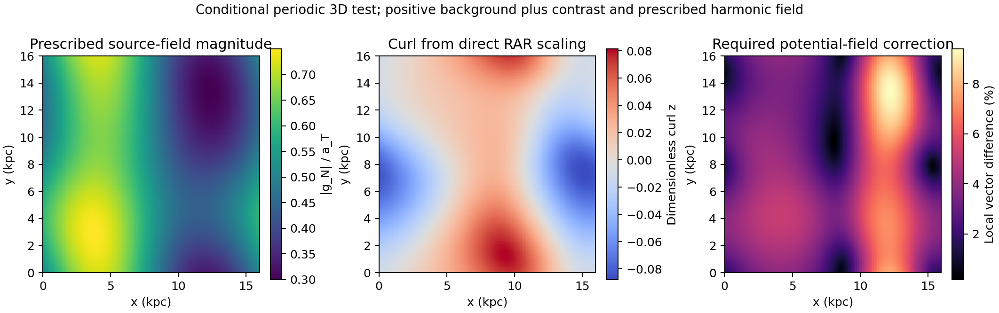

# 1. 검증 입력과 이번 진전

**WRRA = Wonsik Reality–Renderer Architecture.** v0.2에서 기존 RAR를 재현한 노출량 $\sigma$를 국소 뒤틀림 진폭에 연결한다. 검증 입력 → WRRA 변환 → 산출값 → 반증조건으로 평가한다.

MCC 3.0 v0.27-r1의 21–23장에서 양방향 뒤틀림, 이차 저장 에너지, 질량 표현형과 정적 중력 응답을 확인했다. 기존 공유 D 에너지 장부와 v0.2 RAR 게이트 결과를 동결했다. SOURCE 주소·할당 슬롯·수치 공간 격자는 계속 구별한다.

이번 성과는 세 가지다. 첫째, $\sigma$의 SI 단위 해석을 기존 에너지식에 붙였다. 둘째, 기존 용량 계약을 명시적인 장력–원천 하중 계약으로 구체화했다. 셋째, 같은 게이트 비용을 기존 QUMOND 수학의 수신기에 연결해 비구대칭 3차원 시험을 실행했다. 새로운 관측 적합이나 완전한 상대론적 중력 이론의 완성을 뜻하지 않는다.

# 2. WRRA 변환 I: 뒤틀림의 단위와 정규화

기존 저장 에너지와 같은 상태의 가속도 정규화는

$$
u_T=\frac{\zeta c^4\kappa^2}{16\pi G},\qquad
 a_T=cH_0\sqrt{\frac{u_D}{8u_{\rm crit}}},\qquad
 u_{\rm crit}=\frac{3H_0^2c^2}{8\pi G}.
$$

여기서 $u_D$는 기존 표기에서 에너지 밀도로 사용한 D 성분이다. 이 식들을 결합하면

$$
u_D=\frac{3a_T^2}{\pi G}.
$$

절대 강성 $\zeta$와 뒤틀림률 $\kappa$를 별도로 결정하지 않고, 관측 가능한 조합에 해당하는 **강성 가중 뒤틀림률**을 사용한다.

$$
\omega=\sqrt\zeta\,\kappa,\qquad
\omega_D=\frac{4\sqrt3\,a_T}{c^2},\qquad
L_0=\omega_D^{-1},\qquad
\boxed{\sigma=L_0\omega,\quad\sigma^2=u_T/u_D.}
$$

마지막 관계는 기존 이차 저장식에 맞춘 정규화 항등식이며 그 자체로 새로운 동역학적 예측은 아니다. 기준 상태에서는

| 양 | 값 |
|---|---:|
| $u_D$ | $2.0321854301\times10^{-10}$ J/m³ |
| $a_T$ | $1.1917875314\times10^{-10}$ m/s² |
| $\omega_D$ | $9.1870916799\times10^{-27}$ $\mathrm{m}^{-1}$ |
| $L_0$ | $1.0884837496\times10^{26}$ m |

$L_0$는 진폭의 정규화 길이다. 우주의 크기, 실제 접촉 범위, 순간 통신 길이로 해석하지 않는다. $\zeta$를 바꾸고 $\kappa$를 반대로 조정하면 같은 $\omega$와 모든 결과가 유지된다. 기존 강성–뒤틀림 퇴화를 임의의 수치 선택으로 닫지 않았다.

# 3. WRRA 변환 II: 최소 저장 에너지와 원천 장력

국소 법선 $n$ 방향의 가중 뒤틀림 1형식에 대해, 기존 이차 에너지를 고정 공변 1형식으로 계량 변분한 **후보 응력**은

$$
S_{ij}=\frac{c^4}{16\pi G}(2\omega_i\omega_j-|\omega|^2\delta_{ij}),\qquad S_{nn}=u_T
$$

이다. 이를 보편적인 완성형 응력 텐서로 선언하지 않고 단순 이차 모델의 단위·장력 증거로 사용한다. 별도 수치 계량 미분으로 확인했다.

기준 면하중을

$$
\Sigma_\star=\frac{u_D}{a_T}=\frac{3a_T}{\pi G}
=1.7051574853\ \mathrm{kg/m^2}
$$

로 정의하고, 다음 **신규 원천 하중 계약**을 둔다.

$$
\min u_T\quad\text{subject to}\quad S_{nn}\ge\Sigma_\star g_N.
$$

$g_N$은 바리온 원천이 정하는 보조 뉴턴 장의 크기다. $\Sigma_\star$는 응답 포트의 면하중 정규화이며 실측된 별·가스의 표면질량이나 새 입자 성분이 아니다. 일반 물질이 총 중력장 대신 보조 장을 느낀다는 가정을 하지 않는다.

최소점에서 $u_T=\Sigma_\star g_N$이므로

$$
\sigma^2=\frac{u_T}{u_D}=\frac{g_N}{a_T}.
$$

v0.2의 이차 용량 계약을 같은 에너지식과 장력 조건으로 표현했다. ‘하중을 지지하는 최소 뒤틀림 에너지’라는 물리적 뜻이 생겼지만, 이런 포트와 원천 하중 결합이 SOURCE에서 자율 생성됨을 증명한 것은 아니다. 총 장 $g$를 대신 넣으면 다른 응답 법칙이 되므로 원천 장과 관측 장을 구별한다. 기존 단위 허용률 $\mu=1-e^{-\sigma}$도 명시적 구성 가정으로 유지한다.

반대 방향 뒤틀림은 기존 식처럼 $\kappa^2=\kappa_+^2+\kappa_-^2$로 합산한다. 방향 편향을 바꿔도 제곱합·저장량·정상 장력이 같음을 검사했다. 따라서 순 방향 편향이 작아도 저장 응답은 남을 수 있다.

# 4. 같은 비용을 쓰는 3차원 수신기

v0.2의 하중 비용은 $\Psi(y)=\int_0^y t/[1-e^{-\sqrt t}]\,dt$였다. 보조 퍼텐셜 $\Phi_N$에 대해 $Y=|\nabla\Phi_N|^2/a_T^2$라 두면

$$
\mathcal Q(Y)=2\Psi(\sqrt Y),\qquad
\mathcal Q'(Y)=\nu(\sqrt Y),\qquad
\nu(y)=\frac1{1-e^{-\sqrt y}}.
$$

이 비용을 Milgrom의 **기존 QUMOND 수학**에 넣어 다음 비상대론적 두 퍼텐셜 수신기를 채택했다 [2].

$$
\mathscr S_{\rm stat}=-\int d^3x\left[\frac{2\nabla\Phi\!\cdot\!\nabla\Phi_N-a_T^2\mathcal Q(Y)}{8\pi G}+\rho_b\Phi\right].
$$

두 변분은

$$
\nabla^2\Phi_N=4\pi G\rho_b,\qquad
\nabla^2\Phi=\nabla\!\cdot[\nu(|\nabla\Phi_N|/a_T)\nabla\Phi_N]
$$

를 준다. 이는 정지 작용의 안장점 표현이며 전체 작용을 양의 최소 에너지라고 부르지 않는다. 구대칭에서는 기존 RAR를 회복하지만 비구대칭에서는 AQUAL과 동일한 이론이 아니다. 이번 수신기 선택을 WRRA만의 유일한 미시 유도로 취급하지 않는다.

일반 3차원에서 $\nu\nabla\Phi_N$는 curl이 0일 필요가 없다. 따라서 이를 그대로 관측 중력 퍼텐셜의 구배로 삼지 않고, 동일한 발산을 보존하는 무회전 성분을 계산한다. 유한 푸리에 공간의 직교 투영은 최소 제곱 보정이기도 하다. 이 수신기를 실제 실행했으므로 이 후보의 내부 계산 연결로 기록하되 완전한 GR 통합으로 부풀리지 않는다.

## 4.1 실행 경계

$32^3$, $64^3$, $128^3$ 주기 격자에서 매끄러운 비구대칭 밀도 대비를 사용했다. 양의 기준 배경을 더하면 전체 밀도는 양수이며, 푸아송 방정식은 평균을 뺀 대비에 적용했다. 16 kpc는 시험 상자의 선언된 길이로 SOURCE 크기나 우주 크기가 아니다. 보조 장의 외부 조화 성분을 고정하고, 출력은 대수 응답의 평균을 유지하도록 경계 관례를 정했다. 실제 고립 은하·SPARC 적합은 아니다.

실수 짝수 격자의 Nyquist 면은 허용 대역에서 제외했다. 최대 제외 상대량은 약 $1.38\times10^{-12}$이며 해상도 증가 시 반올림 수준으로 줄었다. 보정은 이 허용 대역에 대해 검사했다.

# 5. 산출값·독립 검산·소유권

기준 구대칭 계산은 **207.5102418659 km/s**를 유지했다. 새 3차원 시험의 단순 대수 배율 장에는 회전 성분이 있었고, 퍼텐셜 장으로 만드는 벡터 보정의 상대 $L^2$ 크기는 **4.318148%**였다. 특정 은하 관측 잔차가 아니라 선언한 시험의 기하학적 결과다.

| 검사 | 결과 |
|---|---:|
| 스펙트럴 출력의 curl RMS | $5.59\times10^{-15}$ 이하 |
| 보정 전후 발산 상대 차이 | $3.01\times10^{-14}$ 이하 |
| 별도 유한 체적 수렴 차수 | 1.99931, 1.99983 |
| 혼합 작용의 두 방향 미분 오차 | $3.34\times10^{-11}$ 이하 |
| 이차 저장식의 계량 미분 오차 | $2.04\times10^{-11}$ 이하 |
| 주 계산 / 별도 검산 | 61/61, 5/5 내부 검사 통과 |

검사 수는 독립 물리 관측 수가 아니다. 별도 검산은 staggered 유한 체적 포아송 풀이를 사용했으며 스펙트럴 출력에 2차 수렴했다.

{width=100%}

*비구대칭 주기 시험의 원천 장, 직접 배율 장의 회전 및 필요한 퍼텐셜 보정. 관측 지도나 고립 은하 모형이 아니다.*

가중 연결 $\boldsymbol\omega=\omega_D\sqrt{|\nabla\Phi_N|/a_T}\,n$을 원천 구배 방향으로 택한 폐곡선 시험에서는 선적분과 곡면 curl 적분이 일치했고, 16 kpc 시험 상자에서 가중 폐곡선 값은 약 $-1.3110\times10^{-9}$였다. 이 후보는 단일 스칼라 위상의 완전 미분만으로 표현되지 않는 연결을 허용한다. 실제 우주 위상이나 비가환 홀로노미를 측정한 것은 아니다. $\sigma$를 한 셔터의 실제 회전각과 동일시하면 실패하며, 그 조건부 미세 변 길이의 가중 각은 약 $3.79\times10^{-39}$ rad로 전혀 다른 양이다.

\Needspace{10\baselineskip}

## 5.1 저장 에너지와 질량 표현형

8.2 kpc 기준점에서 $\sigma=0.92973206$, $u_T=1.75662\times10^{-10}$ J/m³다. 그러나

$$
u_T/c^2=1.95451\times10^{-27}\ \mathrm{kg/m^3},\qquad
\rho_{\rm eff}=5.12098\times10^{-22}\ \mathrm{kg/m^3}
$$

로 약 $2.62009\times10^5$배 다르다. 전자는 저장 장 에너지를 단순 질량으로 나눈 값이고, 후자는 같은 수정 응답을 표준 푸아송 언어로 바꾼 유효 잔차다. 단순 최소 결합 GR에서 전자만 추가 물질 밀도로 넣으면 기존 응답을 재현하지 못한다. 이번 구성은 수신기 변분을 통해 후자를 계산하며 둘을 중복 합산하지 않는다.

또한 단순 고정 1형식 응력의 등방 평균은 $-u_T I/3$으로, 기존 D 성분의 dust 압력과 같지 않다. 따라서 이 국소 저장식만으로 우주적 압력 법칙을 새로 유도했다고 쓰지 않는다. 기존 D 장부와 새 저장장을 별도 가산 성분으로 동시에 넣지 않으며, 동역학·전달·계량 완성에서 그 관계를 결정해야 한다.

# 6. 반증조건과 결론

원본·단위·정규화·정상 장력 관계가 실패하거나, 원천 장과 총 장을 바꿔 쓰거나, 저장량과 유효 질량을 동일시·이중계산하거나, 3차원 발산·curl·수렴 조건이 실패하면 해당 연결을 수정한다. 관측 비교에서는 원천·경계·게이트·계수를 고정해야 한다.

**결론:** $\sigma$를 기존 D 장부로 정규화한 강성 가중 뒤틀림으로 구체화했고, 최소 장력 용량과 같은 비용의 3차원 수신기를 실행했다. 앞으로 필요한 핵심 구조는 원천 하중을 받는 포트의 실제 미시 구성, 단위 허용률의 동역학, 기존 D 압력과의 완전한 계량 접합이다. 이 진전은 단순 명칭 변경을 넘지만, 그 남은 연결까지 완료했다고 주장하지 않는다.

# 7. 출처와 재현

[1] MCC 3.0 v0.27-r1, 21–23장. DOI **10.5281/zenodo.23516661**. 원본 발췌·공유 상태·v0.2 결과와 해시를 포함했다.

[2] M. Milgrom, *Quasi-linear formulation of MOND*, MNRAS 403, 886 (2010), <https://arxiv.org/abs/0911.5464>, DOI **10.1111/j.1365-2966.2009.16184.x**. 기존 수신기 수학으로 명시해 사용했다.

Python 3와 NumPy로 `python3 compute.py`, 이어서 `python3 verify.py`를 실행한다. 도표 재생은 Matplotlib로 `python3 plot.py`를 실행한다. 이번 패키지에는 아직 새 공개 릴리스·DOI를 부여하지 않았다. 저장소: <https://github.com/Wonsik-Choi-janefather/wrra-m-0.1>.
