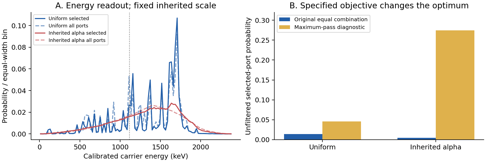

**WRRA = Wonsik Reality-Renderer Architecture.** 기존 MCC 3.0 v0.27-r1의 130–134장을 확인하고, 131장의 제타 위상 출력을 기존 질량 없는 전달 규칙에 연결했다. 이번 성취는 **제타 입력으로부터 단위가 있는 에너지와 검출 분포까지 실제 계산한 것**이다. 입자 질량·표준모형 양자수·제타의 유일성을 유도한 것으로 해석하지 않는다.

## 1. 검증 입력과 소유권

| 고정 입력 | 값과 역할 |
|---|---|
| 유한 SOURCE 후보 | $N_U=500\times29\times70=1{,}015{,}000$ |
| 위상 입력 | 기존 파일의 첫 70개 양의 제타 영점 높이 $\gamma_j$ |
| 선택 주소 | 서로 다른 소인수를 둘 이상 갖는 935,155개 주소 |
| CRT 구현 공간 | $(213,65,77)$, 용량 1,066,065; 주소 충돌 없음 |
| 준비 상태 | 선택 주소에서 균일 진폭 또는 $n^{-\alpha/2}$, $\alpha=1.8996877935161325$ |
| 물리적 눈금 | 기존 $\tau=1.481301966415863\times10^{-21}\,\mathrm{s}$, $d=c\tau$ |
| 전달 규칙 | 기존 $H=\hbar c|k|$, 스칼라 공간 인자 |

두 준비는 기존 131장의 시험 상태이며 원래 부문별 SOURCE 자료의 재구성이 아니다. 주소 수, 내부 모드 수, 공간 셀 수, 물질 비율을 서로 바꾸지 않는다. 이 CRT 공간과 기존 $500\times29\times70$ 이웃 그래프도 동일한 기하가 아니다. 공간 눈금과 해밀토니언의 상속은 이번 제타 연결에 대한 명시적 조건이다.

기존 영점 목록은 고정 입력이다. 유한 목록 검산은 전체 영점의 리만 가설을 증명하지 않는다. 제타의 원래 디리클레 급수는 $\Re s>1$에서 쓰며, 임계선에서 유한 위상 합을 해석적 연속 제타 자체로 놓지 않는다 [2,3].

## 2. WRRA 변환: 제타 위상에서 물리적 판독까지

주소 $n$에 대해 기존 규칙을 그대로 사용한다.

$$D_j|n\rangle=e^{-i\gamma_j\log n}|n\rangle,
\qquad K_0(n)=\frac1{70}\sum_{j=1}^{70}e^{-i\gamma_j\log n}.$$

$\log n$은 무차원 주소 좌표다. 영점 높이는 그 좌표의 위상을 정하며 물리적 시간, 미터 또는 입자 에너지가 아니다. 기존 CRT 등거리 매장 $J$ 후 공간 푸리에 변환으로 파수 $k$를 읽는다. 각 축에서 $k_a d=2\pi\ell_a/m_a$이다. 따라서

$$E_{\boldsymbol\ell}=\frac{\hbar}{\tau}\sqrt{\sum_a(2\pi\ell_a/m_a)^2},
\quad U(t)=e^{-iHt/\hbar},\quad t=\tau.$$

**영점 번호와 공간 고유모드 번호를 임의로 짝짓지 않는다.** 하나의 $D_j$도 여러 공간 에너지 성분을 갖는 파동 묶음을 만든다. 에너지 눈금은 $\hbar/\tau=444.346913\,\mathrm{keV}$이다. 이 값은 기존 눈금의 결과이며 새로운 입자 질량 예측이 아니다. 기존 $e^{-iL}$의 무차원 전달을 ‘1초’로 바꾸지도 않았다. 이번에는 물리적 $H$를 별도로 실제 실행했다.

## 3. 70개 포트와 에너지 장부

균일 보조 레지스터에 제어 $D_j$를 작용한 뒤 70점 유니터리 푸리에 결합을 한다. 선택 포트 $m=0$이 기존 $K_0$를 준다. 나머지 69개 포트를 합쳐 보류로 기록한다. 이 계산에서는 확률만 맞춘 $\sqrt{1-|K_0|^2}$ 보류 진폭을 물리적 보류 에너지로 사용하지 않는다. 실제 보완 포트가 에너지를 소유한다.

$$A_m=\frac1C\sum_{j=0}^{C-1}e^{-2\pi imj/C}D_{j+1},
\qquad \sum_{m=0}^{C-1}A_m^\dagger A_m=I.$$

공간 $H$와 보조 레지스터의 결합 연산은 교환하지만, 주소 위상 $D_j$는 일반적으로 $H$와 교환하지 않는다. 따라서 조작의 평균 전달 에너지를 반드시 기록한다.

$$W_{\rm phase}=\frac1C\sum_j\langle JD_j\psi|H|JD_j\psi\rangle
-\langle J\psi|H|J\psi\rangle.$$

검출기는 기존 전달 시험의 대역 $|k|d\le0.8\pi$만 허용하는 이상적 투영 검출기로 명시했다. 선택 포트의 대역 밖 성분도 별도로 남긴다. 최종 기록은 **대역 내 검출 / 대역 밖 / 보류** 세 가지다.

$$P_B+P_{\rm high}+P_{\rm hold}=1,
\quad E_B+E_{\rm high}+E_{\rm hold}=E_{\rm in}+W_{\rm phase}.$$

대역 선택은 정의된 검출 조건이지 실제 장치의 효율 측정이 아니다. 연속 시간 전달은 전체 스펙트럼에 정의하고, 셔터 간격에서의 주파수 판독 주장은 허용 대역에 한정한다. 전달 중에는 자유 $H$의 평균 에너지가 보존된다. 보조 레지스터는 이상적으로 에너지 축퇴라고 놓았으며, 장치 생성·기록 초기화·열역학적 비용을 모두 유도한 것은 아니다. $W_{\rm phase}$는 지정 연산의 평균 에너지 전달량이며 보편적 최소 작업량도 아니다.

\Needspace{15\baselineskip}
## 4. 출력: 고정된 두 준비의 실제 계산

| 판독량 | 균일 준비 | 기존 $\alpha$ 준비 |
|---|---:|---:|
| 선택 포트 확률 | 0.014262842604 | 0.004494840216 |
| 대역 내 검출 확률 | 0.003295611824 | 0.001234165634 |
| 초기 평균 에너지 (keV/시행) | 146.793471 | 1332.797837 |
| 위상 조작 평균 전달 (keV/시행) | 1192.747800 | 7.444499 |
| 모든 포트 평균 에너지 (keV/시행) | 1339.541271 | 1340.242336 |
| 대역 내 조건부 평균 에너지 (keV/검출) | 762.025808 | 809.323557 |

‘검출되었을 때의 평균’과 ‘모든 시행에 대한 에너지’를 구분했다. 예를 들어 균일 준비에서 선택 포트의 확률 가중 에너지는 19.448114 keV/시행, 보완 포트의 에너지는 1320.093157 keV/시행이다. 선택된 출력만 보고 에너지가 생겼다고 계산하지 않는다. 이 에너지와 분포는 주어진 유한 질량 없는 레지스터의 결과이며 실제 광자 종·편광·입자 생성률로 식별하지 않는다.

첫 70개 대신 같은 개수·양 끝 높이의 등간격 목록을 넣으면, 대역 내 조건부 공간 분포가 제타 기준에서 TV 0.640645 / 0.872799만큼 달라진다. 모든 높이에 0.5를 더해도 통과 확률은 같지만 TV는 0.202008 / 0.048468이다. 이는 공통 **주소 의존** 위상이며 전역 상수 위상과 다르다. 대조 목록에는 상류 제타 허가를 강제로 열었으므로 그 목록이 제타 허가를 통과했다고 주장하지 않는다.

\Needspace{23\baselineskip}
## 5. 최적성: 실제 목적함수를 놓고 검산

고정 준비에서 $|\phi_j\rangle=JD_j|\psi\rangle$, $G_{jk}=\langle\phi_j|\phi_k\rangle$라 하자. 전체 935,155개 주소로 $70\times70$ Gram 행렬을 계산했다. 균일한 분기 준비는 유지하고, 정규화된 선택 포트 결합 계수 $b$만 바꾸면

$$P(b)=\frac1C b^\dagger G b,
\qquad P_{\max}=\frac{\lambda_{\max}(G)}C.$$

| 결합 방식 (대역 제한 전) | 균일 준비 | 기존 $\alpha$ 준비 |
|---|---:|---:|
| 기존 동일 비중 결합 | 0.014262843 | 0.004494840 |
| 최대 통과 결합 | 0.045705816 | 0.274756690 |
| 최대값 / 기존값 | 3.20454 | 61.12713 |

따라서 **동일 비중 결합을 ‘통과 확률을 가장 크게 만드는 법칙’으로 정당화할 수는 없다.** 이 진단 결합은 원래 규칙을 교체하거나 관측 자료에 맞춘 새 파라미터가 아니다. 고정 준비에 대한 수학적 최대값을 비교한 것이다. 목표 영상 충실도, 주소 대칭성, 장치 비용을 최적화하면 다른 문제가 된다. 이 비교는 제타 목록 자체의 전역 최적성이나 불필요성을 판정하지도 않는다.

\Needspace{18\baselineskip}
{width=100%}

*왼쪽: 물리적 눈금을 상속한 에너지 분포. 점선은 모든 포트의 평균, 세로선은 검출 대역 경계다. 오른쪽: 동일 비중 결합과 고정 준비의 최대 통과 진단. 에너지와 확률은 관측 자료 적합 결과가 아니다.*

\Needspace{28\baselineskip}
## 6. 반증 조건, 현재 판정과 후속 과제

주 실행 49개와 별도 계산 20개 내부 검사를 수행했다. 별도 검산은 다른 주소 분류, SciPy FFT, 70개 포트의 직접 유니터리 구현, 영점 잔차, 고유벡터 잔차와 변분 상한을 포함한다. 검사 개수는 독립된 물리 실험의 수가 아니다.

1. 같은 고정 입력에서 기존 통과 확률을 재현하지 못하거나, CRT 충돌·확률 손실·에너지 장부 불일치가 생기면 구현을 수정한다.
2. 상수 전역 위상에 따른 에너지·강도 변화, 선언한 자유 전달에서의 에너지 변화, 고정 상태에서 Gram 최대값을 넘는 결합은 실패다.
3. 실제 장치에 연결하려면 준비·주소-검출 좌표·에너지 눈금·대역·잡음·위상 변경을 먼저 고정하고, 같은 규칙의 확률·스펙트럼·방향 분포를 함께 비교한다. 현재 관측 데이터로 이 대응이 확인된 것은 아니다.
4. 동일 비중 결합의 목적, 70개 위상 분기의 물리적 생성과 유지, 상류 허가의 자율 실행, 반복 기록·초기화의 장치 역학, 기존 원래 부문별 SOURCE 연결은 OPEN이다.

**판정:** 제타 위상이 물리적 에너지 고유값과 직접 같아야 한다는 가정 없이, 기존 주소 구조를 통해 에너지·검출·보완 포트까지 연결했다. 완성된 입자 이론으로의 격상에는 장치 역학과 종별 결합을 더 유도해야 한다. 유한 임의 위상 목록도 보존적인 계측기를 만들 수 있으므로 보존만으로 제타를 유일하게 선택하지 않는다. 이번 단계의 유익한 제약은 ‘어떤 물리량을 실제 계산했는가’와 ‘어떤 목적에서는 기존 결합이 최적이 아닌가’를 수치로 고정한 것이다.

## 자료와 재현

[1] MCC 3.0 v0.27-r1, 130–134장, https://doi.org/10.5281/zenodo.23516661 . 원래 영점·코드·결과 및 발췌를 입력 해시와 함께 보존했다.

[2] NIST DLMF §25.2, https://dlmf.nist.gov/25.2 . [3] NIST DLMF §25.10, https://dlmf.nist.gov/25.10 . 수학적 배경이며 새 물리 대응의 실증 근거로 인용하지 않는다.

동봉 코드: `compute.py`, `verify.py`, `plot.py`. NumPy·SciPy·mpmath·Matplotlib. 결과: CSV, JSON, Gram 행렬, 결합 계수, 양언어 보고서. 이번 연구 패키지는 새 GitHub·GitBook·Zenodo 판본으로 아직 등록하지 않았다.
