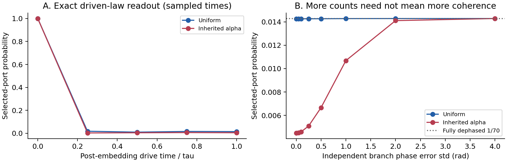

**WRRA = Wonsik Reality-Renderer Architecture.** 앞선 v0.1의 계산을 보존하면서, 동일 비중 결합의 목적과 그 위상을 실제로 실행하는 유한 운동방정식을 추가한다. 평가는 검증 입력, WRRA 변환, 산출값, 반증조건 순으로 제시한다.

## 1. 검증 입력

기존 70개 제타 영점 높이, $N_U=1{,}015{,}000$, 선택 주소 935,155개, CRT 공간 $(213,65,77)$, 두 시험 준비와 v0.1의 물리적 눈금을 고정했다. 거리 $d=c\tau$, $\tau=1.481301966415863\times10^{-21}\,\mathrm{s}$, $H_0=\hbar c|k|$를 재사용한다. 기존 결과·코드·Gram 행렬을 해시로 동결했다.

영점은 고정된 수학적 입력이다. 이번에는 제타 영점 목록을 새로 선택하거나 원래 부문별 SOURCE, 우주 구성비, RAR 또는 GR/CMB 결과를 다시 맞추지 않는다. 시간은 주소를 공간 레지스터에 매장한 뒤의 물리적 구동에만 부여한다. 표현형 이전 SOURCE의 주소나 슬롯 자체에 시간을 넣지 않는다.

## 2. WRRA 변환 A: 비특권 결합의 정확한 목적

앞선 최대 통과 포트는 준비 상태를 보고 결합 계수를 조정했다. 이번에는 **준비·영점 내용에 맞춰 계수를 재조정하지 않고 모든 분기를 같은 방식으로 받는 단일 순수 포트**를 선언한다. 이는 우주의 비특권성만으로 자동 도출되는 정리가 아니라, 결합기에 적용한 명시적 비특권 계약이다. 내용에 따라 달라지는 계수도 단순한 이름 바꾸기에는 공변적일 수 있으므로, 일반적인 재명명 불변성보다 강한 조건이다.

정규화된 결합 계수 $b\in\mathbb C^{70}$의 분기 간 차이 비용을

$$\mathcal C(b)=\frac1C\sum_{j<k}|b_j-b_k|^2
=1-\frac{|\sum_j b_j|^2}{C},\quad \|b\|=1$$

로 정의한다. $\mathcal C\ge0$이고 등호는 $b=e^{i\theta}(1,\ldots,1)/\sqrt C$에서만 성립한다. 따라서 이 계약에서 최소 차이 비용의 포트는 기존 동일 비중 결합이다. 준비 레지스터에도 같은 조건을 적용하면 기존 $K_0=C^{-1}\sum_jD_j$를 얻는다.

이 비용은 **결합 계수의 차별화 정도**이지 줄 단위 에너지나 우주 전체의 계산량이 아니다. 전체 순열 불변 검출기라도 혼합·다중 포트를 허용하면 다른 검출기가 가능하다. 여기서의 유일성은 정규화된 단일 순수 포트와 위 비용의 범위다.

| 서로 다른 최적화 목적 | 판정 |
|---|---|
| 고정 준비의 통과 확률 최대화 | 앞선 Gram 최대 고유벡터 |
| 내용에 적응하지 않는 단일 결합 포트의 차이 비용 최소화 | 기존 동일 비중 벡터 |
| 실제 장치의 에너지·공간 국소성·총 계산 비용 최소화 | 아직 별도 문제 |

두 준비에 대한 최대 통과 벡터의 정규화 차이 비용은 0.976105와 0.999669였다. 통과 확률의 개선과 분기 대칭 계약의 충족은 같은 최적화가 아니다. 원래 결합 규칙을 바꾸지 않고 그 적용 목적을 명확히 할 수 있다.

## 3. WRRA 변환 B: 위상을 실행하는 양의 해밀토니언

공간 매장 $J$ 위에 $\Lambda=\sum_{n\le N_U}\log n\,|Jn\rangle\langle Jn|$를 놓고, 보조 레지스터에 $\Gamma=\operatorname{diag}(\gamma_1,\ldots,\gamma_C)$를 둔다. 여분 슬롯의 $\Lambda$는 0이다. 다음 구동을 새로 선언한다.

$$B=\frac{\hbar}{\tau}\Gamma\otimes\Lambda,\qquad
U_0(t)=I_C\otimes e^{-iH_0t/\hbar},$$
$$V(t)=U_0(t)BU_0(t)^\dagger,\qquad
H_{\rm tot}(t)=I_C\otimes H_0+V(t).$$

$H_0,B,V(t)\ge0$이므로 총 해밀토니언도 양이다. 시간 의존 슈뢰딩거 방정식의 정확한 해는

$$U_{\rm tot}(t)=U_0(t)e^{-iBt/\hbar}.$$

따라서 $t=\tau$에서 각 분기는 $e^{-iH_0\tau/\hbar}JD_j|\psi\rangle$가 된다. **위상 연산 뒤 물리적 전달을 수행한 v0.1의 최종 상태를 한 구간의 운동방정식으로 정확히 실행한다.** $\gamma_j$가 자유 전달 입자의 에너지라는 등식은 필요하지 않다.

제어 항은 보조 분기와 주소 사이에서 하나의 곱 $\Gamma\otimes\Lambda$로 분리된다. 분리 가능한 비영 결합 항 수라는 제한된 기준에서는 1이 최소다. 이것은 최소 회로 게이트 수나 국소 장치의 최저 비용 증명이 아니다. $V(t)$의 공간 회전은 일반적으로 비국소적이며 외부 시계와 제어를 전제로 한다. 자율적인 장치·국소적 장 생성의 완성으로 판정하지 않는다.

## 4. 산출값과 에너지 소유권

기존 두 준비의 통과 확률 0.014262842604 / 0.004494840216와 모든 포트 평균 에너지가 재현되었다. 별도로 3분기·11주소 레지스터에서 정확해를 사용하지 않는 수치 적분을 수행했다. 최대 상태 오차는 $2.71\times10^{-12}$, 구동 작업 적분과 자유 에너지 변화의 오차는 무차원 단위 $4.00\times10^{-14}$였다.

이 구동에서는 $\langle V(t)\rangle=\langle B\rangle$가 일정하다. 이상적 켜기·끄기의 평균 에너지는 각각 $+\langle B\rangle$, $-\langle B\rangle$이고, 구간 내부의 외부 제어 작업은

$$\int_0^\tau\langle\partial_tV\rangle\,dt
=\Delta\langle H_0\rangle=W_{\rm phase}.$$

| 에너지 항 | 균일 준비 | 기존 $\alpha$ 준비 |
|---|---:|---:|
| 구동 중 평균 제어 퍼텐셜 (MeV) | 624.490653 | 147.863326 |
| 내부 구간 평균 전달 작업 (keV/시행) | 1192.747800 | 7.444499 |
| 최종 모든 포트 평균 에너지 (keV/시행) | 1339.541271 | 1340.242336 |

켜고 끌 때 같은 에너지를 회수하는 것은 이 참조 구동의 이상적 장부다. 실제 회수 효율과 초기화 비용을 0으로 입증한 것은 아니다. 제어 퍼텐셜은 전달 입자의 질량도 아니다. 특히 큰 제어 눈금은 이 구동을 보편적 최소 에너지 장치라고 부를 수 없음을 보여준다.

같은 최종 위상을 $\gamma_j\log n\bmod2\pi$로 감은 양의 생성기로도 구현할 수 있다. 그 생성기의 고유값은 $2\pi\hbar/\tau$ 미만이다. 그러나 70분기와 실제 선택 주소 12개만 택해도, 감지 않은 계수 행렬의 계수(rank)는 1, 감은 행렬의 계수는 12였다. 이는 전체 감은 결합의 분리 계수가 적어도 12임을 뜻한다. **공유 결합의 단순성과 생성기 에너지 눈금 사이에 구체적인 선택 문제가 있다.** 감지 않은 법칙을 무조건 최적이라고 선언하지 않는다.

## 5. 산출값: 위상 잡음에 대한 검증 가능한 응답

각 분기에 독립적인 평균 0, 표준편차 $s$ 라디안의 가우스 위상 오차를 가정한다. 새로운 잡음 모수는 관측 적합값이 아니라 지정한 시험 조건이다. 비대각 결맞음은 $\eta=e^{-s^2}$가 된다. 원래 선택 출력 상태를 $\rho_0$, 모든 분기의 비결맞음 혼합을 $\rho_{\rm mix}$라 하면, 비정규화 선택 출력은

$$\rho_{\rm out}(s)=\eta\rho_0+\frac{1-\eta}{C}\rho_{\rm mix},\qquad
P(s)=\eta P(0)+\frac{1-\eta}{C}.$$

이는 같은 포트에서의 장치 응답 예측이다. 대역 확률·에너지·방향 분포에도 같은 비정규화 상태 식을 적용하고 마지막에 조건부 정규화했다. 이산 독립 위상 오차의 전 경우를 합한 별도 계산으로 상태 식도 검산했다.

| 선택 포트 확률 | 균일 준비 | 기존 $\alpha$ 준비 |
|---|---:|---:|
| 위상 오차 없음 | 0.014262843 | 0.004494840 |
| 완전 탈결맞음 | 0.014285714 | 0.014285714 |

특히 기존 $\alpha$ 준비에서는 결맞음이 사라지면 검출 횟수가 증가할 수 있다. 따라서 단순히 통과량을 최대화하는 기준은 원래 간섭 판독의 보존을 보장하지 않는다. 확률과 공간 분포를 함께 측정할 이유가 생긴다. 이미 알려진 간섭·잡음 수학을 WRRA의 고정 입력과 주소-물리 변환 안에서 계산한 결과다.

\Needspace{18\baselineskip}
{width=100%}

*왼쪽: 공간 매장 뒤 한 구간의 정확 구동에서 계산한 포트 확률. 선은 표시한 시간 표본을 연결한다. 오른쪽: 독립 위상 오차에 대한 응답. 두 그림은 실제 장치 측정이 아닌 고정 모형의 계산이다.*

## 6. 반증조건

1. 비특권 단일 포트 계약을 만족하면서 동일 비중 벡터 이외의 영비용 해가 나오면 대칭 논증을 수정한다. 이 계약 밖의 다른 목적함수는 반례로 혼동하지 않는다.
2. 선언한 $H_{\rm tot}(t)$의 직접 적분이 정확해 또는 기존 최종 출력과 불일치하거나, 양성·확률·작업 장부가 깨지면 구동 구현을 수정한다.
3. 준비·눈금·검출 조건을 고정한 장치에서 독립 위상 오차가 지정 분포를 따르는데도 확률·에너지·방향 응답을 함께 재현하지 못하면 이 잡음 연결을 수정한다. 실제 측정 전 유의성·허용 오차를 임의로 확정하지 않는다.

## 7. 판정과 남은 연결

주 실행 79개, 별도 검산 26개가 통과했다. 이는 내부 수치 검사이며 독립된 관측 검증의 개수가 아니다. **동일 비중 결합의 명시적 목적, 기존 위상을 실행하는 양의 유한 구동, 위상 잡음의 물리 판독 응답**이 WRRA 내부 계산으로 연결되었다. 알려진 양자역학을 사용했지만 결과는 외부 인용에만 머물지 않고 해당 주소 모형에서 실제 실행했다.

남은 핵심은 외부 시계를 포함한 자율·국소 제어 장치, 감기/비감기 생성기의 전체 자원 선택, 기록 회수·초기화, 원래 부문별 SOURCE 및 입자 종 연결이다. 제타 목록 자체의 물리적 선택 원리를 이번 대칭 포트 정리로 대체하지 않는다. 리만 가설 또는 유일한 입자 스펙트럼의 증명도 주장하지 않는다.

자료: MCC 3.0 v0.27-r1, 130–134장, https://doi.org/10.5281/zenodo.23516661 ; 직전 제타-물리 판독 v0.1. 제타의 수학적 정의 배경: NIST DLMF §25.2, https://dlmf.nist.gov/25.2 . 동봉 코드·입력 해시·CSV·JSON·한영 보고서로 재현할 수 있다. 이번 연구판은 GitHub·GitBook·Zenodo에 아직 새 판본으로 등록하지 않았다.
