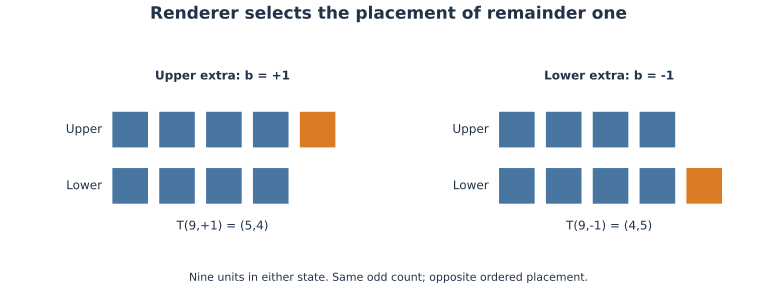
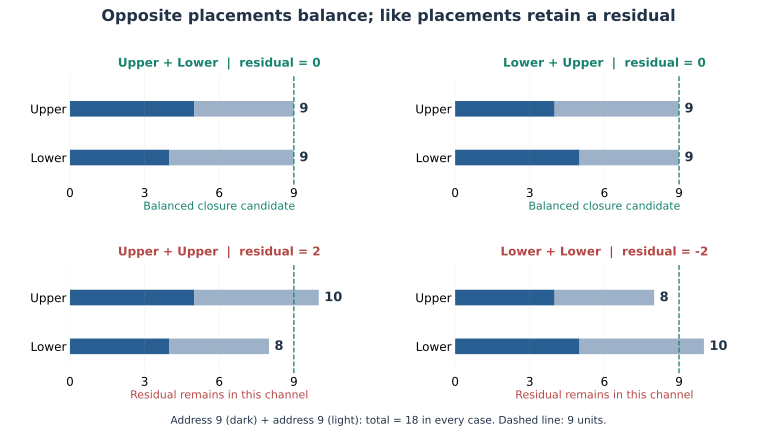

## 범위와 기준본

이 개정의 기준은 2026년 10월 20일 한·영 단독 논문 v1.3(공개 묶음 1.3.1)이다. v1.4는 10월 20일의 구조·용어 보강이며, 기존 로렌츠 계산의 입력·수치를 바꾸지 않는다.

이 원고는 전체 우주론의 재서술이 아니라 v0.24 이후의 추가분 논문 v1.4이다. 책 개정 번호는 v0.25이며, 정식 3.0 최종 확정판이라는 뜻은 아니다. 계보상 기준본은 「Minimal Computing Cosmology 3.0」 한·영 v0.24 원고다. 전자는 주소·허가·출력·자원 장부를 배경으로 제공하고, 이번 논문의 기여는 교대 출력 설정과 켤레 전환 명세다. SOURCE, LAW와 출력의 물리적 동일시는 가정과 접합 조건으로 공개한다. 폐기한 비대칭 보정 초안, 별도 반물질 우주, 핵융합·핵분열 확장은 포함하지 않는다.

최원식의 개념 제안을 명세와 조건부 수식으로 정리했다. ChatGPT를 문안·수식 검토와 재현 코드 작성에 사용했으며 저자의 책임을 대체하지 않는다. 새 외부 동료심사 완료를 주장하지 않는다.

## 검증 입력

입자·반입자의 대응은 같은 질량·스핀 크기와 켤레인 내부 양자수로 기술된다. 전하 부호만으로 모든 대응이 결정되지는 않는다. 전자와 양전자는 대응하지만 전자와 양성자는 반대 전하라는 이유만으로 대응하지 않는다. 대표적 확인 반응은 $e^-+e^+\to\gamma+\gamma$이며, 실제 허용 채널은 초기 상태와 보존조건에 따라 달라진다. 두 입자가 함께 생성된 원래 짝일 필요는 없다 [S1–S2].

이번 가설은 다음 두 규칙을 구별한다. 첫째는 원천의 특정 실행에서 어떤 부문을 신규 출력하는가이고, 둘째는 이미 존재하는 대응 표현형들이 상호작용할 때 어떻게 전환되는가이다. 출력 선택에 쌍생성을 필수로 넣는 것과, 후속 상호작용에서 쌍생성·쌍소멸을 허용하는 것은 별개의 계약이다.

## WRRA 고유 변환

### 1. 한 실행 시점·영역에서는 한쪽 부문만 신규 출력

실행 인덱스 $k$와 선언한 실행 영역에서 원천의 물질·반물질 출력 설정을 $\kappa_k\in\{+1,-1\}$로 둔다. $+1$은 물질 부문, $-1$은 반물질 부문이다. $J_k\ge0$는 해당 원천의 신규 출력 시도량이며, 자원·상호작용·보존 장부의 허가 게이트는 $Q_k\in\{0,1\}$이다. 이번 개정에서는 이 $k$를 기존 제112장의 조건부 셔터 클럭에 연결한다. $J$의 물리적 단위는 접합할 미시 모형에서 정한다.

$$J_{M,k}^{\rm new}=Q_k\frac{1+\kappa_k}{2}J_k,\qquad J_{\bar M,k}^{\rm new}=Q_k\frac{1-\kappa_k}{2}J_k.$$

그러면 정의한 게이트에서

$$J_{M,k}^{\rm new}J_{\bar M,k}^{\rm new}=0,\qquad J_{M,k}^{\rm new}+J_{\bar M,k}^{\rm new}=Q_kJ_k.$$

이것이 ‘어떤 시점에는 한 가지만 생성한다’의 명세다. 동시 신규 출력의 배타성은 이 게이트를 정의해 얻은 형식적 성질이며, 미시 동역학에서 이미 유도한 정리는 아니다. 이전에 만들어진 점유 $N_M,N_{\bar M}$가 동시에 존재할 가능성은 지우지 않는다. 설정 전환은 아래 교대 법칙으로 정하고, 허용 여부·자원 비용은 별도 상태 명세에 남긴다.

이 게이트의 적용 범위는 선언한 원천의 초기·기본 출력이다. 후속 쌍생성도 허용하되, 이번 개정에서는 그 두 켤레 표현형을 연속된 두 클럭에 순차 출력한다고 가정한다. 모든 생성 경로를 이 게이트 하나로 대체하려면 해당 반응의 실제 출력을 재현하도록 모형을 확장해야 한다.

### 2. 우리 우주의 초기 출력 설정

최원식의 제안을 다음 초기조건 가설로 기록한다.

> 표현형 출력기는 물질 또는 반물질 부문을 선택할 수 있다. 우리 우주의 초기 원천 실행은 물질 출력 조건으로 준비되어 있었다.

즉 초기의 해당 원천에는 $\kappa_0=+1$을 적용한다. 이는 우리 우주의 관측된 물질 우세에 대응하도록 명시한 초기 준비이며, 이 부호가 필연적으로 정해지는 원인을 계산한 결과는 아니다. 반대 설정도 법칙의 허용 후보로 남기므로 우리 우주에 특별한 선택자를 추가하지 않는다. 실제로 또 다른 우주가 존재한다거나 반물질 영역이 암흑부문이라는 주장도 여기서 도출하지 않는다.

‘물질 출력’은 음전하만 출력한다는 뜻이 아니다. 보통물질 구성에는 음전하 전자와 양전하 양성자가 함께 들어간다. $\kappa$는 구성 전체의 물질/반물질 대응이며 공간의 단순 좌우 반사나 기존 외대수 parity 선택만으로 동일시하지 않는다.

초기조건의 소유권은 공개한다. $\kappa_0$를 기존 SOURCE 준비 $\eta$의 함수로 구현할 수도 있고, 독립 초기조건으로 채택한다면 추가 입력으로 장부에 센다. 이 장에서는 그 접합을 완료했다고 주장하지 않는다. 제8.1장의 추가 비대칭 초기등록 금지 조건을 유지하는 기본 분기에서는 $\kappa_0=F(\eta,\mathrm{LAW})$로 접합해야 한다. 독립적인 부호를 새 입력으로 허용하는 분기는 그 금지 조건을 완화한 대안이며, 두 분기의 전제를 동시에 적용하지 않는다. 정확한 CP 대칭 법칙과 CP 대칭 초기 준비에서 임의로 비대칭을 얻을 수 없다는 제8장의 조건은 유지한다. 이번 $\kappa_0=+1$ 준비는 상태 쪽의 비대칭을 선언하는 다른 가설이다.

단독 출력이 실제 입자 생성이라면 원천 에너지, 전하와 보존·위반을 선언한 각 양자수의 전달을 계산해야 한다. 보존된 바리온수를 0으로 고정한 닫힌 초기 상태에서 순바리온을 아무 근거 없이 만들어서는 안 된다. 전달·허용된 위반·opening 접합 중 어느 기작이 담당하는지는 미시 모형의 과제로 남는다. 출력 허가와 실제 생성의 소유권을 구별한다.

### 3. 매 셔터 타이밍의 교대 위상과 드문 후기 출력

최신 제안에서는 출력 설정의 전환 법칙을 명시한다.

$$\kappa_{k+1}=-\kappa_k,\qquad \kappa_0=+1,\qquad \kappa_k=(-1)^k.$$

설정은 매 셔터 타이밍 교대하지만, 실제 생성은 허가 게이트 $Q_k$가 열렸을 때만 일어난다. 따라서 ‘매번 한 입자를 반드시 생성한다’가 아니다. $J_k$는 비교 가능한 출력 패키지의 개수로 정의한다. 초기 큰 출력은 $Q_0J_0=A>0$이며 물질 모드 안에서 완료된다고 가정한다. 여러 셔터 주기에 걸친 초기 출력이라면 부문별 합 $\sum_k\kappa_kQ_kJ_k$를 다시 계산해야 한다. 크기가 같은 출력을 연속된 두 모드에 적용하면 초기 비대칭은 상쇄된다. 초기 부호 하나만으로 물질 우세가 보장되지는 않는다.

후기에는 작은 출력이 드물게 허가되며, 두 모드에서의 평균 허가량이 같다는 추가 조건을 둔다. 예를 들어 $k=1,\ldots,2n$에서 $J_k=1$, 서로 독립인 $Q_k\sim\mathrm{Bernoulli}(p)$, $0<p<1$이면 후기 개수의 차이 $D=N_M^{\rm late}-N_{\bar M}^{\rm late}$는

$$\mathbb E[D]=0,\qquad \operatorname{Var}(D)=2np(1-p).$$

각 부문의 평균 개수는 $np$다. 후기 비율이 장기적으로 1:1에 접근하는 데에는 모드에 치우치지 않은 통계와 충분한 사건 수가 필요하다. 유한 실현에서 정확히 같은 수라는 보장은 없다. 이 독립 베르누이 예시는 통계적 양립 가능성을 보이는 장난감 모형이며 실제 입자 생성 확률을 도출한 결과가 아니다. 모드와 허가가 상관되면 평균 차이도 0이 아닐 수 있다.

총 부문 차이는 다음과 같다.

$$\Delta N=A+\sum_{k=1}^{2n}(-1)^kQ_kJ_k.$$

초기 큰 물질 출력과 후기의 평균 대칭 출력은 이 조건 아래 함께 기술된다. 바리온 비대칭은 패키지별 바리온수를 가중해 별도로 계산해야 한다. 이 식은 관측된 5% 물질 비중이나 바리온-광자 비율의 수치 도출이 아니다.

### 4. 단일 짝수의 동일량 분해와 결합

단일 짝수(singly even number)는 2로 나누어지지만 4로는 나누어지지 않는 수다 [S5]. 양의 정수에서

$$r=4j+2=2n,\qquad n=2j+1,\qquad j\ge0.$$

짝수 상태의 모든 분해를 허용하는 것이 아니라, 이 채널에서는 단일 짝수를 정확히 반으로 나누는 경로만 허용한다.

$$\mathcal D_{\rm eq}(r)=\{(n,n):n\in\mathbb N\text{는 홀수},\ r=2n\}.$$

이 산술 정의에는 합성수 조건을 넣지 않는다. $10\to5+5$와 $18\to9+9$는 모두 동일량 홀수 분해이며, $24\to9+15$와 $54\to9+45$는 비대칭이므로 금지한다. $24/2=12$는 짝수여서 이 채널의 후보가 아니다. 분해 결과가 질량화된 표현형으로 구현되는가는 별도 차원 필터와 허가 판독이 결정한다. 따라서 5가 소수라는 사실이 산술 분해를 금지하지는 않지만, 5를 곧바로 3차원 물질 표현형으로 판정하지도 않는다.

입자·반입자의 같은 정지질량을 입력으로 받아 같은 입자종의 켤레 구현에는 동일 코드 $n$을 배정한다. 이것은 WRRA의 대응 가정이며, 같은 질량만으로 모든 정보 주소가 같다고 증명되는 것은 아니다.

$$\mathcal C_{\rm up}(2n,\xi)\rightleftarrows(n,a,\chi)+(n,a,\bar\chi).$$

왼쪽에서 오른쪽은 쌍생성의 분해·출력 방향, 반대는 쌍소멸의 결합·표현형 해제 방향이다. 실제 출력은 입자종·켤레 양자수·에너지·운동량·표현형 허가를 충족해야 한다. 같은 코드와 같은 정지질량은 모든 관측계에서 운동에너지까지 같다는 뜻이 아니다. $\xi$는 코드 하나로 복원되지 않는 운동량·스핀·위상·상관관계를 소유한다.

실험적으로 알려진 쌍생성은 재현 대상이다 [S3]. 실제 반응에서 단일 광자가 진공에서 자유 유질량 쌍으로 단독 전환할 수 없다는 운동학 조건은 유지한다. 두 광자·반동 원천·외부장 등 필요한 환경을 포함한다. 단일 짝수라는 산술 조건이 물리적 보존 조건을 대신하지 않는다.

### 5. 원천·전환·점유의 분리 장부

쌍의 구조 분할과 두 표현형의 실제 출력을 구별한다. 한 쌍은 같은 코드 $n$의 켤레 상태로 분할되며, 첫 출력은 클럭 $k$, 둘째 출력은 $k+1$에서 일어난다. 첫 부문은 현재 모드가 선택한다. $P_{M,k},P_{\bar M,k}$를 각 클럭에서 실제로 나온 쌍생성 유래 출력 수로 두면

$$N_{M,k+1}=N_{M,k}+J_{M,k}^{\rm new}+P_{M,k}-H_k,$$
$$N_{\bar M,k+1}=N_{\bar M,k}+J_{\bar M,k}^{\rm new}+P_{\bar M,k}-H_k.$$

미출력된 짝의 예약 점유를 $L_{M,k},L_{\bar M,k}$로 기록한다. 물질이 먼저 나왔다면 반물질 예약이 남고, 반물질이 먼저 나왔다면 물질 예약이 남는다. 미완료 한 클럭 동안의 표현형 개수 차이는 가능하지만, 예약을 포함한 쌍의 총 장부는 대칭이다. 완료된 각 쌍에서는 $\sum_k P_{M,k}=\sum_k P_{\bar M,k}$다. 따라서 완료된 동일량 쌍의 생성·소멸은 자체적으로 순물질 차이를 만들지 않는다.

중간 원천·부모·환경 상태는 예약된 짝의 에너지와 보존량을 소유해야 한다. 한 클럭 동안의 전하·에너지 공백을 허용하는 설명으로 사용하지 않는다. 예약은 실제로 출력된 입자와 중복 계상하지 않는다. 쌍의 완성 전후에 부모 및 환경을 포함한 보존 장부를 확인한다. 이것은 기존의 클럭당 양쪽 동시 추가 $+P_k$ 명세를 대체한다.

전기전하는 패키지의 부문과 구별한다. 전자 단독 출력이라면 원천·환경은 반대 전하를 보유해야 하며, 그 전달이 끝날 때까지 장부를 닫지 않는다. 전기적으로 중성인 물질 패키지도 가능하지만 그 바리온·렙톤수의 소유권은 여전히 요구된다. 국소 전하보존을 평균적인 두 모드의 상쇄로 대체하지 않는다.

### 6. 홀수 나머지 1의 위·아래 배치

홀수 $n=2q+1$의 나머지 1이 위 또는 아래 중 어디에 붙는지를 배치 변수 $b\in\{+1,-1\}$로 구별한다. 두 위치의 점유를 다음과 같이 표현한다.

$$T(n,b)=\left(\frac{n+b}{2},\frac{n-b}{2}\right),\qquad U+D=n,\quad U-D=b.$$

$b=+1$은 위에 하나가 더 있는 배치, $b=-1$은 아래에 하나가 더 있는 배치다. 산술적 홀짝성은 같지만 두 위치에 대한 순서 있는 배치가 다르다. 출력기는 허가된 표현형의 나머지 위치 $b$를 정한다. 출력 모드와 접합하려면 입자종별 기준 $b_a^{(0)}$를 정하고 $b_{a,k}=\kappa_k b_a^{(0)}$로 대응시킬 수 있다. 이 대응은 명시한 구조 가정이다.

{width=95%}

*그림 1. 홀수 9를 두 위치에 배치한 도해. 나머지 1을 위에 붙이면 (5,4), 아래에 붙이면 (4,5)다. 셀은 산술적 점유 단위이며 실제 입자의 측정 형상은 아니다.*

두 배치가 주는 결합 잔여는

$$\delta_{\rm pair}=(U_1+U_2)-(D_1+D_2)=b_1+b_2.$$

따라서 반대 배치끼리는 $\delta_{\rm pair}=0$이고, 같은 배치끼리는 $+2$ 또는 $-2$가 남는다. $b_2=-b_1$이면 두 위치가 각각 $n$를 가지는 균형 결합이 된다. 예를 들어 $9$의 위 배치 $(5,4)$와 $9$의 아래 배치 $(4,5)$를 더하면 $(9,9)$다. 둘 다 위 배치면 $(10,8)$로 잔여 2가 남는다.

| 첫 상태 | 둘째 상태 | 두 위치의 점유: 9와 9의 예 | 결합 잔여 | 이 균형 닫힘 채널 |
|---|---|---|---|---|
| 위 | 아래 | $(9,9)$ | $0$ | 후보로 허용 |
| 아래 | 위 | $(9,9)$ | $0$ | 후보로 허용 |
| 위 | 위 | $(10,8)$ | $+2$ | 이 규칙에서는 닫히지 않음 |
| 아래 | 아래 | $(8,10)$ | $-2$ | 이 규칙에서는 닫히지 않음 |

{width=95%}

*그림 2. 같은 홀수 주소 두 개라도 나머지 위치에 따라 균형 결합과 잔여 결합이 달라진다. 모든 경우 주소 합은 짝수 18이므로, 짝수화만으로 쌍소멸을 판정할 수 없다.*

후보 닫힘 게이트는 $K_{\rm close}=\mathbf1[n_1=n_2]\mathbf1[b_1+b_2=0]$다. ‘위위·아래아래가 맞물리기 어렵다’는 말을 여기서는 이 특정 균형 닫힘 채널이 열리지 않는다는 규칙으로 정밀화한다. 같은 배치 입자 사이의 모든 상호작용·결합을 금지하지 않는다. 실제 맞물림의 용이함이나 전환률은 점유 차이만으로 계산되지 않는다.

위·아래 교환은 $\tau T(n,b)=T(n,-b)$이며 $\tau^2=1$이다. 이를 켤레 관계의 기하학적 후보로 사용할 수 있지만, 실제 전하·바리온·렙톤수와 입자종의 켤레 조건을 대신하지 않는다. 위·아래는 우선 내부 또는 국소 구조의 두 위치이며, 전자의 스핀 업·다운이나 우주의 절대 위·아래와 동일시하지 않는다. 실제 공간 형상이라면 좌표변환 아래의 규칙, 길이·에너지 함수와 상호작용을 추가해야 한다.

짝수 부모의 역분할에서는 $U=D=r/2$인 상태를 동일한 홀수 $n=n_1=n_2=r/2$와 반대 배치 $b,-b$에 분배하는 경로를 후보로 둔다. 부모 코드 $r$만으로는 분할 주소·방향·양자상관이 정해지지 않아 $\xi$와 허가 조건이 필요하다. 같은 질량은 입력·코드 대응 가정으로 적용하며, 실제 전하의 크기, 광자 채널 및 쌍소멸 단면적은 이 점유 모형에서 아직 도출하지 않았다.

### 7. 켤레 구조가 서로의 해제 경로를 연다

쌍소멸에 대한 제안의 중심 문장은 다음이다.

> 서로 켤레인 두 입자 표현형이 만나면 각자의 안정된 구현 구조를 상대가 해제하는 상호작용 경로가 열리고, 입자 형태의 에너지가 운반자의 다른 표현형으로 재배치된다.

‘매듭’과 ‘열쇠’는 구조의 상호 적합성과 해제 경로를 뜻한다. 위·아래 나머지 도식은 서로 맞물리는 켤레 관계의 예시다. 실제 구조는 더 복잡한 기하일 수 있으며, 이 두 칸 도형으로 확정하지 않는다. 실제 기하학적·위상적 꼬임인지 여부는 미정이다. 실제 구조라고 주장하려면 자유도·불변량·에너지 함수·상호작용식을 정의해야 한다. 같은 질량만으로 비트 수나 모든 정보량의 동일성이 도출되지는 않는다. 질량의 구현 부하와 구별 가능한 상태·상관관계의 정보 장부를 각각 정의한다.

이미 표현형으로 편입된 홀수 합성수 코드 $n,n$과 대응하는 입자종 $a$, 켤레 구조 $\chi,\bar\chi$를 둔다. 후보 코드는

$$(n,a,\chi)+(n,a,\bar\chi)\xrightarrow{\text{허용된 상호작용}}\bigl(r=2n,\text{운반자 출력 상태}\bigr)$$

이다. 홀수 두 개의 합은 언제나 짝수다. 따라서 켤레 조건은 산술적 짝수화의 조건이 아니라, 해당 결합을 쌍소멸로 실행하는 조건이다. 같은 물질 두 개도 합은 짝수지만 그 이유만으로 소멸시키지 않는다.

$r$은 결합 코드이며, 기존 SOURCE의 짝수 합성수 거주 부문과 타입을 구별한다. 짝수라는 이유만으로 광자·암흑물질이라고 부르지 않는다. $r$이 주소 상한을 넘는 경우도 새 SOURCE 용량의 자동 생성으로 해석하지 않고 유한 출력 표현과 비용을 명세한다.

### 8. 에너지와 정보의 전달

원래 입자들의 점유가 줄어든 몫은 에너지·운동량·보존되는 내부 양자수 장부에서 출력으로 이어져야 한다. 반물질의 에너지를 음수로 상쇄하지 않는다. 광자 각각의 정지질량은 0이어도 전체 출력 계의 불변질량이 반드시 0인 것은 아니다.

$$E_{\rm out}=E_{\rm in},\qquad \mathbf p_{\rm out}=\mathbf p_{\rm in}.$$

‘정보가 삭제된다’는 설명 대신 상태·위상·상관관계가 어떻게 출력에 남는지 확인한다. $2n$으로 동일량 분할의 코드 $n$은 복원되지만, 운동량·스핀·위상·상관관계는 복원되지 않는다. 비대칭 분할의 대체 경로는 허용하지 않는다. 전체 가역성을 요구하는 구현에서는 출력의 다른 자유도나 포함한 환경의 상관관계가 그 구별을 소유해야 한다. 이것은 우주 과거 전체를 별도 기록으로 저장한다는 뜻이 아니다.

### 9. 기존 출력기 클럭과 켤레 배치의 교대

제112장에서 계산한 조건부 셔터 간격을 출력기 한 클럭으로 채택한다. 새 시간 상수를 맞추지 않고 기존 값을 이번 생성 규칙에 연결하는 구성 가정이다. 이 연결이 해당 클럭을 실험으로 측정한 결과이거나 유일한 우주 최소시간이라는 뜻은 아니다.

$$\Delta t_{\rm clk}=1.4813019664158633\times10^{-21}\ {\rm s},$$
$$f_{\rm clk}=1/\Delta t_{\rm clk}\simeq6.750818015\times10^{20}\ {\rm Hz}.$$

물질과 반물질은 별도의 분자 꼬임을 말하는 것이 아니라, 입자 자체의 서로 켤레인 구현 배치를 뜻한다. 반대 꼬임 방향 또는 나머지 1의 위·아래 배치는 그 켤레 차이의 구조 표현 후보다. 이 둘을 독립적인 네 상태나 네 클럭 주기로 늘리지 않는다. 분자 키랄성, L/D 아미노산과 당의 방향은 이번 내용에 포함하지 않는다.

$$\kappa_{k+1}=-\kappa_k,\qquad b_{a,k}=\kappa_k b_a^{(0)},\qquad \tau_{k+1}-\tau_k=\Delta\tau_{\rm clk}.$$

물질을 위 배치로 부르는 것은 기준 부호의 선택이다. 기준을 반대로 잡으면 이름표가 바뀌지만 켤레 관계는 같다. 같은 모드가 돌아오는 주기는 $2\Delta t_{\rm clk}$이고, 그 주파수는 약 $3.375409007\times10^{20}$ Hz다. 클럭 주파수와 같은 부문 반복 주파수를 구분한다.

| 클럭 | 선택 부문 예 | 동일 코드의 켤레 배치 예 | 쌍의 출력 상태 |
|---|---|---|---|
| $k$ | 물질 | 위 / 꼬임 기준 방향 | 첫 표현형 출력, 반대 짝 예약 |
| $k+1$ | 반물질 | 아래 / 반대 꼬임 | 같은 코드의 둘째 표현형 출력 |
| $k+2$ | 물질 | 위 / 꼬임 기준 방향 | 다음 허가 출력 기회 |

클럭은 모드를 선택하며 모든 클럭에서 입자를 반드시 만드는 것은 아니다. 한 쌍의 생성이 허가되면 둘째 출력을 다음 클럭에 예약하는 규칙을 적용한다. 에너지·전하 등 중간 장부를 닫을 수 없는 사건은 실행하지 않는다.

### 10. 한 클럭 시차와 생성 직후의 분리

쌍생성에서도 두 표현형의 출력 시점은 한 클럭 차이가 난다고 가정한다. 먼저 나온 표현형이 이동한 뒤 같은 원천 위치에서 켤레 표현형이 출력되면, 둘은 같은 시공간 지점에서 동시에 출발하지 않는다. 두 번째 출력 직후의 거리는

$$d(t_{k+1})=\left|\mathbf x_1(t_k)+\int_{t_k}^{t_{k+1}}\mathbf v_1(t)dt-\mathbf x_2(t_{k+1})\right|.$$

같은 출력 위치·일정 속도에서는 $d=|v_1|\Delta t_{\rm clk}$다. 기준 원천계에서 첫 입자의 속도가 $c$ 이하인 이 제한된 예의 길이 척도는

$$c\Delta t_{\rm clk}=4.440831575520451\times10^{-13}\ {\rm m}=0.4440831575520451\ {\rm pm}.$$

이 값은 광속 이동의 기준 척도이며, 유질량 입자의 실제 분리거리로 일괄 지정하지 않는다. 실제 입자는 해당 속도만큼 이동한다. 한 클럭 순차 출력은 생성 직후의 공간적 분리 가능성을 기술하며, 이후 궤적의 재접촉이나 다른 대응 입자와의 상호작용은 별도 동역학으로 계산한다. 생성률·상관관계·중간 보존량을 아직 계산하지 않았으므로 이 규칙을 실험으로 확정했다고 주장하지 않는다.

### 11. 기존 광속 운반과 순차 출력의 로렌츠 정합성

**검증 입력.** 제112장의 15채널·64셔터 운반 검사(광속 상대차 약 $6.24\times10^{-14}$), 제117장의 7방향·64셔터 검사(약 $2.80\times10^{-13}$), 기존 클럭과 국소 기준계 시간 정의를 이어받는다. 기존 두 검사는 채택한 광속의 운반 재현·방향 정합성 성과다. 이번에는 그 틀에 제135장의 두 출력 사건과 중간 보존 장부를 실제로 연결한다. 상대론의 고유시간·사차원 벡터 변환을 검증·보강 도구로 사용한다 [S4].

**WRRA 고유 변환.** 기존 클럭 → 원천 세계선의 국소 시간 → 켤레 출력 예약 → 중간 상태의 보존 → 다음 출력 → 관성계별 판독 순서로 실행한다. 표현형 이전 SOURCE 주소에 물리적 고유시간을 부여하지 않는다. 여기의 원천은 시공간에서 출력 사건과 에너지·운동량을 소유하는 유효한 물리적 원천·환경이다.

**(a) 국소 클럭의 명시.** 제135.9의 클럭은 원천의 정지계에서 정의하며, 이번 연결에서는 이를 그 원천 세계선의 고유시간 간격으로 채택한다. 이는 이전 국소 시간 정의를 순차 출력에 구체화한 구성 규칙이다.

$$\Delta\tau_{\rm clk}=1.4813019664158633\times10^{-21}\ {\rm s},\qquad \tau_{k+1}-\tau_k=\Delta\tau_{\rm clk},\qquad\kappa_{k+1}=-\kappa_k.$$

각 원천의 $k$는 그 세계선의 실행 인덱스다. 서로 떨어진 모든 원천의 동일 $k$가 절대적으로 동시라는 조건은 부과하지 않는다. 원천 간 위상 관계가 필요하면 실제 준비·상호작용의 장부로 지정한다. 켤레 라벨 $\kappa$와 코드 $n$은 좌표축 이름이 아니므로 관성계 변경만으로 물질·반물질 라벨이나 $2n\to n+n$ 규칙이 바뀌지 않는다. 위·아래 배치는 국소 내부 구조의 표시이며 우주 전체의 고정 수직축을 요구하지 않는다. 스핀·내부 양자수의 완전한 동역학은 별도 명세 대상이다.

**(b) 출력 사건의 변환.** 계량 부호를 $(+,-,-,-)$로 둔다. 출력 사이에 관성 운동하는 유효 원천의 사속도 $u^\mu$는 $u_\mu u^\mu=c^2$를 만족한다. 두 출력 사건의 차이는

$$\Delta z^\mu=u^\mu\Delta\tau_{\rm clk},\qquad \Delta z_\mu\Delta z^\mu=c^2\Delta\tau_{\rm clk}^2>0.$$

원천 정지계에서 $\Delta\mathbf x=0$, $\Delta t=\Delta\tau_{\rm clk}$다. 이 계에 대해 속도 $V$로 움직이는 계에서는

$$\Delta t'=\gamma_V\Delta\tau_{\rm clk},\quad\Delta x'=-\gamma_V V\Delta\tau_{\rm clk},\quad\gamma_V=(1-V^2/c^2)^{-1/2}.$$

따라서 시간 방향을 보존하는 로렌츠 변환에서는 $\Delta t'>0$다. 첫 출력과 둘째 출력의 순서는 유지된다. 좌표시간 간격은 변하지만 한 클럭이라는 고유시간 간격은 같다. 원천이 가속하면 $\Delta z^\mu=\int u^\mu d\tau$를 사용하며, 위의 일정 사속도 식을 그대로 대입하지 않는다. 미래방향 시간꼴 세계선 위의 순서는 가속하는 경우에도 유지된다.

| 상대속도 $V/c$ | $\gamma_V$ | 두 출력의 좌표시간 간격(s) |
|---:|---:|---:|
| 0 | 1 | $1.4813019664\times10^{-21}$ |
| 0.6 | 1.25 | $1.8516274580\times10^{-21}$ |
| 0.8 | 1.666666667 | $2.4688366107\times10^{-21}$ |
| 0.99 | 7.088812050 | $1.0500671229\times10^{-20}$ |

이 예의 좌표시간당 원천 실행률은 $f'=f_0/\gamma_V$다. 이는 관측자에게 도착하는 광신호의 도플러 주파수와 구별한다. 기존 셔터를 광자의 고유시간으로 해석하지 않는다.

**(c) 반동을 포함한 중간 장부의 실행.** 계산 단위는 $c=m=1$이다. 같은 정지질량을 갖는 켤레 쌍의 사운동량을 $p_1=(E,p,0,0)$, $p_2=(E,-p,0,0)$, $E=\sqrt{1+p^2}$로 둔다. 처음 중성 원천을 $P=(10,0,0,0)$, 마지막 중성 잔류 원천을 $q=(10-2E,0,0,0)$로 선택한다. 이 수치는 정합성 시험 입력이며 새 입자 질량의 보정값이 아니다.

$$P=p_1+R,\qquad R=p_2+q,\qquad R=P-p_1.$$

첫 출력 뒤에는 $R$이 반대 전하와 남은 에너지·운동량을 소유한다. $m_R=\sqrt{R_\mu R^\mu}>0$인 중간 원천이 $u_R=R/m_R$로 반동하며, 그 고유시간 한 클럭 뒤에 둘째 출력을 낸다. 두 사건의 간격에는 이 $u_R$를 사용한다. 전하는 $0=(+1)+(-1)$, $(-1)=(-1)+0$으로 각 단계에서 보존한다. 모든 사운동량을 동일하게 변환하면 두 단계의 보존식도 유지된다. 이는 중간 상태를 명시한 유효 운동학 사례이며, 실제 전자·양전자 생성의 진폭·생성률을 계산한 것은 아니다.

**(d) 분리거리의 판독.** 제135.10의 $d=|v_1|\Delta\tau$는 반동 없는 원천 정지계의 제한된 예다. 다른 계의 좌표시간에 같은 식을 무조건 대입하지 않는다. 반동 원천계에서의 동시 분리는 $u_R\cdot(x_1-z_B)=0$을 만족하는 첫 입자의 사건 $x_1$을 골라

$$d_{\rm source}=\sqrt{-(x_1-z_B)_\mu(x_1-z_B)^\mu}$$

로 판독한다. 같은 원천 동시 단면을 좌표 변환하면 이 스칼라 거리는 유지된다. 서로 다른 관성계가 각자 고른 동시 단면의 거리는 서로 달라도 모순이 아니다. 기존 $c\Delta\tau=0.4440831575520451$ pm는 원천 정지계의 광속 이동 기준 척도로 유지한다.

**산출값.** 고정 난수종자 135112117로 18방향과 7속도 크기($0$부터 $0.99c$), 운동량 5값을 조합한 630개 경우를 실행했다. 0속도 방향 중복을 포함한 126개 변환 설정이다. 고유시간 간격, 같은 질량의 켤레 상태, 각 출력 단계의 보존, 역변환, 광속 운반 및 원천 동시 단면 거리를 함께 검사했다.

| 검사 | 최대 오차 |
|---|---:|
| 정규화 시간꼴 사건 간격 | $4.27\times10^{-14}$ |
| 질량껍질의 정규화 잔차 | $6.84\times10^{-13}$ |
| 두 단계 사운동량 보존(초기 에너지 10으로 정규화) | $2.14\times10^{-15}$ |
| 사건 간격 역변환의 정규화 잔차 | $2.13\times10^{-14}$ |
| 변환한 빛의 속도 상대차 | $3.42\times10^{-14}$ |
| 원천 동시 단면 거리의 정규화 잔차 | $2.71\times10^{-14}$ |

모든 경우에서 둘째 사건은 미래방향이었다. 오차는 배정밀도 계산 잔차다. 질량·역변환·거리 잔차는 분모에 $\max(1,|\text{기준값}|)$을 사용한다. 비교 통제로 공간 변위만 변환하고 좌표시간을 모든 계에서 한 클럭으로 고정하면, $V=0.8c$에서 정규화 사건 간격이 정상값 1 대신 $-0.777777778$이 된다. 이 잘못된 절대 좌표시간 규칙은 시간꼴 사건조차 보존하지 못하므로 배제한다.

**반증조건.** 고정 입력을 재실행해 $10^{-10}$보다 큰 정규화 잔차가 나타나거나, 미래방향 변환에서 순서가 역전되거나, 두 출력 사이의 원천이 음의 에너지·비물리적 상태를 요구하거나, 한 단계라도 전하·사운동량이 닫히지 않으면 이 구현은 실패다. 이는 구현의 수치 기준이며 실험 허용오차가 아니다. 실제 채널에 연결한 후 측정된 생성 시간·상관관계·보존량과 어긋나면 물리적 연결을 수정한다.

**결론.** 기존 광속 운반 뼈대를 유지하면서, 동일량 켤레 분할·한 클럭 순차 출력·반동 및 중간 장부를 국소적으로 공변인 운동학으로 실행했다. 클럭 값은 기존 WRRA 입력을 재사용했고 새 시간 상수를 맞추지 않았다. 이 결과는 제135장의 구체적인 연결 성과다. 전체 유한 격자 연산자의 모든 부스트에 대한 공변성, 상호작용 진폭·미시 인과성 및 전 원천 위상 동기화까지 증명했다는 뜻은 아니다.

[S4] Richard Fitzpatrick, University of Texas at Austin, *Proper time* 및 연결된 사속도 강의. https://farside.ph.utexas.edu/teaching/em/lectures/node114.html . 이 자료는 고유시간 변환의 근거이며 WRRA 순차 출력 가설의 관측 증거로 사용하지 않는다.

### 12. 최상류·중간층·표현형의 두 정보교환 경계

**검증 입력·구성 전제.** 기존의 차원 필터, 켤레 관계, 동일량 분할 및 보존 장부를 이어받는다. 최상류와 중간층은 유사소수를 매개로 정보교환하고, 중간층과 표현형은 단일 짝수를 매개로 정보교환한다고 정의한다. 두 경계의 교환 매개를 동일시하지 않는다. 여기의 유사소수는 WRRA 상류 구성 요소를 가리키는 작업 용어다. 특정 밑의 페르마 판정을 통과하는 표준 수론의 유사소수 집합과 동일하다고 정하지 않으며, 정확한 대응·생성식은 후속 명세로 남긴다. 따라서 상류 전체를 ‘합성수만 존재하는 구간’으로 바꾸지 않는다.

**WRRA 고유 변환.** 출력기의 작동 범위와 질량화된 표현형의 허용 범위를 분리한다. 출력기는 상류 구조에도 작동하며, 홀수 합성수만을 입력으로 받는 장치로 제한하지 않는다. 기존 소수·짝수 합성수·홀수 합성수 분류는 자연수 코드에 적용하는 판독 규칙이다. 유사소수 교환 상태와 중간층의 단일 짝수 전환 코드를 연결하는 사상 $\mathcal A$를 중간층의 내부 대응으로 둔다. 이 사상의 실제 생성식과 보존량 소유권은 별도 명세 대상이다.

| 정보교환 경계 | 매개 | 적용 범위 |
|---|---|---|
| 최상류 ↔ 중간층 | 유사소수 | 두 층 사이의 각 정보교환 사건 |
| 중간층 ↔ 표현형 | 단일 짝수 | 켤레 분해·구현과 역결합·형체 해제 |

‘한 번씩’은 최상류–중간층의 개별 교환 사건을 가리키며, 여기에 표현형의 셔터 주기나 전역 물리시간을 자동으로 부여하지 않는다.

$$S_{\rm top}\underset{\text{유사소수}}{\rightleftarrows}S_{\rm mid},\qquad S_{\rm mid}\xrightarrow{\mathcal A}\mathcal C_{\rm mid}(r,\xi),$$

$$
\mathcal C_{\rm mid}(2n,\xi)\underset{\text{결합·해제}}{\overset{\text{분해·구현}}{\rightleftarrows}}\Phi_{n,+}+\Phi_{n,-}.$$

오른쪽의 $\Phi$는 실제 허가를 통과한 표현형을 뜻한다. 산술 분해가 가능해도 표현형 필터가 닫히면 실제 입자를 출력하지 않고 상류·예약 상태로 남긴다. 생성 방향은 현재 셔터 위상에 맞는 켤레를 먼저 내보내고 다음 셔터 주기에 반대 켤레를 내보낸다. 역방향은 이미 존재하는 두 켤레 표현형의 허용된 상호작용으로 실행하며, 소멸까지 반드시 한 셔터 주기에 끝난다고 새로 가정하지 않는다. 양방향 기능은 두 방향의 속도·확률이 같다는 주장이나 상세평형의 증명도 아니다.

**산출되는 설명.** 쌍생성·쌍소멸은 중간층–표현형 경계의 정보교환이다. 쌍생성은 단일 짝수의 분해를 통한 형체의 출현이고, 쌍소멸은 켤레 상태의 결합으로 단일 짝수가 형성되며 질량화된 두 입자의 형체가 해제되는 과정이다. 이때 사라지는 것은 두 입자 표현형의 점유이지 에너지·정보 자체가 아니다. 원천·환경과 운반자 출력의 에너지·운동량·전하·상관관계를 함께 계상한다. 단일 짝수 코드는 광자와 자동으로 동일하지 않으며, 두 광자처럼 각자의 정지질량이 0인 출력도 전체 계의 불변질량은 0이 아닐 수 있다.

**반증조건.** 상류 상태에서 코드로 가는 사상·표현형 필터·예약의 소유권이 일관되지 않거나 전환에서 보존량이 사라지면 실패다. 자연수의 합산만으로 실제 쌍소멸이나 정보의 완전 복원을 판정하지 않는다.

### 13. 단일 짝수와 ‘2.5차원 전환수’

**검증 입력.** 이번 홀짝 기반 부문 판독에서는 소수=1차원수, 짝수 합성수=2차원수, 홀수 합성수=3차원수라는 표지를 사용한다. 이는 제75장의 부문 판독과 연결하며, 제130장의 소수/소수거듭제곱/서로 다른 소인수의 접힘 분류와는 다른 판독이다. 제133장은 두 규칙을 각각 유지한다. 예를 들어 9는 홀짝 판독에서는 3차원 표지지만 소수거듭제곱 접힘에서는 2번 부류이고, 6은 각각 2차원 표지와 3번 부류다. 두 표지를 같은 차원 변수로 사용하지 않는다. 단일 짝수는 정확히 반으로 나누면 같은 홀수 두 개가 되는 $r=4j+2$다 [S5].

**WRRA 고유 변환.** 산술 분류 $d_{\rm class}$와 전환 역할의 이름 $d_{\rm trans}$를 구분한다. 단일 짝수의 켤레 분해·복귀 역할을 WRRA 내부에서 ‘2.5차원 전환수’라고 명명한다. 이 이름을 기존 차원 판독의 수치값과 덮어쓰지 않는다.

$$d_{\rm trans}(r)=\text{‘2.5차원 전환’},\qquad r\equiv2\pmod4.$$

**산출되는 정의.** 2.5는 2차원 결합 상태와 3차원 표현형의 연결 역할을 가리키는 모형 내부의 명칭이며, 새 공간축·프랙탈 차원·스펙트럴 차원을 계산한 값이 아니다. 모든 단일 짝수의 반이 홀수 합성수인 것은 아니다. $10=5+5$는 산술 분해가 가능하지만 기존 3차원 물질 필터를 통과하지 않는다. $18=9+9$는 코드 수준의 표현형 후보이며 실제 출력에는 다른 허가도 필요하다. 산술 집합에는 $2=1+1$도 있으나, 2 자체는 소수이고 1의 기존 기준주소 취급도 유지한다. 그러므로 ‘모든 단일 짝수는 원래 분류에서도 2차원수’라고 일반화하지 않는다.

**반증조건.** 2.5라는 명칭 때문에 기존 소수·합성수 판정이 바뀌거나 필터를 거치지 않은 소수가 질량화된 3차원 표현형으로 출력되면 구현 오류다. 이 명칭만으로 물리적 차원의 존재를 입증했다고 판정하지 않는다.

### 14. 빅뱅 이론의 하부 모형: 최초 출력의 구현과 위상

**검증 입력·구성 가정.** 기존 빅뱅 이론의 팽창·냉각·방사 지배·핵합성·재결합 및 기존 3.0의 열림·에너지 전달 경로를 상위 기술로 유지한다. 표현형 출력기는 그 안에서 최초 물질 구현과 물질/반물질 출력 위상을 설명하려는 하부 모형으로 둔다. ‘일괄 출력’은 최초 표현형 구현의 공통 경계·초기화를 가리키며, 상위 이론의 단계적 열역사를 삭제하거나 현재의 우주 내용을 모두 완성해 놓는 대체 우주사가 아니다. 상위 기술과의 실제 동역학 접합은 추가로 검증해야 한다.

**WRRA 고유 변환.** 초기 출력 경계의 위상을 $\kappa_{\rm B}\in\{+1,-1\}$, 허가된 일괄 출력량을 $A_{\rm B}>0$로 두면

$$N_M^{\rm B}=\frac{1+\kappa_{\rm B}}2 A_{\rm B},\qquad N_{\bar M}^{\rm B}=\frac{1-\kappa_{\rm B}}2 A_{\rm B}.$$

물질 위상이면 물질 부문만, 반물질 위상이면 반물질 부문만 최초로 일괄 구현한다. 우리 우주의 초기조건은 $\kappa_{\rm B}=+1$로 둔다. 그 준비의 소유권과 추가 입력 허용 여부는 제2절의 분기 구분을 따른다. 이는 다른 우주의 존재를 요구하지 않는다. 일괄 출력은 선택된 부문의 내용이 형성되는 사건을 뜻하며, 복합체·별·생명까지 현재 모습으로 한 번에 완성된다는 뜻은 아니다.

**산출되는 설명.** 최초의 일괄 출력과 평상시 쌍생성을 구별한다. 최초 출력의 반대 부문 전체를 다음 셔터에 예약하지 않는다. 반대 짝의 예약 규칙은 평상시 허가된 쌍생성 채널에 적용한다. 위상 교대는 출력량의 반복을 뜻하지 않으며, 다음 셔터에 $A_{\rm B}$를 다시 공급하는 조건은 없다. 초기 경계의 공통 위상은 선언한 초기 준비이며 모든 관성계의 시계가 같은 좌표시각에 동시 실행된다는 주장이 아니다. 실제로 여러 국소 셔터에 걸친 경계 구현이라면 준비의 일관성과 부문별 가중합을 계산해야 한다.

**반증조건.** 초기 부문·자원·전하·바리온·렙톤수의 소유권을 설명하지 못하거나 후속 열역사·구성 관측과 양립하지 못하면 이 초기조건 접합을 수정한다. 부호 선택만으로 관측된 바리온 비대칭의 크기를 계산했다고 판정하지 않는다.

### 15. 블랙홀과 평상시 전환의 공통 구조

**검증 입력·구성 가정.** 양방향 전환과 표현형 해제 규칙을 사용한다. ‘블랙홀에서 표현형 출력기의 출력부가 서로 맞닿는다’는 설명은 이번에 추가하는 구조 가정이다. ‘맞닿음’은 출력 채널의 접합·경계 상태를 뜻하며, 실제 장치의 접촉면을 관측했다는 뜻이 아니다.

**WRRA 고유 변환.** 평상시에는 쌍생성·쌍소멸이 중간층과 표현형 사이의 개별 정보 전환 통로다. 최상류와 중간층 사이에는 별도의 유사소수 교환 경계가 있다. 블랙홀은 출력부 접합에서 질량화된 형체의 구현이 해제되는 특수한 출력 상태로 연결한다. 빅뱅은 최초 일괄 구현, 평상시 쌍생성·쌍소멸은 국소 분해·결합, 블랙홀은 출력 경계의 특수 해제 상태라는 세 작동 양상을 같은 아키텍처에 둔다.

**산출되는 설명과 범위.** 형체의 해제를 정보 삭제와 구별한다. 해제 뒤에도 에너지·운동량·전하·각운동량 및 상관관계의 소유자가 있어야 한다. 이 구조 가정으로 블랙홀의 중력 질량이 사라진다고 하지 않으며, 상류로의 전환을 사건지평선 밖으로 정보가 전달되는 관측 가능한 통신으로 곧바로 동일시하지 않는다. 현재 단계에서는 지평선·계량·엔트로피·복사·전환률을 이 새 접합에서 계산하지 않았다.

**반증조건.** 같은 보존 규칙으로 평상시 반응과 블랙홀 경계 상태를 연결할 수 없거나, 실제 구현한 계량·열역학·관측 특성이 알려진 블랙홀과 양립하지 않으면 이 동일시를 수정한다. 기존 630개 로렌츠 운동학 검산은 이 블랙홀 가정이나 빅뱅 경계 전체를 검증한 결과로 재사용하지 않는다.

### 16. 셔터 용어와 기존 조건부 시간의 재사용

**검증 입력.** 제112장의 에너지·위상 해상도 조건에서 얻은 기존 셔터 간격을 유지한다. 이번 개정에서 시간 상수를 새로 맞추지 않았다.

| 용어 | 정의 |
|---|---|
| 셔터 타이밍 | 출력 허가와 위상을 판독하는 시점 $\tau_k$ |
| 셔터 주기 | 연속한 두 출력 기회의 고유시간 간격 $\Delta\tau_{\rm sh}$ |
| 셔터 주파수 | 출력 기회의 반복률 $f_{\rm sh}=1/\Delta\tau_{\rm sh}$ |
| 출력 위상 | 그 셔터 타이밍의 물질/반물질 모드 $\kappa_k$ |

$$\Delta\tau_{\rm sh}=1.4813019664158633\times10^{-21}\ {\rm s},\qquad f_{\rm sh}\simeq6.750818015\times10^{20}\ {\rm Hz}.$$

**WRRA 고유 변환.** 기존 비공식 용어 ‘딸깍’은 셔터 타이밍 또는 셔터 주기로 바꾼다. 절대 출력 위상·최초 시각을 측정했다는 뜻으로 ‘타이밍을 계산했다’고 쓰지 않는다. 계산된 것은 선언한 조건에 따른 간격이며, 그 간격마다 위상을 교대한다.

$$\tau_k=\tau_0+k\Delta\tau_{\rm sh},\qquad \kappa_{k+1}=-\kappa_k.$$

**산출값.** 기존 셔터 주기를 양방향 출력기의 시간 명세로 재사용한다. 실제 출력이 없는 셔터 기회도 있으며, 쌍이 허가되면 두 켤레 표현형을 한 주기 차이로 내보낸다. 같은 위상의 반복률은 $f_{\rm sh}/2$다. 이 숫자로 셔터의 열림 지속시간이나 듀티비까지 결정하지 않는다. 고유시간과 다른 관성계의 좌표시간 변환은 제11절을 따른다.

**반증조건.** 같은 에너지·위상 입력에서 기존 간격이 재현되지 않거나 관측과의 접합이 실패하면 조건부 주기나 접합을 수정한다. 전역 절대 동시성이나 실험으로 확정된 보편적 최소시간을 추가하지 않는다.

## 산출값과 적용 범위

v1.4는 제12–16절의 양방향 출력기·상류 작동 범위·2.5차원 전환수·빅뱅/블랙홀 연결·셔터 용어를 추가한다. 이 부분은 구조 명세이며 새 블랙홀·열역사 수치 산출이 아니다. 기존 630개 로렌츠 검산의 입력·수치는 유지한다.

이번 추가 산출물은 교대 모드·드문 출력의 통계 장부, 짝수 결합 상태의 켤레 분할 및 소멸의 공통 장부, 초기·기본 출력의 단일 부문 게이트, 우리 우주의 물질 초기조건, 켤레 구조의 상호 해제 및 산술 코드·물리 장부의 타입 구별이다. 신규 미시 생성률, 쌍소멸 단면적·수명, 우주 열역사나 5% 구성비 계산을 수행하지 않았다. 책 제135장은 제8·18장과 출력 아키텍처의 후속 가설을 연결하며, 기존 주소·에너지·GR·CMB 수치를 재보정하지 않는다.

## 반증조건

선택된 한 클럭 시차로 계산한 생성 시간 상관관계가 관측과 어긋나거나 예약된 짝의 중간 보존량을 닫지 못하면 이 순차 출력 규칙은 실패한다.

동일 입자종의 켤레 분할에서 $n_1\ne n_2$를 허용하면 이번 가정을 위반한다. 관측에 접합한 질량 판독이 두 코드의 동일 정지질량을 재현하지 못하면 판독을 수정한다. 시차와 이동·출력 위치로 계산한 거리 및 재접촉 모형이 관측과 맞지 않으면 해당 분리 기작을 수정한다.

같은 물질 두 개를 홀수합이라는 이유로 소멸시키거나, 반대 전하만으로 전자·양성자를 대응시키거나, 에너지·보존량을 누락·중복 생성하거나, 보존한다고 선언한 정보를 결합 코드에서 잃으면 해당 구현은 실패다. 초기 설정을 실제 생성식으로 접합했을 때 알려진 생성·소멸 채널을 재현하지 못하거나 초기조건·자원 비용의 소유자가 없다면 접합을 수정해야 한다.

## 결론과 연구계보

v1.4의 중심은 최상류–중간층의 유사소수 정보교환과 중간층–표현형의 단일 짝수 정보교환을 구분하는 양방향 구조다. 단일 짝수의 분해는 켤레 형체의 구현으로, 역결합은 질량화된 두 형체의 해제로 연결한다. 조건부로 얻은 셔터 주기에 따라 출력 위상을 교대하고, 빅뱅의 최초 일괄 구현과 평상시 국소 전환 및 블랙홀의 특수 해제 상태를 같은 아키텍처의 서로 다른 작동 양상으로 제안한다. 2.5차원은 이 전환 역할의 내부 명칭이다. 이 새 구조 명세의 물리적 검증은 기존 산술·로렌츠 검산과 구분한다.

이번 가설은 ‘초기 물질 모드의 큰 출력’, ‘후기 교대 모드의 드문 출력’, ‘짝수 결합 상태의 켤레 분할과 역방향 소멸’을 구별한다. 쌍생성 금지 주장은 철회한다. 우리 우주의 $\kappa_0=+1$은 명시한 초기조건이며, 산술적 짝수화는 전환 코드 후보다. 실제 매듭 구조와 미시 상호작용의 도출은 남는다.

이 장은 정식 기준본 v0.24 위에 추가했다. 종전 v0.25의 비대칭 생성·잔존 보정 초안은 폐기하고, 그 계산을 제외한 이번 내용으로 새 v0.25를 구성한다. 물질·반물질 분리 우주 및 SOURCE 수 탐색도 별도 분기로 유지한다. 이번 편입은 가설·구조 명세의 편입이며 물리적 검증 완료를 뜻하지 않는다.

[S1] MIT, Markus Klute, [Charge Conjugation, Lecture 2.4](https://ocw.mit.edu/courses/8-701-introduction-to-nuclear-and-particle-physics-fall-2020/1f2bba94386a64cd8f5b640358c6a8d4_MIT8_701f20_lec2.4.pdf).

[S2] MIT, [Principles of Radiation Interactions: Electron–Positron Annihilation](https://ocw.mit.edu/courses/22-55j-principles-of-radiation-interactions-fall-2004/ca1553f56c6670570f63f804edbeffa9_energ_depos_elec.pdf).

[S3] SLAC E144 Collaboration, [Experiment E144: pair production](https://www.slac.stanford.edu/exp/e144/e144.html); K. T. McDonald, [Positron Production by Laser Light](https://www.slac.stanford.edu/pubs/slacreports/reports08/ssi97-029.pdf), 1997.

## 부록 A. 이번 개정의 산술 확인

9부터 99까지의 홀수 합성수 25개에 대해 동일량 분할 25개와 반대·같은 배치 조합 100개를 확인했다. 반대 배치 50개는 위·아래 점유가 같으며, 같은 배치 50개는 잔여가 ±2다. 비대칭 예 24→9+15, 54→9+45는 거부했다. 이는 선언된 규칙의 산술 확인이다. 종전 v1.0의 일반 분할 열거 결과는 이번 제한 규칙의 검증 결과로 사용하지 않는다.

## 부록 B. 남은 접합과 판정

원천 모드의 물리적 자유도, 채택한 셔터 주기-물리시간 대응의 검증, 초기 burst의 부문별 가중치, 모드에 치우치지 않은 후기 허가 통계, 전하·바리온·렙톤수의 소유권, 기존 클럭의 생성 동역학 접합, 코드에서 종·질량·스핀·위상으로 가는 판독, 생성·소멸의 상호작용 연산자와 단면적, 전체 우주 열역사가 남는다. 알려진 결과의 보정 재현은 정당한 설명 작업이며 입력과 조정 자유도를 공개해 평가할 수 있다. 그것과 아직 수행하지 않은 계산·측정은 구별한다.

## 연구자료와 라이선스

저자: 최원식, 최정인. 최원식 ORCID: https://orcid.org/0009-0001-4263-9772. 독립 연구. 2026년 10월 20일. 본 논문과 자료는 CC BY 4.0, 재현 코드는 MIT License다. 기준본 한·영 SHA-256과 변경 패치는 책 배포 자료의 `change_ledger.json` 및 `changes_from_v024_*.patch`에 포함한다. 기존 책 전체 시리즈 DOI는 https://doi.org/10.5281/zenodo.23202731 이며 이 논문의 신규 DOI를 의미하지 않는다.

[S5] Eric W. Weisstein, [Singly Even Number, Wolfram MathWorld](https://mathworld.wolfram.com/SinglyEvenNumber.html). 기존 수론 용어의 정의를 인용하며, WRRA의 2.5차원 전환수는 이 논문에서 부여한 별도 명칭이다.

## v1.4 산술 확인과 계산 범위

단일 짝수 2부터 1998까지 500개와 각 수의 위·아래 조합 총 2,000개를 확인했다. 그중 홀수 합성수 필터의 후보는 332개, 산술 분해는 가능하지만 그 필터를 통과하지 않는 경우는 168개다. 10→5+5와 18→9+9를 대조하고 2→1+1의 경계도 따로 확인했다. 이는 산술 허용과 표현형 허용이 다른 조건임을 확인하는 계산이다. 기존 로렌츠 코드도 재실행하여 630개 경우의 수치가 유지됨을 확인했다. 빅뱅·블랙홀·유사소수 사상의 물리 구현을 새로 계산한 것은 아니다.
