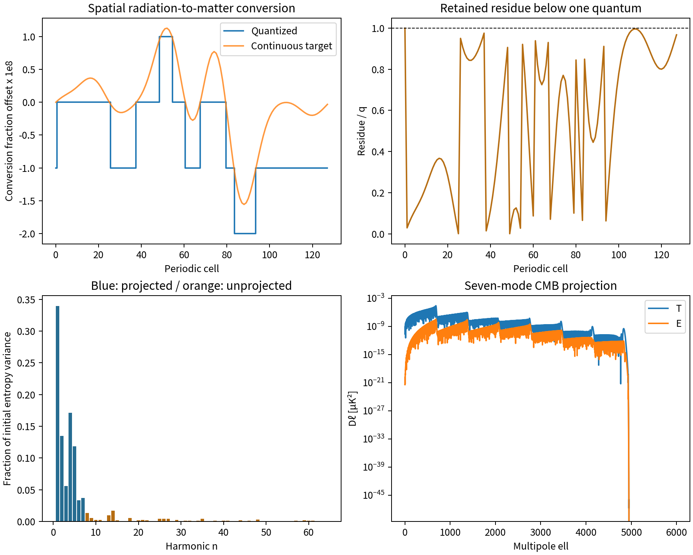

# Conservative Quantization Residues, Twist-Induced Preparation and CMB Projection in WRRA

**A finite implementation for Item 6 of Minimal Computing Cosmology 3.0, v0.2**  
Wonsik Choi · Jeongin Choi | Independent researchers | 20 October 2026

## Verified inputs

We use the seven $S_D$ harmonics of the inherited WRRA address-generated candidate and actual cached patched-CAMB transfers. The wavenumbers are $k_n=0.05n\,\mathrm{Mpc}^{-1}$, $n=1,\ldots,7$, with multipoles $\ell=2,\ldots,6000$. The previous background, composition and shutter values are not refitted. The previous standard CMB component is retained as a comparator.

New adopted preparation inputs are 128 periodic cells, reference conversion fraction $\bar f=1/2$, fractional energy quantum $q=10^{-8}$, and twist coupling $\kappa=1$. These are conditional engineering choices. The quantum has the same numerical value as the inherited supplier coefficient, but is not derived from Planck's constant or Planck time. The reference half-conversion is neither today's cosmic composition nor a calculated universal conversion efficiency.

The old **R denotes the return/vacuum sector**, not radiation. We distinguish the new radiation sector $\gamma$ and set the old $\delta_R=0$ in the new projection. The new entropy amplitudes enter the existing regular D-isocurvature transfer basis. This is an effective pressureless clustering component, not a computed ordinary-baryon production reaction.

Known constants, observations and established structures are legitimate disclosed construction inputs for reverse engineering. Reproduction is an implementation and explanatory achievement; independent prediction is an additional achievement. Evaluation proceeds through verified inputs, WRRA transformation, outputs and refutation conditions. Inputs are not relabeled as newly derived outputs.

## WRRA transformation

### 1. A conservative spatial response to twist

Let $b_j$ be the inherited address-generated harmonic profile and $\theta_j=2\pi j/128$. We adopt a minimal periodic central-difference response:

$$
w_j=\frac{b_{j+1}-b_{j-1}}{2\sin(2\pi/128)},\qquad
\sum_jw_j=0.
$$

This operator can be written as a difference of neighboring face fluxes. It changes the distribution without creating a mean source. We do not claim that the Einstein equations uniquely derive this geometry-response operator. The address template and macroscopic wavenumber assignment remain disclosed inputs.

The desired radiation-to-matter conversion fraction is

$$
g=\frac1{\bar f}+\frac{3}{4(1-\bar f)}=3.5,\qquad
f_j^*=\bar f+\frac{\kappa w_j}{g}.
$$

Each cell initially has normalized radiation energy 1 and matter energy 0. Initial radiation preparation is assumed; its origin is not derived here. The cell energy is a normalized ledger unit, not an inferred early-universe energy density.

### 2. Quantized conversion that retains the residue

Split the same integrated demand into $N=128$ equal requests $u_j=f_j^*/N$:

$$
a_{i,j}=u_j+r_{i,j},\quad
\Delta m_{i,j}=q\left\lfloor\frac{a_{i,j}}q\right\rfloor,\quad
r_{i+1,j}=a_{i,j}-\Delta m_{i,j}.
$$

Only converted energy is added to the matter ledger and subtracted from radiation. Unconverted energy remains in radiation. The residue is an unmet-demand record used by the next conversion gate, not a third energy component added to the ledger.

$$
E_{m,j}+E_{\gamma,j}=1,\qquad
0\le r_{i,j}<q,\qquad
f_j^*-f_j=r_{N,j}.
$$

The operative rule is bounded residue carry, rather than compulsory amplification of every error. Without carry, repeated flooring under-converts progressively. With carry, the final unmet demand remains smaller than one quantum. Stage number labels this preparation algorithm; multiplying it by a shutter interval does not establish a cosmological thermal-history duration. This quantizer is not itself a derivation of quantum amplitudes or Born-rule single outcomes.

### 3. Density differences and the CMB boundary interface

Using the realized mean $f_0=\langle f_j\rangle$, define

$$
\delta_m=\frac{f_j-f_0}{f_0},\qquad
\delta_\gamma=-\frac{f_j-f_0}{1-f_0},\qquad
S_j=\delta_m-\frac34\delta_\gamma.
$$

The snapshot obeys $f_0\delta_m+(1-f_0)\delta_\gamma=0$. Its entropy label is projected onto the inherited regular radiation-era D-isocurvature boundary completion. **Metric, velocity and pressure matching during the conversion transient are not solved.** Conservation of the normalized cell ledger does not by itself prove a completed covariant conversion history.

Let $c_n,s_n$ be the cosine and sine coefficients of $S_j$. The inherited common-axis, uniformly translated statistical readout gives

$$
C_\ell^{XY}=2\pi\sum_{n=1}^7(c_n^2+s_n^2)
\Delta^X_{\ell n}\Delta^Y_{\ell n}.
$$

We actually insert the new amplitudes into the cached T, E and lensing-potential transfer arrays, including the previous $T_{\rm CMB}=2.7255\,\mathrm K$ unit conversion. This is an executed seven-mode connection. It is not a new Boltzmann evolution, observational likelihood fit, or exact non-Gaussian lens remapping. Translation and orientation averaging are statistical representations, not a new physical mechanism for preparing the ensemble.

## Outputs

| Check or output | Result |
|---|---:|
| Main checks | 46/46 passed |
| Separate oracle checks | 530/530 passed |
| Cell-stage ledger cases | 16,384 |
| Exact rational energy-ledger error | 0 |
| Maximum final residue | $9.9955487\times10^{-9}<q$ |
| Maximum unmet demand without carry | $1.2799955487\times10^{-6}$ |
| Full initial entropy RMS | $2.4651873074\times10^{-8}$ |
| Seven-mode entropy RMS | $2.3269959901\times10^{-8}$ |
| New temperature RMS, $\ell=2\ldots6000$ | $0.0017288345\,\mu\mathrm K$ |
| New E-polarization RMS | $0.0000639105\,\mu\mathrm K$ |
| New deflection RMS | $0.0023194933$ arcsec |

Before projecting the new preparation, the code independently reconstructs the previous D+R two-point spectra. Maximum relative differences for T, E and the lensing potential are $3.97\times10^{-16}$, $3.48\times10^{-16}$ and $1.36\times10^{-16}$.

The v0.2 review freezes all eight input hashes before scientific readout. It checks the complete T/E/lensing correlation matrix, including cross terms, at all 5,999 multipoles. A separate endpoint oracle compares 408 accumulator cases to one Euclidean division. It also audits 100 nonuniform-demand carry identities, exact finite-phase covariance, the derivative's Fourier eigenvalues, the full Nyquist variance budget and angular quadrature refinement. These total 530 separate checks. The nonuniform-demand audit is a mathematical extension, not an autonomous physical reaction-rate calculation. Maximum standardized disagreement between direct phase summation and CMB covariance is $6.57317\times10^{-16}$. The principal RMS values and omitted-variance fraction are unchanged from v0.1.

Other checks cover positivity, residue bounds, energy compensation, exact final equality after subdividing fixed demand into 1, 7, 32 or 257 stages, spatial translation, twist-sign power symmetry, and four invalid conversion inputs. Numerical checks demonstrate internal implementation consistency, not empirical validation.

The projected new temperature variance is $2.3596780\times10^{-10}$ of the inherited standard-CMB comparator variance; the E ratio is $9.8633788\times10^{-11}$. **This new component does not reproduce the entire observed CMB by itself.** Comparison assumes zero cross correlation with the retained standard component. There is no new likelihood score or observational detection claim.

### Physical quantum size versus numerical subdivision

At fixed integrated demand and $q$, changing the algorithmic subdivision leaves the final converted amount and residue exactly unchanged in rational arithmetic. Changing $q$ instead defines a different physical preparation model. Refining that assumed quantum reduces the deviation from the continuous target:

| Physical quantum | Entropy RMS | Error RMS relative to continuous target |
|---|---:|---:|
| $q$ | $2.46519\times10^{-8}$ | $1.15516\times10^{-8}$ |
| $q/2$ | $2.10738\times10^{-8}$ | $5.05226\times10^{-9}$ |
| $q/4$ | $2.00189\times10^{-8}$ | $2.47853\times10^{-9}$ |
| $q/16$ | $1.96247\times10^{-8}$ | $6.56031\times10^{-10}$ |

Computer roundoff is not used as a physical fluctuation source. The demand is frozen as a finite decimal rational; conversion and residue updates are exact. Residue denominators reach at most 57 bits, but numerator, counter and other storage are additional. This is not a physical memory-work estimate. Fixed-demand subdivision checks do not establish spatial grid convergence or validity for an arbitrary time-dependent reaction history.

## Refutation conditions

1. Energy creation or loss, a negative radiation/matter ledger, or a failed residue bound rejects the implementation.
2. A changed endpoint under mere numerical subdivision of fixed physical demand requires numerical repair.
3. Incorrect inherited transfer normalization, a nonpositive covariance, or a failed Fourier variance budget rejects the projection.
4. After the full mode range and relativistic matching are implemented, disagreement of fixed-rule CMB or structure outputs with specified observational tests rejects or revises that branch.

## Assessment and remaining work

**Item 6 advances from an unimplemented idea to an executed finite conversion preparation and seven-mode CMB projection.** We construct one spatial realization and distinguish it from translation/orientation averages. We do not equate the previous mean-stress readout with the single quantum outcome of supplier bits. The earlier large intrinsic supplier fluctuations, recording costs and dynamical averaging resources remain unresolved by this calculation.

Quantization generates harmonics outside the original seven-mode transfer coverage. **10.8971852% of the total initial entropy variance** lies outside that coverage. The omitted components are retained in the initial-state ledger and arrays, not deleted. This is not the percentage of missing CMB sky variance; their different transfer weights have not been computed.

Remaining connections are actual transfers for harmonics 8-64; conversion-time stress, metric and velocity matching; generation of the twist template and physical wavenumbers; ordinary matter species and reaction rates; expansion and thermal history; and single-outcome supplier dynamics with its resources. Therefore Item 6 remains **partially implemented, with remaining tasks OPEN**. The existing published MCC 3.0 v0.25-r5 baseline is not retrospectively replaced by these outputs. Independent predictions are not required for legitimacy; a claimed completed connection must nevertheless have been executed internally.

## Reproduction and sources

Run `python reproduce.py`, then `python review.py`. The first produces main checks, JSON outputs, arrays and the seven-mode CMB spectrum CSV. The second runs the separate 530-check audit. NumPy and SciPy are required; Matplotlib regenerates figures. Input SHA-256 values are frozen before execution and included in the archive.

Paper DOI: [10.5281/zenodo.23488763](https://doi.org/10.5281/zenodo.23488763)

Code, inputs and results: [GitHub reproduction files](https://github.com/Wonsik-Choi-janefather/wrra-m-0.1/tree/main/submission/quantization_residue_cmb_v0_2)

Zenodo hosts both complete manuscripts and PDFs; data and code are supplied through GitHub links.

- Input archive: `WRRA_Shutter_SOURCE_and_Macroscopic_Cases_v0_3_r1_2026-10-15.zip`, retained version 3, directory `shutter_three_tests_v02/inputs`.
- MCC 3.0 Chapters 120, 121, 123 and 125: finite mean preparation, actual CMB/lensing transfer, supplier fluctuations and higher correlations. Published book: [Source link](https://zenodo.org/records/23488205)
- CAMB official documentation, transfer functions and temperature/lensing units: [Source link](https://camb.readthedocs.io/en/stable/results.html)
- Malik & Wands, *Cosmological perturbations*, entropy and interacting-fluid perturbations: [Source link](https://arxiv.org/abs/0809.4944)
- Hu, Spergel & White, *Distinguishing causal seeds from inflation*, causal initial conditions and CMB conservation: [10.1103/PhysRevD.55.3288](https://doi.org/10.1103/PhysRevD.55.3288)

External theory supplies transfer and verification material. A citation alone is not counted as an internally executed WRRA photon-reaction or twist-dynamics calculation.

\newpage

## Computed diagnostics

{width=95%}
