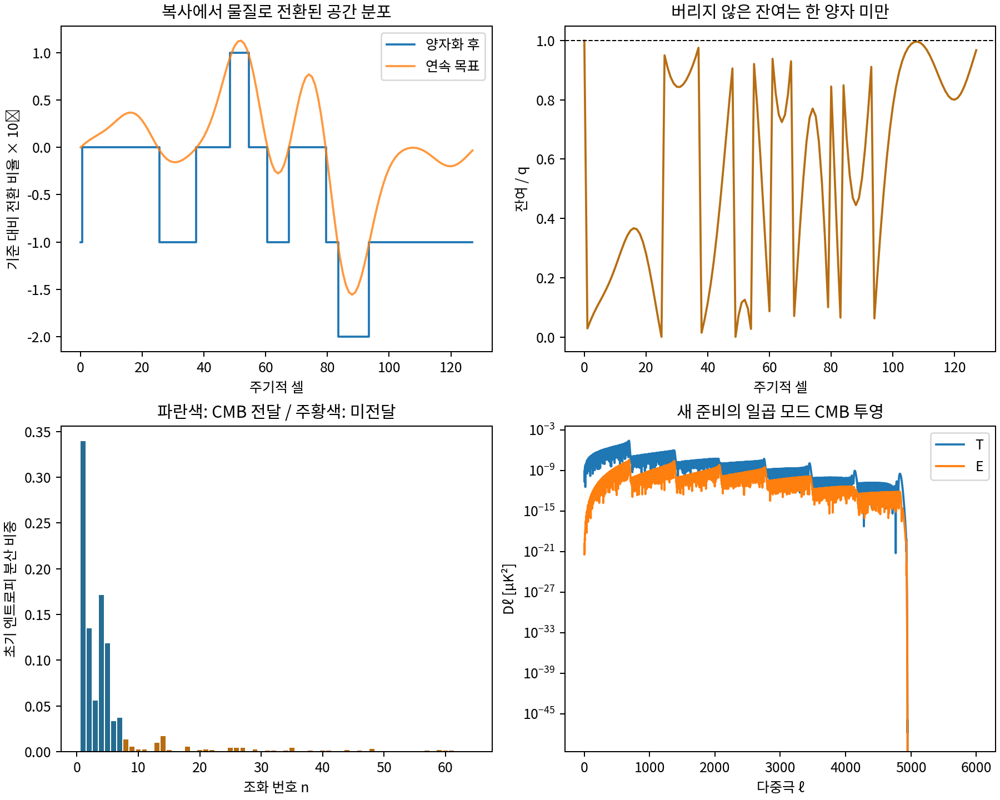

# 양자화 잔여·뒤틀림에서 CMB 초기조건까지

**WRRA / 최소계산우주론 3.0의 6번 보강 계산 v0.2**  
최원식 · 최정인 | 2026년 10월 20일

## 검증 입력

기존 WRRA 주소 생성 후보의 일곱 개 $S_D$ 조화성분과 저장된 패치 CAMB 전달값을 사용했다. 파수는 $k_n=0.05n\,\mathrm{Mpc}^{-1}$, $n=1,\ldots,7$, 다중극은 $\ell=2,\ldots,6000$이다. 기존 배경, 구성비, 셔터 수치를 다시 맞추지 않았다. 표준 CMB 성분은 이전 계산의 비교 기준으로 보존했다.

새로 채택한 준비 규칙은 128개 주기적 셀, 기준 물질 전환율 $\bar f=1/2$, 전환 양자 $q=10^{-8}$, 뒤틀림 결합 $\kappa=1$이다. 이 값들은 조건부 설계 입력이다. $q$는 기존 공급 확률의 계수와 같은 숫자를 택했으며, 플랑크 상수·플랑크시간에서 유도한 물리량은 아니다. $1/2$도 현재 물질 구성비나 우주 전체의 실제 전환 효율을 뜻하지 않는다.

기존 자료의 **R은 복귀·진공 부문**이다. 이번 모형의 복사 $\gamma$와 구별한다. 새 CMB 투영에서는 기존 $\delta_R=0$으로 두고, 새로 산출한 엔트로피 진폭을 기존 D 등곡률 전달 기저에 입력했다. 따라서 보통물질 입자종의 생성 반응을 계산한 것으로 표시하지 않는다.

## WRRA 고유 변환

### 1. 뒤틀림의 보존형 공간 응답

주소에서 생성된 기존 조화 프로파일을 $b_j$, $\theta_j=2\pi j/128$이라 하자. 뒤틀림의 최소 조건부 응답을 주기적 중앙차분으로 정했다.

$$
w_j=\frac{b_{j+1}-b_{j-1}}{2\sin(2\pi/128)},\qquad
\sum_jw_j=0.
$$

이는 이웃 면의 흐름 차이로 쓸 수 있어 평균 에너지를 새로 만들지 않는 공간 분포 규칙이다. 뒤틀림이 아인슈타인 방정식에서 이 연산자로 유일하게 귀결됐다는 주장은 아니다. 기존 주소 프로파일과 거시 파수 배정은 입력으로 남는다.

복사에서 물질로 전환하려는 셀별 목표 비율을 다음처럼 둔다.

$$
g=\frac1{\bar f}+\frac{3}{4(1-\bar f)}=3.5,\qquad
f_j^*=\bar f+\frac{\kappa w_j}{g}.
$$

초기 셀에는 정규화한 복사 에너지 1, 물질 에너지 0을 둔다. 이는 장부 단위이며 초기 우주의 실제 에너지 밀도를 추정한 값이 아니다. 이 초기 복사 준비 자체는 가정이며 그 생성 원인까지 산출하지 않는다.

### 2. 잔여를 버리지 않는 양자화 전환

동일한 총 전환 요구를 $N=128$단계로 나눈 $u_j=f_j^*/N$에 대해,

$$
a_{i,j}=u_j+r_{i,j},\quad
\Delta m_{i,j}=q\left\lfloor\frac{a_{i,j}}q\right\rfloor,\quad
r_{i+1,j}=a_{i,j}-\Delta m_{i,j}.
$$

전환된 에너지만 물질 장부에 더하고 복사 장부에서 뺀다. 미전환 에너지는 복사에 남는다. 잔여 $r$은 별도로 더해지는 제3의 에너지가 아니라 다음 허가를 위한 미충족 전환 요구 기록이다.

$$
E_{m,j}+E_{\gamma,j}=1,\qquad
0\le r_{i,j}<q,\qquad
f_j^*-f_j=r_{N,j}.
$$

핵심 수정은 ‘오차를 무조건 증폭한다’가 아니라 **버리지 않은 잔여가 다음 전환으로 넘어가며, 최종 잔여는 한 양자보다 작다**는 규칙이다. 반복 단계는 이 준비 계산의 지표다. $N$에 셔터시간을 곱해 우주 열역사의 실제 지속시간으로 해석하지 않는다. 이 양자화기는 양자 진폭이나 Born 규칙의 개별 결과를 도출한 구현도 아니다.

### 3. 밀도 차이에서 CMB 전달로

실제 평균 $f_0=\langle f_j\rangle$를 사용해,

$$
\delta_m=\frac{f_j-f_0}{f_0},\qquad
\delta_\gamma=-\frac{f_j-f_0}{1-f_0},\qquad
S_j=\delta_m-\frac34\delta_\gamma.
$$

그러면 $f_0\delta_m+(1-f_0)\delta_\gamma=0$으로 셀의 에너지 밀도 차이가 보상된다. 이 스냅샷의 엔트로피 라벨을 기존 복사시대의 정규 D 등곡률 초기조건에 연결한다. **전환 중 계량·속도·압력의 연속 접합은 아직 계산하지 않았다.** 따라서 전체 변환 열역사가 상대론적으로 완결됐다는 판정과 구분한다.

$S_j$의 Fourier 코사인·사인 계수 $c_n,s_n$을 실제 저장 전달값 $\Delta^X_{\ell n}$에 넣는다. 기존 공통 축·균등 이동 통계 규칙을 유지하면,

$$
C_\ell^{XY}=2\pi\sum_{n=1}^7(c_n^2+s_n^2)
\Delta^X_{\ell n}\Delta^Y_{\ell n}.
$$

온도·편광에는 기존 $T_{\rm CMB}=2.7255\,\mathrm K$의 단위 변환을 적용했다. 전달식을 인용한 데 그치지 않고 새 계수를 배열에 실제 입력했다. 새 Boltzmann 실행·관측 우도 적합·비가우시안 렌즈 재매핑은 하지 않았다.

## 산출값

| 검사 또는 산출량 | 결과 |
|---|---:|
| 자동 검사 | 46/46 본 검사 + 530/530 별도 대조 검사 |
| 셀·전환 단계 장부 | 16,384개 |
| 정확 유리수 장부의 에너지 오차 | 0 |
| 최종 최대 잔여 | $9.9955487\times10^{-9}<q$ |
| 잔여를 이월하지 않을 때의 최대 미전환 요구 | $1.2799955487\times10^{-6}$ |
| 전체 초기 엔트로피 요동 RMS | $2.4651873074\times10^{-8}$ |
| 일곱 모드에 포함된 엔트로피 RMS | $2.3269959901\times10^{-8}$ |
| 새 온도 성분 RMS, $\ell=2\ldots6000$ | $0.0017288345\,\mu\mathrm K$ |
| 새 E 편광 성분 RMS | $0.0000639105\,\mu\mathrm K$ |
| 새 렌즈 편향 RMS | $0.0023194933$ 각초 |

기존 D+R 결과를 같은 코드의 정규화 대조군으로 재구성했다. T·E·렌즈 퍼텐셜의 최대 상대 차이는 각각 $3.97\times10^{-16}$, $3.48\times10^{-16}$, $1.36\times10^{-16}$이었다. 새 투영은 그 검사를 통과한 동일 전달값을 사용한다.

v0.2에서는 입력 8개 해시를 실행 전에 검증하고, 온도·편광·렌즈 교차항을 포함한 3×3 공분산을 전체 5,999개 다중극에서 검사했다. 별도 코드의 단일 유클리드 나눗셈으로 408개 누적기 사례를 대조하고, 비균등 요구의 잔여 항등식 100개, 정확 위상 합산·Fourier·각도 적분 대조 등을 포함해 530개 검사가 통과했다. 명시적 위상 합산과 전달 공분산의 최대 표준화 차이는 $6.57317\times10^{-16}$이었다. 기존 온도·편광·편향 RMS와 누락 분산 비중은 v0.1과 같았다.

검사는 잔여 경계, 양성, 에너지 보상, 고정 총 요구를 1·7·32·257단계로 나눈 경우의 정확한 최종 일치, 공간 이동 대응, 뒤틀림 부호 반전의 파워 대칭, Fourier 분산 장부, CMB 정규화·공분산, 네 가지 잘못된 입력의 거부를 포함한다. 검사 통과는 선언한 계산의 재현·정합성 확인이다.

새 온도 분산은 비교 기준 표준 CMB 분산의 $2.3596780\times10^{-10}$, 새 E 분산은 $9.8633788\times10^{-11}$이다. **이 새 성분 하나로 관측된 전체 CMB를 재현한 것은 아니다.** 기존 표준 성분과의 교차 상관을 0으로 두는 비교 분기를 사용했으며, 새 우도 점수나 관측 검출을 주장하지 않는다.

### 물리 양자 크기와 계산 분할의 구별

총 요구와 $q$를 고정하면 계산 단계 수를 바꿔도 최종 전환량·잔여는 유리수 연산에서 정확히 같다. 이것이 공간 격자 수렴이나 임의의 시간 의존 반응률의 정합성을 증명하지는 않는다. 반대로 $q$ 자체를 줄이면 다른 물리적 준비 모형이 되며, 양자화의 연속 목표 대비 편차가 작아졌다.

| 물리 양자 | 엔트로피 RMS | 연속 목표 대비 오차 RMS |
|---|---:|---:|
| $q$ | $2.46519\times10^{-8}$ | $1.15516\times10^{-8}$ |
| $q/2$ | $2.10738\times10^{-8}$ | $5.05226\times10^{-9}$ |
| $q/4$ | $2.00189\times10^{-8}$ | $2.47853\times10^{-9}$ |
| $q/16$ | $1.96247\times10^{-8}$ | $6.56031\times10^{-10}$ |

이는 연산기의 반올림 오차를 우주 요동으로 사용한 결과가 아니다. 입력 실수는 선언된 유한 소수 유리수로 고정하고, 전환·잔여 연산을 정확히 수행했다. 잔여 기억장부의 분모는 최대 57비트였으나 분자·전환계수 등 추가 저장과 물리적 준비 비용까지 평가한 수치는 아니다.

## 반증조건

1. 양자화 과정에서 에너지가 생기거나 없어지거나, 복사·물질 장부가 음수가 되면 이 구현은 실패다.
2. 고정한 물리 입력·총 요구에서 단순 계산 분할만 바꿔 최종 결과가 달라지면 수치 절차를 수정한다.
3. 기존 CMB 전달 정규화, 공분산 양성 또는 Fourier 분산 장부가 맞지 않으면 투영을 수정한다.
4. 전체 모드와 상대론적 접합을 완성한 뒤, 고정 규칙의 CMB·물질 구조 결과가 사전에 정한 관측 검증을 통과하지 못하면 해당 모형 분기를 수정한다.

## 판정과 다음 연결

**6번은 ‘아이디어 없음’에서 ‘보존되는 전환 준비와 일곱 모드 CMB 투영을 실행한 부분 구현’으로 진전했다.** 하나의 공간 분포를 실제 구성하고, 그 분포의 이동·방향 평균과 개별 실현을 구별했다. 다만 기존 평균 응력 장부를 실제 양자 공급 비트의 단일 결과와 같게 만든 것은 아니다. 이전의 큰 공급 고유 요동·기록·평균화 자원 문제도 이 계산만으로 해소되지 않는다.

양자화는 원래 일곱 조화 밖에도 성분을 만든다. 전체 초기 엔트로피 **분산의 10.8971852%**가 이번 저장 전달 범위 밖에 있다. 이를 삭제하거나 0이라고 가정하지 않고 별도 장부에 남겼다. 이 비율은 누락된 CMB 분산 비율이 아니다. 다른 전달 가중치를 가지므로 아직 그 하늘 기여를 알 수 없다.

다음 연결은 8~64번 모드의 실제 전달, 전환 중 응력·계량·속도 접합, 초기 뒤틀림·파수의 생성, 보통물질 입자종과 반응률, 팽창 속 열역사, 큰 공급 요동의 개별 실행과 비용이다. 따라서 6번 전체는 **부분 구현·잔여 과제 OPEN**으로 기록한다. 현재 3.0 v0.25-r5의 기존 수치와 공개본을 이 결과로 소급 교체하지 않는다.

## 재현과 출처

논문 DOI: [10.5281/zenodo.23488763](https://doi.org/10.5281/zenodo.23488763)

코드·입력·결과: [GitHub 재현 자료](https://github.com/Wonsik-Choi-janefather/wrra-m-0.1/tree/main/submission/quantization_residue_cmb_v0_2)

Zenodo에는 한·영 원고와 PDF를 두고, 데이터·코드는 GitHub 링크로 제공한다.

같은 폴더에서 `python reproduce.py`를 실행하면 검사, JSON 결과, 일곱 모드 CMB 스펙트럼 CSV와 배열이 생성된다. 별도 `python review.py`는 대조 검사 530개를 실행한다. NumPy·SciPy가 필요하고 그림 재생성에는 Matplotlib을 쓴다. 원 입력의 SHA-256을 동봉했다.

- 기존 자료: `WRRA_Shutter_SOURCE_and_Macroscopic_Cases_v0_3_r1_2026-10-15.zip`, 보존 판본 3. 그 안의 `shutter_three_tests_v02/inputs`에서 입력을 복사했다.
- 기존 3.0 제120·121·123·125장: 평균 준비, 실제 CMB 전달·렌즈, 공급 요동, 고차 상관의 범위.
- CAMB 공식 문서, 전달 함수·온도·렌즈 단위: [원문 링크](https://camb.readthedocs.io/en/stable/results.html)
- Malik & Wands, *Cosmological perturbations*, 초기조건·엔트로피·상호작용 유체: [원문 링크](https://arxiv.org/abs/0809.4944)
- Hu, Spergel & White, *Distinguishing causal seeds from inflation*, 인과적 초기조건·보존과 CMB: [10.1103/PhysRevD.55.3288](https://doi.org/10.1103/PhysRevD.55.3288)

외부 이론은 전달·검증·보강 자료로 사용했다. 새 광자 반응·뒤틀림 동역학까지 외부 문헌 인용만으로 WRRA 내부에서 계산됐다고 부르지 않는다.

## 계산 그림

{width=95%}
