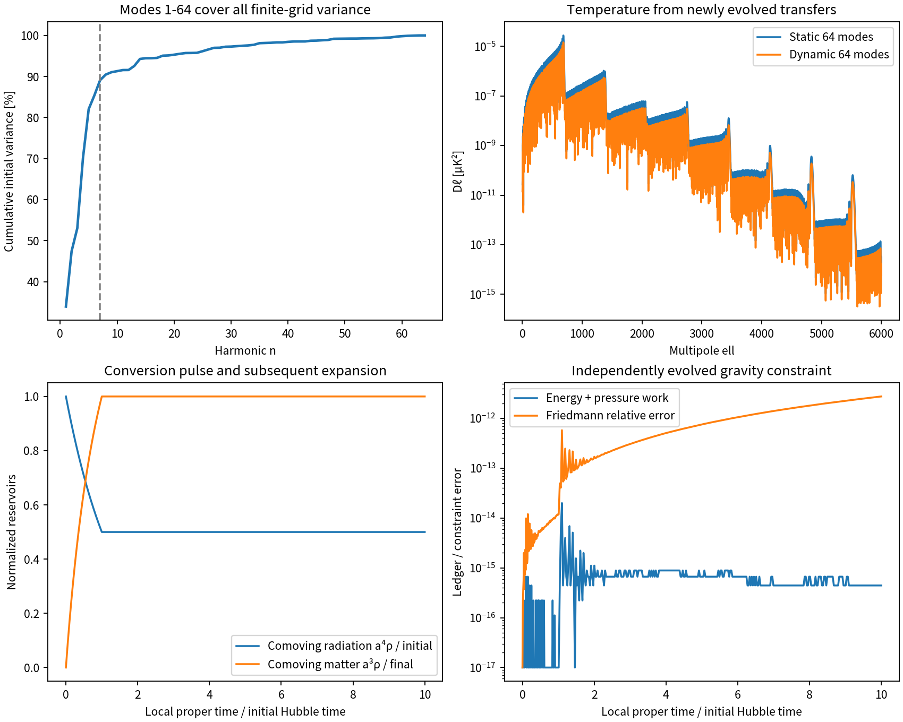

# Sixty-Four Modes and Expanding Radiation-to-Matter Conversion in WRRA

**MCC 3.0 Item 6 reinforcement, v0.3**  
Wonsik Choi · Jeongin Choi | Independent researchers | 20 October 2026

## Verified inputs

We retain the v0.2 quantized 128-cell profile, address-generated background and patched CAMB 2.0.4 source. The previous 576 checks belong to the previous audit and are not counted again. Known observations are legitimate disclosed construction/calibration inputs; outputs remain distinguished from inputs.

We extend $k_n=0.05n\,\mathrm{Mpc}^{-1}$ to $n=1,\ldots,64$ and calculate **all 5,999 integer multipoles** from 2 through 6000. These are new Boltzmann evolutions, not extrapolations of the seven cached modes. The outputs use linear T/E/lensing transfers; nonlinear structure and a new observational likelihood are not executed.

New dynamical choices are $a_i=10^{-10}$, a proper-time conversion pulse lasting one initial Hubble-time unit, and $\Gamma=\ln2$ in that unit. The existing quantized seed modulates the proper rate as $\Gamma_j=\Gamma(1+S_j^{(0)})$. This is a declared continuum fluid-rate closure, not a calculated particle cross section or a finite-quantum emission-time law.

## WRRA transformation

### Complete mode and multipole coverage

A single dense Bessel table exceeded memory. We instead calculate eight shifted paired-parity multipole grids per initial basis, and merge their actual transfer values. Their union contains every integer multipole. Overlap agreement and complete coverage are checked. **No missing-multipole interpolation or wavenumber extrapolation is used in the final arrays.** Both D-isocurvature and A-adiabatic transfers are evolved.

For the finite 128-cell Fourier transform, mode variances are $v_n=2|\hat S_n|^2$ for $n<64$ and $v_{64}=|\hat S_{64}|^2$. Under the retained real Nyquist cosine and 128 discrete translations, the Nyquist mode contributes to even multipoles only. This is an adopted finite-grid readout property, not a universal cosmic parity law. An additional Nyquist sine state would define a different preparation.

### Expansion, conversion and pressure work

The earlier half-conversion reference is interpreted as half conversion of a small convertible radiation sub-reservoir, not half of all cosmic radiation. Its calibrated fraction is $\beta=7.62452468\times10^{-7}$, fixed by the adopted observed CDM/radiation background ratio. This is a disclosed calibration input.

With $8\pi G/3=1$, initially $a=H=1$, define $N=\ln a$, $C=\rho_c a^4$, $U=1-\beta$, and $M=\rho_m a^3$. In each cell's proper time,

$$
\dot N=H,\quad\dot C=-\Gamma_j C,\quad
\dot M=\Gamma_j C e^{-N},\quad
\dot H=-\tfrac12(4\rho_r+3\rho_m),
$$

$$
\rho_r=(U+C)e^{-4N},\quad\rho_m=Me^{-3N},\quad
\dot W=H(U+C)e^{-N},\quad
E=(U+C)e^{-N}+M,\quad E+W=1.
$$

H evolves independently, so $H^2=\rho_r+\rho_m$ is a nontrivial constraint check rather than an overwritten identity. Exchange terms enter the two components with opposite signs. This implements $Q_m^\mu=-Q_r^\mu$ in a common comoving velocity at leading gradient order. These are local patches of one universe, not multiple physical universes. Local proper-time clocks do not introduce a universal absolute simultaneity. Unconverted radiation redshifts and does pressure work; its energy alone is not incorrectly held constant.

### Dynamical entropy and curvature enter actual CMB bases

Tangent ODEs propagate the small rate modulation without subtracting nearly equal full solutions. After exchange ends,

$$
\zeta_r=\frac{\partial_\xi C}{4(U+C)},\quad
\zeta_m=\frac{\partial_\xi M}{3M},\quad S=3(\zeta_m-\zeta_r).
$$

The selected closure gives $S=0.723567385056 S^{(0)}$ and $\zeta_r=-6.60614975286\times10^{-8}S^{(0)}$. These are correlated amplitudes from the same preparation. Actual CAMB initial callbacks establish the initial-vector mapping $(-\zeta_r,S,0,0,0)$. We therefore combine $S\Delta_D-\zeta_r\Delta_A$ before forming covariance, retaining the cross term. The generated curvature is not silently deleted.

## Outputs

| Audit or quantity | Result |
|---|---:|
| Projection/coverage checks | 96 passed |
| Dynamics checks | 15 passed |
| Initial-basis checks | 4 passed |
| Separate precision/slicing/Nyquist controls | 8 passed |
| Untransferred variance within the declared 128-cell model | 0% |
| Maximum normalized old-seven transfer discrepancy | 9.5725592e-05 |
| Maximum standardized direct-phase covariance discrepancy | 6.3596178e-16 |
| Energy plus pressure-work error | below $2.0\times10^{-14}$ |
| Relative Friedmann constraint error | below $2.8\times10^{-12}$ |

| Projected output | Static 64-mode preparation | Dynamical 64-mode preparation |
|---|---:|---:|
| T RMS [$\mu\mathrm K$] | 0.00172883455993 | 0.0012509283125 |
| E RMS [$\mu\mathrm K$] | 6.39105354627e-05 | 4.62436378837e-05 |
| Deflection RMS [arcsec] | 0.00232005986269 | 0.00167871840042 |

The newly transferred 57 modes contribute 1.6121617e-05%, 9.1445155e-05% and 0.048377115% of static projected temperature, E-polarization and deflection variance, respectively. These differ from the initial entropy-variance fraction of 10.897%; the CMB transfer weights are now actually applied.

Matching occurs near $a=4.58258\times10^{-10}$, with maximum $k/(aH)=6.79764\times10^{-4}$. Its square, $4.62079\times10^{-7}$, is a gradient-expansion parameter, **not a rigorous bound on all omitted matching errors**. The calibrated proper-time unit is about 0.477 seconds, conditional on the chosen starting scale and simple effective-radiation history; it is not a detailed MeV thermal-history chronology.

At 471 actually evolved multipoles, raising precision from 2.5 to 3.0 changes the power L2 norm by 0.232% for T, 0.0156% for E and 0.0973% for the lensing potential. Printed digits identify reproducible numerical outputs, not physical precision or detection. An independent nonlinear uniform-density-slice calculation agrees with the tangent curvature response to relative $1.59\times10^{-6}$.

## Refutation conditions

Missing modes/multipoles, contradictory overlaps or Nyquist double counting reject the transfer implementation. Fourier/covariance failure, failed direct-phase checks or failure to recover old modes requires repair. Negative densities, failed energy-work/Friedmann constraints or nonconserved post-exchange component curvatures reject the dynamical branch. The separate-universe approximation is not used if the required small-gradient condition fails. Changed pulse, reservoir or starting assumptions define a separately recorded branch. A complete fixed physical model must pass its specified observational comparisons.

## Assessment and remaining scope

**Modes 8-64 are transferred, and an expanding conversion closure with pressure work and curvature response is implemented.** Dynamically generated entropy and radiation curvature are actually inserted into CMB initial bases. The new fluid closure and calibration freedoms are disclosed.

Full finite-gradient metric/momentum/free-streaming-neutrino matching, particle species and rates, finite-quantum emission timing and recording costs, detailed thermal history, nonlinear lensing and a new likelihood remain OPEN. CAMB's regular baryon/neutrino completion is adopted; the two-fluid model has not computed their production reactions. Thus Item 6 is partially implemented through leading-gradient dynamics, not completely closed. The small new component does not replace the entire observed CMB.

## Reproduction and sources

DOI: [10.5281/zenodo.23489547](https://doi.org/10.5281/zenodo.23489547). Code, inputs and computed projection data: [GitHub](https://github.com/Wonsik-Choi-janefather/wrra-m-0.1/tree/main/submission/quantization_residue_cmb_v0_3).

Run `run_all.py`, `dynamics.py`, `check_basis.py`, then `analyze.py`. Sources, patches, runtime, inputs, arrays and hashes are included. The failed full-table attempt is distinguished from the successful split-grid evolutions.

- Previous v0.2: [published study](https://zenodo.org/records/23488763).
- CAMB official [model and initial-basis documentation](https://camb.readthedocs.io/en/stable/model.html).
- Malik & Wands, [Cosmological perturbations](https://arxiv.org/abs/0809.4944).
- Park, [Equations of General Relativistic Radiation Hydrodynamics from Tensor Formalism](https://arxiv.org/abs/astro-ph/0601635).

External equations are disclosed construction and verification material. Only the internally executed scope is called integrated.

{width=95%}
