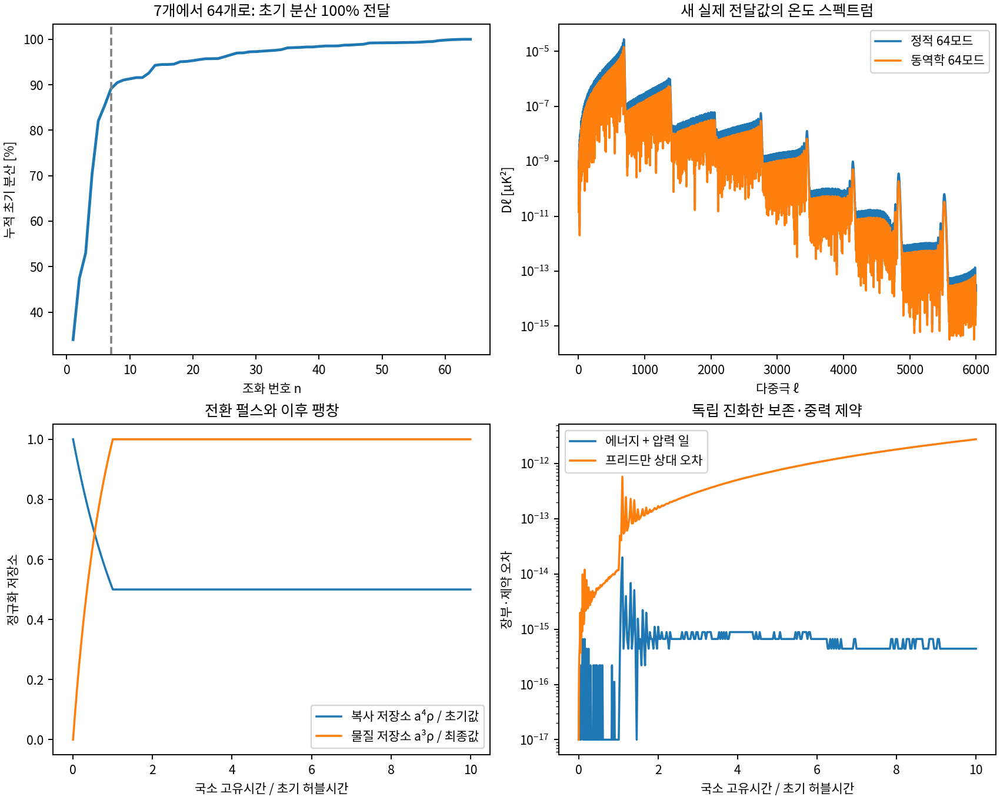

# 64개 모드와 팽창하는 복사·물질 전환

**WRRA / 최소계산우주론 3.0의 6번 보강 v0.3**  
최원식 · 최정인 | 독립연구자 | 2026년 10월 20일

## 검증 입력

v0.2의 128셀 양자화 잔여·뒤틀림 프로파일, 기존 주소 생성 배경과 패치 CAMB 2.0.4 소스를 사용했다. v0.2의 검사 576개는 선행 검수 기록이며 이번 새 검사의 개수와 합쳐 세지 않는다. 관측값을 구성·보정 입력으로 쓰는 역설계 원칙을 유지한다. 보정 입력과 실제 계산된 출력을 구별하고, 알려진 결과의 재현도 설명 성과로 평가한다.

파수는 기존 $k_n=0.05n\,\mathrm{Mpc}^{-1}$를 $n=1,\ldots,64$로 확장했다. 다중극은 $\ell=2,\ldots,6000$의 **모든 정수 5,999개**다. 기존 전달값을 바깥으로 외삽하지 않고 CAMB를 새로 진화시켰다. 원래의 7개 파수도 함께 다시 계산해 대조했다. 최종 결과는 선형 T·E·렌즈 퍼텐셜 전달이다. 비선형 물질 진화·관측 우도를 새로 계산한 것은 아니다.

동역학의 새 조건부 입력은 시작 축척 $a_i=10^{-10}$, 국소 초기 허블률을 단위로 한 전환 펄스 길이 1과 전환률 $\Gamma=\ln2$다. 전환률의 공간 조절자는 기존 양자화 프로파일 $\xi_j=S_j^{(0)}$를 그대로 사용하며 $\Gamma_j=\Gamma(1+\xi_j)$로 정했다. 이는 새로 채택한 유체 동역학 규칙이다. 전환 입자의 단면적이나 유한 양자별 방출 시각까지 계산한 반응률은 아니다.

## WRRA 고유 변환

### 1. 기존에 빠졌던 57개 모드의 실제 전달

한 번에 큰 Bessel 표를 만들면 메모리를 넘으므로 인접 홀수·짝수 다중극 묶음을 어긋나게 계산했다. 8개 묶음의 합집합이 모든 정수 다중극을 채우는지 검사하고, 중복 지점의 전달값이 같은지도 확인했다. **최종 표에는 누락 다중극 보간이 없다.** 파수 64개 모두 실제 진화·적분한 값이다. 등곡률 D 기저와 단열 A 기저를 각각 계산했다.

Fourier 분산 장부에서 $1\ldots63$ 모드는 $v_n=2|\hat S_n|^2$, 최고 모드인 $n=64$는 $v_{64}=|\hat S_{64}|^2$다. 최고 모드를 두 배로 세지 않는다. 원래의 128개 이산 이동과 실수 코사인 최고 모드를 유지하면, 최고 모드의 홀수 다중극 기여는 0이다. 이는 채택한 격자·판독 규칙의 성질이며 우주의 보편적 짝홀 법칙으로 주장하지 않는다. 추가 사인 상태를 넣는 다른 준비는 별도 모형이다.

이 분산과 T·E·렌즈 전달로 각 다중극의 전체 공분산을 계산했다. 독립적인 128상태 직접 합산과도 대조했다.

### 2. 압력이 한 일을 포함한 팽창·전환

복사 전부를 반으로 바꾸면 초기 배경과 맞지 않으므로, 앞선 $1/2$ 전환은 **전환 가능한 작은 복사 저장소의 준비 기준**으로 한정했다. 관측 배경의 물질/복사 비율을 맞추는 저장소 비중은 $\beta=7.62452468\times10^{-7}$로 보정했다. 이는 계산의 공개된 보정 입력이다. 우주 전체 복사량의 절반을 전환했다는 뜻이 아니다.

초기 국소 축척을 1, $8\pi G/3=1$로 정규화하고 $N=\ln a$, $C=\rho_c a^4$, $U=1-\beta$, $M=\rho_m a^3$를 둔다. $c$는 전환 가능한 복사, $U$는 비전환 복사, $m$은 유효 압력 없는 물질이다. 각 셀의 고유시간에서

$$
\dot N=H,\qquad \dot C=-\Gamma_j C,\qquad
\dot M=\Gamma_j C e^{-N},
$$

$$
\rho_r=(U+C)e^{-4N},\quad \rho_m=Me^{-3N},\quad
\dot H=-\tfrac12(4\rho_r+3\rho_m).
$$

$H$를 제약식에서 매번 덮어쓰지 않고 별도 진화시켜 $H^2=\rho_r+\rho_m$를 검사했다. 압력이 한 일은

$$
\dot W=H(U+C)e^{-N},\qquad
E=(U+C)e^{-N}+M,\qquad E+W=1
$$

로 장부에 넣었다. 팽창하는 셀에서 물질·복사의 에너지만 상수라고 잘못 고정하지 않는다. 전환항은 두 부문에서 반대 부호로 나타난다. 공변식으로는 같은 국소 유체 속도에서 $Q_m^\mu=-Q_r^\mu$를 채택한 선도 구배 근사다. 셀은 하나의 우주 안 국소 패치를 근사하며, 서로 다른 우주를 상정하지 않는다. 각 셀은 국소 고유시간을 사용하며 전역 절대 동시성을 새로 선언하지 않는다.

### 3. 전환 중 생기는 엔트로피와 곡률의 연결

작은 공간 조절자의 효과를 두 큰 수의 차로 구하지 않고 접선 미분방정식으로 적분했다. 전환 후 부문별 곡률과 상대 엔트로피는

$$
\zeta_r=\frac{\partial_\xi C}{4(U+C)},\qquad
\zeta_m=\frac{\partial_\xi M}{3M},\qquad
S=3(\zeta_m-\zeta_r).
$$

이 전환 규칙에서 $S=0.723567385056\,S^{(0)}$, $\zeta_r=-6.60614975286\times10^{-8}S^{(0)}$가 산출됐다. 두 진폭은 독립 난수가 아니라 같은 준비에서 생긴 상관 성분이다. CAMB의 실제 초기 콜백으로 기저 부호를 검사한 뒤,

$$
\text{초기 기저 계수}=(-\zeta_r,\ S,\ 0,\ 0,\ 0)
$$

에 연결했다. 따라서 전달값은 $S\Delta_D-\zeta_r\Delta_A$를 먼저 더하고 그 공분산을 구한다. 상관된 두 성분의 파워를 따로 더해 교차항을 없애지 않았다. 무작정 곡률 성분을 버리는 접합을 보강한 것이다.

## 산출값

| 항목 | 결과 |
|---|---:|
| 새 투영 검사 | 96개 통과 |
| 동역학 검사 | 15개 통과 |
| 초기 기저 정규화 검사 | 4개 통과 |
| 별도 정밀도·비선형 접합·최고 모드 대조 | 8개 통과 |
| 선언된 128셀 내 전달하지 못한 초기 분산 | 0% |
| 옛 7모드 전달 재현의 최대 정규화 차이 | 9.5725592e-05 |
| 직접 위상 합산과 공분산의 최대 표준화 차이 | 6.3596178e-16 |
| 에너지와 압력 일의 장부 오차 | $2.0\times10^{-14}$ 이하 |
| 프리드만 제약 최대 상대 오차 | $2.8\times10^{-12}$ 이하 |

| CMB 산출량 | 기존 준비의 64모드 전달 | 새 동역학을 거친 64모드 전달 |
|---|---:|---:|
| 온도 RMS [$\mu\mathrm K$] | 0.00172883455993 | 0.0012509283125 |
| E 편광 RMS [$\mu\mathrm K$] | 6.39105354627e-05 | 4.62436378837e-05 |
| 렌즈 편향 RMS [각초] | 0.00232005986269 | 0.00167871840042 |

새 57개 모드가 정적 64모드 하늘 분산에서 차지하는 비중은 온도 1.6121617e-05%, E 편광 9.1445155e-05%, 렌즈 편향 0.048377115%다. 앞선 **초기 엔트로피 분산 10.897%**와 같은 수치가 아니다. 각각 실제 전달 가중치를 적용해 새로 산출했다.

맞춤 축척은 약 $4.58258\times10^{-10}$이며, 최대 $k/(aH)$는 $6.79764\times10^{-4}$다. 제곱값 $4.62079\times10^{-7}$은 무시한 구배 항의 전개 매개변수이지, 완성된 시공간 접합의 엄밀한 오차 상한은 아니다. 기준 고유시간 단위는 약 0.477초지만 시작 축척·단순 복사 유체 가정을 바꾸면 달라진다. 실제 MeV 열역사·유효 자유도 변화까지 계산한 연대 측정이 아니다.

정밀도 2.5와 3.0의 실제 471개 다중극을 대조한 파워 L2 변화는 T 0.232%, E 0.0156%, 렌즈 퍼텐셜 0.0973%였다. 아래 많은 유효 숫자는 수치 재현용이며 물리적 정밀도나 관측 검출을 뜻하지 않는다. 별도 비선형 이력에서 같은 총밀도에 도달한 축척 차이로 구한 곡률 응답은 접선 계산과 상대 $1.59\times10^{-6}$ 이내에서 일치했다.

## 반증조건

1. 64개 파수 또는 모든 정수 다중극의 누락, 중복 모순, 최고 모드의 이중 계상이 나타나면 전달 구현을 수정한다.
2. 고정 입력에서 Fourier 분산·공분산 양성·직접 위상 합산·기존 모드 재현이 실패하면 해당 모듈을 수정한다.
3. 전환 장부와 압력 일, 프리드만 제약, 양성, 전환 후 엔트로피·부문 곡률 보존이 실패하면 동역학 분기를 수정한다.
4. 충분한 초기 구배 작음이 성립하지 않으면 이 국소 패치 근사를 적용하지 않는다. 전환률·저장소·시작 조건을 바꾸면 새 분기로 기록한다.
5. 전체 물리 접합과 관측 우도를 갖춘 고정 모형이 합의한 관측 비교와 맞지 않으면 수정한다.

## 판정과 남은 범위

**8~64번 모드의 실제 전달은 완료됐고, 팽창·압력 일·곡률을 포함한 전환 동역학도 조건부로 구현됐다.** 두 모듈은 전환에서 나온 $S,\zeta_r$를 실제 CMB 초기 기저에 넣는 수준까지 연결됐다. v0.2의 정적 준비를 그대로 부르는 대신 새 유체 규칙과 보정 자유도를 공개한다.

다만 유한 파수의 전체 운동량·계량·자유비행 중성미자 접합, 전환 입자의 반응률·입자종, 유한 양자별 방출 시각과 기록 비용, 상세 열역사·비선형 렌즈·새 관측 적합은 남는다. CAMB의 표준 바리온·중성미자 초기 확장은 채택된 정규 완성이다. 그 부문들의 생성 반응까지 이 두 유체가 계산했다고 하지 않는다. **6번 전체는 선도 구배 동역학까지 진전한 부분 구현**으로 기록한다. 기존 전체 CMB가 이 작은 성분만으로 대체됐다고 주장하지 않는다.

## 재현·출처

DOI: [10.5281/zenodo.23489547](https://doi.org/10.5281/zenodo.23489547). 코드·입력·계산된 투영 자료: [GitHub](https://github.com/Wonsik-Choi-janefather/wrra-m-0.1/tree/main/submission/quantization_residue_cmb_v0_3).

`run_all.py`가 16개 실제 전달 묶음을 계산하고, `dynamics.py`, `check_basis.py`, `analyze.py`가 동역학·기저 정규화·합병 검사를 수행한다. 사용한 소스, 패치, 바이너리, 입력·배열·해시를 동봉했다. 최초 전체 Bessel 표의 메모리 부족은 계산 실패로 보존하고 성공한 분할 계산과 구별한다.

- 선행 v0.2: [공개 논문](https://zenodo.org/records/23488763).
- CAMB 공식 문서: [모형·초기 기저](https://camb.readthedocs.io/en/stable/model.html).
- Malik & Wands, *Cosmological perturbations*: [원문](https://arxiv.org/abs/0809.4944).
- Park, *Equations of General Relativistic Radiation Hydrodynamics from Tensor Formalism*: [원문](https://arxiv.org/abs/astro-ph/0601635).

외부 식은 공개된 유체·중력 구성 규칙과 검증 자료로 사용했다. 내부에서 실행한 범위와 아직 실행하지 않은 범위를 나누어 기록한다.

{width=95%}
